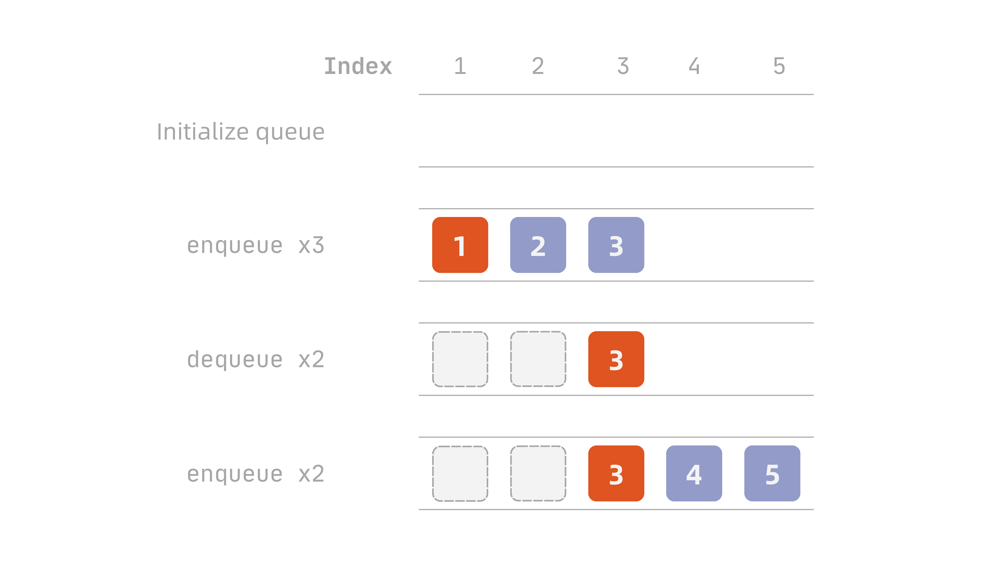

The **queue** has even wider applications than the [stack](/dsa/stack-en/), and it is also a little more complicated to implement.

!!! info "Definition: Queue"
    A queue is a dynamic set in which the insertion and deletion of elements follows the **first-in-first-out (FIFO)** principle: the element removed is always the one that was inserted earliest, among those not yet removed.

    A queue supports two basic operations:

    - `enqueue(Q, x)`: inserts element $x$ at the **tail** of queue $Q$
    - `dequeue(Q)`: removes and returns the element at the **head** of queue $Q$

## Basic Operations

Unlike a stack, a queue works at both ends: new elements go in at the tail, and the only element you can take out is the one at the head.

That gives us three operations: **enqueue**, which adds an element at the tail, **dequeue**, which removes the element at the head, and **front**, which looks at the head element without removing it.

There is one thing to be careful about, though. If we handle these operations the same way we did for a stack, we run into the problem shown in @fig-queue-drift:

::: {#fig-queue-drift}

:::

In the last step, `tail` has moved to 6, which is already outside the array. But the queue only holds 3 elements, and there are still 2 free slots at the front — the space has not run out, yet nothing more can be added.

This is why we normally use a **circular queue**, where the pointers wrap around and the array becomes a ring, so the free slots can be reused.

### Enqueue

Enqueueing first checks whether the queue is full, then does one of the following:

- If full: reject the insertion, optionally returning/printing a failure message
- If not full: write the element into the slot that `tail` points to, then move `tail` forward by one; if `tail` is already at the last slot, it wraps back to the first

```plaintext
Enqueue(Q, x)
    if (tail[Q] mod length[Q]) + 1 = head[Q] then
        error "overflow"
    else
        Q[tail[Q]] = x
        if tail[Q] = length[Q] then
            tail[Q] = 1
        else
            tail[Q] = tail[Q] + 1
        end if
    end if
```

Here `(tail[Q] mod length[Q]) + 1` is simply "the slot after `tail`", written with `mod` so that it handles wrapping back to the start. If that next slot happens to be `head`, then adding another element would run into the head, so the queue is treated as full.

!!! tip "Why can an array of length $n$ only hold $n-1$ elements?"
    Look at the two conditions above: **empty** is `head[Q] = tail[Q]`, but **full** is "the slot after `tail` equals `head`", which deliberately leaves one slot unused. The reason is that these two states would otherwise collide. If we really did fill all $n$ slots, `tail` would wrap around from the last slot and land exactly on `head`, giving `head[Q] = tail[Q]` — but that is the condition for an empty queue. The same pair of pointer values would mean both empty and full, and the program could no longer tell them apart.

    A circular queue therefore gives up one slot as a separator, so that `head[Q] = tail[Q]` means only one thing: the queue is empty. An array of length $n$ can hold at most $n-1$ elements. If you really need all $n$ slots, you have to keep an extra `size` field that counts the current elements, and use `size = 0` for empty and `size = length[Q]` for full instead of relying on the pointers.

### Dequeue

Dequeueing simply checks whether the queue is empty:

- If empty: reject the removal, optionally returning/printing a failure message
- If not empty: take the element that `head` points to, move `head` forward by one (wrapping around in the same way), and return that element

Written as pseudocode:

```plaintext
Dequeue(Q)
    if head[Q] = tail[Q] then
        error "underflow"
    else
        x = Q[head[Q]]
        if head[Q] = length[Q] then
            head[Q] = 1
        else
            head[Q] = head[Q] + 1
        end if
        return x
    end if
```

### Front

Looking at the front element also starts with the empty check:

- If empty: reject the request, optionally returning/printing a failure message
- If not empty: return the head element without removing it

Written as pseudocode:

```plaintext
Front(Q)
    if head[Q] = tail[Q] then
        error "underflow"
    else
        return Q[head[Q]]
    end if
```

### Time Complexity of Each Operation

`enqueue`, `dequeue`, and `front` only ever touch the two pointers `head[Q]` and `tail[Q]`, plus the single slot each one points to. Whether it is a comparison, a read/write, or moving a pointer (including the `mod` that wraps it around), the number of steps is fixed. None of them has to do extra work just because the queue currently holds more elements, so all three run in $O(1)$ time.

| Operation | Time Complexity |
| --- | --- |
| `enqueue` | $O(1)$ |
| `dequeue` | $O(1)$ |
| `front` | $O(1)$ |
| Traversal (visiting every element) | $O(n)$ |

It is worth noticing that this $O(1)$ is exactly what **wrapping around** buys us. If we did not wrap, and instead shifted every remaining element forward by one slot on each `dequeue`, then `head` would always stay at the first slot — but every removal would move $O(n)$ elements, and the most important operation of a queue would drop from $O(1)$ to $O(n)$.

As with the stack, traversing the whole queue is not a standard operation, since a queue only guarantees access to `head`. To see every element you have to start at `head` and walk forward one at a time, with no way to jump to an arbitrary position, so each element is touched once and the cost is $O(n)$. Traversing with `dequeue` also empties the queue itself, unless you save each element elsewhere and `enqueue` it back afterwards.

## Queue Implementation

### Using an Array

The circular queue below is built on a fixed-size array. Note that `size()` relies on one particular behaviour of Python's `%` operator[^1]:

```python
class ArrayQueue:
    def __init__(self, capacity: int):
        """Initialize the queue"""
        self.capacity: int = capacity
        self._queue: list[int] = [0] * self.capacity
        self._head: int = 0
        self._tail: int = 0

    def is_empty(self) -> bool:
        """Check whether the queue is empty"""
        return self._head == self._tail

    def size(self) -> int:
        """Return the number of elements"""
        return (self._tail - self._head) % self.capacity

    def _next(self, endpoint: int) -> int:
        """Return the slot after the given index"""
        return (endpoint + 1) % self.capacity

    def enqueue(self, x: int) -> None:
        """Enqueue"""
        if self._next(self._tail) == self._head:
            raise IndexError("queue is full")
        self._queue[self._tail] = x
        self._tail = self._next(self._tail)

    def dequeue(self) -> int:
        """Dequeue"""
        if self.is_empty():
            raise IndexError("queue is empty")
        x = self._queue[self._head]
        self._head = self._next(self._head)
        return x

    def front(self) -> int:
        """Peek at the front element"""
        if self.is_empty():
            raise IndexError("queue is empty")
        return self._queue[self._head]

    def __repr__(self) -> str:
        """Convert to a string"""
        result: list[str] = []
        curr_idx = self._head
        while curr_idx != self._tail:
            result.append(str(self._queue[curr_idx]))
            curr_idx = self._next(curr_idx)

        return " <- ".join(result)
```

### Using a Linked List

First we define the node:

```python
class ListNode:
    def __init__(self, data: int):
        self.data: int = data
        self.next: ListNode | None = None
```

Then the implementation:

```python
class LinkedListQueue:
    def __init__(self):
        """Initialize the queue"""
        self._head: ListNode | None = None
        self._tail: ListNode | None = None
        self._size: int = 0

    def is_empty(self) -> bool:
        """Check whether the queue is empty"""
        return not self._head

    def size(self) -> int:
        """Return the number of elements"""
        return self._size

    def enqueue(self, x: int) -> None:
        """Enqueue"""
        node: ListNode = ListNode(x)
        if self.is_empty():
            self._head = node
            self._tail = node
        else:
            self._tail.next = node
            self._tail = node
        self._size += 1

    def dequeue(self) -> int:
        """Dequeue"""
        if self.is_empty():
            raise IndexError("queue is empty")

        node = self._head
        self._head = self._head.next
        if self._head is None:
            self._tail = None

        self._size -= 1
        return node.data

    def front(self) -> int:
        """Peek at the front element"""
        if self.is_empty():
            raise IndexError("queue is empty")
        return self._head.data

    def __repr__(self) -> str:
        """Convert to a string"""
        if self.is_empty():
            return ""

        result: list[str] = []
        curr = self._head

        while curr:
            result.append(str(curr.data))
            curr = curr.next

        return " <- ".join(result)
```

Two things differ from the array version. First, `size` cannot be computed from the pointers, so it is kept as a field and updated on every insertion and removal. Second, when `dequeue` removes the last remaining node, `_head` becomes `None` but `_tail` still points at a node that is no longer in the queue, so it has to be cleared as well.

The direction of `next` also matters. It has to point from the head towards the tail, following the order in which elements leave. If it pointed the other way, `dequeue` would need to find the node **before** the one it removes, and a singly linked list cannot walk backwards — it would have to traverse the whole list, making the operation $O(n)$.

## Deque

The queue we implemented above is quite restricted: elements can only enter at the tail and leave at the head. That restriction is what buys us $O(1)$ operations, but it also makes some things impossible — taking back an element you just added, for example, or cutting in at the very end of the line.

A **double-ended queue (deque)** relaxes that restriction: both ends allow insertion and removal, and all four operations still run in $O(1)$ time.

!!! info "Definition: Deque"
    A deque is a dynamic set with the properties of both a stack and a queue, in which insertion and deletion can be performed at either end.

Once the restriction is lifted, a deque covers both of the structures we have seen. Only entering at the tail and leaving at the head makes it a queue; only entering and leaving at the tail makes it a stack. A deque can therefore be seen as a generalisation of the stack and the queue.

### Basic Operations

Since both ends allow insertion and removal, a deque has twice as many operations as a plain queue:

| Method | Description | Time Complexity |
| --- | --- | --- |
| `push_first()` | Add an element at the front | $O(1)$ |
| `push_last()` | Add an element at the back | $O(1)$ |
| `pop_first()` | Remove the front element | $O(1)$ |
| `pop_last()` | Remove the back element | $O(1)$ |
| `peek_first()` | Access the front element | $O(1)$ |
| `peek_last()` | Access the back element | $O(1)$ |

Those are the generic names. In Python they map onto the methods of `deque` in the `collections` module (where `d` is a `deque` object below):

| Method | `deque` | Queue in this post |
| --- | --- | --- |
| `push_last()` | `d.append(x)` | `enqueue(x)` |
| `push_first()` | `d.appendleft(x)` | — |
| `pop_first()` | `d.popleft()` | `dequeue()` |
| `pop_last()` | `d.pop()` | — |
| `peek_first()` | `d[0]` | `front()` |
| `peek_last()` | `d[-1]` | — |

The four blank cells in the right-hand column are exactly what a deque adds. Using only `push_last()` and `pop_first()` gives a plain queue; using only `push_last()` and `pop_last()` (both at the back) gives a stack — which is why a single `deque` can play the part of both.

One warning: although a `deque` supports indexing, reaching an element in the middle is $O(n)$. It is not an array, and the closer to the middle you go, the more steps it takes. **If you need frequent random access, use a `list` instead of a `deque`.**

### Using an Array

```python
class ArrayDeque:
    def __init__(self, capacity: int):
        """Initialize the deque"""
        self.capacity: int = capacity
        self._deque: list[int] = [0] * self.capacity
        self._head: int = 0
        self._tail: int = 0

    def is_empty(self) -> bool:
        """Check whether the deque is empty"""
        return self._head == self._tail

    def size(self) -> int:
        """Return the number of elements"""
        return (self._tail - self._head) % self.capacity

    def _next(self, endpoint: int) -> int:
        """Return the slot after the given index"""
        return (endpoint + 1) % self.capacity

    def _prev(self, endpoint: int) -> int:
        """Return the slot before the given index"""
        return (endpoint - 1) % self.capacity

    def push_last(self, x: int) -> None:
        """Add an element at the back"""
        if self._next(self._tail) == self._head:
            raise IndexError("deque is full")
        self._deque[self._tail] = x
        self._tail = self._next(self._tail)

    def push_first(self, x: int) -> None:
        """Add an element at the front"""
        if self._next(self._tail) == self._head:
            raise IndexError("deque is full")
        self._head = self._prev(self._head)
        self._deque[self._head] = x

    def pop_last(self) -> int:
        """Remove the back element"""
        if self.is_empty():
            raise IndexError("deque is empty")
        self._tail = self._prev(self._tail)
        x = self._deque[self._tail]
        return x

    def pop_first(self) -> int:
        """Remove the front element"""
        if self.is_empty():
            raise IndexError("deque is empty")
        x = self._deque[self._head]
        self._head = self._next(self._head)
        return x

    def peek_last(self) -> int:
        """Peek at the back element"""
        if self.is_empty():
            raise IndexError("deque is empty")
        return self._deque[self._prev(self._tail)]

    def peek_first(self) -> int:
        """Peek at the front element"""
        if self.is_empty():
            raise IndexError("deque is empty")
        return self._deque[self._head]

    def __repr__(self) -> str:
        """Convert to a string"""
        result: list[str] = []
        curr_idx = self._head
        while curr_idx != self._tail:
            result.append(str(self._deque[curr_idx]))
            curr_idx = self._next(curr_idx)

        return " <- ".join(result)
```

### Using a Linked List

First we define the node. Unlike the singly linked node used for the queue earlier, this one has to remember both directions[^2]:

```python
class DoublyListNode:
    def __init__(self, data: int):
        self.data: int = data
        self.prev: DoublyListNode | None = None
        self.next: DoublyListNode | None = None
```

The implementation then mirrors the array version:

```python
class LinkedListDeque:
    def __init__(self):
        """Initialize the deque"""
        self._head: DoublyListNode | None = None
        self._tail: DoublyListNode | None = None
        self._size: int = 0

    def is_empty(self) -> bool:
        """Check whether the deque is empty"""
        return not self._head

    def size(self) -> int:
        """Return the number of elements"""
        return self._size

    def push_last(self, x: int) -> None:
        """Add an element at the back"""
        node: DoublyListNode = DoublyListNode(x)
        if self.is_empty():
            self._head = node
            self._tail = node
        else:
            self._tail.next = node
            node.prev = self._tail
            self._tail = node
        self._size += 1

    def push_first(self, x: int) -> None:
        """Add an element at the front"""
        node: DoublyListNode = DoublyListNode(x)
        if self.is_empty():
            self._head = node
            self._tail = node
        else:
            self._head.prev = node
            node.next = self._head
            self._head = node
        self._size += 1

    def pop_first(self) -> int:
        """Remove the front element"""
        if self.is_empty():
            raise IndexError("deque is empty")

        node = self._head
        self._head = self._head.next
        if self._head is None:
            self._tail = None
        else:
            self._head.prev = None

        self._size -= 1
        return node.data

    def pop_last(self) -> int:
        """Remove the back element"""
        if self.is_empty():
            raise IndexError("deque is empty")

        node = self._tail
        self._tail = self._tail.prev
        if self._tail is None:
            self._head = None
        else:
            self._tail.next = None

        self._size -= 1
        return node.data

    def peek_first(self) -> int:
        """Peek at the front element"""
        if self.is_empty():
            raise IndexError("deque is empty")
        return self._head.data

    def peek_last(self) -> int:
        """Peek at the back element"""
        if self.is_empty():
            raise IndexError("deque is empty")
        return self._tail.data

    def __repr__(self) -> str:
        """Convert to a string"""
        if self.is_empty():
            return ""

        result: list[str] = []
        curr = self._head

        while curr:
            result.append(str(curr.data))
            curr = curr.next

        return " <- ".join(result)
```

### Using `deque`

Implementing a queue with an array or a linked list is a good way to understand how it works underneath, but almost nobody does this in practice — it is simply too much work. And if you take the lazy route and use a Python `list` as a queue (`append` to add, `pop(0)` to remove), the performance is terrible:

| Number of elements | `list.pop(0)` | `deque.popleft()` | Ratio |
| --- | --- | --- | --- |
| 10,000 | 6.0 ms | 0.3 ms | 18x |
| 50,000 | 195.0 ms | 1.6 ms | 124x |
| 100,000 | 781.8 ms | 3.3 ms | 240x |
| 200,000 | 3894.0 ms | 8.0 ms | 488x |

The reason is the one mentioned earlier: `pop(0)` shifts every remaining element forward by one slot to fill the gap, so each removal costs $O(n)$.

In practice, when you need a queue in Python, you use `deque` from the `collections` module[^3].

`deque` lives in `collections` and is not a built-in type, so it has to be imported first:

```python
from collections import deque
```

There are three common ways to create one:

```python
d = deque()             # an empty deque
d = deque([1, 2, 3])    # from an iterable
d = deque(range(1, 5))  # the same
```

The four end operations map one-to-one onto the methods we implemented ourselves:

```python
d = deque([1, 2, 3])

d.append(4)       # add at the back
d.appendleft(0)   # add at the front

d[0]              # peek at the front
d[-1]             # peek at the back

d.pop()           # remove from the back
d.popleft()       # remove from the front

len(d)            # current number of elements
```

The naming is easy to remember: **methods without `left` work at the back** (`append`, `pop`), exactly as they do on a `list`; **methods with `left` work at the front** (`appendleft`, `popleft`).

So when a `deque` is used as a queue, only `append` and `popleft` are involved:

```python
q = deque()
q.append(x)       # enqueue
q.popleft()       # dequeue
q[0]              # front
```

Used as a stack, it is `append` together with `pop`, both at the back, which is exactly how a `list` is used.

Removing from or peeking into an empty `deque` raises an `IndexError`, matching the `raise IndexError` in our own implementations:

```plaintext
deque().pop()      # IndexError: pop from an empty deque
deque().popleft()  # IndexError: pop from an empty deque
deque()[0]         # IndexError: deque index out of range
```

In practice, checking whether a deque is empty is just `if not d:`.

Besides these operations, a `deque` can also be created with a `maxlen`, which sets an upper bound on its size:

```python
d = deque(maxlen=3)
```

Once the deque reaches that limit, adding another element **automatically pushes out the oldest element at the other end**. No exception is raised and nothing has to be handled manually:

```plaintext
append(1)  ->  deque([1])
append(2)  ->  deque([1, 2])
append(3)  ->  deque([1, 2, 3])
append(4)  ->  deque([2, 3, 4])   # 1 is pushed out
append(5)  ->  deque([3, 4, 5])   # 2 is pushed out
```

The direction is always relative: adding at the back pushes an element out of the front, and adding at the front (`appendleft`) pushes one out of the back — it always leaves from the opposite end.

!!! tip "Raise an error, or drop the oldest?"
    Note that `maxlen` behaves differently from the `ArrayDeque` we implemented earlier. Our version treats a full deque as a problem the caller should know about, and raises `IndexError("deque is full")`; `maxlen` takes the view that **only the most recent $N$ items matter, and old ones are supposed to be discarded**.

    So `maxlen` can be understood as **keeping only the most recent $N$ items**. Typical uses include holding the last few log entries, recording a user's recent actions to support undo, and sliding windows, where a new element enters as the window moves forward and the oldest one leaves on its own.

Without `maxlen`, the same effect has to be maintained by hand:

```python
d.append(x)
if len(d) > 3:
    d.popleft()
```

Note also that `d.maxlen` is read-only and cannot be changed after creation; leaving it out means there is no limit.

### Comparing the Implementations

The table below compares the two implementations of a queue:

| | Array queue (`ArrayQueue`) | Linked list queue (`LinkedListQueue`) | `collections.deque` |
| --- | --- | --- | --- |
| Capacity | Fixed at creation, and only $n-1$ is usable | Effectively unbounded (limited only by memory) | Unbounded by default, or set with `maxlen` |
| Size must be known in advance | Yes | No | No |
| Extra space | The whole array is allocated up front, and unused slots stay reserved | One extra `next` pointer per node | Pointer cost is shared across a whole block |
| Memory locality | Good — elements are stored contiguously, high cache hit rate | Poor — nodes are scattered across memory | Good — elements within a block are contiguous |
| `enqueue` / `dequeue` / `front` | All $O(1)$ | All $O(1)$ | All $O(1)$ |

The three core operations have identical time complexity, so the difference is in how memory is used. The array version allocates $n$ slots at creation and holds onto that space no matter how many elements it actually stores; the linked list version allocates one node per element, but every node has to carry an extra `next` pointer.

As with the stack, the array version is usually faster in practice. Its elements sit next to each other in memory, which gives better memory locality and a higher cache hit rate; the nodes of a linked list are scattered, so even with the same number of operations, the actual access speed is slower.

When writing your own, the choice comes down to **whether you know how many elements there will be**:

- A clear upper bound and speed matters (a fixed-size buffer, for example): use the array version
- No idea how many will arrive (the pending nodes in a BFS, for example): use the linked list version, so a full queue is never a concern

In practice, though, neither needs to be written by hand. Internally a `deque` is a chain of fixed-size blocks linked by pointers in both directions — elements within a block are contiguous, so it keeps the memory locality of an array; the blocks are linked by pointers, so its length is unbounded, and the pointer cost is shared across a whole block instead of being paid once per element. In other words, it takes the advantages of both of the first two columns, which is why the standard library is worth using directly.

The two implementations of a deque involve the same trade-off, with two differences a plain queue does not have:

| | Array deque (`ArrayDeque`) | Linked list deque (`LinkedListDeque`) |
| --- | --- | --- |
| Capacity | Fixed at creation, and only $n-1$ is usable | Effectively unbounded (limited only by memory) |
| Extra space per element | None | Two pointers (`prev` and `next`) |
| Position of the back | `_tail` points at a free slot, so reading needs `_prev()` | `_tail` points directly at the node |
| All six operations | All $O(1)$ | All $O(1)$ |

The first difference is space. Each node in the linked list queue carries only a `next` pointer, while a deque needs both `prev` and `next`, doubling the overhead. This is the price of being able to enter and leave at both ends in $O(1)$ — removing the back element of a singly linked list means finding the node before it, which takes a full traversal and costs $O(n)$.

The second difference is how easily the back element can be read. The array version follows the same convention as the queue: `_head` points at the first element while `_tail` points at the next free slot. The two pointers are not symmetric, so `peek_last()` has to compute `_prev(_tail)` before it can reach the back. In the linked list version, `_tail` is the last node itself, so `peek_first()` and `peek_last()` are perfectly symmetric.

That asymmetry also decides the order of steps in the array version's four operations, which is very easy to get backwards:

| Operation | What the pointer points at | Order |
| --- | --- | --- |
| `push_last` | `_tail` is a free slot | Write first, then move the pointer |
| `pop_last` | `_tail` is a free slot | Move the pointer first, then read |
| `push_first` | `_head` is an element | Move the pointer first, then write |
| `pop_first` | `_head` is an element | Read first, then move the pointer |

The rule is this: when the pointer sits on a free slot, write-then-move and move-then-read; when it sits on an element, the order is reversed.

The linked list version does not have this problem, but it has one of its own. **Every link in a doubly linked list comes in a pair**: attaching a new node means setting both directions, and removing one means clearing both sides. When writing the mirrored version of an operation, `_head` and `_tail` **and** `prev` and `next` must be swapped **together** — changing only one of the two pairs will wire the list up incorrectly.

## Problems

### [LeetCode 933: Number of Recent Calls](https://leetcode.com/problems/number-of-recent-calls/)

::: {.problem}
Write a `RecentCounter` class that counts the number of recent requests within the last 3000 milliseconds. Implement the following methods:

- `RecentCounter()`: initializes the counter with zero requests
- `int ping(int t)`: adds a new request at time `t` and returns the number of requests that happened in the range `[t - 3000, t]`, including the new one

Every call to `ping` is guaranteed to use a strictly larger value of `t` than the previous call.

#### Example

```plaintext
Input:
["RecentCounter", "ping", "ping", "ping", "ping"]
[[], [1], [100], [3001], [3002]]
Output:
[null, 1, 2, 3, 3]

Explanation:
recentCounter = RecentCounter()
recentCounter.ping(1)     # requests = [1], range [-2999, 1], returns 1
recentCounter.ping(100)   # requests = [1, 100], range [-2900, 100], returns 2
recentCounter.ping(3001)  # requests = [1, 100, 3001], range [1, 3001], returns 3
recentCounter.ping(3002)  # requests = [1, 100, 3001, 3002], range [2, 3002], returns 3
                          # 1 has now fallen out of the range
```
:::

Every new request is added at the back. Then, as long as the time at the front is earlier than `t - 3000`, that request has fallen out of the range and is removed from the front. Since the problem guarantees that `t` is increasing, the left edge of the range only moves to the right, so a request that has fallen out will never come back and can safely be discarded. Whatever is left in the queue is exactly the set of requests within the range, and its size is the answer:

```python
from collections import deque

class RecentCounter:
    def __init__(self):
        self.q = deque()

    def ping(self, t: int) -> int:
        self.q.append(t)
        while self.q[0] < t - 3000:
            self.q.popleft()
        return len(self.q)
```

Note that this has to be a `while` and not an `if`. The number of requests to discard in a single `ping` is not fixed — it depends on how far `t` has jumped. After `ping(1)`, `ping(2)`, and `ping(3)`, a call to `ping(5000)` makes the range `[2000, 5000]`, and all three earlier requests fall out at once.

As for complexity, a single `ping` costs $O(n)$ in the worst case, when it discards every existing request. But each request is only ever added once and removed once in its whole lifetime, so $n$ calls to `ping` cost $O(n)$ in total — **an amortized $O(1)$ per call**.

!!! tip "The constraints tell you which structure to use"
    This problem suits a queue because of three constraints together. `t` is increasing, so a new request can simply be added at the back with no sorting or searching. The left edge of the range only moves right, so requests that fall out can be discarded immediately. And the problem only asks *how many*, not *which ones*, so `len()` is the answer. First in, first out, and only the two ends are ever touched — that is the shape of a queue.

### [LeetCode 232: Implement Queue using Stacks](https://leetcode.com/problems/implement-queue-using-stacks/)

::: {.problem}
Implement a first-in-first-out queue using only two stacks. The queue must support all the usual queue operations (`push`, `pop`, `peek`, `empty`). Implement the `MyQueue` class:

- `void push(int x)`: pushes element `x` to the back of the queue
- `int pop()`: removes and returns the element from the front of the queue
- `int peek()`: returns the element at the front of the queue
- `boolean empty()`: returns `true` if the queue is empty, `false` otherwise

You may only use the standard operations of a stack: push to the top, peek/pop from the top, and check whether it is empty.

#### Example

```plaintext
Input:
["MyQueue", "push", "push", "peek", "pop", "empty"]
[[], [1], [2], [], [], []]
Output:
[null, null, null, 1, 1, false]

Explanation:
myQueue = MyQueue()
myQueue.push(1)   # queue = [1]
myQueue.push(2)   # queue = [1, 2]
myQueue.peek()    # returns 1
myQueue.pop()     # returns 1, queue = [2]
myQueue.empty()   # returns False
```
:::

A stack reverses the order of its elements, so reversing twice puts the order back. We therefore keep two stacks: everything pushed in goes into `_in`, while `pop` and `peek` always take from `_out`. When `_out` is empty, the whole of `_in` is poured into it, and the resulting order is first-in-first-out:

```plaintext
push 1, 2, 3       _in  = [1, 2, 3]        top on the right, pop gives 3 first
pour into _out     _out = [3, 2, 1]        pop gives 1 first, which is FIFO
```

Since both `pop` and `peek` need this step, it is worth pulling out into a private method:

```python
class MyQueue:
    def __init__(self):
        self._in: list[int] = []
        self._out: list[int] = []

    def push(self, x: int) -> None:
        self._in.append(x)

    def _transfer(self) -> None:
        if not self._out:
            while self._in:
                self._out.append(self._in.pop())

    def pop(self) -> int:
        self._transfer()
        return self._out.pop()

    def peek(self) -> int:
        self._transfer()
        return self._out[-1]

    def empty(self) -> bool:
        return len(self._in) == 0 and len(self._out) == 0
```

There are two places here that are easy to get wrong. The first is the condition in `_transfer`: **`_out` must be completely empty before anything is poured into it**. Pouring while elements are still waiting there would stack the new ones on top of the old, so they would be taken out first and the order would be ruined. The second is that `empty()` has to check both stacks — the elements may all be sitting in `_out`, and looking only at `_in` would wrongly report an empty queue.

A single `pop` costs $O(n)$ in the worst case, which is when `_out` happens to be empty and everything has to be moved across. But each element only ever goes through four steps in its lifetime: pushed onto `_in`, popped from `_in`, pushed onto `_out`, popped from `_out`. That is four steps no matter how the operations are interleaved, so $n$ operations cost $O(n)$ in total — **an amortized $O(1)$ each**.

The key is the `if not self._out` check: it guarantees that elements are never moved back and forth repeatedly. If every `pop` poured the stack across again, the complexity really would degrade to $O(n)$.

### [LeetCode 622: Design Circular Queue](https://leetcode.com/problems/design-circular-queue/)

::: {.problem}
Design a circular queue by implementing the `MyCircularQueue` class:

- `MyCircularQueue(k)`: initializes the queue with capacity `k`
- `boolean enQueue(int value)`: inserts an element into the queue, returning `true` on success
- `boolean deQueue()`: deletes an element from the queue, returning `true` on success
- `int Front()`: gets the front element, or `-1` if the queue is empty
- `int Rear()`: gets the last element, or `-1` if the queue is empty
- `boolean isEmpty()`: checks whether the queue is empty
- `boolean isFull()`: checks whether the queue is full

#### Example

```plaintext
Input:
["MyCircularQueue", "enQueue", "enQueue", "enQueue", "enQueue", "Rear", "isFull", "deQueue", "enQueue", "Rear"]
[[3], [1], [2], [3], [4], [], [], [], [4], []]
Output:
[null, true, true, true, false, 3, true, true, true, 4]

Explanation:
myCircularQueue = MyCircularQueue(3)
myCircularQueue.enQueue(1)   # returns True
myCircularQueue.enQueue(2)   # returns True
myCircularQueue.enQueue(3)   # returns True
myCircularQueue.enQueue(4)   # returns False, the queue is full
myCircularQueue.Rear()       # returns 3
myCircularQueue.isFull()     # returns True
myCircularQueue.deQueue()    # returns True
myCircularQueue.enQueue(4)   # returns True
myCircularQueue.Rear()       # returns 4
```
:::

This problem is a restatement of the `ArrayQueue` from earlier in this post. The only difference is the interface: failure returns `False` instead of raising an exception, and `Front()` and `Rear()` return `-1` when the queue is empty.

One thing does have to change, though. `ArrayQueue` gives up one slot to tell empty from full, so an array of length $n$ only holds $n-1$ elements — but this problem requires `MyCircularQueue(k)` to hold a full $k$. The array therefore has to be $k+1$ slots long, absorbing the cost of that separator. Note that the modulus in `_next()` and `_prev()` has to change to the array's real length as well, otherwise the last slot is never used and the capacity falls back to $k-1$:

```python
class MyCircularQueue:
    def __init__(self, k: int):
        self.k: int = k
        self.capacity: int = k + 1
        self.q: list[int] = [0] * self.capacity
        self._head: int = 0
        self._tail: int = 0

    def _next(self, endpoint: int) -> int:
        return (endpoint + 1) % self.capacity

    def _prev(self, endpoint: int) -> int:
        return (endpoint - 1) % self.capacity

    def enQueue(self, value: int) -> bool:
        if self.isFull():
            return False
        self.q[self._tail] = value
        self._tail = self._next(self._tail)
        return True

    def deQueue(self) -> bool:
        if self.isEmpty():
            return False
        self._head = self._next(self._head)
        return True

    def Front(self) -> int:
        if self.isEmpty():
            return -1
        return self.q[self._head]

    def Rear(self) -> int:
        if self.isEmpty():
            return -1
        return self.q[self._prev(self._tail)]

    def isEmpty(self) -> bool:
        return self._head == self._tail

    def isFull(self) -> bool:
        return self._next(self._tail) == self._head
```

Two other mistakes are easy to make, and both were mentioned earlier. First, `isFull()` cannot be written as `self._tail == self.k` — `_tail` is produced by `_next()`, so it always stays within the valid index range, the condition never holds, and the queue is filled forever. Second, `Rear()` cannot read `q[_tail]` directly, because `_tail` points at the next free slot; the last element is in the slot before it, which is what `_prev()` is for.

Since `deQueue()` only reports whether it succeeded, the removed value is never needed, so there is no reason to hold it in a variable the way `dequeue()` does.

[^1]: Once the queue has wrapped around, `_tail` sits behind `_head`, so subtracting them gives a negative number. In Python the result of `%` always takes the sign of the divisor, so `-2 % 5` gives `3`, and the negative difference is turned into the correct element count with no special handling. In C, C++, and Java, `%` follows the sign of the dividend instead, so `-2 % 5` gives `-2` and the same formula has to be written as `(tail - head + capacity) % capacity`.

[^2]: Removing the back element of a singly linked list means the second-to-last node has to become the new tail, but a singly linked list has no way to get from a node back to the one pointing at it — the only option is to walk the list from the head, which costs $O(n)$. Storing an extra `prev` pointer in every node is exactly what keeps all four end operations at $O(1)$.

[^3]: Note the spelling: `deque` here is not the `dequeue` operation. `deque` stands for **double-ended queue**, a queue that supports insertion and removal at both ends, with all four operations running in $O(1)$ time.
