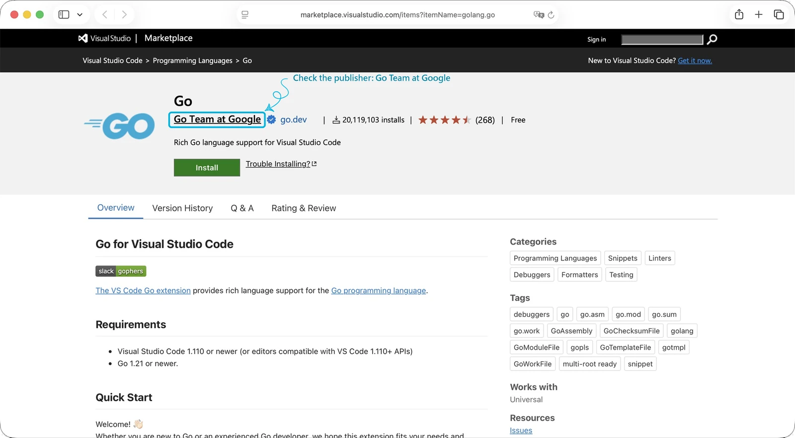

## Install Go

Before we start learning, we need to install Go. Open a terminal and run the command for your operating system:

::: {.tabs}
# macOS
```bash
brew install go
```

# Linux
```bash
sudo snap install go --classic
```

# Windows
```powershell
winget install GoLang.Go
```
:::

### Verify the Installation

Once the installation finishes, reopen your terminal and run the command below. If it prints a version number[^version], the installation worked:

```bash
go version
```

## Set Up the Development Environment

### Install Visual Studio Code

You can write Go in any text editor, but an editor that offers code completion and highlights errors makes coding easier and more comfortable. In this series I use [Visual Studio Code](https://code.visualstudio.com/) (VS Code for short). Again, run the command for your operating system:

::: {.tabs}
# macOS
```bash
brew install --cask visual-studio-code
```

# Linux
```bash
sudo snap install code --classic
```

# Windows
```powershell
winget install Microsoft.VisualStudioCode
```
:::

You can also download the installer from the [official website](https://code.visualstudio.com/). Using another editor (for example [GoLand](https://www.jetbrains.com/go/)[^goland]) is fine too, and nothing later in the series depends on this choice.

### Install the Go Extension

VS Code does not understand Go by itself, so we need the official extension maintained by the Go team, [Go](https://marketplace.visualstudio.com/items?itemName=golang.go). It connects us to Go's language server, `gopls`, and features such as code completion, go to definition and instant error checking all depend on it.

<figure id="fig-go-extension"><figcaption><strong>Figure 1</strong> The Go extension, published by Go Team at Google</figcaption></figure>

In the Extensions panel on the left side of VS Code, search for `Go`, pick the one published by [Go Team at Google](https://marketplace.visualstudio.com/publishers/golang), and click Install. If you prefer the command line, run this in your terminal:

```bash
code --install-extension golang.go
```

After it is installed, the first time you open a `.go` file, a prompt appears in the bottom right corner asking you to install the helper tools the extension needs (such as `gopls`). Just click `Install All`.

## Create Your First Project

With the environment ready, it is time to write some code. First, create a folder for the project and move into it in your terminal (you can name the folder anything; I use `hello-go` here):

```bash
mkdir hello-go
cd hello-go
```

Once you are inside the project directory, you can initialize a Go module (what that means is a topic for a later post). The command looks like this:

```bash
go mod init <module-path>
```

For this project, run the following in your terminal:

```bash
go mod init hello-go
```

If everything goes well, a `go.mod` file is created:

```text
go: creating new go.mod: module hello-go
```

### Write Your First Go Program

Now that the Go module exists, we can create our first Go program in the project folder: `main.go`.

```bash
touch main.go
```

Then open it and write:

```go
package main

import "fmt"

func main() {
    fmt.Println("Hello, Go!")
}
```

Here is what each line does:

| Code | Explanation |
| --- | --- |
| `package main` | This file belongs to the `main` package, and a `main` package is compiled into a program you can run directly |
| `import "fmt"` | Imports the `fmt` package from the standard library, which handles formatted output |
| `func main()` | The entry point of the program, where execution starts; it takes no arguments and returns no value |
| `fmt.Println("Hello, Go!")` | Calls `Println` from `fmt` to print the text followed by a new line |

## Run and Build

After writing the code in `main.go`, go back to the terminal and check that the program works. Go gives us two ways to run it: `go run` and `go build`.

### Run: `go run`

In the project folder, run:

```bash
go run main.go
```

If everything goes well, the terminal prints:

```text
Hello, Go!
```

`go run` compiles the program and runs it right away without leaving an executable behind. It is handy for quick tests while you develop, and it feels a lot like `python main.py` in Python.

### Build: `go build`

In the project folder, run:

```bash
go build
```

An executable file appears in the folder, named after the module, so it is `hello-go` (on Windows it also gets an `.exe` extension). Then run it with the command for your operating system:

::: {.tabs}
# macOS
```bash
./hello-go
```

# Linux
```bash
./hello-go
```

# Windows
```powershell
.\hello-go.exe
```
:::

It prints `Hello, Go!` again. This executable already contains everything it needs to run, so you do not need to install Go on the machine. You can copy it to any computer with the **same** operating system and architecture and it will run.

## Summary

In this post we installed Go and VS Code, created a module with `go mod init`, and wrote our first Go program. In the next post, we will start with Go's basic types and control flow.

[^version]: At the time of writing, the Go version was `1.27.3`. If anything here is unclear or out of date, please follow the official documentation for the version you installed.

[^goland]: GoLand is a paid product from JetBrains. It comes with a 30-day free trial, and students and teaching staff can use it for free after verifying their status. For licensing and pricing, see the [official pricing page](https://www.jetbrains.com/go/buy/).
