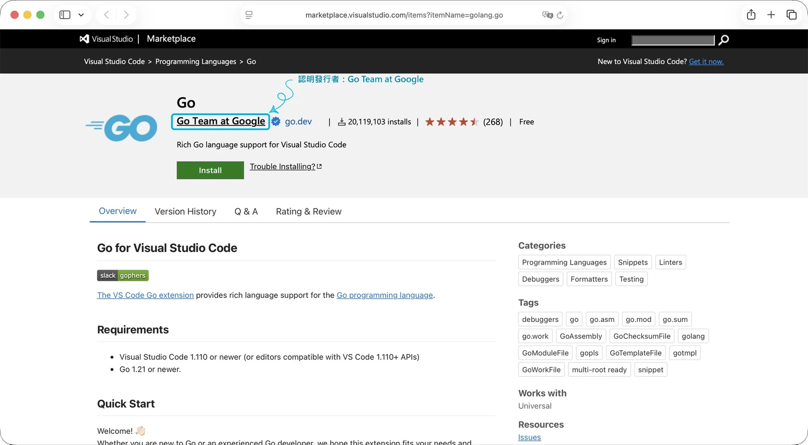

## 安裝 Go

開始學習之前，我們必須先把 Go 安裝好。依照自己的作業系統，打開終端機後輸入對應指令：

::: {.tabs}
# macOS
```bash
brew install go
```

# Linux
```bash
sudo snap install go --classic
```

# Windows
```powershell
winget install GoLang.Go
```
:::

### 驗證安裝

安裝成功後，重新開啟終端機並輸入下面的指令。若有印出版本號[^version]，就代表安裝成功：

```bash
go version
```

## 設定開發環境

### 安裝 Visual Studio Code

Go 的程式碼用任何文字編輯器都能寫，不過有編輯器幫忙補全、標出錯誤，撰寫程式碼會相對輕鬆與方便。本系列我用 [Visual Studio Code](https://code.visualstudio.com/)（下稱 VS Code），一樣依照作業系統輸入對應指令：

::: {.tabs}
# macOS
```bash
brew install --cask visual-studio-code
```

# Linux
```bash
sudo snap install code --classic
```

# Windows
```powershell
winget install Microsoft.VisualStudioCode
```
:::

也可以直接從[官網](https://code.visualstudio.com/)下載安裝檔。用別的編輯器（例如 [GoLand](https://www.jetbrains.com/go/)[^goland]）也沒問題，之後的內容不會因此不同。

### 安裝 Go 擴充套件

VS Code 本身不認得 Go，需要裝 Go 團隊維護的官方擴充套件 [Go](https://marketplace.visualstudio.com/items?itemName=golang.go)。它會幫我們接上 Go 的語言伺服器 `gopls`，程式碼補全、跳到定義、即時報錯等方便的功能都需要仰賴該套件。

<figure id="fig-go-extension"><figcaption><strong>圖 1</strong> Go 擴充套件，發行者為 Go Team at Google</figcaption></figure>

在 VS Code 左側的擴充套件面板搜尋 `Go`，選發行者是 [Go Team at Google](https://marketplace.visualstudio.com/publishers/golang) 的那個，按安裝即可。想用指令安裝的話，在終端機輸入：

```bash
code --install-extension golang.go
```

裝好後，第一次打開 `.go` 檔案時，右下角會跳出提示，要你安裝擴充套件需要的輔助工具（例如 `gopls`），按 `Install All` 就好。

## 建立第一個專案

環境準備齊全後，接下來就是動手寫程式。先建立一個資料夾放這個專案，並在終端機切過去（資料夾名稱自己取，這裡以 `hello-go` 為例）：

```bash
mkdir hello-go
cd hello-go
```

切進去該專案目錄後，就可以初始化 Go Module（至於這是什麼，待後續文章再談），指令如下：

```bash
go mod init <module-path>
```

以本專案為例，請在終端機輸入：

```bash
go mod init hello-go
```

若運行順利，應該會建立 `go.mod` 檔：

```bash
go: creating new go.mod: module hello-go
```

### 撰寫第一支 Go 程式

成功建立 Go Module 後，我們可以在專案資料夾內建立我們的第一支 Go 程式——`main.go`

```bash
touch main.go
```

接著打開並在裡面寫：

```go
package main

import "fmt"

func main() {
    fmt.Println("Hello, Go!")
}
```

逐行對照如下：

| 程式碼 | 說明 |
| --- | --- |
| `package main` | 代表此檔案屬於 `main` 套件，`main` 套件會被編譯成可以直接執行的程式 |
| `import "fmt"` | 引入標準函式庫的 `fmt` 套件，負責格式化輸出 |
| `func main()` | 程式的入口，執行時從這裡開始；沒有參數、沒有回傳值 |
| `fmt.Println("Hello, Go!")` | 呼叫 `fmt` 的 `Println`，印出內容並換行 |

## 執行與編譯

在 `main.go` 寫完程式碼後，回到終端機，就可以檢驗程式能不能如期運行。Go 支援兩種跑法，分別是 `go run` 以及 `go build`。

### 執行：`go run`

在專案資料夾輸入：

```bash
go run main.go
```

若運行順利，終端機會印出：

```text
Hello, Go!
```

`go run` 會先編譯、馬上執行，不會留下執行檔，適合開發時快速測試，用起來就像 Python 的 `python main.py`。

### 編譯：`go build`

在專案資料夾輸入：

```bash
go build
```

資料夾裡會多出一個執行檔，檔名是 Module 的名稱 `hello-go`（Windows 會多一個 `.exe`）。接著依照作業系統輸入對應指令執行：

::: {.tabs}
# macOS
```bash
./hello-go
```

# Linux
```bash
./hello-go
```

# Windows
```powershell
.\hello-go.exe
```
:::

一樣會印出 `Hello, Go!`。這個執行檔已經包含執行所需的一切，不需要在機器上另外安裝 Go，直接複製給**相同**作業系統與架構的電腦就能跑。

## 小結

這篇從安裝 Go 和 VS Code 開始，用 `go mod init` 建立 Module，並寫下第一支 Go 程式。下一篇我們將會從 Go 基本的型別與流程控制講起～

[^version]: 本文撰寫時的 Go 版本號為 `1.27.3`，若本文撰寫之內容有歧義，請以安裝版本對應的官方文件為主。

[^goland]: GoLand 是 JetBrains 的付費產品，提供 30 天免費試用；學生與教職員驗證身分後可免費使用。授權方式與定價請見[官方定價頁面](https://www.jetbrains.com/go/buy/)。
