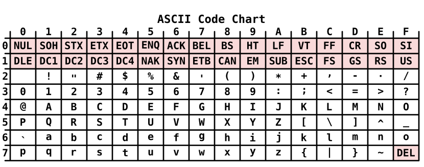

In the last post we set up our environment and ran our first Hello World. Now it is time to write real programs, and the first step is variables and types. In Python, a variable can hold anything, and its type is only known once the program runs. Go is different: it is a **statically typed** language, which means the type of every variable is fixed at compile time, and if the types do not match, the compiler rejects the program with an error.

This post starts with the two ways of declaring a variable and the basic types in Go, and then moves on to type conversion and a few related topics.

## Variables in Go

Every variable in Go has a fixed type. You can state it explicitly when you declare the variable, or let the compiler infer it from the value. Go gives us two ways to declare a variable: `var`, and the short declaration `:=`.

### Declaring with `var`

`var` is the most complete form. Its syntax is

```go
var name type = value
```

For example:

```go
var name string = "gopher"
var age int = 3
```

The type can also be left out, and Go will infer it from the value on the right. In the example below, `name` is a `string` and `age` is an `int`:

```go
var name = "gopher"
var age = 3
```

### Declaring with `:=`

Inside a function, the more common form is `:=`. It declares a variable and assigns a value in one step, and the type is again inferred from the value:

```go
func main() {
    name := "gopher"
    age := 3
    fmt.Println(name, age)
}
```

The biggest difference between `:=` and `var` is where they can be used: `var` works both inside and outside functions, while `:=` can only be written inside a function. If you write it outside a function, the compiler reports this error:

```text
syntax error: non-declaration statement outside function body
```

Outside a function, only declarations are allowed, meaning statements that start with `var`, `const`, `func` or `type`, and `:=` is not a declaration keyword. Here is where each form can be used:

| Location | `var` | `:=` |
|---|---|---|
| Outside a function | Allowed | Not allowed |
| Inside a function | Allowed | Allowed (more common) |

### Assignment and Redeclaration

If you expect to change a variable's value after declaring it, use `=`. The meaning of `:=` is to declare a **new** variable, so using `:=` again on an existing variable causes a compile error:

```go
age := 3
age = 4    // OK: changes the value
age := 5   // compile error

// no new variables on left side of :=
```

Also, once a type is decided, it cannot change. In the example below, `age` already has the type `int`, so assigning a string to it is a compile error too:

```go
age := 3
age = "four"   // compile error

// cannot use "four" (untyped string constant) as int value in assignment
```

When you declare several variables at once, the left side of `:=` only needs **at least one new name** to compile. Names that already exist are simply assigned, and only the new names are actually declared.

```go
age, name := 3, "gopher"
age, city := 4, "Taipei"   // age is assigned, city is a new variable
fmt.Println(age, name, city)

// 4 gopher Taipei
```

## Types in Go

A type determines which values a variable can hold and which operations can be applied to them @citep[gospec|Types]. Go's types fall into two groups: the types Go predeclares, and **composite types** built from existing ones. The table below lists all of Go's types. Click **Integers** and **Composite types** to see each type on its own:

::: {.table-fold}
| Category | Type | Description |
|---|---|---|
| Boolean | `bool` | The truth values `true` and `false` |
| Integers {fold} | Show more | 13 types |
| Integers | `int8` | 8-bit signed integer |
| ^^ | `int16` | 16-bit signed integer |
| ^^ | `int32` | 32-bit signed integer |
| ^^ | `int64` | 64-bit signed integer |
| ^^ | `uint8` | 8-bit unsigned integer |
| ^^ | `uint16` | 16-bit unsigned integer |
| ^^ | `uint32` | 32-bit unsigned integer |
| ^^ | `uint64` | 64-bit unsigned integer |
| ^^ | `int` | Signed integer whose size depends on the implementation: 32 or 64 bits |
| ^^ | `uint` | Unsigned integer of the same size as `int` |
| ^^ | `uintptr` | Unsigned integer large enough to hold the bits of a pointer |
| ^^ | `byte` | Alias for `uint8` |
| ^^ | `rune` | Alias for `int32` |
| Floating point | `float32` | IEEE 754 32-bit floating-point number |
| ^^ | `float64` | IEEE 754 64-bit floating-point number |
| Complex | `complex64` | Complex number whose real and imaginary parts are both `float32` |
| ^^ | `complex128` | Complex number whose real and imaginary parts are both `float64` |
| String | `string` | A sequence of bytes; the content cannot be modified once created |
| Composite types {fold} | Show more | 8 types |
| Composite types | `[n]T` | Array: a fixed-length sequence of elements of the same type |
| ^^ | `[]T` | Slice: a description of a contiguous section of an underlying array |
| ^^ | `struct` | A sequence of named fields, each with a name and a type |
| ^^ | `*T` | Pointer: points to a variable of some type |
| ^^ | `func` | Function: the set of all functions with the same parameter and result types |
| ^^ | `interface` | Defines a set of types; any value belonging to that set can be stored in it |
| ^^ | `map[K]V` | An unordered group of elements indexed by unique keys |
| ^^ | `chan T` | Channel: lets concurrently running functions send and receive values |
:::

In this post we will cover integers, floating-point numbers, strings and booleans. The other types will be explained in more detail when we reach the topics that use them.

### Integers

Go's integer types are classified by two things: how many bits they use, and whether they can represent negative numbers:

| Size | Signed (can be negative) | Unsigned (cannot be negative) |
|---|---|---|
| Specified bits | `int8`, `int16`, `int32`, `int64` | `uint8`, `uint16`, `uint32`, `uint64` |
| Machine-dependent | `int` | `uint` |

- The number after the name is the number of bits, so `int8` uses 8 bits
- `int` and `uint` do not specify a bit count; their size depends on the machine. On a 64-bit machine they are 64 bits

Different bit counts can represent different ranges of numbers. In Python, integers have no upper limit, so you never have to think about this, but in Go you need to pay attention to it.

#### The Range of Integers

An $n$-bit unsigned integer ranges from $0$ to $2^n - 1$, and an $n$-bit signed integer ranges from $-2^{n-1}$ to $2^{n-1} - 1$.

:::: {.fold}
The relationship between the number of bits and the range can be derived. Suppose we use $n$ bits. Each bit can be 0 or 1, so there are $2^n$ different combinations in total, which means we can represent at most $2^n$ different integers.

An unsigned integer uses all of these combinations for non-negative integers, counting up continuously from 0, so its range is

::: {.equation #eq:uint-range}
0 \leq x \leq 2^{n} - 1
:::

A signed integer has to represent both negative and non-negative numbers, so the $2^n$ combinations are split in half, $2^{n-1}$ each. The negative half is $-1, -2, \cdots, -2^{n-1}$, and the non-negative half is $0, 1, \cdots, 2^{n-1} - 1$. Zero takes one of the non-negative slots, so there is one fewer positive number than negative numbers, and the range is

::: {.equation #eq:int-range}
-2^{n-1} \leq x \leq 2^{n-1} - 1
:::

::: {.example}
Take `int8` as an example. Here $n = 8$, and substituting into @eq:int-range gives

$$
-2^{7} \leq x \leq 2^{7} - 1 \quad \Longrightarrow \quad -128 \leq x \leq 127
$$

For `uint8`, substituting into @eq:uint-range gives $0 \leq x \leq 2^{8} - 1 = 255$.
:::
::::

In the same way, we get the range of each type @citep[gospec|Numeric types]:

| Signed integer | Bits | Minimum | Maximum |
|---|---|---|---|
| `int8` | 8 | -128 | 127 |
| `int16` | 16 | -32,768 | 32,767 |
| `int32` | 32 | -2,147,483,648 | 2,147,483,647 |
| `int64` | 64 | -9,223,372,036,854,775,808 | 9,223,372,036,854,775,807 |

| Unsigned integer | Bits | Minimum | Maximum |
|---|---|---|---|
| `uint8` | 8 | 0 | 255 |
| `uint16` | 16 | 0 | 65,535 |
| `uint32` | 32 | 0 | 4,294,967,295 |
| `uint64` | 64 | 0 | 18,446,744,073,709,551,615 |

#### Integer Overflow

What happens if the result of an operation goes outside the range? Let us look at an example:

```go
var x int8 = 127
x = x + 1
fmt.Println(x)

// -128
```

This program compiles, and it does not report an error when it runs, yet `127 + 1` became `-128`. This is because when a value goes out of range, Go does not report an error or stop the program @citep[gospec|Integer overflow]. Instead, it **wraps around** to the other end of the range[^twos-complement], like an odometer rolling from 999999 back to 000000.

The wrapping rule is this: an $n$-bit integer can only keep $2^n$ different results, so for any integer $x$, the value you actually get is the one that has the same remainder as $x$ when divided by $2^n$ and lies within the range.

:::: {.fold}
Shift $x$ by $2^{n-1}$ so that the range starts from 0, take the remainder, and then shift back. This gives

::: {.equation #eq:wrap}
\operatorname{wrap}_{n}(x) = \left( \left( x + 2^{n-1} \right) \bmod 2^{n} \right) - 2^{n-1}
:::

::: {.example}
For `int8`, $n = 8$, so $2^{n-1} = 128$ and $2^n = 256$.

$x = 127 + 1 = 128$:

$$
\operatorname{wrap}_{8}(128) = \left( (128 + 128) \bmod 256 \right) - 128 = 0 - 128 = -128
$$

$x = 100 + 100 = 200$:

$$
\operatorname{wrap}_{8}(200) = \left( (200 + 128) \bmod 256 \right) - 128 = 72 - 128 = -56
$$

$x = -128 - 1 = -129$:

$$
\operatorname{wrap}_{8}(-129) = \left( (-129 + 128) \bmod 256 \right) - 128 = 255 - 128 = 127
$$

Let us verify this by actually running a program:

```go
var x1 int8 = 127
var x2 int8 = 100
var x3 int8 = -128

fmt.Println(x1 + 1)
fmt.Println(x2 + 100)
fmt.Println(x3 - 1)

// -128
// -56
// 127
```

:::

The range of an unsigned integer already starts from 0, so no shift is needed and the wrapping rule simplifies to

::: {.equation #eq:wrap-unsigned}
\operatorname{wrap}_{n}(x) = x \bmod 2^{n}
:::

For example, for `uint8`, substituting `255 + 1` into @eq:wrap-unsigned gives $256 \bmod 256 = 0$, and running it really does print `0`.
::::

Note that the compiler can only check cases where it already knows the value at compile time. If you hard-code a constant that is out of range, you get a compile error right away:

```go
var x int8 = 128

// cannot use 128 (untyped int constant) as int8 value in variable declaration (overflows)
```

But if the value is the result of an operation on variables, the compiler does not know it at compile time, so the value can only wrap around at run time, with no warning at all. This is why integer overflow so easily turns into a bug. Before you use an integer type, estimate whether your values could exceed its range.

### Floating-Point Numbers

Numbers with a decimal part use floating-point types. Go has two of them, `float32` and `float64`, where the number is the bit count, and `float64` is the one you normally use. Go has no type called `float`, and writing it causes a compile error:

```go
var a float = 3

// undefined: float
```

Both are IEEE 754 floating-point numbers[^ieee754] @citep[gospec|Numeric types]. They differ mainly in precision, and secondarily in range:

| Type | Bits | Significand bits $p$ | About this many decimal digits | Maximum | Smallest positive number |
|---|---|---|---|---|---|
| `float32` | 32 | 24 bits | about 7 | $3.4 \times 10^{38}$ | $1.4 \times 10^{-45}$ |
| `float64` | 64 | 53 bits | about 15 to 16 | $1.8 \times 10^{308}$ | $5 \times 10^{-324}$ |

#### Floating-Point Precision

A floating-point number stores a value using a limited number of binary significant digits. With $p$ significant bits, the gap between 1 and the next representable number above it is

::: {.equation #eq:float-eps}
\varepsilon = 2^{-(p-1)}
:::

The smaller this gap, the higher the precision. `float32` is accurate to about 7 decimal digits, and `float64` to about 15 to 16.

:::: {.fold}
To convert this into decimal digits, we can compare how many values each can tell apart: $p$ binary bits give $2^p$ combinations, and $d$ decimal digits give $10^d$. Setting the two equal, $10^d = 2^p$, and taking $\log_{10}$ of both sides gives

::: {.equation #eq:float-digits}
d = p \log_{10} 2
:::

::: {.example}
For `float32`, $p = 24$, and substituting into @eq:float-eps and @eq:float-digits gives

$$
\varepsilon = 2^{-23} \approx 1.19 \times 10^{-7}, \qquad d = 24 \log_{10} 2 \approx 7.22
$$

For `float64`, $p = 53$, so

$$
\varepsilon = 2^{-52} \approx 2.22 \times 10^{-16}, \qquad d = 53 \log_{10} 2 \approx 15.95
$$

This agrees with the gaps actually measured with `math.Nextafter` (`1.1920929e-07` and `2.220446049250313e-16`).
:::
::::

Neither type can store exactly 0.1, but `float64` gets much closer[^printf]:

```go
var a float32 = 0.1
var b float64 = 0.1
fmt.Printf("%.20f\n%.20f\n", a, b)

// 0.10000000149011611938
// 0.10000000000000000555
```

Limited precision can also cause **adding 1 to have no effect**: from $2^{24}$ for `float32`, and from $2^{53}$ for `float64`, the gap between neighboring numbers is greater than 1, so adding 1 gets rounded back to the original number.

:::: {.fold}
When a value falls in $2^k \leq x < 2^{k+1}$, the gap between neighboring representable numbers is

::: {.equation #eq:float-gap}
2^{k-p+1}
:::

For `float32`, $p = 24$. When $k = 24$, that is, starting from $2^{24} = 16{,}777{,}216$, the gap is $2^{24-24+1} = 2$, which is greater than 1, so adding 1 gets rounded back to the original number:

```go
var c float32 = 16777216 // 2^24
var d float64 = 16777216
fmt.Println(c+1, d+1)

// 1.6777216e+07 1.6777217e+07
```

For `float64`, $p = 53$, so the same thing only happens at $2^{53}$.
::::

We usually use `float64` because its precision and range are enough for most purposes, and because functions in the `math` package (such as `math.Sqrt`) take `float64`. `float32` is better suited to cases where there is a lot of data and you need to save memory.

### Strings

A string has to be wrapped in double quotes `"`, and its type is `string`. Unlike in Python, the content of a Go string is a sequence of **bytes** encoded in UTF-8[^utf8], not a sequence of characters, so `len` returns the number of bytes:

```go
s := "Go你好"
fmt.Println(len(s))

// 8
```

In Python, `len("Go你好")` is 4, but in Go it is 8. This is because in UTF-8, different characters take up different numbers of bytes:

| Character | Bytes | Examples |
|---|---|---|
| ASCII (English letters, digits, half-width symbols) | 1 | `G`, `o` |
| [Common Chinese characters](https://www.unicode.org/charts/PDF/U4E00.pdf) | 3 | `你`, `好` |
| [Emoji](https://unicode.org/emoji/charts/full-emoji-list.html) | 4 | `😀` |

So `Go你好` is $1 + 1 + 3 + 3 = 8$ bytes. ASCII has only 128 characters in total, and the full chart is in @fig-ascii.

::: {#fig-ascii}


ASCII character chart, adapted from [Wikimedia Commons](https://commons.wikimedia.org/wiki/File:ASCII_Code_Chart.svg) (public domain)
:::

When you index into a string, what you get is also a byte:

```go
s := "Go你好"
fmt.Println(s[0], s[2])
fmt.Printf("%T\n", s[0])

// 71 228
// uint8
```

`s[0]` is the byte 71 for `G`, and `s[2]` is 228, the first of the three bytes of `你`, which is not a complete character. The type `uint8` is exactly the 0 to 255 range from the integer section above.

Go calls the number that corresponds to one character a **rune**, and its type is an alias of `int32`. When you want to process a string character by character, for example to count characters, you need runes. We will leave that for a later post dedicated to strings.

### Booleans

The boolean type is `bool`. It has only two values, `true` and `false`, and both are lowercase, unlike Python's `True` and `False`:

```go
a := true
b := false
fmt.Println(a, b)
fmt.Printf("%T\n", a)

// true false
// bool
```

In Python, `True` is actually the integer `1`[^py-bool], so `True + 1` gives `2`. A Go `bool` is not a number at all. You cannot use `1` or `0` in its place, you cannot use it in numeric operations, and you cannot even convert it to a number:

```go
var b bool = 1
// cannot use 1 (untyped int constant) as bool value in variable declaration

a := true
fmt.Println(a + 1)
// invalid operation: a + 1 (mismatched types bool and untyped int)

fmt.Println(int(a))
// cannot convert a (variable of type bool) to type int
```

None of these three lines compile. There is no conversion at all between `bool` and the numeric types, which fits Go's preference for being explicit instead of converting automatically, as we saw earlier.

## Type Conversion and Zero Values

The types we have just seen often need to work together in real programs. This section explains how to convert between types, and what Go fills in for a variable that is declared without a value.

### Type Conversion

In Python, `3 * 1.5` automatically gives `4.5`. In Go, however, different numeric types cannot be mixed directly in an operation @citep[gospec|Numeric types]:

```go
var a int = 3
var b float64 = 1.5
fmt.Println(a * b)

// invalid operation: a * b (mismatched types int and float64)
```

You first have to convert one of them to the type of the other. The syntax is

```go
type(value)
```

With 3 and 1.5, there are two obvious approaches: convert `1.5` to an integer, or convert `3` to a floating-point number. Let us try the first one:

```go
var a int = 3
var b float64 = 1.5
fmt.Println(a * int(b))

// 3
```

But converting `1.5` to `int` truncates it to `1`, and the decimal part is lost. The result is `3 * 1 = 3`, not the `4.5` we wanted.

So we have to go the other way and convert the integer to a floating-point number:

```go
var a int = 3
var b float64 = 1.5
fmt.Println(float64(a) * b)

// 4.5
```

`3` becomes `3.0`, with no loss of information. The general principle is to convert to a type that can represent both numbers completely: most values an integer can represent can also be represented by a floating-point number[^int-float], but an integer cannot represent `1.5`.

!!! info "Why Doesn't Go Convert Automatically?"
    Automatic conversion makes it easy to lose track of whether an expression is unsigned, how large a value is, whether it might overflow, and whether the result is the same on different machines. Go chooses to make the code a little longer with explicit conversions in exchange for clarity and portability @citep[gofaq|Why does Go not provide implicit numeric conversions?]. It also lets anyone reading the code see at a glance where a type conversion happens, which is where information might be lost.

In the other direction, when you convert a floating-point number to an integer, the decimal part is discarded:

```go
var f float64 = 3.9
var g float64 = -3.9
fmt.Println(int(f), int(g))

// 3 -3
```

This rule is called **rounding toward zero** @citep[gospec|Conversions]. The value is truncated in the direction of zero. It is not rounding to the nearest integer, and it is not always rounding down (taking the floor).

:::: {.fold}
In mathematical terms, this is

::: {.equation #eq:trunc}
\operatorname{trunc}(x) = \operatorname{sgn}(x) \left\lfloor |x| \right\rfloor
:::

where $\operatorname{sgn}(x)$ is the sign of $x$. Substituting $x = 3.9$ gives $1 \times \lfloor 3.9 \rfloor = 3$, and substituting $x = -3.9$ gives $-1 \times \lfloor 3.9 \rfloor = -3$. Compared with the floor, $\lfloor -3.9 \rfloor = -4$, we can see that @eq:trunc differs from the floor for negative numbers.
::::

If you need to round to the nearest integer, first use `math.Round`, and then convert to an integer.

Finally, constants and variables follow different conversion rules. For a constant, the compiler already knows at compile time that `3.9` is not an integer, so it rejects the conversion outright:

```go
fmt.Println(int(3.9))

// cannot convert 3.9 (untyped float constant) to type int
```

**Constants are checked at compile time, and variables are handled at run time.** We have already seen this difference once in integer overflow, and it shows up again in type conversion.

### Zero Values

In Python, a variable must be assigned a value before you can use it. In Go, a variable has a value as soon as it is declared, and if you do not give it one, it gets the **zero value** of its type:

```go
var n int
var s string
var ok bool
fmt.Printf("%d %q %t\n", n, s, ok)

// 0 "" false
```

The zero value is decided by the type. The zero values of all the types are as follows @citep[gospec|The zero value]:

| Type | Zero value |
|---|---|
| `bool` | `false` |
| Numeric types (integers, floating-point numbers, complex numbers) | `0` |
| `string` | `""` (the empty string) |
| Pointers, functions, `interface`, slices, channels, `map` | `nil` |
| Arrays, `struct` | Each element or field takes the zero value of its own type |

So `var i int` and `var i int = 0` are exactly equivalent. We will explain `nil` when we get to slices and maps.

## Summary

In this post we covered Go's two ways of declaring a variable, `var` and `:=`, and four basic types: integers, floating-point numbers, strings and booleans. Go is a statically typed language, so types are never converted automatically; you have to write every conversion explicitly, and a variable with no value gets the zero value of its type. In the next post, we will look at operators.

[^twos-complement]: Signed integers are stored in **two's complement**, and when they overflow only the lowest $n$ bits are kept, so the result lands at the other end of the range.

[^ieee754]: IEEE 754 is the international standard for floating-point arithmetic. It defines how floating-point numbers are stored and rounded, and most programming languages and processors follow it.

[^printf]: `fmt.Printf` prints according to a format string. `%.20f` prints a floating-point number with 20 digits after the decimal point, and `\n` is a newline. We will also use `%T` (the type), `%d` (an integer), `%q` (a quoted string) and `%t` (a boolean) later. For the full list of formats, see the [documentation of the `fmt` package](https://pkg.go.dev/fmt).

[^utf8]: Unicode assigns a number to every character, and UTF-8 defines how that number is stored in 1 to 4 bytes.

[^py-bool]: More precisely, Python's `bool` is a subclass of `int`, with `True == 1` and `False == 0`.

[^int-float]: More precisely, by @eq:float-gap, `float64` has $p = 53$, and when $k \leq 52$ the gap $2^{k-52}$ between neighboring numbers is at most 1, so every integer up to $2^{53}$ can be represented exactly by `float64`, and the conversion loses no information. Integers beyond $2^{53}$ may no longer be exactly representable.

## References

[references]
