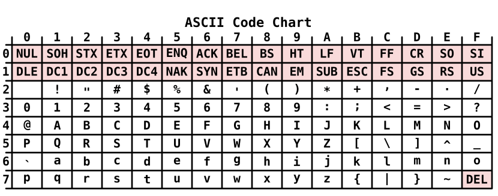

上一篇我們裝好環境，也跑出了第一支 Hello World。接下來要寫真正的程式，第一步是變數與型別。在 Python 中，變數想放什麼都行，型別要等程式跑起來才知道；而 Go 與 Python 不同，它是**靜態型別**的語言，也就是每個變數的型別必須在編譯時就定下來，若型別對不上，編譯器會直接拒絕並報錯。

這篇會先從 Go 的型別以及宣告變數的兩種寫法，接著討論型別轉換以及型別相關的議題。

## Go 的變數

Go 的每個變數都有固定型別，宣告時可以明寫，也可以讓編譯器從值推出來。在 Go 中，我們有兩種宣告變數的方式，分別是用 `var`，以及使用 `:=` 的簡短宣告。

### 使用 `var` 宣告

`var` 是最完整的寫法，格式為 

```go
var 名稱 型別 = 值
```

例如：

```go
var name string = "gopher"
var age int = 3
```

不過型別也可以省略，Go 會直接從右邊的值推出來。例如下面的 `name` 會是 `string`，`age` 會是 `int`：

```go
var name = "gopher"
var age = 3
```

### 使用 `:=` 宣告

在函式裡面，更常見的寫法是 `:=`，它一次完成宣告與賦值，型別同樣由值推出來：

```go
func main() {
    name := "gopher"
    age := 3
    fmt.Println(name, age)
}
```

`:=` 和 `var` 最大的差別是位置：`var` 在函式內外都能用，`:=` 只能寫在函式內。如果寫在函式外，編譯時會出現這個錯誤：

```text
syntax error: non-declaration statement outside function body
```

函式外只能放宣告，也就是以 `var`、`const`、`func`、`type` 開頭的敘述，而 `:=` 不是宣告關鍵字。兩種寫法的使用位置整理如下：

| 位置 | `var` | `:=` |
|---|---|---|
| 函式外 | 可以 | 不行 |
| 函式內 | 可以 | 可以（較常用） |

### 賦值與重複宣告

若預期宣告之後，變數會想要更換值，則要使用 `=`。`:=` 的意思是宣告一個**新**變數，所以對已存在的變數再用一次 `:=` 會出現編譯錯誤：

```go
age := 3
age = 4    // 可以：換值
age := 5   // 編譯錯誤

// no new variables on left side of :=
```

另外，型別一旦決定就不能換。例如下面 `age` 已經定義型別為 `int`，因此將字串賦給它也會出現編譯錯誤：

```go
age := 3
age = "four"   // 編譯錯誤

// cannot use "four" (untyped string constant) as int value in assignment
```

而一次宣告多個變數時，`:=` 的左邊只要**至少有一個新名字**就可以通過編譯，已存在的名字只會被賦值，新名字才是真的宣告。

```go
age, name := 3, "gopher"
age, city := 4, "Taipei"   // age 被賦值，city 是新變數
fmt.Println(age, name, city)

// 4 gopher Taipei
```

## Go 的型別

型別決定一個變數能存哪些值，以及這些值能做哪些運算 @citep[gospec|Types]。Go 的型別分成兩類：Go 預先宣告好的型別，以及用現有型別組合出來的**複合型別**。下表整理了 Go 的所有型別，點開**整數**和**複合型別**則可以看每個型別各自的說明：

::: {.table-fold}
| 分類 | 型別 | 說明 |
|---|---|---|
| 布林 | `bool` | 真值 `true` 與 `false` |
| 整數 {fold} | 展開查看更多 | 共 13 種 |
| 整數 | `int8` | 8 位元的有號整數 |
| ^^ | `int16` | 16 位元的有號整數 |
| ^^ | `int32` | 32 位元的有號整數 |
| ^^ | `int64` | 64 位元的有號整數 |
| ^^ | `uint8` | 8 位元的無號整數 |
| ^^ | `uint16` | 16 位元的無號整數 |
| ^^ | `uint32` | 32 位元的無號整數 |
| ^^ | `uint64` | 64 位元的無號整數 |
| ^^ | `int` | 有號整數，大小由實作決定，為 32 或 64 位元 |
| ^^ | `uint` | 無號整數，與 `int` 同大小 |
| ^^ | `uintptr` | 大到足以存放指標位元的無號整數 |
| ^^ | `byte` | `uint8` 的別名 |
| ^^ | `rune` | `int32` 的別名 |
| 浮點數 | `float32` | IEEE 754 的 32 位元浮點數 |
| ^^ | `float64` | IEEE 754 的 64 位元浮點數 |
| 複數 | `complex64` | 實部與虛部皆為 `float32` 的複數 |
| ^^ | `complex128` | 實部與虛部皆為 `float64` 的複數 |
| 字串 | `string` | 位元組的序列，內容建立後不能修改 |
| 複合型別 {fold} | 展開查看更多 | 共 8 種 |
| 複合型別 | `[n]T` | 陣列：由同一種型別的元素組成、長度固定的序列 |
| ^^ | `[]T` | slice：底層陣列中一段連續區間的描述 |
| ^^ | `struct` | 由具名欄位組成的序列，每個欄位有名稱與型別 |
| ^^ | `*T` | 指標：指向某個型別的變數 |
| ^^ | `func` | 函式：參數與回傳型別相同的所有函式 |
| ^^ | `interface` | 定義一組型別，凡屬於這組型別的值都能存入 |
| ^^ | `map[K]V` | 無序的元素群，以不重複的鍵索引 |
| ^^ | `chan T` | channel：讓並行執行的函式互相傳送與接收值 |
:::

本篇接下來先介紹整數、浮點數、字串與布林值，其他型別留待後續提到相關內容再詳細說明與討論。

### 整數

Go 的整數型別依兩件事分類：占幾個位元，以及能不能表示負數：

| 大小 | 有號整數（可為負） | 無號整數（不可為負） |
|---|---|---|
| 指定位元數 | `int8`、`int16`、`int32`、`int64` | `uint8`、`uint16`、`uint32`、`uint64` |
| 由機器決定 | `int` | `uint` |

- 名稱後面的數字就是位元數，例如 `int8` 就占 8 位元
- `int` 和 `uint` 沒有指定位元數，大小由機器決定。在 64 位元的機器上是 64 位元

不同位元數能表示的數字不一樣。在 Python 裡整數沒有上限，不需要考慮這件事，但在 Go 中則需要特別留意。

#### 整數的範圍

$n$ 位元的無號整數範圍是 $0$ 到 $2^n - 1$，有號整數範圍是 $-2^{n-1}$ 到 $2^{n-1} - 1$。

:::: {.fold}
位元數與範圍的關係可以推導出來：假設設定 $n$ 個位元，每個位元有 0 和 1 兩種可能，因此一共有 $2^n$ 種不同的組合，也就是最多能表示 $2^n$ 個不同的整數。

無號整數把這些組合全部拿來表示非負整數，從 0 開始連續往上數，所以範圍是

::: {.equation #eq:uint-range}
0 \leq x \leq 2^{n} - 1
:::

有號整數則要同時表示負數與非負數，因此把 $2^n$ 個組合對半分，各得 $2^{n-1}$ 個。負數這一半是 $-1, -2, \cdots, -2^{n-1}$，非負數這一半是 $0, 1, \cdots, 2^{n-1} - 1$。其中 0 占去了非負這一半的一個位置，所以正數會比負數少一個，範圍是

::: {.equation #eq:int-range}
-2^{n-1} \leq x \leq 2^{n-1} - 1
:::

::: {.example}
以 `int8` 為例，$n = 8$，代入@eq:int-range 可得

$$
-2^{7} \leq x \leq 2^{7} - 1 \quad \Longrightarrow \quad -128 \leq x \leq 127
$$

而 `uint8` 代入@eq:uint-range 則是 $0 \leq x \leq 2^{8} - 1 = 255$。
:::
::::

依照相同方式，可以得到各型別的範圍 @citep[gospec|Numeric types]：

| 有號整數 | 位元數 | 最小值 | 最大值 |
|---|---|---|---|
| `int8` | 8 | -128 | 127 |
| `int16` | 16 | -32,768 | 32,767 |
| `int32` | 32 | -2,147,483,648 | 2,147,483,647 |
| `int64` | 64 | -9,223,372,036,854,775,808 | 9,223,372,036,854,775,807 |

| 無號整數 | 位元數 | 最小值 | 最大值 |
|---|---|---|---|
| `uint8` | 8 | 0 | 255 |
| `uint16` | 16 | 0 | 65,535 |
| `uint32` | 32 | 0 | 4,294,967,295 |
| `uint64` | 64 | 0 | 18,446,744,073,709,551,615 |

#### 整數溢位

如果運算的結果超出範圍，會發生什麼事？先看一個例子：

```go
var x int8 = 127
x = x + 1
fmt.Println(x)

// -128
```

這段程式可以編譯，執行時也不會報錯，`127 + 1` 卻變成了 `-128`。這是因為超出範圍之後，Go 不會報錯或中止程式 @citep[gospec|Integer overflow]，而是**繞回**範圍的另一端[^twos-complement]，就像里程表從 999999 跳回 000000。

繞回的規則是：$n$ 位元整數只能保留 $2^n$ 種結果，所以任意整數 $x$ 實際得到的值，是與 $x$ 除以 $2^n$ 餘數相同、且落在範圍內的那一個數。

:::: {.fold}
把 $x$ 先平移 $2^{n-1}$，使範圍變成從 0 開始，取餘數後再平移回去，即可得到

::: {.equation #eq:wrap}
\operatorname{wrap}_{n}(x) = \left( \left( x + 2^{n-1} \right) \bmod 2^{n} \right) - 2^{n-1}
:::

::: {.example}
`int8` 的 $n = 8$，所以 $2^{n-1} = 128$，$2^n = 256$。

$x = 127 + 1 = 128$：

$$
\operatorname{wrap}_{8}(128) = \left( (128 + 128) \bmod 256 \right) - 128 = 0 - 128 = -128
$$

$x = 100 + 100 = 200$：

$$
\operatorname{wrap}_{8}(200) = \left( (200 + 128) \bmod 256 \right) - 128 = 72 - 128 = -56
$$

$x = -128 - 1 = -129$：

$$
\operatorname{wrap}_{8}(-129) = \left( (-129 + 128) \bmod 256 \right) - 128 = 255 - 128 = 127
$$

實際撰寫程式進行驗證：

```go
var x1 int8 = 127
var x2 int8 = 100
var x3 int8 = -128

fmt.Println(x1 + 1)
fmt.Println(x2 + 100)
fmt.Println(x3 - 1)

// -128
// -56
// 127
```

:::

無號整數的範圍本來就從 0 開始，不需要平移，繞回的規則簡化為

::: {.equation #eq:wrap-unsigned}
\operatorname{wrap}_{n}(x) = x \bmod 2^{n}
:::

例如 `uint8` 的 `255 + 1`，代入@eq:wrap-unsigned 得 $256 \bmod 256 = 0$，實際執行也是 `0`。
::::

要注意的是，編譯器只能檢查它在編譯時就知道值的情況。把常數寫死在程式裡，超出範圍會直接編譯錯誤：

```go
var x int8 = 128

// cannot use 128 (untyped int constant) as int8 value in variable declaration (overflows)
```

但如果是變數運算的結果，編譯器在編譯時並不知道值，所以只能等到執行時繞回，不會有任何提示。這是整數溢位容易變成 bug 的原因，使用時要先估算數值會不會超出型別的範圍。

### 浮點數

帶小數的數字使用浮點數，Go 有 `float32` 和 `float64` 兩種，數字代表位元數，通常使用 `float64`。Go 沒有叫做 `float` 的型別，寫了會出現編譯錯誤：

```go
var a float = 3

// undefined: float
```

兩者都是 IEEE 754 的浮點數[^ieee754] @citep[gospec|Numeric types]，差別主要在精度，其次是範圍：

| 型別 | 位元數 | 有效位數 $p$ | 約等於十進位 | 最大值 | 最接近 0 的正數 |
|---|---|---|---|---|---|
| `float32` | 32 | 24 位元 | 約 7 位 | $3.4 \times 10^{38}$ | $1.4 \times 10^{-45}$ |
| `float64` | 64 | 53 位元 | 約 15 至 16 位 | $1.8 \times 10^{308}$ | $5 \times 10^{-324}$ |

#### 浮點數的精度

浮點數用有限個二進位有效位數來儲存數字。有效位數為 $p$ 位元時，從 1 往上，下一個可表示的數與 1 的間距是

::: {.equation #eq:float-eps}
\varepsilon = 2^{-(p-1)}
:::

這個間距越小，表示精度越高。`float32` 大約能準確到 7 位十進位數字，`float64` 約 15 至 16 位。

:::: {.fold}
若要換算成十進位，可以比較能區分的數量：$p$ 位元的二進位有 $2^p$ 種組合，$d$ 位的十進位有 $10^d$ 種，令兩者相等，即 $10^d = 2^p$，兩邊取 $\log_{10}$ 可得

::: {.equation #eq:float-digits}
d = p \log_{10} 2
:::

::: {.example}
`float32` 的 $p = 24$，代入@eq:float-eps 與@eq:float-digits 可得

$$
\varepsilon = 2^{-23} \approx 1.19 \times 10^{-7}, \qquad d = 24 \log_{10} 2 \approx 7.22
$$

`float64` 的 $p = 53$，則是

$$
\varepsilon = 2^{-52} \approx 2.22 \times 10^{-16}, \qquad d = 53 \log_{10} 2 \approx 15.95
$$

這和用 `math.Nextafter` 實際量出的間距（`1.1920929e-07` 與 `2.220446049250313e-16`）一致。
:::
::::

兩者都存不下剛好的 0.1，只是 `float64` 近得多[^printf]：

```go
var a float32 = 0.1
var b float64 = 0.1
fmt.Printf("%.20f\n%.20f\n", a, b)

// 0.10000000149011611938
// 0.10000000000000000555
```

精度不足還會造成**加 1 沒有效果**：`float32` 從 $2^{24}$ 開始、`float64` 從 $2^{53}$ 開始，相鄰兩數的間距大於 1，加 1 會被捨入回原來的數。

:::: {.fold}
數值落在 $2^k \leq x < 2^{k+1}$ 時，相鄰兩個可表示的數的間距是

::: {.equation #eq:float-gap}
2^{k-p+1}
:::

`float32` 的 $p = 24$，當 $k = 24$，也就是從 $2^{24} = 16{,}777{,}216$ 開始，間距是 $2^{24-24+1} = 2$，大於 1，所以加 1 會被捨入回原來的數：

```go
var c float32 = 16777216 // 2^24
var d float64 = 16777216
fmt.Println(c+1, d+1)

// 1.6777216e+07 1.6777217e+07
```

`float64` 的 $p = 53$，要到 $2^{53}$ 才會遇到同樣的情形。
::::

通常使用 `float64`，是因為它的精度與範圍都夠用，而且 `math` 套件的函式（例如 `math.Sqrt`）接受的就是 `float64`。`float32` 比較適合資料量很大、需要省記憶體的情況。

### 字串

字串需要用雙引號 `"` 包起來，型別是 `string`。與 Python 不同的是，Go 的字串內容是以 UTF-8[^utf8] 編碼的**位元組**序列，而不是字元序列，所以 `len` 回傳的是位元組數：

```go
s := "Go你好"
fmt.Println(len(s))

// 8
```

Python 中 `len("Go你好")` 是 4，在 Go 卻是 8。這是因為在 UTF-8 中，不同字元占用的位元組數不一樣：

| 字元 | 位元組數 | 範例 |
|---|---|---|
| ASCII（英文、數字、半形符號） | 1 | `G`、`o` |
| [常見的中文](https://www.unicode.org/charts/PDF/U4E00.pdf) | 3 | `你`、`好` |
| [emoji](https://unicode.org/emoji/charts/full-emoji-list.html) | 4 | `😀` |

所以 `Go你好` 是 $1 + 1 + 3 + 3 = 8$ 個位元組。ASCII 一共只有 128 個字元，完整的對照可以參考@fig-ascii。

::: {#fig-ascii}


ASCII 字元對照表，改自 [Wikimedia Commons](https://commons.wikimedia.org/wiki/File:ASCII_Code_Chart.svg)（公有領域）
:::

用索引取值時，取出的同樣是位元組：

```go
s := "Go你好"
fmt.Println(s[0], s[2])
fmt.Printf("%T\n", s[0])

// 71 228
// uint8
```

`s[0]` 是 `G` 的位元組 71，`s[2]` 則是 `你` 三個位元組中的第一個 228，並不是一個完整的字。型別 `uint8` 就是前面整數那一節的 0 到 255。

Go 把一個字元對應的編號稱為 **rune**，型別是 `int32` 的別名。要以字元為單位處理字串，例如計算字數，就需要用到它，這部分留到之後專門介紹字串的文章。

### 布林值

布林值的型別是 `bool`，只有 `true` 和 `false` 兩個值，而且都是小寫，與 Python 的 `True`、`False` 不同：

```go
a := true
b := false
fmt.Println(a, b)
fmt.Printf("%T\n", a)

// true false
// bool
```

Python 的 `True` 其實就是整數 `1`[^py-bool]，所以 `True + 1` 會得到 `2`。Go 的 `bool` 則完全不是數字，不能用 `1` 或 `0` 代替，也不能參與數值運算，連型別轉換都不行：

```go
var b bool = 1
// cannot use 1 (untyped int constant) as bool value in variable declaration

a := true
fmt.Println(a + 1)
// invalid operation: a + 1 (mismatched types bool and untyped int)

fmt.Println(int(a))
// cannot convert a (variable of type bool) to type int
```

這三行都無法編譯。`bool` 與數值型別之間沒有任何轉換，這也呼應了前面 Go 偏好明確、不自動轉換的設計。

## 型別轉換與零值

前面介紹的幾種型別，實際使用時常常需要互相搭配。這一節說明型別之間如何轉換，以及變數宣告後沒有給值時，Go 會幫它填上什麼。

### 型別轉換

在 Python 中，`3 * 1.5` 會自動算出 `4.5`。但在 Go 裡，不同的數值型別不能直接混合運算 @citep[gospec|Numeric types]：

```go
var a int = 3
var b float64 = 1.5
fmt.Println(a * b)

// invalid operation: a * b (mismatched types int and float64)
```

要先把其中一個轉成另一個的型別，語法是 

```go
型別(值)
```

以 3 與 1.5 為例，直觀的做法有兩種：把 `1.5` 轉成整數，或把 `3` 轉成浮點數。先試第一種：

```go
var a int = 3
var b float64 = 1.5
fmt.Println(a * int(b))

// 3
```

但是 `1.5` 轉成 `int` 後會被截成 `1`，小數部分就不見了，算出來的是 `3 * 1 = 3`，不是我們要的 `4.5`。

所以要反過來，把整數轉成浮點數：

```go
var a int = 3
var b float64 = 1.5
fmt.Println(float64(a) * b)

// 4.5
```

`3` 變成 `3.0`，沒有損失任何資訊。一般的原則是轉成能完整表示兩個數的型別：整數能表示的值，浮點數大多也能表示[^int-float]，但整數表示不了 `1.5`。

!!! info "為什麼 Go 不自動轉換？"
    自動轉換容易讓人搞不清楚運算式是不是無號、數值有多大、會不會溢位，以及結果在不同機器上是否一致。Go 選擇讓程式碼多寫一些明確的轉換，換取清楚與可移植 @citep[gofaq|Why does Go not provide implicit numeric conversions?]。同時，讀程式的人也能一眼看出哪裡發生了型別轉換，也就是哪裡可能損失資訊。

反方向，也就是把浮點數轉成整數時，小數部分會被捨去：

```go
var f float64 = 3.9
var g float64 = -3.9
fmt.Println(int(f), int(g))

// 3 -3
```

這個規則叫做**向零取整**（round toward zero）@citep[gospec|Conversions]，也就是往零的方向截斷，不是四捨五入，也不是無條件捨去（取地板）。

:::: {.fold}
用數學式表示為

::: {.equation #eq:trunc}
\operatorname{trunc}(x) = \operatorname{sgn}(x) \left\lfloor |x| \right\rfloor
:::

其中 $\operatorname{sgn}(x)$ 是 $x$ 的正負號。代入 $x = 3.9$ 得 $1 \times \lfloor 3.9 \rfloor = 3$；代入 $x = -3.9$ 得 $-1 \times \lfloor 3.9 \rfloor = -3$。對照取地板 $\lfloor -3.9 \rfloor = -4$，可以看出@eq:trunc與取地板在負數時結果不同。
::::

若需要四捨五入，要先用 `math.Round` 處理，再轉成整數。

最後，常數與變數的轉換規則不同。對常數而言，編譯器在編譯時就知道 `3.9` 不是整數，所以會直接拒絕：

```go
fmt.Println(int(3.9))

// cannot convert 3.9 (untyped float constant) to type int
```

**常數在編譯時檢查，變數在執行時處理**，這個差別在前面的整數溢位已經出現過一次，在型別轉換又出現了一次。

### 零值

Python 的變數必須先賦值才能使用，但是 Go 的變數一宣告就有值，而如果沒有給值時，就是該型別的**零值**：

```go
var n int
var s string
var ok bool
fmt.Printf("%d %q %t\n", n, s, ok)

// 0 "" false
```

零值的規則由型別決定，所有型別的零值如下 @citep[gospec|The zero value]：

| 型別 | 零值 |
|---|---|
| `bool` | `false` |
| 數值型別（整數、浮點數、複數） | `0` |
| `string` | `""`（空字串） |
| 指標、函式、`interface`、slice、channel、`map` | `nil` |
| 陣列、`struct` | 每個元素或欄位各自取其型別的零值 |

因此 `var i int` 與 `var i int = 0` 完全等價。`nil` 留到講 slice 和 map 時再說明。

## 小結

這篇介紹了 Go 的兩種變數宣告方式 `var` 與 `:=`，以及四種基本型別：整數、浮點數、字串與布林值。Go 是靜態型別的語言，不同型別之間不會自動轉換，必須明確寫出轉換，而沒有給值的變數則會得到該型別的零值。下一篇我們將會介紹運算子～

[^twos-complement]: 有號整數在電腦中以**二補數**表示，溢位時只會保留最低的 $n$ 個位元，所以結果會落在範圍的另一端。

[^ieee754]: IEEE 754 是浮點數運算的國際標準，規定了浮點數的儲存格式與捨入方式，大多數程式語言與處理器都遵循它。

[^printf]: `fmt.Printf` 依照格式字串輸出。`%.20f` 是印出小數點後 20 位的浮點數，`\n` 是換行；後面還會用到 `%T`（型別）、`%d`（整數）、`%q`（加上引號的字串）與 `%t`（布林值）。完整的格式請見 [`fmt` 套件文件](https://pkg.go.dev/fmt)。

[^utf8]: Unicode 為每個字元訂定一個編號，UTF-8 則規定這個編號要怎麼存成 1 到 4 個位元組。

[^py-bool]: 更精確地說，Python 的 `bool` 是 `int` 的子類別，`True == 1`、`False == 0`。

[^int-float]: 更精確地說，由@eq:float-gap 可知，`float64` 的 $p = 53$，當 $k \leq 52$ 時，相鄰兩數的間距 $2^{k-52}$ 不大於 1，所以 $2^{53}$ 以內的整數都能被 `float64` 精確表示，轉換不會損失資訊。超過 $2^{53}$ 的整數就不一定能精確表示了。

## 參考文獻

[references]
