今天學了見面時的問候、詢問名字與自我介紹，還有不同時段的問候與道別。先看一段把這些串起來的對話：

::: {.comic}

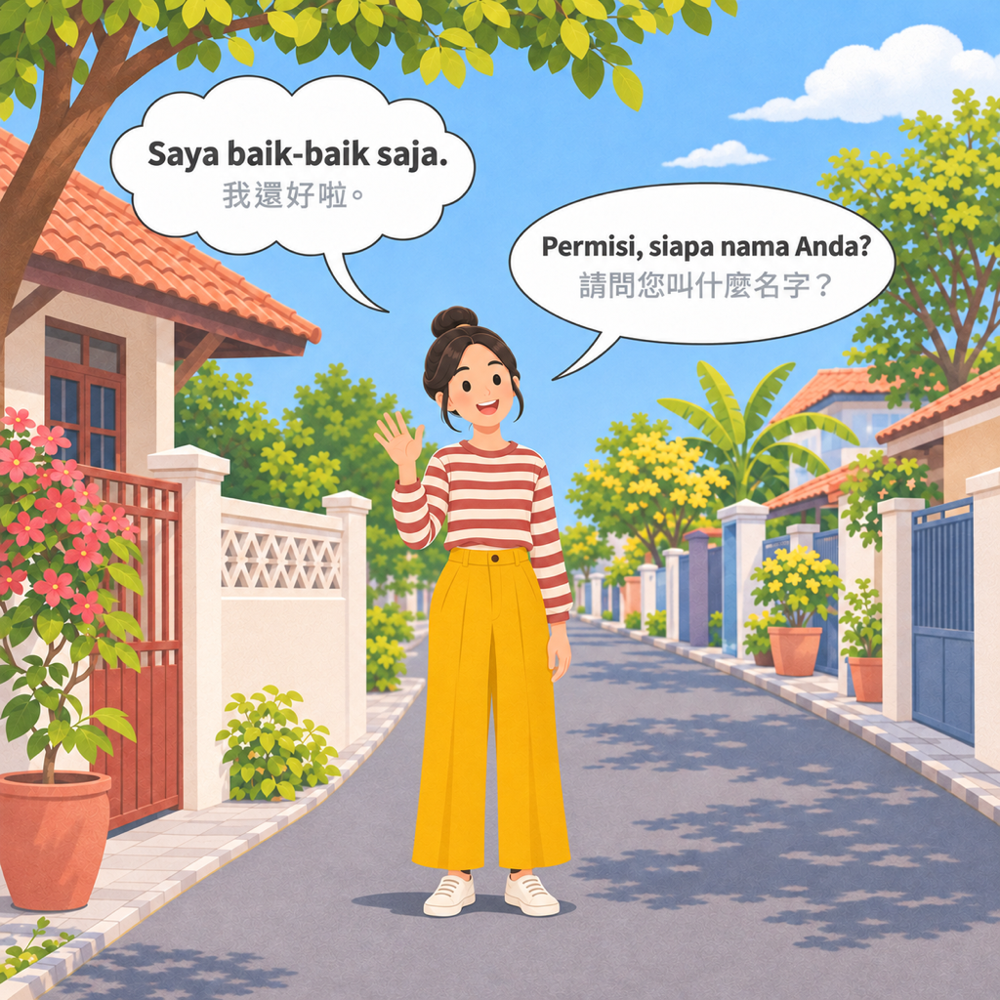
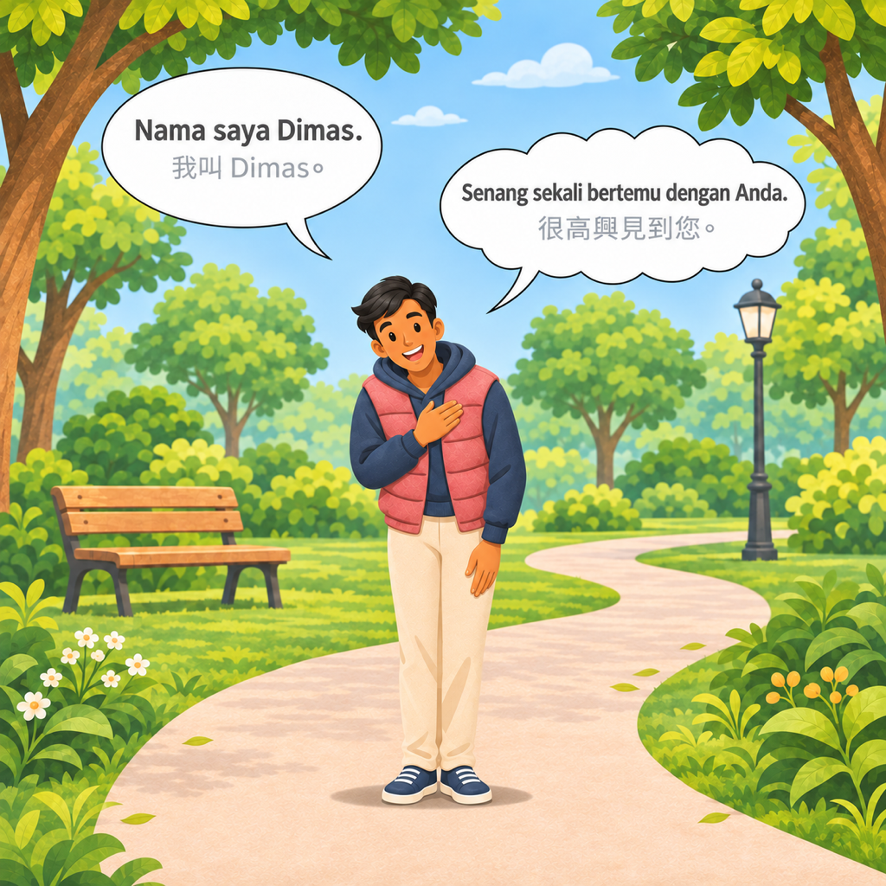
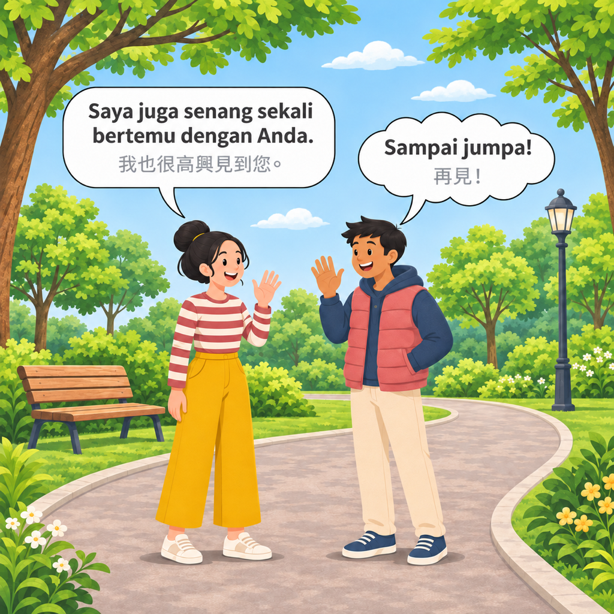
:::

## 單字

### 人稱代名詞

印尼語的**我**和**你**，依場合分成正式與口語兩種說法：

| 意思 | 正式 | 口語 |
|---|---|---|
| 我 | saya | aku、gue |
| 你／您 | kamu、Anda | engkau、kau |

Anda 是比較尊敬的**您**，kamu 則是一般的**你**。

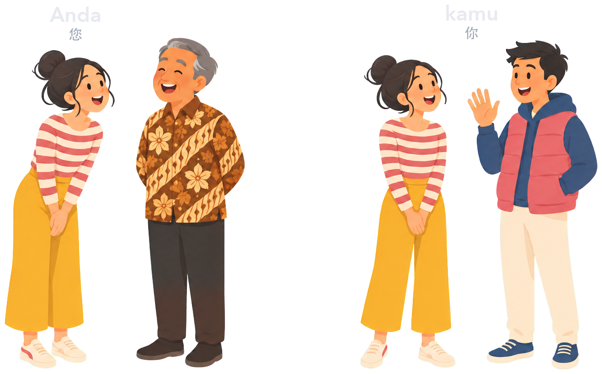

### 稱謂

稱呼對方時，可以把稱謂加在句尾：Bapak（簡稱 Pak）用於男性，Ibu 用於女性。

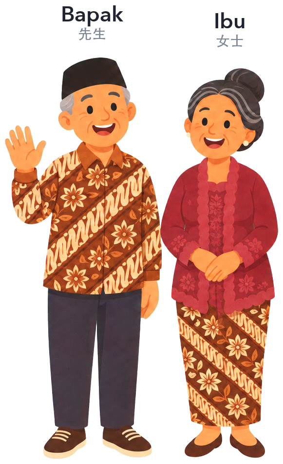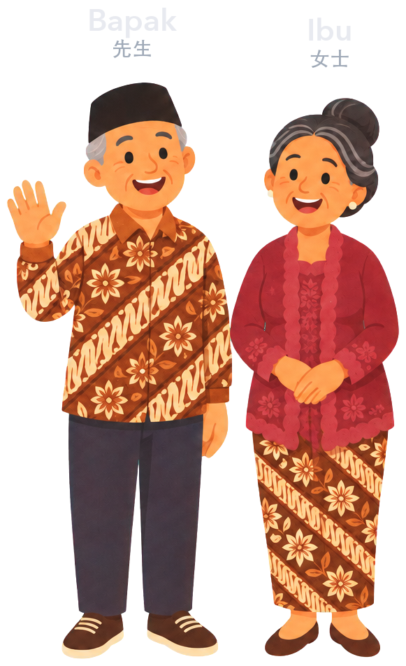

## 文法

### 是非問句

Apa 放在句首，表示這是一個是非問句。句尾的 saja 原意是**只是**，在這裡讓整句帶有**嗎**的語氣。

### 回答句型

回答時把主詞換成 saya（我），句尾的 saja 則帶有**啦**的語氣。回答名字時，用 nama saya（我的名字）接上名字。回應對方的話時，可以在主詞後面加上 juga（也）。

## 片語

### 詢問近況

::: {.gloss}
Apa=什麼／是否 kamu=你 baik-baik=還好 saja?=只是
:::

意思是**你還好嗎？**回答是：

> *Saya baik-baik saja.*
>
> 我還好啦。

### 詢問名字

::: {.gloss}
Permisi,=請問／不好意思 siapa=誰 nama=名字 Anda,=您 Bapak?=先生
:::

意思是**請問您叫什麼名字？**回答是：

> *Nama saya Dimas.*
>
> 我叫 Dimas。

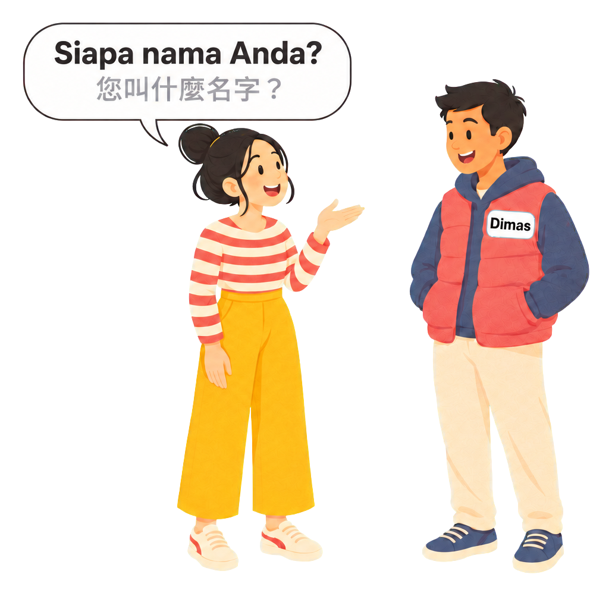

### 初次見面

::: {.gloss}
Senang=開心 sekali=很 bertemu=見到 dengan=跟 Anda.=您
:::

意思是**很高興見到您**。對方這樣說的時候，這樣回應：

> *Saya juga senang sekali bertemu dengan Anda.*
>
> 我也很高興見到您。

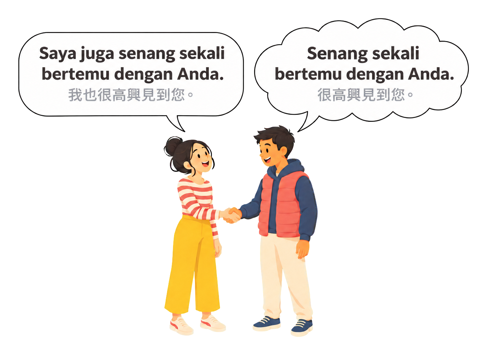

### 時段問候

Selamat 的意思是祝福、平安、沒事，後面接上不同的詞，就變成各種問候語：

| 說法 | 意思 |
|---|---|
| Selamat pagi | 早安 |
| Selamat siang | 午安（11:00～14:00） |
| Selamat sore | 下午好（14:00～18:00） |
| Selamat malam | 晚上好（18:00～） |
| Selamat tidur | 晚安（睡前） |

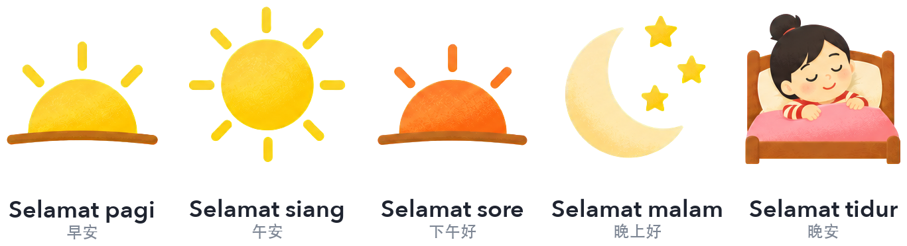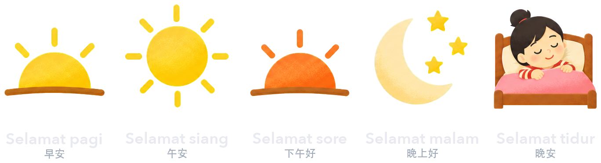

### 道別

Selamat 後面接 jalan 或 tinggal，也可以用來道別。另外還有兩種不用 Selamat 的說法：

| 說法 | 意思 |
|---|---|
| Selamat jalan | 再見（慢走） |
| Selamat tinggal | 再見（離別） |
| Sampai jumpa | 再見（下次見） |
| Dadah | 再見（口語） |

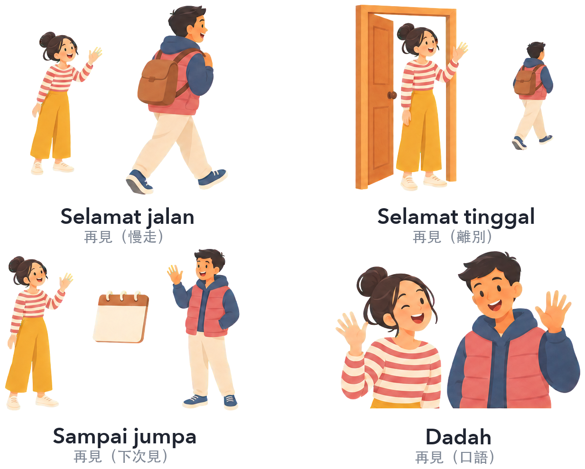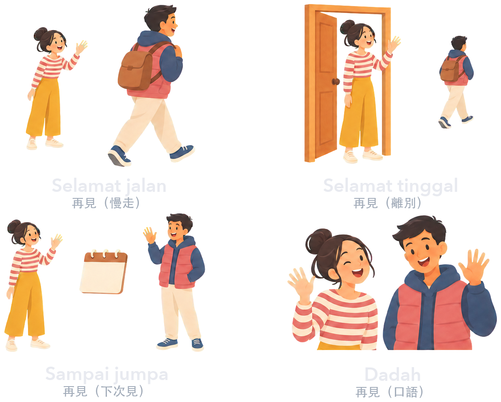
