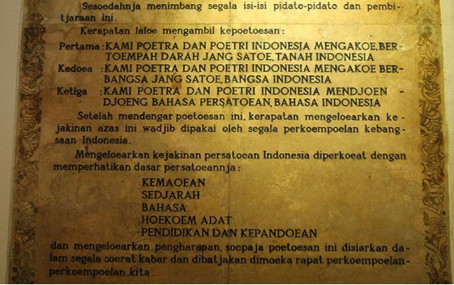
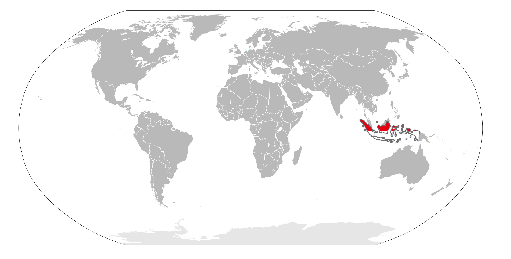
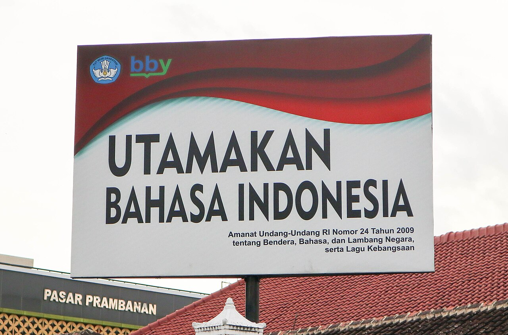

我開始學印尼語了！

之後每次學到的內容，都會整理成筆記放在這個系列裡。這是這個系列的第一篇，在開始正式的筆記之前，先來認識印尼語是什麼樣的語言，再看看它的發音規則～

## 認識印尼語

印尼語（Bahasa Indonesia）是印尼的官方語言，源自 1928 年 10 月 28 日青年誓言（Sumpah Pemuda）中確立的統一語言，也是各族群之間的溝通工具 @citep[uu242009|Pasal 25]。誓言的第三條是尊崇統一的語言，也就是印尼語：

::: {#fig-pledge}
{width=560}

青年誓言的條文，第三條是尊崇統一的語言：印尼語。Sania Amalia，來自 [Wikimedia Commons](https://commons.wikimedia.org/wiki/File:Youthpledge.jpg)（CC BY-SA 4.0）
:::

使用人數方面，Wikipedia 條目引用 Ethnologue 在 2026 年的數字，印尼語的使用者約 2.7 億人，其中母語者約 8,000 萬、第二語言使用者約 1.9 億 @citep[wikiindo]。不過不同來源的母語者人數出入不小，這些數字只能當作參考。以印尼語為國語的是印尼，在@fig-map中用國旗的紅白兩色標出。

::: {#fig-map}
{width=640}

印尼語為國語的國家（印尼）。改色自 Ichwan Palongengi 的作品，來自 [Wikimedia Commons](https://commons.wikimedia.org/wiki/File:Indonesian_Language_Map.svg)（CC BY-SA 3.0）
:::

印尼語屬於南島語系，與馬來語關係密切 @citep[soderberg2008]，書寫使用拉丁字母。字彙受到荷蘭語、爪哇語、阿拉伯語與梵語等語言影響。在印尼街頭，可以看到如@fig-sign這樣提醒大家優先使用印尼語的看板。

::: {#fig-sign}
{width=640}

日惹街頭的看板：*Utamakan Bahasa Indonesia*（優先使用印尼語）。Pinerineks，來自 [Wikimedia Commons](https://commons.wikimedia.org/wiki/File:Utamakan_Bahasa_Indonesia,_Yogyakarta.jpg)（CC BY-SA 4.0）
:::

## 印尼語的特色

對學中文與英文的人來說，印尼語有幾個比較好上手的地方，文法上的特色可參見@citet[sneddon2010]：

- **沒有聲調**：這一點與中文不同，不需要記每個字的聲調。
- **沒有文法上的性別**：例如 dia 不分**他**和**她**。
- **動詞不會依時間或人稱變化**：想表達時間，是在句子裡加上時間副詞，或是 sudah（已經）、akan（將要）這類的詞。
- **基本語序**：主詞、動詞、受詞（SVO），與中文、英文相同。

另外，印尼語常用重複詞來表示複數，例如 buku（書）重複成 buku-buku 就是**很多書**。不過重複詞不一定表示複數，像下一篇會出現的 baik-baik 是**還好**。

課本與正式場合用的是標準印尼語（baku），日常口語則和課本有不小的差別，例如 nggak 代替 tidak（不）、banget 代替 sangat（非常）@citep[sneddon2010]。我的筆記會把正式與口語的說法分開標示。

## 發音入門

下面用 IPA（國際音標）標示每個音，IPA 寫在斜線之間。標準印尼語的發音描述可參見@citet[soderberg2008]。

### 字母

印尼語使用與英文相同的 26 個拉丁字母，但唸法不一樣：

| 字母 | 簡易發音 | IPA | 字母 | 簡易發音 | IPA |
|---|---|---|---|---|---|
| Aa | ah | /a/ | Nn | en | /ɛn/ |
| Bb | bé | /be/ | Oo | oh | /o/ |
| Cc | ché | /tʃe/ | Pp | pé | /pe/ |
| Dd | dé | /de/ | Qq | ki | /ki/ |
| Ee | é | /e/ | Rr | er | /ɛr/ |
| Ff | ef | /ɛf/ | Ss | es | /ɛs/ |
| Gg | gé | /ɡe/ | Tt | té（似 d） | /te/ |
| Hh | ha | /ha/ | Uu | oo | /u/ |
| Ii | ee | /i/ | Vv | vé | /ve/ |
| Jj | jé | /dʒe/ | Ww | wé | /we/ |
| Kk | ka | /ka/ | Xx | iks | /ɪks/ |
| Ll | el | /ɛl/ | Yy | yé | /je/ |
| Mm | em | /ɛm/ | Zz | set | /sɛt/ |

### 母音

| 字母 | IPA |
|---|---|
| a | /a/ |
| i | /i/ |
| u | /u/ |
| o | /o/ |
| e | /e/、/ə/ |

字母 e 同時代表 /e/ 與 /ə/ 兩個音，字典有時會把 /e/ 寫成 é 來區分 @citep[soderberg2008]。/ə/ 是中央母音，發音像**呃**。

### 子音

大多數子音的唸法與英文接近，下表列出需要特別留意的：

| 拼寫 | IPA |
|---|---|
| c | /tʃ/ |
| j | /dʒ/ |
| y | /j/ |
| ny | /ɲ/ |
| ng | /ŋ/ |
| sy | /ʃ/ |
| kh | /x/ |
| r | /r/ |
| k（詞尾） | /ʔ/ |

幾點補充：

- ng 是一個音 /ŋ/，不是 /n/ 加 /g/。要唸出 /ŋɡ/，就要寫成 ngg。
- 詞尾的 k 不爆破，唸成喉塞音 /ʔ/，像是話到一半突然收住。有些外來詞與地方口音不會這樣唸 @citep[soderberg2008]。
- r 通常是顫音 /r/，有時會變成彈音 [ɾ] @citep[soderberg2008]。
- kh 只出現在外來詞，唸 /x/，現在常被 /k/ 取代 @citep[soderberg2008]。

### 雙母音

ai、au、oi 是三個雙母音，兩個母音連在一起唸成一個音節：

| 拼寫 | IPA |
|---|---|
| ai | /ai/ |
| au | /au/ |
| oi | /oi/ |

雙母音只出現在詞根的結尾 @citep[soderberg2008]。

## 參考文獻

[references]
