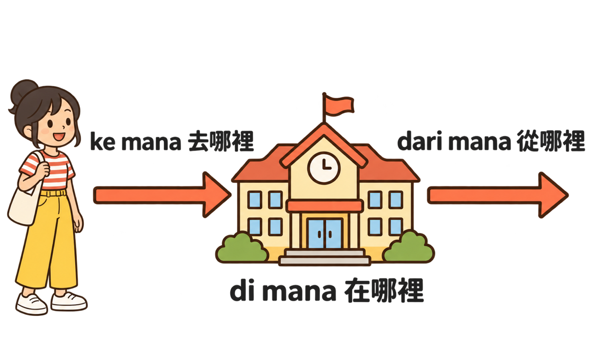

今天學了久別重逢時的問候，還有用 mana（哪裡）詢問地點的三種句型。先看一段把這些串起來的對話：

::: {.comic}

:::

## 單字

### 久別重逢

| 單字 | 意思 |
|---|---|
| lama | 久 |
| tidak | 不 |
| bertemu | 見面 |
| bagaimana | 如何 |
| kabar | 消息 |

### 地點與動詞

| 單字 | 意思 |
|---|---|
| mana | 哪裡 |
| pergi | 去 |
| tinggal | 居住、停留 |
| dekat | 附近 |
| mau | 想 |

### 常見地點

| 單字 | 意思 |
|---|---|
| sekolah | 學校 |
| pasar | 市場 |
| kantor | 辦公室 |

## 文法

### 以 mana 詢問地點

mana 的意思是**哪裡**。前面接上不同的介系詞，就能問不同的事：

- **ke mana**：去哪裡，表示目的地，搭配動詞 pergi（去）。
- **di mana**：在哪裡，表示所在位置，搭配動詞 tinggal（居住、停留）。
- **dari mana**：從哪裡，表示來源或出發地。

回答時只要把 mana 換成具體的地點，介系詞維持不變。

### 去哪裡：ke mana

問句中的 mau 是**想**，放在動詞前表示意願，也可以省略。回答時把 mana 換成地點，例如 sekolah（學校）。

### 在哪裡：di mana

回答時，di 後面接地名，也可以接 dekat sini（這附近）。

### 從哪裡：dari mana

回答時，dari 後面接地名，表示自己來自哪裡。

## 片語

### 久別重逢

::: {.gloss}
Hai,=嗨 lama=久 tidak=不 bertemu,=見面 bagaimana=如何 kabar?=消息
:::

意思是**嗨，好久不見，近況如何？**回答是：

::: {.gloss}
Baik-baik=還好 saja,=啦 kamu=你 apa=什麼 kabar?=消息
:::

意思是**我還不錯啊，你近況如何？**

### 去哪裡

::: {.gloss}
Kamu=你 (mau)=想 pergi=去 ke=到 mana?=哪裡
:::

意思是**你要去哪裡？**回答是：

> *Saya pergi ke sekolah.*
>
> 我去學校。

### 在哪裡

::: {.gloss}
Permisi,=請問 Ibu=女士 tinggal=居住 di=在 mana?=哪裡
:::

意思是**請問您住在哪裡？**回答是：

> *Saya tinggal di [地名].*
>
> 我住在 [地名]。

也可以回答：

> *Saya tinggal di dekat sini.*
>
> 我住在這附近。

### 從哪裡

::: {.gloss}
Kamu=你 dari=從 mana?=哪裡
:::

意思是**你從哪裡來？**回答是：

> *Saya dari [地名].*
>
> 我來自 [地名]。
