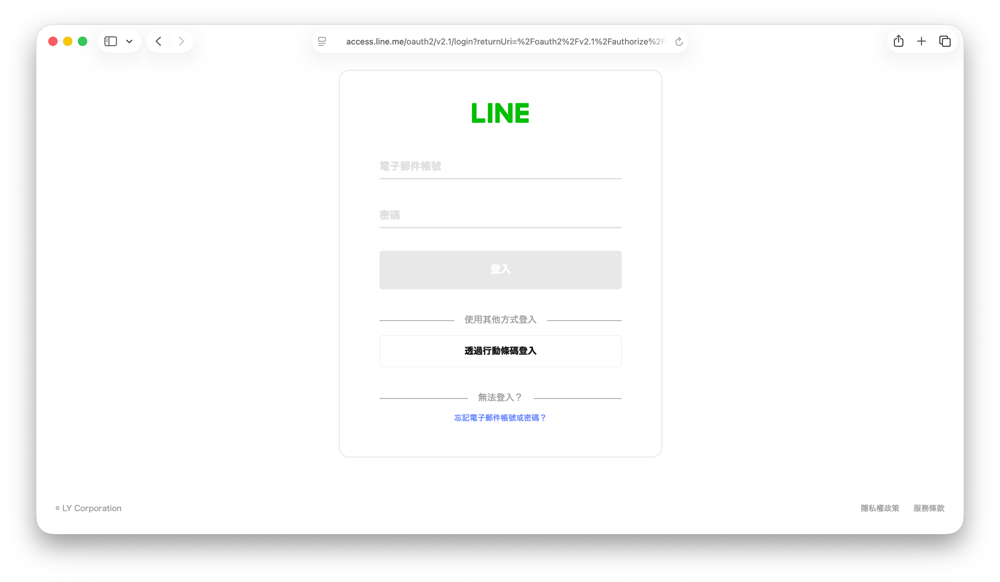
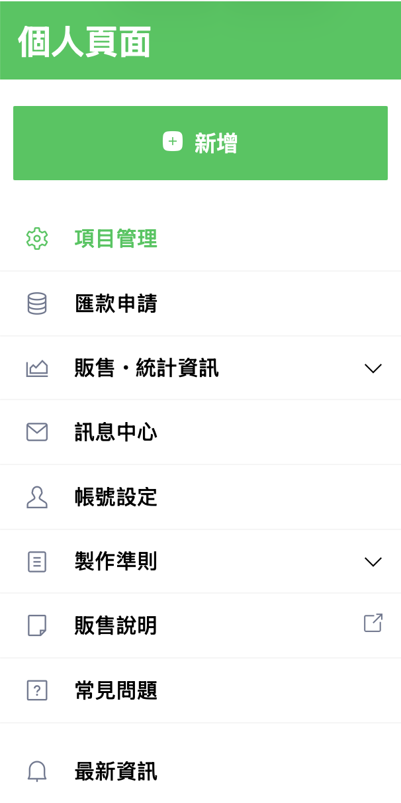
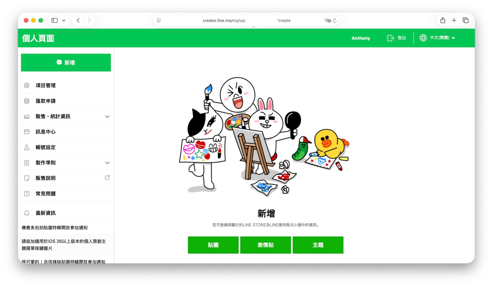
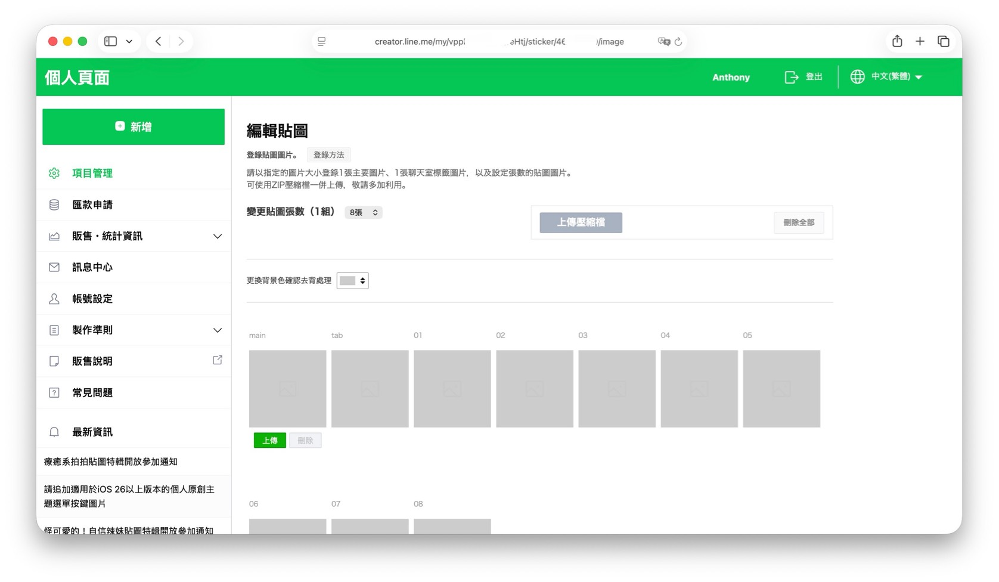
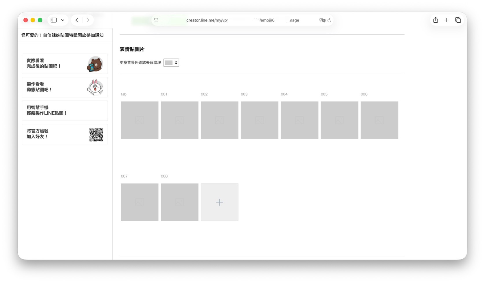
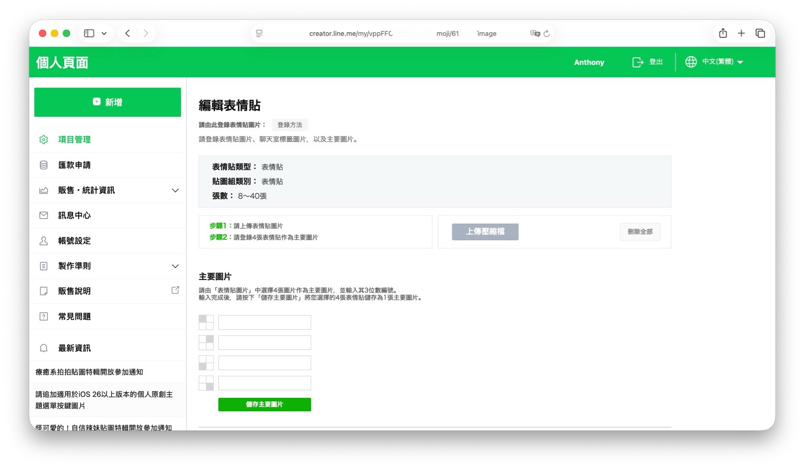

AI image generation is so easy now that making a picture takes a few minutes. But have you ever thought about turning those pictures into a way of expressing how you feel?

In this post I'll walk you through the whole process from scratch: creating the stickers/emoji, cropping them, and finally publishing your very own LINE stickers/emoji!

## AI Tools

Before we start, we need an AI helper. Common image generators include ChatGPT (OpenAI), Midjourney, Google Gemini, Stable Diffusion and more. Each has its own style and workflow, so just pick one you're comfortable with. I personally prefer OpenAI for image generation, so everything below uses ChatGPT.

## Sign Up for LINE Creators Market

To publish the stickers we made, we need to register at [LINE Creators Market](https://creator.line.me/en/). On the home page, click **Register here** in the middle of the screen:

<figure><figcaption>LINE Creators Market home page</figcaption></figure>

You'll then be redirected to the LINE login page. Sign in with your LINE account (you can also log in by scanning a QR code with the mobile app):

<figure><figcaption>LINE login page</figcaption></figure>

On your first login you'll need to fill in some basic information to create a creator account:

- Applicant name (must be in Japanese or English)
- Your name or shop name
- Phone number
- Address (must be in Japanese or English; you can use Chunghwa Post's [Chinese address to English translation](https://www.post.gov.tw/post/internet/Postal/index.jsp?ID=207) service)

Once you submit the form, your creator account is ready.

A quick note on the two ways to upload finished images:

1. Upload them directly on the LINE Creators Market page
2. Upload through the [LINE Camera](https://apps.apple.com/tw/app/line%E6%8B%8D%E8%B2%BC/id1239684967) app, which only works for stickers and does not support emoji

I'd still recommend uploading on the Creators Market page. Emoji review progress can be seen on the LINE official account, but not inside the LINE Camera app.

## Sticker and Emoji Specs

Before generating anything, get the differences between stickers and emoji straight. Otherwise you may find out the size is wrong after you're done, and all that work is wasted. The files you need to prepare are actually quite similar: both need a **main image** (`main.png`, the cover shown in the store listing) and a **chat room tab image** (`tab.png`, the small icon you see when switching sticker packs in a chat). It's not just stickers that need `tab.png`; emoji need one too:

| | Stickers | Emoji |
| --- | --- | --- |
| Main image `main.png` | 240 x 240 px | 240 x 240 px |
| Tab image `tab.png` | 96 x 74 px | 96 x 74 px |
| Each image | within 370 x 320 px | 180 x 180 px (no empty margin on any side) |
| Count | 8 / 16 / 24 / 32 / 40 | 8 to 40 |
| Format | PNG, transparent background, 72 dpi or higher | PNG, transparent background, 72 dpi or higher |
| File size | under 1 MB each | under 1 MB each |

For the full specs, see the official [sticker guidelines](https://creator.line.me/en/guideline/sticker/) and [emoji guidelines](https://creator.line.me/en/guideline/emoji/).

In short, the biggest difference is the **size of each image**. Stickers have a larger canvas (370 x 320 px), so you can leave some empty space around the character. Emoji are square (180 x 180 px), and the official rules ask for the artwork to fill the canvas with no margin on any of the four sides. Keep that in mind when generating and cropping.

## Generate the Images

I'll cover two ways: chatting with ChatGPT in the browser, and generating images with Codex in your terminal.

### ChatGPT in the Browser

Open your browser and go to [ChatGPT](https://chatgpt.com/), then enter the prompt below. The more detailed the prompt, the more stable and on-target the result, so fill in everything inside the square brackets `[ ]` before sending:

```plaintext
Please design a series of 10 LINE stickers/emoji with the following specs and requirements:

[Character]
- Main character: [person / animal / other, e.g. an orange Shiba Inu]
- Appearance: [hairstyle, outfit, accessories, etc. Keep them identical across all 10]
- Overall style: [e.g. chibi flat illustration, watercolor, meme style, 3D clay...]
- Main color palette: [e.g. pastel, Morandi, neon...]

[Content of each sticker] (generate all 10 in order, with the expression/action and text below)
1. Expression/action: [e.g. waving happily]   Text: "[Hello]"
2. Expression/action: [e.g. surprised]        Text: "[What!?]"
3. Expression/action: [            ]   Text: "[      ]"
4. Expression/action: [            ]   Text: "[      ]"
5. Expression/action: [            ]   Text: "[      ]"
6. Expression/action: [            ]   Text: "[      ]"
7. Expression/action: [            ]   Text: "[      ]"
8. Expression/action: [            ]   Text: "[      ]"
9. Expression/action: [            ]   Text: "[      ]"
10. Expression/action: [           ]   Text: "[      ]"

[Text rules]
- Language: [Traditional Chinese / Japanese / English]
- Font style: [cute handwriting / bold print]
- Text position: [bottom center / top left / bottom right]

[Technical specs]
- Background: fully transparent (cut out), no white or colored background
- Outline: [with / without] a white outline
- Size of each image: [stickers: within 370 x 320 px / emoji: 180 x 180 px, artwork must fill the canvas with no margin on any side]
- File format: PNG

[Consistency]
- Proportions, hairstyle and colors of the character must be identical across all 10; only the expression/action/text differ
- Avoid: background noise, extra text, distorted limbs, inconsistent style
```

If you want the stickers based on a specific picture, such as a photo of yourself, a friend or a pet, upload the picture first and add this line at the start of the prompt above:

```plaintext
Based on the image I uploaded, please design a series of 10 LINE stickers/emoji with the following specs and requirements:
```

In practice the browser version of ChatGPT can be a bit dull. If you ask for 10 images at once, it may suddenly say it can only generate a certain number, or the style and colors may drift from one image to the next. If the results look unstable, scale down to 2 or 3 at a time, and once the character design and art style are stable, fill in the rest batch by batch.

### Codex in the Terminal

First install the [Codex CLI](https://github.com/openai/codex) locally. Open a terminal and run the command for your OS:

<div class="tabset brand-tabset" id="os-tabset">
<div class="tabset-nav">
<button class="tabset-btn active" data-tab="macos"><svg class="tabset-icon"><use href="images/macos.svg#icon-macos"></use></svg>macOS</button>
<button class="tabset-btn" data-tab="linux"><svg class="tabset-icon"><use href="images/linux.svg#icon-linux"></use></svg>Linux</button>
<button class="tabset-btn" data-tab="windows"><svg class="tabset-icon"><use href="images/windows.svg#icon-windows"></use></svg>Windows</button>
</div>
<div class="tabset-panel active" data-tab="macos">

```bash
brew install --cask codex
```

</div>
<div class="tabset-panel" data-tab="linux">

```bash
curl -fsSL https://chatgpt.com/codex/install.sh | sh
```

</div>
<div class="tabset-panel" data-tab="windows">

```powershell
powershell -ExecutionPolicy ByPass -c "irm https://chatgpt.com/codex/install.ps1 | iex"
```

</div>
</div>

Once it's installed, create a folder and switch to it in the terminal (name it whatever you like; I'll use `line-sticker`):

```bash
mkdir line-sticker
cd line-sticker
```

Then type `codex` in the terminal to start a conversation with Codex in that folder, and paste in the same prompt from the ChatGPT section above. You can also ask Codex to create a subfolder to hold all the results and name the output files in a regular pattern (for example `sticker-01.png`, `sticker-02.png` in order), so they're easy to match up and track when you crop and remove backgrounds later:

```bash
ls stickers
```

When generation finishes, the folder will contain every sticker in order:

```plaintext
sticker-01.png  sticker-02.png  sticker-03.png  ...
```

Whether you're cropping, removing backgrounds or uploading to LINE Creators Market, just take the files from this folder.

## Crop the Images

AI-generated images rarely match LINE's size requirements exactly, so you need to crop them before uploading. Again there are two ways: crop by hand with a web tool, or batch process in the terminal with a CLI tool, which suits larger numbers of images better.

### Web Tool

If only a few images need cropping, an online tool such as [Photopea](https://www.photopea.com/) (a Photoshop-like editor that runs in the browser, no install needed) will do. Drag the image in, use **Image → Canvas Size** to set the size you need, and export as PNG when you're done.

### Batch Processing with the CLI

When there are many images, cropping them one by one gets tiring. Use the command-line tool [ImageMagick](https://imagemagick.org/) to batch process them. Open a terminal and install it with the command for your OS:

<div class="tabset brand-tabset" id="imagemagick-tabset">
<div class="tabset-nav">
<button class="tabset-btn active" data-tab="macos"><svg class="tabset-icon"><use href="images/macos.svg#icon-macos"></use></svg>macOS</button>
<button class="tabset-btn" data-tab="linux"><svg class="tabset-icon"><use href="images/linux.svg#icon-linux"></use></svg>Linux</button>
<button class="tabset-btn" data-tab="windows"><svg class="tabset-icon"><use href="images/windows.svg#icon-windows"></use></svg>Windows</button>
</div>
<div class="tabset-panel active" data-tab="macos">

```bash
brew install imagemagick
```

</div>
<div class="tabset-panel" data-tab="linux">

```bash
sudo apt-get install imagemagick
```

</div>
<div class="tabset-panel" data-tab="windows">

```powershell
choco install imagemagick -y
```

</div>
</div>

After installing, you can crop with the `magick` command. Stickers and emoji are cropped differently (emoji can't have margins on any side), so let's look at them separately:

<div class="tabset" id="crop-tabset">
<div class="tabset-nav">
<button class="tabset-btn active" data-tab="sticker">Sticker</button>
<button class="tabset-btn" data-tab="emoji">Emoji</button>
</div>
<div class="tabset-panel active" data-tab="sticker">

Go to the folder holding your stickers and crop to 370 x 320 px around the center of the image:

```bash
cd stickers
magick sticker-01.png -gravity center -crop 370x320+0+0 +repage sticker-01-cropped.png
```

To crop a whole folder to the same size, wrap it in a shell loop:

```bash
for f in sticker-*.png; do
  magick "$f" -gravity center -crop 370x320+0+0 +repage "cropped-$f"
done
```

</div>
<div class="tabset-panel" data-tab="emoji">

Emoji must fill the whole 180 x 180 px canvas with no margin on any side. If you crop straight from the center and the original isn't aligned, it's easy to end up with a transparent border. So instead, first scale the image up proportionally until it covers the whole canvas, then crop it to a square. The `^` in `-resize 180x180^` means scale to cover (rather than fit inside), and `-extent` trims whatever sticks out past the canvas:

```bash
cd emojis
magick emoji-01.png -resize 180x180^ -gravity center -extent 180x180 emoji-01-cropped.png
```

The same loop works for the whole folder:

```bash
for f in emoji-*.png; do
  magick "$f" -resize 180x180^ -gravity center -extent 180x180 "cropped-$f"
done
```

</div>
</div>

## Upload and Publish

Once every image is cropped and `main.png` and `tab.png` are ready, the last step is to go back to [LINE Creators Market](https://creator.line.me/en/), upload the whole set, fill in the product info and submit it for review. After it passes, it goes on sale!

After logging in, open your **personal page** from the top right and click the green **New** button at the top to start a new sticker/emoji item:

<figure><figcaption>LINE Creators Market personal page</figcaption></figure>

After clicking **New**, you'll see three options: **Stickers**, **Emoji** and **Themes**. Click the one that matches what you're publishing:

<figure><figcaption>Choose the type of item to create</figcaption></figure>

Next comes a pile of basic info: title, description, creator name, tags, copyright and so on. Most of it you can just fill in as the form asks. Two things are easy to miss:

- **AI usage label**: if the stickers/emoji were made with AI, be honest and tick the **Use of AI** option. After release, the store page shows a note that AI was used. LINE may ask for a record of your original prompts during review, and if you didn't tick it and get caught, the submission is more likely to be rejected.
- **Copyright field**: this field only accepts English letters, numbers and the symbols `©`, `™`, `®`, with a limit of 50 characters. The most common format is `Copyright©YourCreatorName` (for example `Copyright©Anthony`). Any name of your own will do, no need to overthink it.

### Upload the Stickers/Emoji

The upload screens for stickers and emoji differ, so let's look at them separately:

<div class="tabset" id="upload-tabset">
<div class="tabset-nav">
<button class="tabset-btn active" data-tab="sticker">Sticker</button>
<button class="tabset-btn" data-tab="emoji">Emoji</button>
</div>
<div class="tabset-panel active" data-tab="sticker">

The sticker upload screen is simpler. `main` (main image), `tab` (tab image) and `01` to `08` (the stickers themselves, as many as the set size you chose) are all on one page. You can click **Upload** for each one, or zip all the images and import them at once with **Upload ZIP** at the top right:

<figure><figcaption>The sticker edit page: upload main, tab and every sticker at once</figcaption></figure>

</div>
<div class="tabset-panel" data-tab="emoji">

Emoji upload has two steps. **Step 1** is uploading the `tab` image and every emoji image (`001` and up, depending on the count):

<figure><figcaption>Step 1: upload the tab image and all emoji images</figcaption></figure>

**Step 2** is picking 4 of the uploaded emoji to make up the **main image** shown on the store page. Type the 3-digit number of each image (for example `001`) in its field, then press **Save main image**:

<figure><figcaption>Step 2: pick 4 emoji to form the main image</figcaption></figure>

</div>
</div>

### Submit for Review

After uploading everything and double-checking the info, press **Submit** at the top right to send it for review. The official estimate is that review finishes within 10 days, but in practice most results arrive within two days of submitting (it still varies with the review queue and the number of images).

If it gets rejected, open **Message Center** in the left menu to see which images were judged NG and why. Adjust as suggested and resubmit; you don't need to re-upload the whole set.

Passing review **doesn't put it on sale right away**. You have to go back to **Item Management** on your personal page and press **Release** yourself before it starts selling. The official note says it takes about an hour to take effect, but in my experience it appears on LINE STORE within half an hour!

## Conclusion
