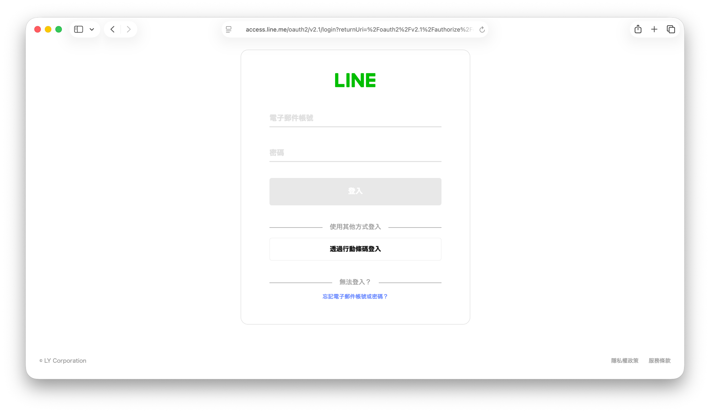
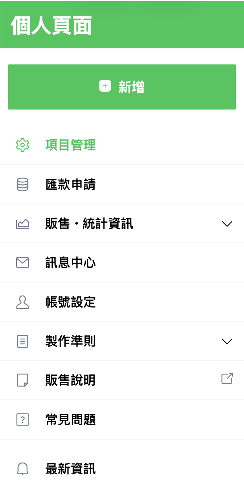
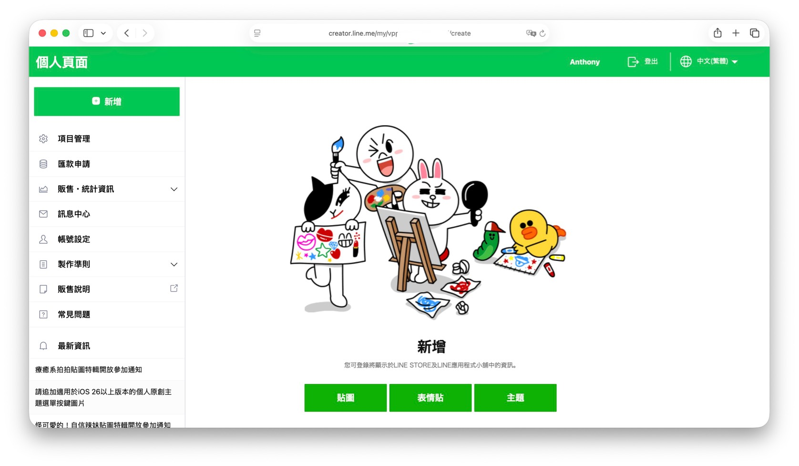
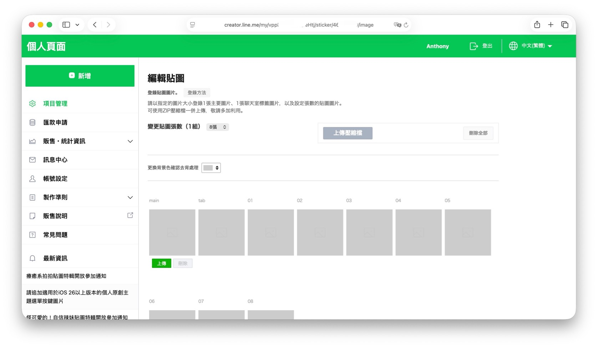
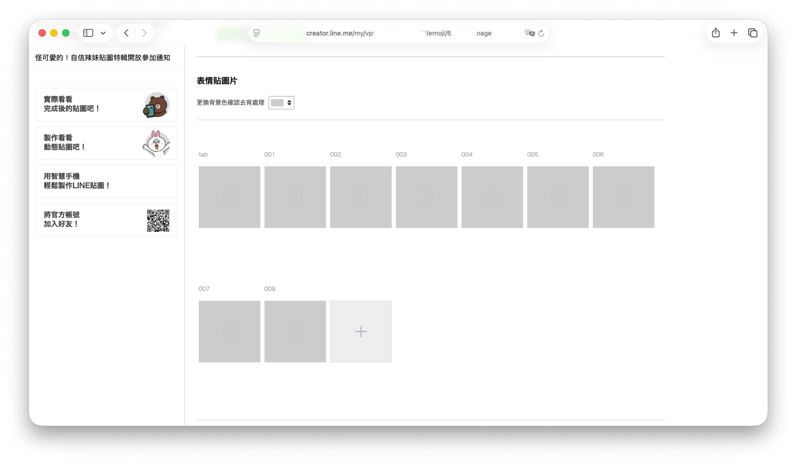
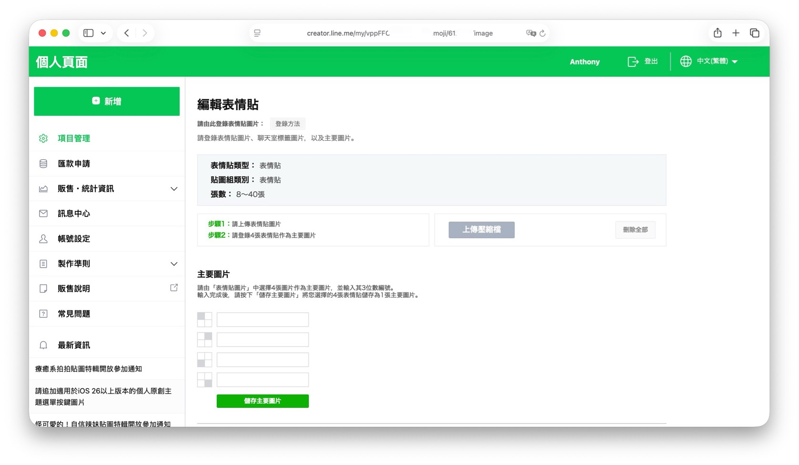

現在 AI 製圖很方便，隨手讓 AI 做個圖是幾分鐘的事。但你有沒有想過，可以把這些圖變成傳達情感的方式呢？

今天照片就要來教大家手把手從零開始，建立貼圖/表情貼，到裁切，最後上架你的專屬 Line 貼圖/表情貼！

## AI 工具

開始之前，需要先準備好我們的 AI 小幫手，常見的生圖工具有 ChatGPT（OpenAI）、Midjourney、Google Gemini、Stable Diffusion 等等，各家風格與使用方式都不太一樣，挑一個順手的就好。我自己個人比較喜歡用 OpenAI 來生圖，因此以下教學都會使用 ChatGPT 進行教學。

## 註冊 Line Creator

為了要上架我們做好的精美貼圖，我們需要到 [LINE Creators Market](https://creator.line.me/zh-hant/) 註冊，進到首頁後點擊畫面正中間的**請點此註冊**：

<figure><figcaption>LINE Creators Market 首頁</figcaption></figure>

接著會跳轉到 LINE 的登入頁面，輸入你的 LINE 帳號密碼登入即可（也可以用行動條碼掃描登入）：

<figure><figcaption>LINE 登入頁面</figcaption></figure>

首次登入後，需要填寫一些基本資訊才能建立創作者帳號，包含：

- 申請人姓名（須以日文或英文填寫）
- 姓名或店名
- 電話號碼
- 地址（須以日文或英文填寫，可用[郵局中文地址英譯](https://www.post.gov.tw/post/internet/Postal/index.jsp?ID=207)服務）

填完並送出後，創作者帳號就建立完成了。

先說明一下，上傳做好的圖有兩種方式：

1. 直接在 Line Creator 頁面上上傳圖片
2. 透過 [LINE 拍貼](https://apps.apple.com/tw/app/line%E6%8B%8D%E8%B2%BC/id1239684967)上傳圖片，但僅限貼圖，不支援表情貼的上傳

個人還是建議在 Line Creator 頁面上傳貼圖，因為表情貼的審核雖然可以在 Line 官方帳號看到申請進度，但是無法在 LINE 拍貼 App 看到。

## 貼圖與表情貼的尺寸規格

開始生圖之前，要先弄清楚貼圖跟表情貼的規格差異，不然生完才發現尺寸不對，等於白做工。兩者要準備的檔案結構其實很像，都需要**主圖**（`main.png`，上架後顯示在商店列表的封面圖）跟**聊天室標籤圖**（`tab.png`，也就是聊天室裡切換貼圖包時看到的小圖示），並不是只有貼圖才需要 `tab.png`，表情貼一樣要準備：

| | 貼圖 | 表情貼 |
| --- | --- | --- |
| 主圖 `main.png` | 240 x 240 px | 240 x 240 px |
| 標籤圖 `tab.png` | 96 x 74 px | 96 x 74 px |
| 本體圖片 | 370 x 320 px 以內 | 180 x 180 px（四邊不能留白） |
| 張數 | 8 / 16 / 24 / 32 / 40 張 | 8～40 張 |
| 格式 | PNG，透明背景，72dpi 以上 | PNG，透明背景，72dpi 以上 |
| 單張大小 | 小於 1MB | 小於 1MB |

完整規格分別可以參考官方的[貼圖製作準則](https://creator.line.me/zh-hant/guideline/sticker/)與[表情貼製作準則](https://creator.line.me/zh-hant/guideline/emoji/)。

簡單來說，貼圖跟表情貼最大的差別在**本體圖片的尺寸**：貼圖的畫布比較大（370 x 320 px），角色四周可以留一些空白；表情貼則是正方形（180 x 180 px），而且官方要求圖案要盡量佔滿整個畫布、四個邊都不能留白，這點在生圖跟裁切的時候要特別注意。

## 生圖囉～

以下會介紹兩種方式，第一種是直接在網頁跟 ChatGPT 進行對話，第二種則是在電腦的終端機透過 Codex 生圖。

### ChatGPT 網頁版

首先我們打開瀏覽器後進入 [ChatGPT](https://chatgpt.com/)，接著我們可以輸入以下的提示詞（提示詞越詳細，AI 生成的結果越穩定、越符合預期，建議把方括號 `[ ]` 裡的內容都填好再送出）：

```plaintext
請設計一套 10 張一系列的 LINE 貼圖/表情貼，規格與要求如下：

【主角設定】
- 主角：[人物 / 動物 / 其他角色描述，例如：一隻橘色柴犬]
- 外觀特徵：[髮型、服裝、配件等，10 張都要保持一致]
- 整體風格：[例如：Q 版扁平插畫、水彩手繪、迷因風、3D 黏土風...]
- 主色調：[例如：粉彩色系、莫蘭迪色系、螢光色系...]

【每張貼圖內容】（請依序生成 10 張，表情/動作與文字如下）
1. 表情/動作：[例如：開心揮手]　文字：「[你好]」
2. 表情/動作：[例如：驚訝]　　　文字：「[什麼！]」
3. 表情/動作：[            ]　文字：「[      ]」
4. 表情/動作：[            ]　文字：「[      ]」
5. 表情/動作：[            ]　文字：「[      ]」
6. 表情/動作：[            ]　文字：「[      ]」
7. 表情/動作：[            ]　文字：「[      ]」
8. 表情/動作：[            ]　文字：「[      ]」
9. 表情/動作：[            ]　文字：「[      ]」
10. 表情/動作：[           ]　文字：「[      ]」

【文字規範】
- 語言：[繁體中文 / 日文 / 英文]
- 字型風格：[手寫可愛字體 / 粗體印刷字體]
- 文字位置：[置中偏下 / 左上角 / 右下角]

【技術規格】
- 背景：純透明（去背），不要白色或彩色底
- 邊框：[需要 / 不需要] 白色描邊
- 單張尺寸：[貼圖：370 x 320 px 以內 / 表情貼：180 x 180 px，圖案需佔滿畫布、四邊不留白]
- 檔案格式：PNG

【一致性要求】
- 10 張貼圖的主角比例、髮型、配色需完全一致，只有表情/動作/文字不同
- 避免：背景雜訊、多餘文字、肢體扭曲變形、風格前後不一致
```

如果有想要根據特定的圖片生成，比如根據自己或朋友的照片、寵物的照片來設計貼圖，可以先把圖片上傳，再上述的提示詞前加入這句：

```plaintext
請根據我上傳的這張圖片，設計一套 10 張一系列的 LINE 貼圖/表情貼，規格與要求如下：
```

實測上，ChatGPT 網頁版有時候會呆呆的，一次要求生成 10 張的話，會突然跟你說只能生成特定張數的圖，或是會在風格、配色上出現前後不一致的狀況，如果發現生成結果不穩定，可以先縮小成一次 2～3 張，確認角色設定跟畫風穩定之後，再逐批補齊剩下的張數。

### Codex 終端機 CLI

首先我們需要在本地安裝 [Codex CLI](https://github.com/openai/codex)，依照作業系統打開終端機後輸入對應指令：

<div class="tabset brand-tabset" id="os-tabset">
<div class="tabset-nav">
<button class="tabset-btn active" data-tab="macos"><svg class="tabset-icon"><use href="images/macos.svg#icon-macos"></use></svg>macOS</button>
<button class="tabset-btn" data-tab="linux"><svg class="tabset-icon"><use href="images/linux.svg#icon-linux"></use></svg>Linux</button>
<button class="tabset-btn" data-tab="windows"><svg class="tabset-icon"><use href="images/windows.svg#icon-windows"></use></svg>Windows</button>
</div>
<div class="tabset-panel active" data-tab="macos">

```bash
brew install --cask codex
```

</div>
<div class="tabset-panel" data-tab="linux">

```bash
curl -fsSL https://chatgpt.com/codex/install.sh | sh
```

</div>
<div class="tabset-panel" data-tab="windows">

```powershell
powershell -ExecutionPolicy ByPass -c "irm https://chatgpt.com/codex/install.ps1 | iex"
```

</div>
</div>

安裝完成後，我們可以建立一個資料夾，並在終端機切過去（資料夾名稱自己取，這裡以 `line-sticker` 為例）：

```bash
mkdir line-sticker
cd line-sticker
```

接著在終端機輸入 `codex`，即可在該資料夾開啟與 Codex 的對話，把前面 ChatGPT 網頁版那份提示詞貼上去即可。這裡也可以請 Codex 幫忙建立一個子資料夾統一存放生成結果，並要求輸出的檔名依規律命名（例如 `sticker-01.png`、`sticker-02.png` 依序編號），之後要裁切、去背時才能一眼對應與追蹤：

```bash
ls stickers
```

生成完成後，資料夾裡就會依序排好每一張貼圖：

```plaintext
sticker-01.png  sticker-02.png  sticker-03.png  ...
```

不管是要裁切、去背，還是上傳到 Line Creator，都直接從這個資料夾裡拿檔案就好。

## 裁切圖片

AI 生成的圖片尺寸通常不會剛好符合 LINE 的規格要求，上傳前還需要裁切成正確的大小。這裡一樣介紹兩種方式，第一種是用網頁版工具手動裁切，第二種則是在終端機用 CLI 工具批次處理，比較適合圖片量比較多的情況。

### 網頁版工具

如果只有少數幾張圖片要裁切，可以用像 [Photopea](https://www.photopea.com/)（免安裝的網頁版 Photoshop）這類線上工具，把圖片拖進去之後，用**影像 → 畫布尺寸**調整成需要的尺寸，裁切完直接匯出成 PNG 即可。

### CLI 批次處理

如果圖片數量比較多，一張一張手動裁切太累人，可以改用 [ImageMagick](https://imagemagick.org/) 這套命令列工具批次處理。依照作業系統打開終端機後輸入對應指令安裝：

<div class="tabset brand-tabset" id="imagemagick-tabset">
<div class="tabset-nav">
<button class="tabset-btn active" data-tab="macos"><svg class="tabset-icon"><use href="images/macos.svg#icon-macos"></use></svg>macOS</button>
<button class="tabset-btn" data-tab="linux"><svg class="tabset-icon"><use href="images/linux.svg#icon-linux"></use></svg>Linux</button>
<button class="tabset-btn" data-tab="windows"><svg class="tabset-icon"><use href="images/windows.svg#icon-windows"></use></svg>Windows</button>
</div>
<div class="tabset-panel active" data-tab="macos">

```bash
brew install imagemagick
```

</div>
<div class="tabset-panel" data-tab="linux">

```bash
sudo apt-get install imagemagick
```

</div>
<div class="tabset-panel" data-tab="windows">

```powershell
choco install imagemagick -y
```

</div>
</div>

安裝完成後，就可以用 `magick` 指令裁切圖片了。貼圖跟表情貼的裁切方式不太一樣（表情貼四邊不能留白），分開來看：

<div class="tabset" id="crop-tabset">
<div class="tabset-nav">
<button class="tabset-btn active" data-tab="sticker">貼圖</button>
<button class="tabset-btn" data-tab="emoji">表情貼</button>
</div>
<div class="tabset-panel active" data-tab="sticker">

切到剛剛存放貼圖的資料夾，以圖片中心為基準，裁切成 370 x 320 px：

```bash
cd stickers
magick sticker-01.png -gravity center -crop 370x320+0+0 +repage sticker-01-cropped.png
```

如果整個資料夾都要裁切成同樣尺寸，可以搭配 shell 的迴圈一次處理完：

```bash
for f in sticker-*.png; do
  magick "$f" -gravity center -crop 370x320+0+0 +repage "cropped-$f"
done
```

</div>
<div class="tabset-panel" data-tab="emoji">

表情貼規定圖案要填滿整個 180 x 180 px 的畫布、四邊不能留白，如果直接從中心裁切，原圖沒對齊的話很容易切出透明邊框。這裡改用「先等比例放大到覆蓋整個畫布，再裁成正方形」的方式，`-resize 180x180^` 的 `^` 代表以覆蓋（而非塞入）的方式縮放，`-extent` 則是裁掉超出畫布的部分：

```bash
cd emojis
magick emoji-01.png -resize 180x180^ -gravity center -extent 180x180 emoji-01-cropped.png
```

同樣可以搭配迴圈批次處理整個資料夾：

```bash
for f in emoji-*.png; do
  magick "$f" -resize 180x180^ -gravity center -extent 180x180 "cropped-$f"
done
```

</div>
</div>

## 上傳與上架

裁切好所有圖片，也準備好 `main.png` 跟 `tab.png` 之後，最後一步就是回到 [LINE Creators Market](https://creator.line.me/zh-hant/) 把整套貼圖/表情貼上傳、填寫商品資訊，送出審核，通過後就會正式上架囉！

登入後點擊右上角進入**個人頁面**，點擊最上方綠色的**新增**按鈕，開始建立新的貼圖/表情貼項目：

<figure><figcaption>LINE Creators Market 個人頁面</figcaption></figure>

點擊**新增**後，會看到**貼圖**、**表情貼**、**主題**三個選項，依照這次要上架的類型點選對應的按鈕即可：

<figure><figcaption>選擇要新增的項目類型</figcaption></figure>

進去之後會有一堆基本資訊要填，像是標題、說明、創意人名稱、標籤、版權等等，大部分照著表單填就好，這裡特別提醒兩個容易漏掉的地方：

- **使用 AI 標籤**：如果貼圖/表情貼是用 AI 生成的，記得誠實勾選**使用 AI**這個選項，上架後商店頁面會顯示已使用 AI 製作的標示。LINE 審核時可能會要求提供當初下的提示詞紀錄，沒勾選被抓到的話反而容易被退件。
- **版權欄位**：這欄只能輸入英文、數字，以及 `©`、`™`、`®` 三種符號，字數上限 50 字，最常見的填法是 `Copyright©你的英文創作者名稱`（例如 `Copyright©Anthony`），隨便填一個屬於自己的名稱就好，不需要想太多。

### 上傳貼圖/表情貼

貼圖跟表情貼的上傳介面不太一樣，這裡分開來看：

<div class="tabset" id="upload-tabset">
<div class="tabset-nav">
<button class="tabset-btn active" data-tab="sticker">貼圖</button>
<button class="tabset-btn" data-tab="emoji">表情貼</button>
</div>
<div class="tabset-panel active" data-tab="sticker">

貼圖的上傳介面比較單純，`main`（主圖）、`tab`（標籤圖）跟 `01`～`08`（貼圖本體，張數依你選擇的組數而定）都在同一頁，可以逐張點擊**上傳**，也可以把所有圖片打包成一個 ZIP 檔，直接用右上角的**上傳壓縮檔**一次匯入：

<figure><figcaption>編輯貼圖頁面，一次上傳 main、tab 與全部貼圖</figcaption></figure>

</div>
<div class="tabset-panel" data-tab="emoji">

表情貼的上傳分成兩個步驟。**步驟 1** 是先把 `tab`（標籤圖）跟每一張表情貼圖片（`001`～依張數而定）上傳上去：

<figure><figcaption>步驟 1：上傳 tab 與所有表情貼圖片</figcaption></figure>

**步驟 2** 則是從剛剛上傳的表情貼圖片中，挑 4 張拼成商店頁面顯示用的**主要圖片**，只要在對應欄位輸入圖片的 3 位數編號（例如 `001`），再按**儲存主要圖片**即可：

<figure><figcaption>步驟 2：挑選 4 張表情貼組成主要圖片</figcaption></figure>

</div>
</div>

### 送出審核

圖片都上傳完、資訊也確認無誤之後，就可以按右上角的**送出申請**送審。官方說審核作業預計 10 天內完成，但實務上大部分都會在送出後兩天內就有結果（審核時間仍會因為送審量、圖片數量而有落差）。

如果被退件，可以到左側選單的**訊息中心**查看哪幾張圖片被判定 NG、以及退件原因，照著建議調整後重新送出審核即可，不用整包重新上傳。

審核通過後**還不會馬上上架**，要自己回到個人頁面的**項目管理**畫面，手動點擊**上架**按鈕才會開始販售。官方說明生效大約需要 1 小時，但實測通常半小時內就會出現在 LINE STORE 上了！

## 結語

從發想、生圖、裁切到送審上架，整個流程其實比想像中簡單，最花時間的反而是想角色設定跟每一張的表情/文字。如果第一次做出來的成果不滿意，別氣餒，多換幾組提示詞、多試幾次風格，很快就能抓到跟 AI 溝通的手感。祝大家都能做出自己滿意的 LINE 貼圖/表情貼！