::: {#fig-eye}
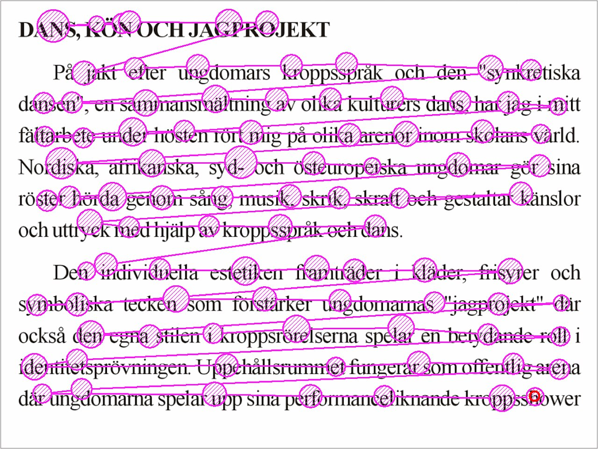{width=640}

Eye movements while reading a page of text, from [Wikimedia Commons](https://commons.wikimedia.org/wiki/File:Reading_Fixations_Saccades.jpg) (public domain)
:::

Have you ever decided whether to read a post from the **about $N$ minutes** line under its title? That number is usually a word count divided by one fixed speed, yet some people read fast and some slowly, and code and images are not timed by word count at all.

My blog shows a suggested reading time on every post too, which got me wondering:

> *Is the suggested reading time actually accurate?*

This post runs no experiment. It uses public eye-tracking data to check whether my blog's estimate holds up, and to produce a range of times instead of a single number.

## Suggested Reading Time

How is that number usually worked out? Take Medium: @citet[medium2026readtime] says that English posts are timed at about 265 words per minute, an average adult's speed, and Chinese, Japanese and Korean posts at 500 characters per minute, with an adjustment for the number of images.


### The Current Formula

My blog follows the same idea, with a few extra coefficients:

- Chinese posts count only Chinese characters, at 400 per minute; English posts count words, at 200 per minute.
- Code is read at 40 lines per minute.
- Each level-3 heading adds 20 seconds, each level-4 heading 10 seconds.
- The three parts are multiplied by weights, 1.5 for text, 1.2 for headings and 1.3 for code, then summed, rounded up to a whole minute, with a minimum of 1 minute.

Let $C$ be the number of Chinese characters, $L$ the number of code lines, and $h_3$ and $h_4$ the heading counts. For a Chinese post the number of minutes is:

$$
T = \left\lceil 1.5 \cdot \frac{C}{400} + 1.3 \cdot \frac{L}{40} + 1.2 \cdot \frac{20\,h_3 + 10\,h_4}{60} \right\rceil
$$

Fold the weights into the speeds and the formula actually assumes a reading speed of $400 \div 1.5 \approx 267$ characters per minute for prose, and $60 \div (40 \div 1.3) \approx 1.95$ seconds per line of code. The weights were set by feel; no data stands behind them.

### Possible Errors

Behind the formula are three assumptions, and any of them may be wrong:

1. **A typical reader reads 267 Chinese characters per minute.** How many characters per minute does a Chinese reader actually read in an article?
2. **A line of code takes about 2 seconds.** Code is slower to read than prose, but how much slower?
3. **One number fits every reader.** How far apart are fast and slow readers on the same post? If the gap is large, a single number will be off for many readers.

## Data Sources

To answer these three questions, someone has to have actually measured how fast people read. Fortunately, reading researchers have run plenty of eye-tracking experiments, and some teams have made their data public. I used four datasets: two of Chinese readers reading texts, one of English readers reading whole articles, and one of software engineers reading code.

Speed is worked out the obvious way: how many characters (or words) were read, divided by how many minutes it took. Each dataset comes with a table and a distribution chart, and the tables count every single reading. The column worth watching is the **median**: line up all the readings from slowest to fastest, and it is the speed of the one in the middle. The 5% and 95% columns mark where the middle nine tenths fall.

One catch: the same person usually reads several texts, so people who read more show up more often in the tables. So when I project reading times later, I first take each person's own median as that person's usual speed, then take the median across people, so that everyone gets one vote.

::: {#fig-lab}
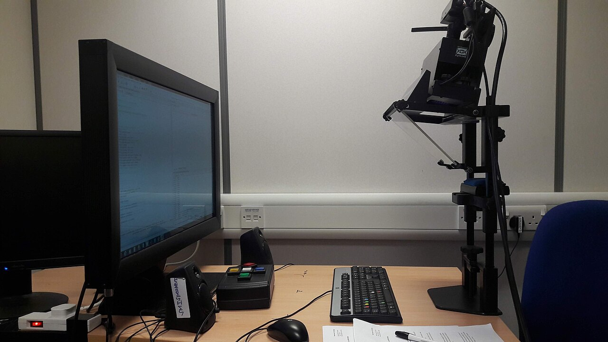{width=640}

A screen and an eye tracker used in eye-tracking experiments, from [Wikimedia Commons](https://commons.wikimedia.org/wiki/File:Eye_tracker.jpg) (CC BY-SA 4.0)
:::

### Chinese Reading Corpora

**The Hong Kong Corpus of Chinese Sentence and Passage Reading (HKC)** @citep[wu2023hkc]: 98 native Chinese-speaking adults, each reading 300 single-line sentences and 7 multi-line passages, in simplified Chinese. I use only the 7 passages, 985 to 2,254 characters each, 686 readings in all.

One caveat: HKC records the total time the eyes rest on the text. The jumps between positions and the blinks are not counted, so speeds computed from it run high, and as a time it is a **lower bound** of true reading time.

| Item | Readers | Readings | Mean | SD | Median | 5% | 25% | 75% | 95% |
|---|---|---|---|---|---|---|---|---|---|
| Chars/min | 98 | 686 | 979 | 441 | 896 | 457 | 658 | 1,181 | 1,767 |

::: {#fig-hkc}
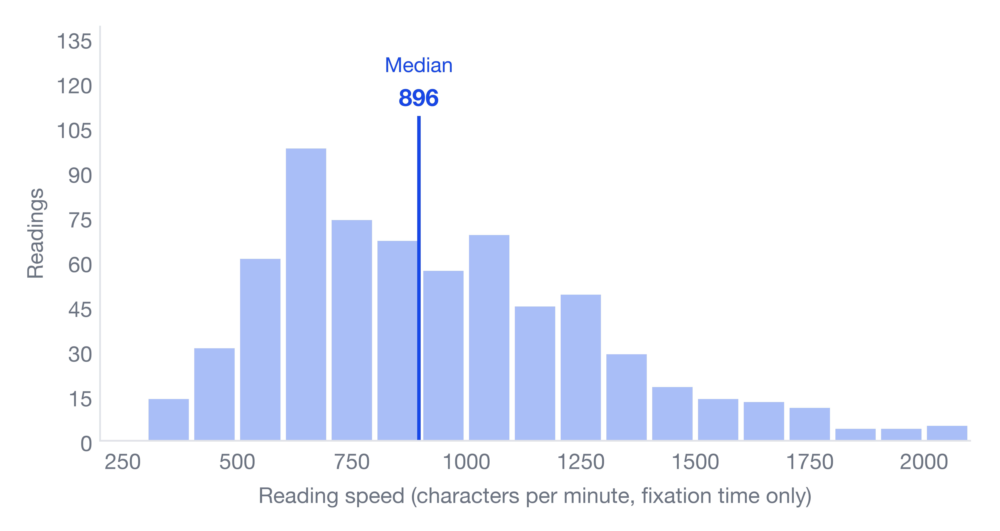{width=640}
:::

**Wave 2 of the Multilingual Eye-Movement Corpus (MECO)** @citep[siegelman2025meco]: 654 readers, 13 languages, each reading 12 short Wikipedia-style texts of about 260 to 370 characters. 77 of the readers read Chinese, in two groups: `ch_t` (38 readers) read the traditional version and `ch_s` (39 readers) the simplified one.

| Label | Readers | Readings | Mean | SD | Median | 5% | 25% | 75% | 95% |
|---|---|---|---|---|---|---|---|---|---|
| `ch_t` | 38 | 297 | 509 | 184 | 461 | 289 | 376 | 611 | 861 |
| `ch_s` | 39 | 325 | 662 | 252 | 609 | 322 | 500 | 799 | 1,148 |

::: {#fig-meco}
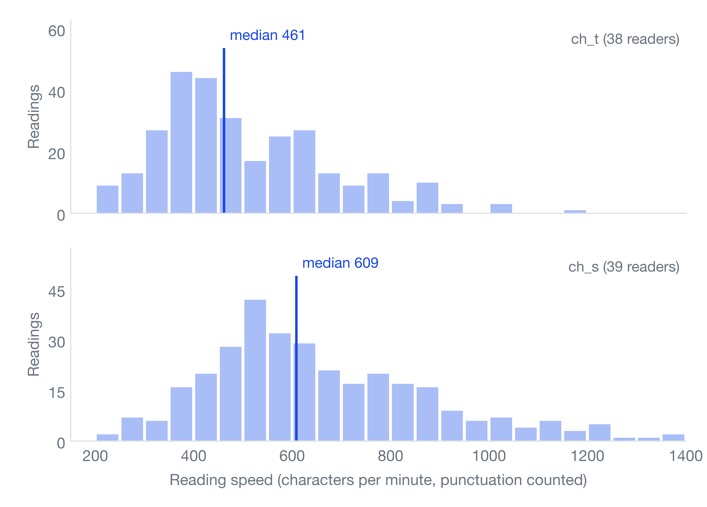{width=640}
:::

### Whole-Article Reading Time in English

**DocumentReadingTime** @citep[weller2020reading] is an online experiment run on Amazon Mechanical Turk, a crowdsourcing platform. Participants first answered a few basic questions such as age and gender, then read one English article at their normal pace and answered some comprehension questions. Those who got them wrong were dropped, as were those who stayed on the article page for an unrealistically short or long time. The data record how many seconds each participant spent on the article page.

There are 32 articles on health or technology topics, written as blog posts or news pieces. They run from 342 to 1,319 words, with a median of 759. Each participant read only one article, and each article was read by 33 to 38 people, 1,130 readings in all.

| Item | Readings | Mean | SD | Median | 5% | 25% | 75% | 95% |
|---|---|---|---|---|---|---|---|---|
| Words/min | 1,130 | 276 | 95 | 258 | 152 | 207 | 332 | 451 |
| Seconds | 1,130 | 192 | 85 | 178 | 84 | 130 | 237 | 354 |

::: {#fig-wdist}
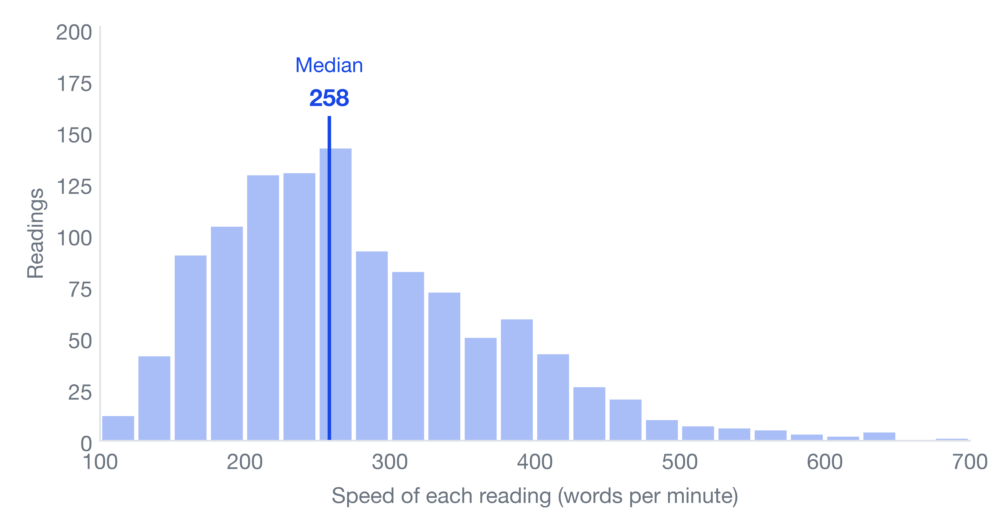{width=640}
:::

### Code Reading Data

**EMIP** @citep[bednarik2020emip]: 216 software engineers, with programming experience from none to senior. Each read two short programs and then answered one multiple-choice question about what the program does, with no time limit. Each program comes in a Java, a Python and a Scala version, and each participant read the versions of one language only.

:::: {.tabs}
# Java
207 participants read the Java version.

::: {.tabs}
## Rectangle
Works out a rectangle's width, height and area from the coordinates of two corners, 18 lines.

```java
public class Rectangle {
    private int x1 , y1 , x2 , y2 ;
    public Rectangle ( int x1 , int y1 , int x2 , int y2 ) {
        this.x1 = x1 ;
        this.y1 = y1 ;
        this.x2 = x2 ;
        this.y2 = y2 ;
    }
    public int width ( ) { return this.x2 - this.x1 ; }
    public int height ( ) { return this.y2 - this.y1 ; }
    public double area ( ) { return this.width ( ) * this.height ( ) ; }
    public static void main ( String [ ] args ) {
        Rectangle rect1 = new Rectangle ( 0 , 0 , 10 , 10 ) ;
        System.out.println ( rect1.area ( ) ) ;
        Rectangle rect2 = new Rectangle ( 5 , 5 , 10 , 10 ) ;
        System.out.println ( rect2.area ( ) ) ;
    }
}
```

After reading, the participants saw this multiple-choice question:

1. The program computes the area of rectangles by multiplying their width (x1-x2) and height (y1-y2).
2. **The program computes the area of rectangles by multiplying their width (x2-x1) and height (y2-y1).**
3. The program computes the area of rectangles by multiplying their width (x1-y1) and height (x2-y2).
4. I'm not sure.

## Vehicle
Stores the maker, model and top speed; accelerating adds to the speed but stops at the top speed, 22 lines.

```java
public class Vehicle {
    String producer , type ;
    int topSpeed , currentSpeed ;

    public Vehicle ( String p , String t , int tp ) {
        this.producer = p ;
        this.type = t ;
        this.topSpeed = tp ;
        this.currentSpeed = 0 ;
    }

    public int accelerate ( int kmh ) {
        if ( ( this.currentSpeed + kmh ) > this.topSpeed ) {
            this.currentSpeed = this.topSpeed ;
        } else {
            this.currentSpeed = this.currentSpeed + kmh ;
        }
        return this.currentSpeed ;
    }

    public static void main ( String args [ ] ) {
        Vehicle v = new Vehicle ( "Audi" , "A6" , 200 ) ;
        v.accelerate ( 10 ) ;
    }
}
```

After reading, the participants saw this multiple-choice question:

1. This program defines a vehicle by a producer, that has a type and can reduce its speed.
2. This program defines a vehicle by a producer, that has a type and can accelerate its speed.
3. **This program defines a vehicle by a producer, that has a type and can accelerate and reduce the speed.**
4. I'm not sure.
:::

# Python
5 participants read the Python version.

::: {.tabs}
## Rectangle
Works out a rectangle's width, height and area from the coordinates of two corners, 13 lines.

```python
class Rectangle :
    def __init__ (self , x1 , y1 , x2 , y2 ) :
        self.x1 = x1
        self.y1 = y1
        self.x2 = x2
        self.y2 = y2
    def width ( self ) : return self.x2 - self.x1
    def height ( self ) : return self.y2 - self.y1
    def area ( self ) : return self.width ( ) * self.height ( )
rect1 = Rectangle ( 0 , 0 , 10 , 10 )
print rect1.area ( )
rect2 = Rectangle ( 5 , 5 , 10 , 10 )
print rect2.area ( )
```

After reading, the participants saw this multiple-choice question:

1. The program computes the area of rectangles by multiplying their width (x1-x2) and height (y1-y2).
2. **The program computes the area of rectangles by multiplying their width (x2-x1) and height (y2-y1).**
3. The program computes the area of rectangles by multiplying their width (x1-y1) and height (x2-y2).
4. I'm not sure.

## Vehicle
Stores the maker, model and top speed; accelerating adds to the speed but stops at the top speed, 14 lines.

```python
class Vehicle :

    def __init__ ( self , p , t , tp ) :
        self.producer = p
        self.vtype = t
        self.topSpeed = tp
        self.currentSpeed = 0

    def accelerate ( self , kmh ) :
        if ( self.currentSpeed + kmh ) > self.topSpeed :
            self.currentSpeed = self.topSpeed
        else :
            self.currentSpeed = self.currentSpeed + kmh
        return self.currentSpeed

v = Vehicle ( "Audi" , "A6" , 200 )
v.accelerate ( 10 )
```

After reading, the participants saw this multiple-choice question:

1. This program defines a vehicle by a producer, that has a type and can reduce its speed.
2. This program defines a vehicle by a producer, that has a type and can accelerate its speed.
3. **This program defines a vehicle by a producer, that has a type and can accelerate and reduce the speed.**
4. I'm not sure.
:::

# Scala
4 participants read the Scala version.

::: {.tabs}
## Rectangle
Works out a rectangle's width, height and area from the coordinates of two corners, 11 lines.

```scala
class Rectangle (val x1: Int, val y1: Int, val x2: Int, val y2: Int) {
  def width = this.x2 - this.x1
  def height = this.y2 - this.y1
  def area = this.width * this.height
}
object RectangleApp extends App {
  val rect1 = new Rectangle(0, 0, 10, 10)
  println(rect1.area)
  val rect2 = new Rectangle(5, 5, 10, 10)
  println(rect2.area)
}
```

After reading, the participants saw this multiple-choice question:

1. The program computes the area of rectangles by multiplying their width (x1-x2) and height (y1-y2).
2. **The program computes the area of rectangles by multiplying their width (x2-x1) and height (y2-y1).**
3. The program computes the area of rectangles by multiplying their width (x1-y1) and height (x2-y2).
4. I'm not sure.

## Vehicle
Stores the maker, model and top speed; accelerating adds to the speed but stops at the top speed, 18 lines.

```scala
class Vehicle (p: String, t: String, tp: Int){
  val producer = p
  val vtype = t
  val topSpeed = tp
  var currentSpeed = 0

  def accelerate(kmh: Int) = {
    if ((this.currentSpeed + kmh) > this.topSpeed) {
      this.currentSpeed = this.topSpeed
    } else {
      this.currentSpeed = this.currentSpeed + kmh
    }
    this.currentSpeed
  }
}

object VehicleApp extends App {
  val v = new Vehicle("Audi", "A6", 200)
  v.accelerate(10)
}
```

After reading, the participants saw this multiple-choice question:

1. This program defines a vehicle by a producer, that has a type and can reduce its speed.
2. This program defines a vehicle by a producer, that has a type and can accelerate its speed.
3. **This program defines a vehicle by a producer, that has a type and can accelerate and reduce the speed.**
4. I'm not sure.
:::
::::

I take the time from **the code appearing on screen to the answer screen**. Besides reading, it includes looking back and thinking about the answer, so it is not pure reading time. All 432 readings were usable; none was excluded.

| Item (seconds) | Readers | Readings | Mean | SD | Median | 5% | 25% | 75% | 95% |
|---|---|---|---|---|---|---|---|---|---|
| All | 216 | 432 | 59.1 | 30.7 | 53.5 | 22.3 | 38.4 | 74.8 | 120.4 |
| Rectangle | 216 | 216 | 54.0 | 27.5 | 46.4 | 19.4 | 33.7 | 65.3 | 109.8 |
| Vehicle | 216 | 216 | 64.3 | 33.0 | 57.8 | 25.3 | 41.7 | 77.4 | 132.5 |

::: {#fig-emip}
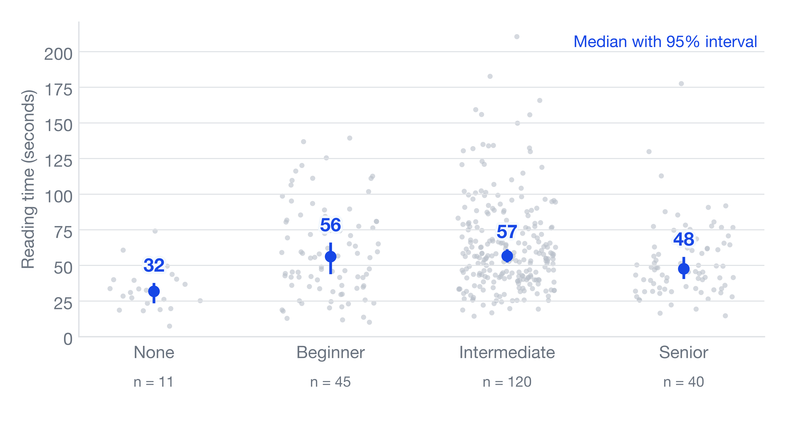{width=640}
:::

One surprise: people with no experience were fastest (median 31.8 seconds, only 11 people), and the intermediate group slowest; the data does not say why. Fast does not mean understood, though. @tbl-acc puts the time and accuracy of each group side by side: people with no experience read the rectangle program fastest, yet only 18% got it right, against 64% to 83% in the experienced groups. A plausible reading is that they could not follow the code and skimmed it once before guessing, but with only 11 people this is no more than a possibility.

::: {#tbl-acc}
Reading time and accuracy in EMIP by experience group

| Experience | Readers | Rectangle time (s) | Rectangle accuracy | Vehicle time (s) | Vehicle accuracy |
|---|---|---|---|---|---|
| None | 11 | 27.3 | 18% | 39.6 | 18% |
| Beginner | 45 | 47.6 | 64% | 58.5 | 20% |
| Intermediate | 120 | 52.1 | 73% | 61.6 | 24% |
| Senior | 40 | 41.6 | 83% | 51.0 | 25% |
| All | 216 | 46.4 | 70% | 57.8 | 23% |

Times are group medians, from the code appearing on screen to the answer screen. Whether an answer is correct follows the answer key shipped with the dataset.
:::

The vehicle program scores about a fifth in every group, which comes from a trap in the question. The key says the vehicle **can accelerate and also slow down**, because passing a negative number to the accelerate method reduces the speed; 148 of the 216 chose "can accelerate" and were all marked wrong.

### What Do the Data Show?

Look closely at the charts above and they all have the same shape: most readings bunch up on the left, with a long tail trailing off to the right. Statisticians call this shape **right-skewed**.

Why does the tail trail to the right? Think of your commute, usually about 30 minutes. Rain slows you down a little, a traffic jam a little more, and when both happen the delays stack up; but however smooth the trip, you will never make it in 5 minutes. Time cannot get much shorter, yet it can get a lot longer, so the distribution stretches to the right.

Reading works the same way. A slightly harder text, a slightly unfamiliar topic, a slightly tired reader: each one turns the time into 1.2 or 1.3 times what it was, instead of adding a fixed few seconds. As the multipliers pile up, the slow end gets pulled further and further out.

This shape has a name, the **log-normal distribution**: take the logarithm of the time and the familiar bell curve comes back. That is because logarithms turn multiplication into addition, and lots of small factors added together is exactly where bell curves usually come from. All four datasets fit this picture: clearly right-skewed as they are, almost symmetric after taking logs.

::: {#fig-lognormal}
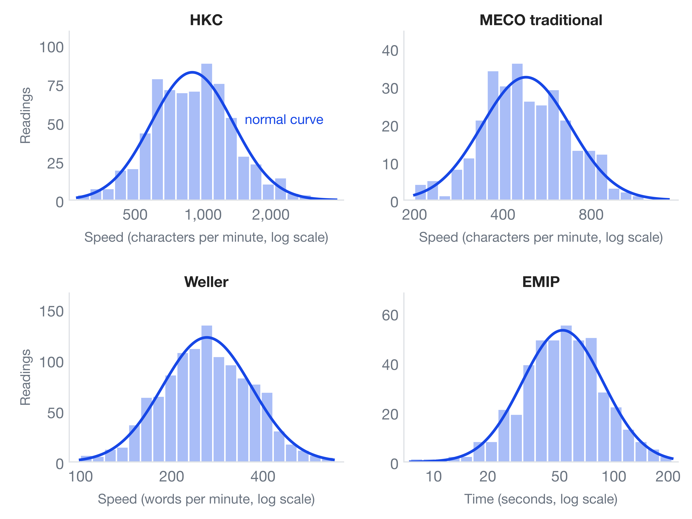{width=640}
:::

### Limits of the Data

Using lab data to estimate how long a blog post takes is like using a running-track time to estimate a commute: the direction is right, but a few gaps need spelling out first:

1. **No data on mixed content.** I could not find any public data on how long people take to read a page that mixes prose, code, formulas and images, so prose and code can only be estimated separately and then combined.
2. **The four datasets measure different kinds of time.** HKC and MECO count only the time the eyes rest on the text, a lower bound of real reading time; Weller records the seconds taken to read a whole English article; EMIP measures the time from seeing the code to starting the answer, thinking included. They cannot be compared directly or added up, only used for orders of magnitude.
3. **The setting is not reading a blog.** The materials are short and the readers took part in a lab study, not reading at home.

Even with these limits, the data can still tell us roughly how fast people read, and how far apart they are.

## Methods

With the data in hand, we look at it from four angles: how reliable the medians are, and how much they would change with a different set of readers; how much of the variation in speed comes from readers and how much from texts; how programming experience and word count affect reading time; and finally, combining prose and code speeds to simulate how long a whole post takes.

### Bootstrap Confidence Intervals

A sample median is only an estimate; a different set of readers would give a different number. To see how far it might be off, the mean has a ready-made formula, but the median does not, so I use the bootstrap[^bootstrap].

The bootstrap takes the sample in hand and resamples it again and again. But one reader reads several texts, so the readings are not independent. Resampling individual readings would treat one person's readings as if they came from different people, pretending there is more data than there is, and the interval would be too narrow. So I resample **readers**: a reader is drawn, or left out, together with all of their readings. This is called a cluster bootstrap. With $n$ readers and $X_i$ the readings of reader $i$, the steps are:

1. Draw $n$ readers with replacement, $i_1, \dots, i_n$. Each drawn reader brings all of their readings into the resample $X^{*} = (X_{i_1}, \dots, X_{i_n})$.
2. Compute the statistic $\hat\theta^{*}$ on the resample. Depending on the quantity reported, it is the pooled median or the median of reader medians.
3. Repeat $B = 10{,}000$ times to get $\hat\theta^{*}_1, \dots, \hat\theta^{*}_B$.
4. Take the 2.5th and 97.5th percentiles of these $B$ values as the 95% confidence interval:

$$
\left[\hat\theta^{*}_{(2.5\%)},\ \hat\theta^{*}_{(97.5\%)}\right]
$$

The random seed is fixed at 20261112, so the results can be reproduced. HKC, MECO and EMIP all use the same procedure; in EMIP the readers are resampled within each experience group. The interval reflects only which readers happened to be drawn. It does not cover bias in the data itself, such as the participants' background or the short materials.

The medians and 95% confidence intervals from the cluster bootstrap:

| Data | Unit | Median | 95% confidence interval |
|---|---|---|---|
| **Text** | | | |
| &emsp;HKC | chars/min | 896 | 807 to 991 |
| &emsp;MECO `ch_t` | chars/min | 461 | 426 to 530 |
| &emsp;MECO `ch_s` | chars/min | 609 | 546 to 691 |
| **Code** | | | |
| &emsp;EMIP | seconds | 53.5 | 48.8 to 56.8 |

### Comparison with the Current Formula

My blog counts only Chinese characters, so to compare with the formula the speeds have to be recomputed without punctuation. The median over readings in MECO `ch_t` then becomes 425 characters per minute; taking each reader's median first and then the median of those gives 433.

::: {#fig-speed}
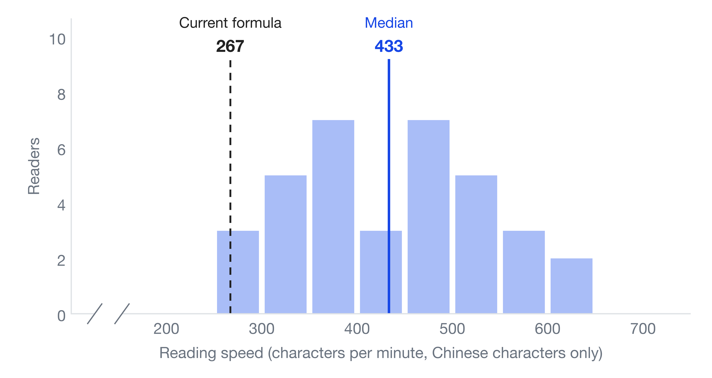{width=640}
:::

Only 1 of the 38 readers is slower than 267 characters per minute. The median is 433 (blue line), and 30 readers fall between 300 and 600. The 267 characters per minute implied by my blog's formula (dashed line) sits at the far left of the distribution. In other words, the formula's time is too long for 37 of the 38 readers.

### Variance Decomposition: Readers and Texts

How much of the difference in speed comes from readers, and how much from texts? To answer that, I take the logarithm of the rate $v_{ij}$ (reader $i$ on text $j$) in HKC and MECO and fit a crossed random-intercept model. The log is there because the rates are right-skewed, as seen above, and only come close to normal after taking logs:

::: {.equation #eq:crossed}
\log v_{ij} = \mu + a_i + b_j + \varepsilon_{ij}, \quad a_i \sim N(0, \sigma_a^2),\ b_j \sim N(0, \sigma_b^2),\ \varepsilon_{ij} \sim N(0, \sigma_\varepsilon^2)
:::

Here $a_i$ is reader $i$'s own speed, $b_j$ is text $j$'s own difficulty, and $\varepsilon_{ij}$ is the remaining variation. The three variances are estimated by REML, and each is divided by their sum. The readers' and the texts' shares are

::: {.equation #eq:share-reader}
\frac{\sigma_a^2}{\sigma_a^2 + \sigma_b^2 + \sigma_\varepsilon^2}
:::

::: {.equation #eq:share-text}
\frac{\sigma_b^2}{\sigma_a^2 + \sigma_b^2 + \sigma_\varepsilon^2}
:::

and likewise for the remainder. The model assumes the components are independent and that the log rates are roughly normal. To make sure the result is not an artefact of the model's assumptions, I also cross-checked it with an analysis of variance. This time readers and texts are not assumed to come from normal distributions; they are treated as fixed effects and fitted by least squares:

$$
\log v_{ij} = \mu + \alpha_i + \beta_j + \varepsilon_{ij}
$$

Let $\mathrm{RSS}$ be the residual sum of squares of this model, the sum of squared differences between each observed and fitted value:

$$
\mathrm{RSS} = \sum_{i,j} \left(\log v_{ij} - \widehat{\log v}_{ij}\right)^2
$$

Let $\mathrm{RSS}_{-\alpha}$ and $\mathrm{RSS}_{-\beta}$ be the residual sums of squares after refitting without the reader effects and without the text effects. How much the residual sum of squares grows when a factor is dropped is the sum of squares that factor explains:

$$
SS_A = \mathrm{RSS}_{-\alpha} - \mathrm{RSS}, \quad SS_B = \mathrm{RSS}_{-\beta} - \mathrm{RSS}, \quad SS_E = \mathrm{RSS}
$$

The readers' share is

$$
\frac{SS_A}{SS_A + SS_B + SS_E}
$$

and likewise for texts and the residual[^text-share].

::: {#fig-variance}
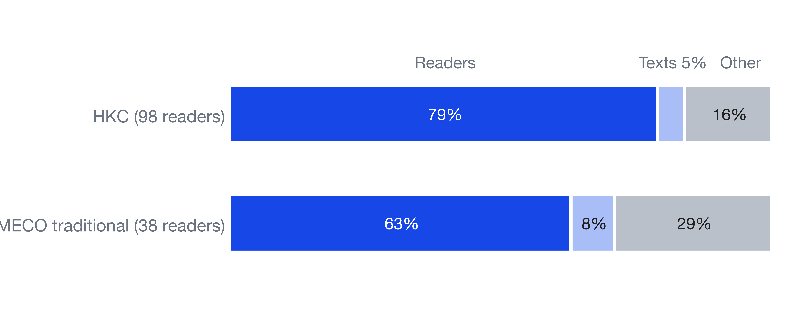{width=640}
:::

@fig-variance splits the variance of the log reading rate into readers, texts and the remainder. **Differences between readers are much larger than differences between texts**: about 79% of the variance in HKC comes from readers and 5% from texts; for MECO `ch_t`, about 63% and 8%. The sum-of-squares cross-check agrees: readers 82% and texts 5% in HKC, readers 68% and texts 8% in MECO `ch_t`. There are only 7 and 12 texts, though, so the text share is unstable.

### Simple Regression: Experience and Reading Time

For EMIP I take the logarithm of reading time and run two regressions. Model 1 has the program only:

$$
\log T_i = \beta_0 + \beta_1\,\text{vehicle}_i + \varepsilon_i
$$

Model 2 adds experience:

$$
\log T_i = \beta_0 + \beta_1\,\text{vehicle}_i + \beta_2\,\text{beginner}_i + \beta_3\,\text{intermediate}_i + \beta_4\,\text{senior}_i + \varepsilon_i
$$

Here $i$ indexes the readings (432 in all), $T_i$ is the number of seconds of reading $i$, and $\varepsilon_i$ is the part of that reading the terms on the right cannot explain. Each term on the right is a 0/1 indicator; for example $\text{vehicle}_i = 1$ when reading $i$ is of the vehicle program, and 0 otherwise. In model 2 the baseline is a person with no experience reading the rectangle program, where all four are 0, so $e^{\beta_0}$ is the baseline reading time; in model 1 the baseline is everyone reading the rectangle program. Vehicle is the question on the `Vehicle` program, so $\beta_1$ is the difference from the rectangle one; the coefficients $\beta_2$ to $\beta_4$ for beginner, intermediate and senior are differences from no experience.

The advantage of the log is that coefficients read as multiples: $e^{\beta_1}$ is how many times longer the vehicle program takes than the rectangle one, for example $e^{0.173} \approx 1.19$, which means 19% more. Standard errors are clustered by reader, because one reader's two programs are not independent.

::: {#tbl-emip}
Regression of log EMIP reading time

| Term | Model 1 | Model 2 |
|---|---|---|
| {sub} | log reading time | log reading time |
| Vehicle | 0.173\*\*\* | 0.173\*\*\* |
| | (0.031) | (0.031) |
| Beginner | | 0.540\*\*\* |
| | | (0.140) |
| Intermediate | | 0.636\*\*\* |
| | | (0.121) |
| Senior | | 0.467\*\*\* |
| | | (0.131) |
| Intercept | 3.865\*\*\* | 3.313\*\*\* |
| | (0.035) | (0.113) |
| Readings | 432 | 432 |
| Readers | 216 | 216 |
| {rule} $R^{2}$ | 0.028 | 0.106 |

\* p < 0.05, \*\* p < 0.01, \*\*\* p < 0.001
1. Model 1 has the program only; model 2 adds experience.
2. The standard error is in parentheses under each coefficient, clustered by reader.
3. The baseline of model 2 is a person with no experience reading the rectangle program, and that of model 1 is everyone reading the rectangle program, so the two intercepts differ.
:::

The coefficients in @tbl-emip show that the same person spends about a fifth longer on the vehicle program (which stores a car's speed and can accelerate) than on the rectangle program (which works out an area from two corners); the vehicle program is longer (22 lines against 18) and has an extra if statement. The vehicle coefficient is 0.173 in both models: every reader read both programs, so the program difference is a person compared with themselves, and adding experience cannot change it.

The experience result is less intuitive: people who have written code, whether beginners, intermediate or senior, took 60% to 90% longer than people with no experience at all (1.60 to 1.89 times after exponentiating). One possibility is that people with no experience could not follow the code, skimmed it once and guessed, while experienced people actually read it through. The accuracy in @tbl-acc points the same way, but the data cannot test this guess directly.

More telling is that the program alone explains only about 3% of the differences in reading time (model 1, R² = 0.028), and adding experience brings it to about a tenth (model 2, R² = 0.106). The other nine tenths come from each person's own habits and speed, just as with prose.

Per line, that is about 2.6 to 2.7 seconds. But it comes from two short programs of under 25 lines; longer or harder code could give a completely different number, so treat it only as a rough guide.

For Weller I run two regressions that predict the seconds $T$ of one reading. Model 1 has only the article's word count $W$:

$$
T = a + bW
$$

Model 2 adds the speed $S$ that the reader rated themselves before reading, from 1 (slow) to 5 (fast):

$$
T = a + bW + cS
$$

Here $a$ is the intercept, $b$ is the seconds added per word, and $c$ is the seconds added per point of self-rated speed.

One article has 33 to 38 readings, and they are not independent, so standard errors are clustered by article. To judge the predictions I leave out **one whole article** at a time as the test set and fit the line on the rest, so the article being predicted never appears in the fit. The error is the mean absolute error (MAE), the average gap between predicted and actual seconds.

Weller's median whole-article reading speed is 258 words per minute, close to Medium's 265. Predicting reading time from word count gives:

| Predictor | MAE (seconds) |
|---|---|
| Fixed 240 words per minute | 52.08 |
| Fixed 258 words per minute | 50.32 |
| Line on word count (leave-one-article-out) | 50.95 |
| Word count plus self-rated speed (leave-one-article-out) | 48.95 |
| Overall mean time only | 66.80 |

Word count does help: the error falls from 66.80 to about 51 seconds. But the line is no better than a fixed speed, and the remaining 50 seconds cannot be removed by word count alone. Adding self-rated speed lowers the error to 48.95 seconds, about 2 seconds less than word count only.

::: {#tbl-weller}
Regressions of Weller reading time

|  | Model 1 | Model 2 |
|---|---|---|
| {sub} | Reading time (seconds) | Reading time (seconds) |
| Words (seconds per word) | 0.218\*\*\* | 0.219\*\*\* |
| | (0.012) | (0.011) |
| Self-rated speed (seconds per point) | | -25.87\*\*\* |
| | | (2.97) |
| Intercept (seconds) | 18.35\* | 106.71\*\*\* |
| | (9.23) | (13.69) |
| Readings | 1,130 | 1,130 |
| Articles | 32 | 32 |
| {rule} $R^{2}$ | 0.400 | 0.448 |

\* $p < 0.05$, \*\* $p < 0.01$, \*\*\* $p < 0.001$
1. Model 1 has word count only; model 2 adds self-rated speed.
2. The standard error is in parentheses under each coefficient, clustered by article.
3. Self-rated speed is what the reader reported before reading: 1 is slow, 5 is fast.
:::

In both models the word coefficient in @tbl-weller is about 0.22 seconds per word, or about 276 words per minute, close to the median of 258. The intercept of model 1 is only 18 seconds ($p$ = 0.047), so the line is close to a fixed speed, which is why their errors are so similar.

The self-rated speed coefficient in model 2 is -25.87: at the same word count, each additional point of self-rated speed goes with about 26 fewer seconds of reading time, so readers who rate themselves faster also read faster. But $R^{2}$ only rises from 0.400 to 0.448, and more than half of the variation lies outside these two variables.

Moreover, self-rated speed is a characteristic of the reader, unknown to the page before the reader opens the article, so it cannot be an input to the estimate. Model 2 therefore serves to gauge how much reader differences explain, not to add an input to the formula.

::: {#fig-weller}
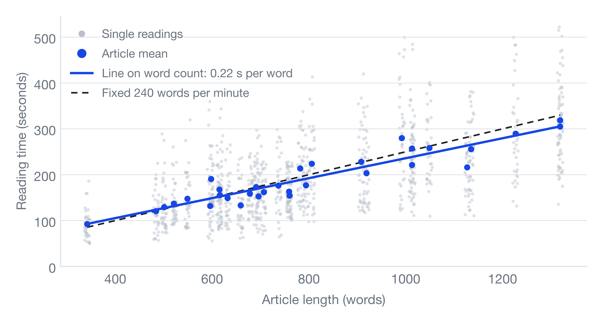{width=640}
:::

In @fig-weller, grey dots are single readings and blue dots are article means. The line on word count almost coincides with the fixed speed of 240 words per minute, while the grey dots spread widely: the same article takes very different times on different readings, which is where those 50 seconds of error come from.

### Monte Carlo Simulation

The prose and code data come from different people, so there is no way to measure directly how long a mixed post takes. A Monte Carlo simulation lets the computer play the reader again and again: draw a prose speed and a code speed at random, work out the time for that one reading, and after many repetitions look at how the times are spread. Each repetition goes:

1. From the traditional-labelled MECO readers, draw one reader (with replacement) and take that reader's median speed $v$ (characters per minute, punctuation excluded) as the prose speed. The median of $v$ over the 38 readers is 433.
2. From EMIP, draw one code reading and take its seconds per line $s$.
3. For an article with $C$ Chinese characters and $L$ lines of code, the reading time is

$$
T = \frac{C}{v} + \frac{L\,s}{60}
$$

Repeat 200,000 times to get 200,000 reading times; their distribution stands for how long readers take to read the post.

The simulation assumes prose speed and code speed are **independent**, because the two datasets are different people. If fast readers are fast at both, the true range would be wider than shown here. It is a projection from observed rates, not a measurement of the reading time of any actual article.

Below are projections for three example posts. Prose uses MECO `ch_t` (punctuation excluded, Chinese characters only) and code uses EMIP's seconds per line.

| Post | Chinese chars | Code | Projected median (5% to 95%) | Current formula | Formula ÷ projection |
|:---|:---:|:---:|:---:|:---:|:---:|
| &#8196;&#8196;Prose only | 3,000 | 0 lines | 6.6 (3.7 to 11.2) min | 11.2 min | 1.70 |
| &#8196;&#8196;Tutorial | 2,000 | 60 lines | 7.6 (5.0 to 11.6) min | 9.4 min | 1.25 |
| &#8196;&#8196;Code-heavy | 1,500 | 150 lines | 10.4 (6.1 to 19.2) min | 10.5 min | 1.01 |

::: {#fig-sim}
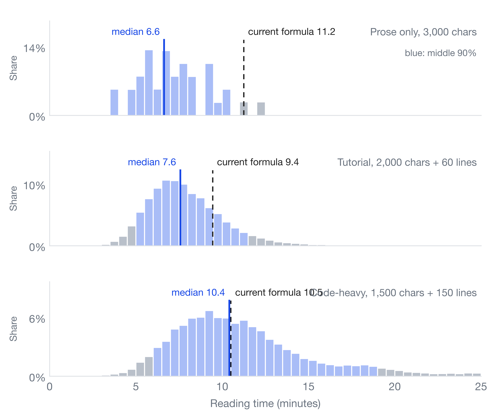{width=640}
:::

@fig-sim shows the distribution of the 200,000 simulated reading times. Blue bars are the middle 90% (5% to 95%), the solid line is the median and the dashed line the current formula. The prose-only panel has only a few scattered bars: with no code, the time depends only on which reader is drawn, so 38 readers give at most 38 outcomes. For the prose-only post the formula's 11.2 minutes lands right on the upper end of the middle 90%; for the code-heavy post, 10.5 minutes almost coincides with the median.

## Discussion

### Differences Between Readers


For the same 3,000-character post, fast readers finish in under 4 minutes while slow readers need more than 11. The gap comes mainly from people, not from the text.

So the better reading of **about $N$ minutes** is roughly how long a middle reader takes, not how long you will take. Changing the weights in the formula only slides the median left or right; a two- to threefold gap between readers is something no single number can handle.

### No Data on Mixed Content

This projection **adds** the time for prose and code, assuming neither affects the other. Real reading may not work that way: a piece of code may send a reader back to reread the explanation before it, and a figure may save a reader hundreds of characters of reading. None of the public data I found can test this.

::: {#fig-heatmap}
{width=640}

Gaze heat map on the German Wikipedia home page, from [Wikimedia Commons](https://commons.wikimedia.org/wiki/File:Eyetracking_heat_map_Wikipedia.jpg) (CC BY-SA 4.0)
:::

Two more limits:

- The code rate comes from two short programs, and it includes time spent thinking about the answer. Code in tutorials is usually longer, and readers may try it out as they read; none of that is in the data.
- Images, tables and formulas have no data at all. Medium's help page mentions an adjustment for images @citep[medium2026readtime], but I could not find what it is based on.

## Conclusion

This post checks the blog's current reading-time formula against four public datasets. The text part runs high, the evidence for the code part is thin, and the biggest variable is the reader rather than the post. For the same post, a fast reader and a slow one can differ by two to three times, so the weights can be tuned, but any single number only stands for the reader in the middle. Rather than chase a more precise number of minutes, it is more honest to treat the estimate as a range.

- **Prose:** In the public data, Chinese readers' median speed, counting Chinese characters only, is about 430 characters per minute (MECO `ch_t`), much faster than the 267 characters per minute implied by my blog's formula, so the time of prose-only posts is overestimated by about 70%.
- **Code:** EMIP's roughly 2.6 seconds per line is the same order of magnitude as the formula's 1.95 seconds, but the data has only two programs, so the evidence is thin.
- **Reader differences:** Sixty to eighty percent of the variance comes from readers, and the 5% to 95% range for one post spans about 2 to 3 times.
- **Scope:** The data is all short material in laboratory settings, with no images, tables or formulas.

If the formula is to be adjusted on the strength of this analysis, the evidence supports lowering the text weight; for the code coefficient, the current evidence is not enough to justify a change. All of this is projected from experimental data and cannot replace times measured on real readers.

Two things about the estimated minutes are still untouched. One is that reading fast does not mean understanding: in EMIP the readers with no experience read fastest, yet they got the fewest answers right, so a short time does not mean they understood. The other is mixed languages: the formula counts only Chinese characters, so the English words in a post are treated as if no one reads them, and how much that underestimates is left for the next post.

[^bootstrap]: The bootstrap works like a slip-drawing game. Write each reader's reading speed on a slip of paper and put all the slips in a bag. Draw one slip, note the speed, put the slip back, and keep drawing until you have as many draws as there were slips. One such batch is a resample, and drawing with the slip put back each time is called sampling with replacement. Because every slip goes back, some readers get drawn several times and some never get drawn, so this batch differs a little from the original sample, and so does its median. Play the game ten thousand times and you get ten thousand medians. How widely they spread is an estimate of how much the median would change if a different set of readers had been studied: the wider the spread, the less reliable the median we have. The method does not need to assume that speeds follow a normal distribution or any other shape. It uses only the data in hand.

[^text-share]: The text share in @eq:share-text needs extra care. $\sigma_b^2$ is the variance of the text effects $b_j$ in @eq:crossed, which can only be estimated from the differences between texts, and HKC has only 7 texts and MECO only 12. That is estimating a variance from 7 and 12 numbers: one more or one fewer especially hard text could shift it noticeably. So the text share only gives a rough order of magnitude, not a precise figure.

## References

[references]
