::: {#fig-eye}
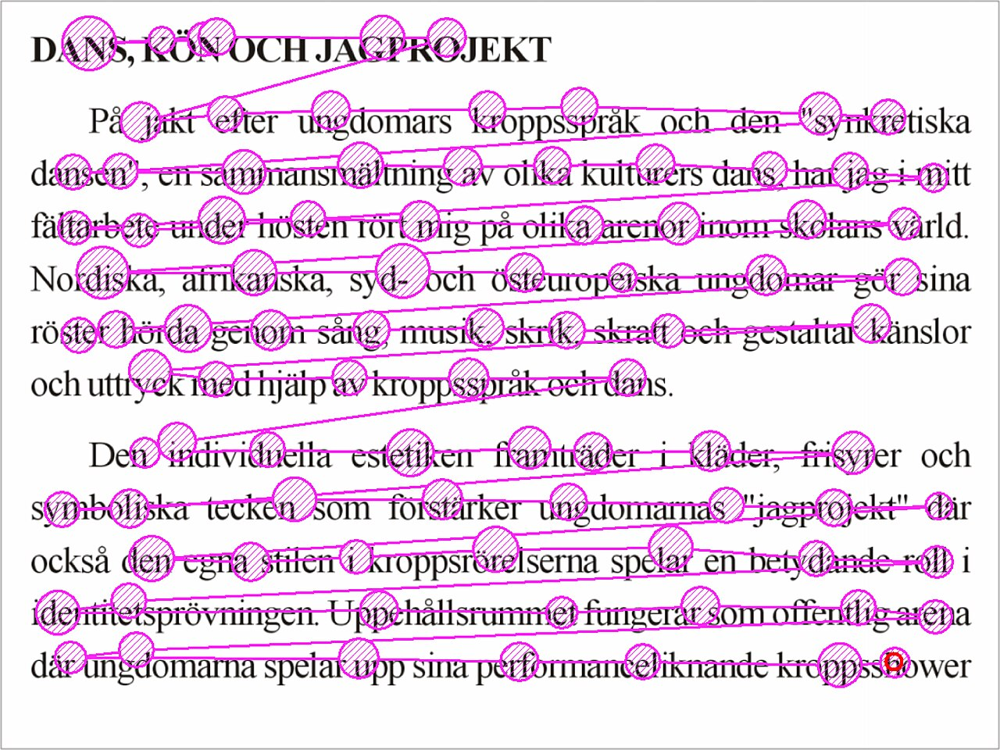{width=640}

閱讀一頁文字時的眼動紀錄，來自 [Wikimedia Commons](https://commons.wikimedia.org/wiki/File:Reading_Fixations_Saccades.jpg)（公有領域）
:::

你是不是也常看到文章標題下方寫著**閱讀時間約 $N$ 分鐘**，然後憑它決定現在要不要讀？這個數字多半是字數除以一個固定速度，但有人讀得快、有人讀得慢，程式碼和圖片也不是照字數算。

## 建議閱讀時間

這個數字通常怎麼算？以 Medium 為例，[Medium Support](https://help.medium.com/hc/en-us/articles/214991667-Read-time) 表明：英文文章以一般成人每分鐘約 265 個字計算，中日韓文章以每分鐘 500 個字元計算，再依圖片數量調整 @citep[medium2026readtime]。


### 現行的算法

我的部落格也是同樣的思路，只是多了幾個係數進行加權：

- 中文文章只數中文字，每分鐘 400 字；英文每分鐘 200 個字。
- 程式碼每分鐘 40 行。
- 每個三級標題加 20 秒，四級標題加 10 秒。
- 三個部分分別乘上權重：文字 1.5、標題 1.2、程式碼 1.3，加總後無條件進位到整數分鐘，最少 1 分鐘。

設 $C$ 為中文字數、$L$ 為程式碼行數、$h_3$ 與 $h_4$ 為標題數，中文文章的分鐘數是：

$$
T = \left\lceil 1.5 \cdot \frac{C}{400} + 1.3 \cdot \frac{L}{40} + 1.2 \cdot \frac{20\,h_3 + 10\,h_4}{60} \right\rceil
$$

把權重併進速度裡，這個算法實際假設的文字速度是 $400 \div 1.5 \approx 267$ 字／分，程式碼則是每行 $60 \div (40 \div 1.3) \approx 1.95$ 秒。這些權重都是憑經驗微調，沒有任何資料佐證，這開始讓我產生一個疑問：

> 建議閱讀時間真的準嗎？

這篇文章不做任何實驗，只用公開的眼動資料，檢查我的部落格用的估算公式準不準，並算出一個時間範圍，而不是單一個數字。

### 可能的錯誤

這個算法背後有三個假設，每一個都可能出現紕漏：

1. **一般讀者每分鐘讀 267 個中文字。** 華語讀者讀一篇文章，實際上每分鐘讀幾個字？
2. **程式碼每行約 2 秒。** 讀程式碼比讀文字慢，但到底慢多少？
3. **每位讀者都適用同一個數字。** 讀得快和讀得慢的人，讀同一篇文章會差多少？如果差很多，只給一個數字，就會有不少讀者對不上。

## 資料來源

為了回答這三個問題，得先有人真的量測過讀者讀得多快。好在研究閱讀的學者做過不少眼動實驗，有些團隊還把資料公開了。我用了四份：兩份是華語讀者讀文章，一份是英文讀者讀整篇文章，一份是軟體工程師讀程式碼，並且回答與程式碼相關的問題。

::: {#fig-lab}
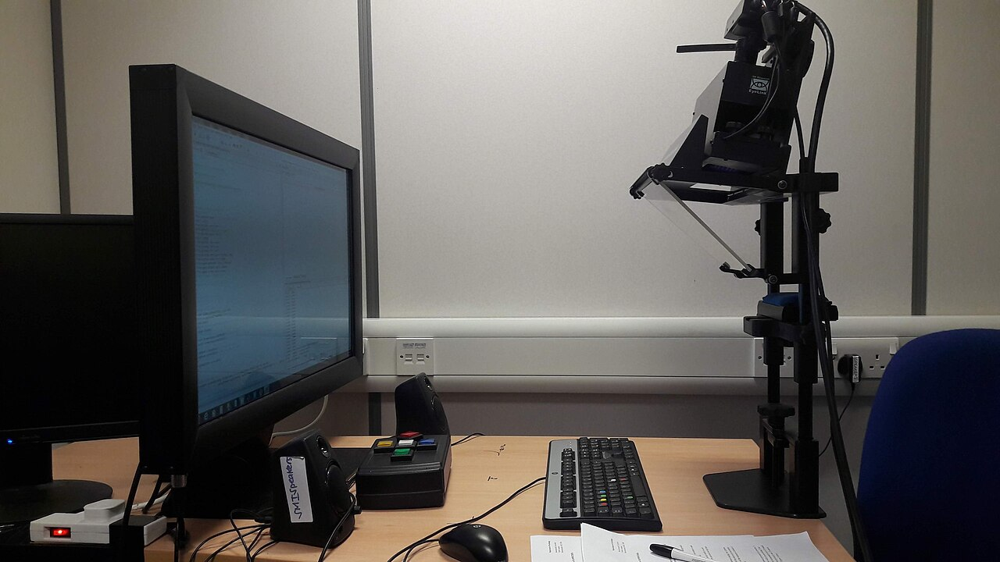{width=640}

眼動實驗用的螢幕與眼動儀，來自 [Wikimedia Commons](https://commons.wikimedia.org/wiki/File:Eye_tracker.jpg)（CC BY-SA 4.0）
:::

### 中文閱讀語料

#### 香港中文句子與篇章閱讀語料庫（HKC）@citep[wu2023hkc]

總共 98 位母語為華語的成人，各讀 300 個單行句子與 7 篇多行文章，文章是簡體中文。我用 7 篇文章，每篇約 985 至 2,254 字，共 686 次閱讀。

要注意的是，HKC 記錄的是眼睛停在文字上的時間總和，眼睛跳到下一個位置、眨眼的時間都不算在內。所以用它算出的速度偏快，換成時間則是真實閱讀時間的**下限**。

| 項目 | 讀者 | 閱讀 | 平均 | 標準差 | 中位數 | 5% | 25% | 75% | 95% |
|---|---|---|---|---|---|---|---|---|---|
| 字／分 | 98 | 686 | 979 | 441 | 896 | 457 | 658 | 1,181 | 1,767 |

::: {#fig-hkc}
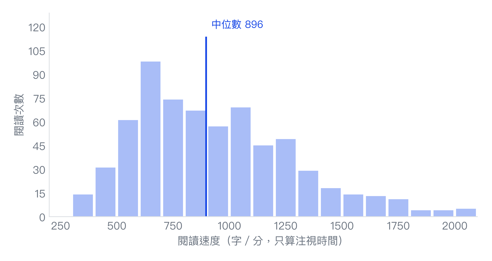{width=640}
:::

#### 多語言眼動語料庫第二波（MECO） @citep[siegelman2025meco]

654 位讀者，13 種語言，每人讀 12 篇維基百科風格的短文，每篇約 260 至 370 字。其中華語讀者有 77 位，分成兩組：讀繁體版的 `ch_t`（38 位）與讀簡體版的 `ch_s`（39 位）。

| 標籤 | 讀者 | 閱讀 | 平均 | 標準差 | 中位數 | 5% | 25% | 75% | 95% |
|---|---|---|---|---|---|---|---|---|---|
| `ch_t` | 38 | 297 | 509 | 184 | 461 | 289 | 376 | 611 | 861 |
| `ch_s` | 39 | 325 | 662 | 252 | 609 | 322 | 500 | 799 | 1,148 |

::: {#fig-meco}
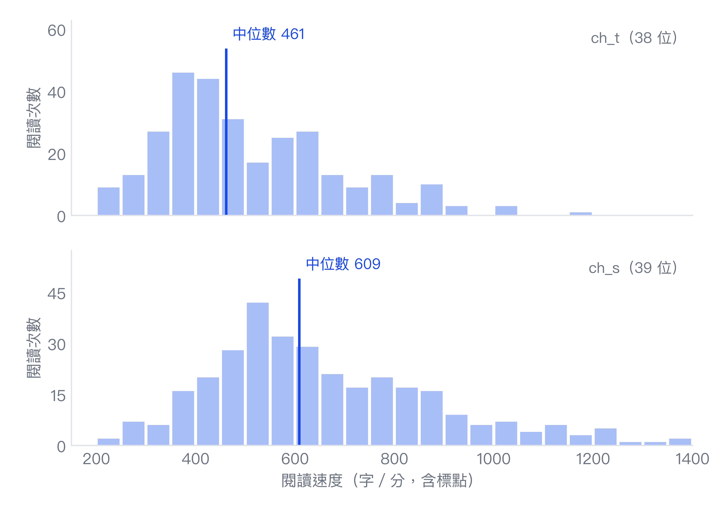{width=640}
:::

### 英文閱讀語料

#### DocumentReadingTime @citep[weller2020reading]

這是一項在 [Amazon Mechanical Turk](https://www.mturk.com/)（網路上的人力外包平台）進行的線上實驗。受試者先回答年齡、性別等幾個基本問題，再用平常的速度讀一篇英文文章，讀完回答幾道理解題，答錯就不採用；在文章那一頁停留太短或太久的人也會被剔除。資料記錄的是受試者在文章頁面停留的秒數。

文章共 32 篇，主題是健康或科技，體裁是部落格文章或新聞，長度從 342 到 1,319 字，中位數 759 字。每位受試者只讀一篇，每篇有 33 到 38 人讀，共 1,130 次閱讀。

| 項目 | 閱讀 | 平均 | 標準差 | 中位數 | 5% | 25% | 75% | 95% |
|---|---|---|---|---|---|---|---|---|
| 字／分 | 1,130 | 276 | 95 | 258 | 152 | 207 | 332 | 451 |
| 秒 | 1,130 | 192 | 85 | 178 | 84 | 130 | 237 | 354 |

::: {#fig-wdist}
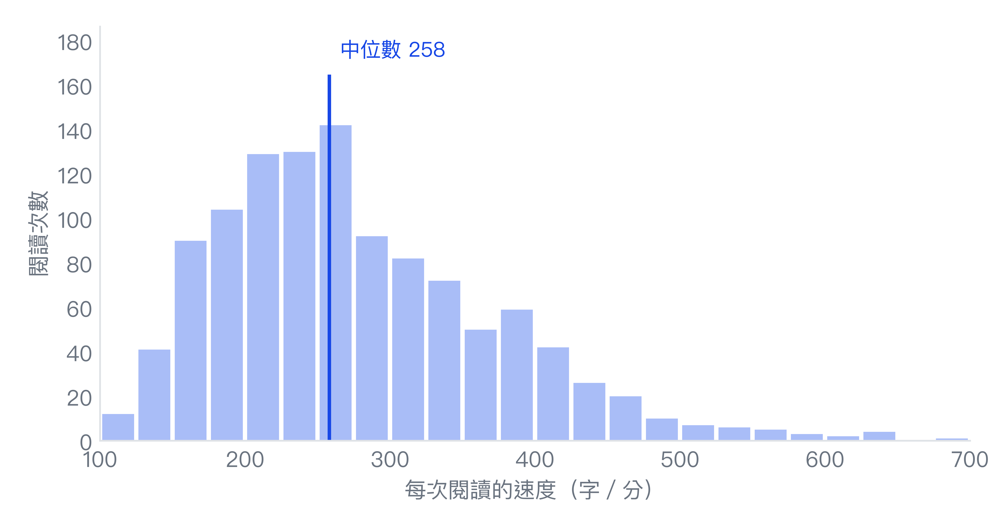{width=640}
:::

### 程式碼閱讀資料

#### EMIP @citep[bednarik2020emip]

實驗總共招來 216 位軟體工程師受試，程式經驗從完全零基礎到資深。每人閱讀以下兩段短程式，讀完回答一題選擇題，問這段程式在做什麼，沒有時間限制。兩段程式各有 Java、Python、Scala 三種寫法，每位受試者只讀其中一種語言的版本。

:::: {.tabs}
# Java
207 位受試者讀 Java 版本。

::: {.tabs}
## 矩形題
用兩個角的座標算出矩形的寬、高與面積，共 18 行。

```java
public class Rectangle {
    private int x1, y1, x2, y2 ;
    public Rectangle (int x1, int y1, int x2, int y2) {
        this.x1 = x1 ;
        this.y1 = y1 ;
        this.x2 = x2 ;
        this.y2 = y2 ;
    }
    public int width () { return this.x2 - this.x1 ; }
    public int height () { return this.y2 - this.y1 ; }
    public double area () { return this.width () * this.height () ; }
    public static void main (String [ ] args) {
        Rectangle rect1 = new Rectangle (0, 0, 10, 10) ;
        System.out.println (rect1.area ()) ;
        Rectangle rect2 = new Rectangle (5, 5, 10, 10) ;
        System.out.println (rect2.area ()) ;
    }
}
```

受試者讀完後看到的選擇題是（粗體為正確答案）：

1. 這個程式用寬 `(x1 − x2)` 乘以高 `(y1 − y2)` 算出矩形的面積。
2. **這個程式用寬 `(x2 − x1)` 乘以高 `(y2 − y1)` 算出矩形的面積。**
3. 這個程式用寬 `(x1 − y1)` 乘以高 `(x2 − y2)` 算出矩形的面積。
4. 不確定。

## 車輛題
記錄車廠、車型與極速，加速時速度加到極速就不再增加，共 22 行。

```java
public class Vehicle {
    String producer, type ;
    int topSpeed, currentSpeed ;

    public Vehicle (String p, String t, int tp) {
        this.producer = p ;
        this.type = t ;
        this.topSpeed = tp ;
        this.currentSpeed = 0 ;
    }

    public int accelerate (int kmh) {
        if ((this.currentSpeed + kmh) > this.topSpeed) {
            this.currentSpeed = this.topSpeed ;
        } else {
            this.currentSpeed = this.currentSpeed + kmh ;
        }
        return this.currentSpeed ;
    }

    public static void main (String args [ ]) {
        Vehicle v = new Vehicle ("Audi", "A6", 200) ;
        v.accelerate (10) ;
    }
}
```

受試者讀完後看到的選擇題是（粗體為正確答案）：

1. 這個程式定義了一輛由車廠製造、有車型的車，它可以減速。
2. 這個程式定義了一輛由車廠製造、有車型的車，它可以加速。
3. **這個程式定義了一輛由車廠製造、有車型的車，它可以加速也可以減速。**
4. 不確定。
:::

# Python
5 位受試者讀 Python 版本。

::: {.tabs}
## 矩形題
用兩個角的座標算出矩形的寬、高與面積，共 13 行。

```python
class Rectangle :
    def __init__ (self, x1, y1, x2, y2) :
        self.x1 = x1
        self.y1 = y1
        self.x2 = x2
        self.y2 = y2
    def width (self) : return self.x2 - self.x1
    def height (self) : return self.y2 - self.y1
    def area (self) : return self.width() * self.height()
rect1 = Rectangle (0, 0, 10, 10)
print rect1.area ()
rect2 = Rectangle (5, 5, 10, 10)
print rect2.area ()
```

受試者讀完後看到的選擇題是（粗體為正確答案）：

1. 這個程式用寬 `(x1 − x2)` 乘以高 `(y1 − y2)` 算出矩形的面積。
2. **這個程式用寬 `(x2 − x1)` 乘以高 `(y2 − y1)` 算出矩形的面積。**
3. 這個程式用寬 `(x1 − y1)` 乘以高 `(x2 − y2)` 算出矩形的面積。
4. 不確定。

## 車輛題
記錄車廠、車型與極速，加速時速度加到極速就不再增加，共 14 行。

```python
class Vehicle :

    def __init__ (self, p, t, tp) :
        self.producer = p
        self.vtype = t
        self.topSpeed = tp
        self.currentSpeed = 0

    def accelerate (self, kmh) :
        if (self.currentSpeed + kmh) > self.topSpeed :
            self.currentSpeed = self.topSpeed
        else :
            self.currentSpeed = self.currentSpeed + kmh
        return self.currentSpeed

v = Vehicle ("Audi", "A6", 200)
v.accelerate (10)
```

受試者讀完後看到的選擇題是（粗體為正確答案）：

1. 這個程式定義了一輛由車廠製造、有車型的車，它可以減速。
2. 這個程式定義了一輛由車廠製造、有車型的車，它可以加速。
3. **這個程式定義了一輛由車廠製造、有車型的車，它可以加速也可以減速。**
4. 不確定。
:::

# Scala
4 位受試者讀 Scala 版本。

::: {.tabs}
## 矩形題
用兩個角的座標算出矩形的寬、高與面積，共 11 行。

```scala
class Rectangle (
    val x1: Int, val y1: Int, val x2: Int, val y2: Int
) {
    def width = this.x2 - this.x1
    def height = this.y2 - this.y1
    def area = this.width * this.height
}
object RectangleApp extends App {
    val rect1 = new Rectangle(0, 0, 10, 10)
    println(rect1.area)
    val rect2 = new Rectangle(5, 5, 10, 10)
    println(rect2.area)
}
```

受試者讀完後看到的選擇題是（粗體為正確答案）：

1. 這個程式用寬 `(x1 − x2)` 乘以高 `(y1 − y2)` 算出矩形的面積。
2. **這個程式用寬 `(x2 − x1)` 乘以高 `(y2 − y1)` 算出矩形的面積。**
3. 這個程式用寬 `(x1 − y1)` 乘以高 `(x2 − y2)` 算出矩形的面積。
4. 不確定。

## 車輛題
記錄車廠、車型與極速，加速時速度加到極速就不再增加，共 18 行。

```scala
class Vehicle (p: String, t: String, tp: Int){
  val producer = p
  val vtype = t
  val topSpeed = tp
  var currentSpeed = 0

  def accelerate(kmh: Int) = {
    if ((this.currentSpeed + kmh) > this.topSpeed) {
      this.currentSpeed = this.topSpeed
    } else {
      this.currentSpeed = this.currentSpeed + kmh
    }
    this.currentSpeed
  }
}

object VehicleApp extends App {
  val v = new Vehicle("Audi", "A6", 200)
  v.accelerate(10)
}
```

受試者讀完後看到的選擇題是（粗體為正確答案）：

1. 這個程式定義了一輛由車廠製造、有車型的車，它可以減速。
2. 這個程式定義了一輛由車廠製造、有車型的車，它可以加速。
3. **這個程式定義了一輛由車廠製造、有車型的車，它可以加速也可以減速。**
4. 不確定。
:::
::::

為了估算讀程式碼要花多久，我取了**程式碼出現在畫面上，到進入答題畫面**的時間。這段時間除了閱讀，還包含回頭再看與思考答案，而非純粹的閱讀時間。

| 項目（秒） | 讀者 | 閱讀 | 平均 | 標準差 | 中位數 | 5% | 25% | 75% | 95% |
|---|---|---|---|---|---|---|---|---|---|
| 全部 | 216 | 432 | 59.1 | 30.7 | 53.5 | 22.3 | 38.4 | 74.8 | 120.4 |
| 矩形題 | 216 | 216 | 54.0 | 27.5 | 46.4 | 19.4 | 33.7 | 65.3 | 109.8 |
| 車輛題 | 216 | 216 | 64.3 | 33.0 | 57.8 | 25.3 | 41.7 | 77.4 | 132.5 |

::: {#fig-emip}
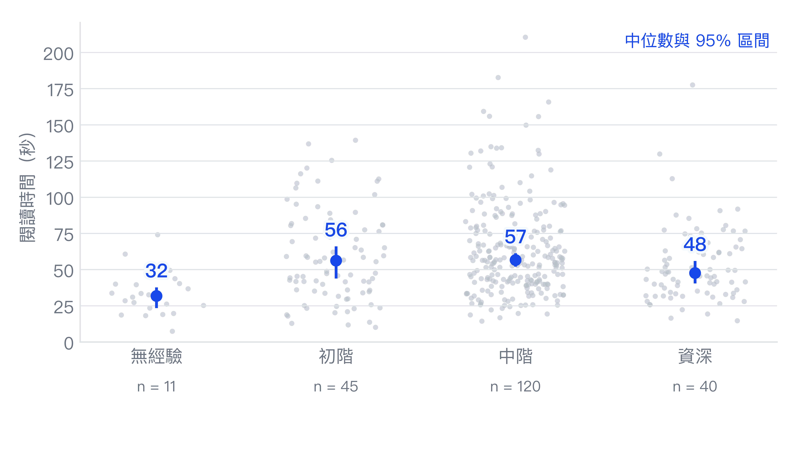{width=640}
:::

有一點出乎意料的是：完全沒經驗的人最快（中位數 31.8 秒，只有 11 人），中階的人反而最慢，資料沒有說明原因。不過快不等於讀懂了，@tbl-acc 把各組的時間和答對率放在一起看：無經驗的人讀矩形題最快，卻只有 18% 答對，有經驗的各組則是 64% 到 83%。比較合理的解釋是，他們看不太懂，掃過一遍就猜答案；不過這組只有 11 人，只能當作一種可能。

::: {#tbl-acc}
EMIP 各經驗組的閱讀時間與答對率

| 經驗 | 人數 | 矩形題時間（秒） | 矩形題答對率 | 車輛題時間（秒） | 車輛題答對率 |
|---|---|---|---|---|---|
| 無經驗 | 11 | 27.3 | 18% | 39.6 | 18% |
| 初階 | 45 | 47.6 | 64% | 58.5 | 20% |
| 中階 | 120 | 52.1 | 73% | 61.6 | 24% |
| 資深 | 40 | 41.6 | 83% | 51.0 | 25% |
| 全部 | 216 | 46.4 | 70% | 57.8 | 23% |

時間是各組的中位數，從程式碼出現在畫面上算到進入答題畫面。答對與否依資料集附的標準答案。
:::

車輛題各組的答對率都只有兩成左右，其實是題目的陷阱，標準答案是這輛車**能加速也能減速**，因為加速的方法傳入負數就會減速；216 人中有 148 人選了只能加速，都被算錯。

### 資料中發現了什麼？

仔細看上面幾張圖，會發現它們長得很像：大部分的閱讀擠在左邊，右邊拖著一條長長的尾巴。統計學把這種形狀叫做**右偏**——當文章難一點、主題陌生一點、人精神狀態稍微不好，每一項都讓時間變成原本的 1.2 倍、1.3 倍，而不是固定多幾秒。倍數一層層乘上去，慢的那一端就被越拉越遠。

事實上，這些圖表符合**對數常態分佈**：把時間取對數之後，它會變回熟悉的鐘形。原因是對數能把乘法變成加法，而一堆小因素加在一起，正是鐘形曲線最常見的來源。四份資料都符合這個說法，原本明顯右偏，取對數後幾乎左右對稱。

::: {#fig-lognormal}
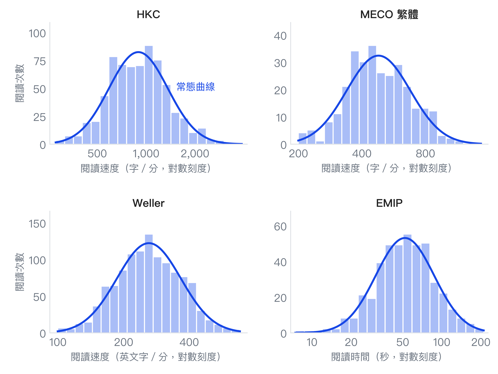{width=640}
:::

### 資料的限制

用實驗室的資料推算部落格的閱讀時間會存在些許落差，並且上述蒐集的資料存在以下限制：

1. **沒有混合內容的資料**：目前缺乏一個完整記錄讀者讀一個文字、程式碼、公式與圖片混合文章閱讀時間的資料，所以僅能把文字和程式碼分開估計，再組合起來。
2. **四份資料量的時間不一樣**：HKC 與 MECO 只算眼睛停在字上的時間，是實際閱讀時間的下限；Weller 是讀完一整篇英文文章的秒數；EMIP 則是從看到程式到開始作答的時間，包含思考。它們不能直接比較，也不能相加，只適合用來看量級。
3. **情境和讀部落格不同**：實驗室給予受試者的文章都很短，且是在實驗室中進行閱讀，和在自己的電腦上讀部落格文章存在環境上的差異。

雖然有這些限制，這些資料還是能告訴我們，讀者大概讀多快、彼此又差多少。

## 方法

有了資料後，接下來我們將從四個角度分析：中位數有多可靠，換一批讀者會差多少；速度的差異有多少來自讀者、多少來自文章；程式經驗與字數如何影響閱讀時間；最後把文字和程式碼的速度組合起來，模擬讀完一篇文章要多久。

### Bootstrap 信賴區間

樣本的中位數只是一個估計值，換一批讀者，數字就會不同。要知道它可能偏離多少，平均數有現成的公式可以算，中位數卻沒有，所以改用 Bootstrap[^bootstrap]。

Bootstrap 的做法是拿手上的樣本，一次又一次地重抽。不過同一位讀者會讀好幾篇，這些閱讀並不互相獨立：如果以每次閱讀為單位重抽，等於把同一個人的閱讀當成不同人的，假裝資料比實際多，區間就會太窄。因此這裡改以**讀者**為單位重抽，也就是整位讀者連同他的全部閱讀一起被抽中或一起落選，稱為分群 Bootstrap。設有 $n$ 位讀者，第 $i$ 位讀者的全部閱讀為 $X_i$，步驟如下：

1. 從 $n$ 位讀者中有放回地抽 $n$ 次，得到 $i_1, \dots, i_n$。每位被抽中的讀者，連同這位讀者的全部閱讀一起進入重抽樣本 $X^{*} = (X_{i_1}, \dots, X_{i_n})$。
2. 計算重抽樣本的統計量 $\hat\theta^{*}$。依報告的量不同，它是合併所有閱讀的中位數，或是讀者中位數的中位數。
3. 重複 $B = 10{,}000$ 次，得到 $\hat\theta^{*}_1, \dots, \hat\theta^{*}_B$。
4. 取這 $B$ 個值的第 2.5 與第 97.5 百分位數，作為 95% 信賴區間 $\left[\hat\theta^{*}_{(2.5\%)},\ \hat\theta^{*}_{(97.5\%)}\right]$

隨機種子固定為 `20261112`，因此結果可以重現，對 HKC、MECO 與 EMIP 等資料都使用同樣的做法，EMIP 的各經驗組則在組內重抽讀者。此區間僅反映抽到哪些讀者所造成的不確定性，不涵蓋資料本身的偏差，例如受試者的背景與文章太短。

以分群 Bootstrap 算出的中位數與 95% 信賴區間如下：

| 資料 | 單位 | 中位數 | 95% 信賴區間 |
|---|---|---|---|
| **文章** | | | |
| &emsp;HKC | 字／分 | 896 | 807 至 991 |
| &emsp;MECO `ch_t` | 字／分 | 461 | 426 至 530 |
| &emsp;MECO `ch_s` | 字／分 | 609 | 546 至 691 |
| **程式碼** | | | |
| &emsp;EMIP | 秒 | 53.5 | 48.8 至 56.8 |

### 與現行公式比較

我的部落格只數中文字，所以要和公式比較，得先把標點拿掉重算。不計標點後，MECO `ch_t` 每次閱讀的中位數是 425 字／分；先取每位讀者的中位數、再取中位數，則是 433 字／分。

::: {#fig-speed}
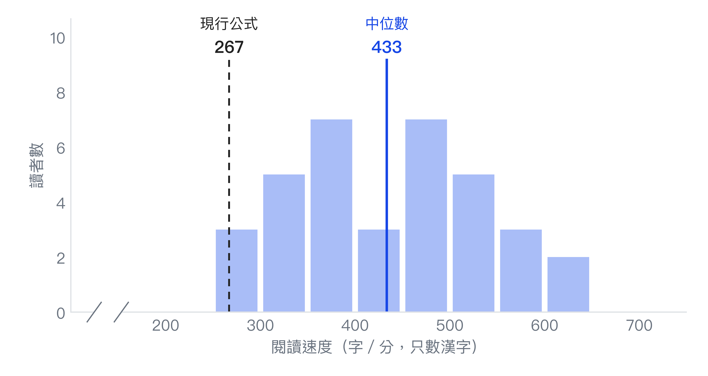{width=640}
:::

38 位讀者中，只有 1 位的速度低於 267 字／分。中位數是 433 字／分（藍線），有 30 位落在 300 至 600 字／分之間。我的部落格公式隱含的 267 字／分（虛線）落在分佈的最左側，換句話說，公式估出的時間，對 38 位讀者中的 37 位都太長。

### 變異拆解：讀者與文章

速度的差異，有多少來自讀者，有多少來自文章？為了回答這個問題，我對 HKC 與 MECO 的速率 $v_{ij}$（第 $i$ 位讀者讀第 $j$ 篇文章）取對數，配適讀者與文章交叉的隨機截距模型。取對數是因為前面看到速率右偏，取對數後才接近常態：

::: {.equation #eq:crossed}
\log v_{ij} = \mu + a_i + b_j + \varepsilon_{ij}, \quad a_i \sim N(0, \sigma_a^2),\ b_j \sim N(0, \sigma_b^2),\ \varepsilon_{ij} \sim N(0, \sigma_\varepsilon^2)
:::

$a_i$ 是讀者 $i$ 本身的快慢，$b_j$ 是文章 $j$ 本身的難度，$\varepsilon_{ij}$ 是其餘的變動。三個變異數用 REML 估計，再各自除以三者的總和。讀者與文章的占比分別是

::: {.equation #eq:share-reader}
\frac{\sigma_a^2}{\sigma_a^2 + \sigma_b^2 + \sigma_\varepsilon^2}
:::

::: {.equation #eq:share-text}
\frac{\sigma_b^2}{\sigma_a^2 + \sigma_b^2 + \sigma_\varepsilon^2}
:::

其餘的占比依此類推。這個模型假設各成分互相獨立，且取對數後的速率近似常態。

為了確認結果不是模型假設造成的，我另外用變異數分析做交叉檢查。這次不假設讀者與文章的效果來自常態分佈，而是把它們當成固定效果，用最小平方法配適

$$
\log v_{ij} = \mu + \alpha_i + \beta_j + \varepsilon_{ij}
$$

設 $\mathrm{RSS}$ 為這個模型的殘差平方和，也就是每次閱讀的實際值與配適值之差的平方和：

$$
\mathrm{RSS} = \sum_{i,j} \left(\log v_{ij} - \widehat{\log v}_{ij}\right)^2
$$

再設 $\mathrm{RSS}_{-\alpha}$ 與 $\mathrm{RSS}_{-\beta}$ 分別是拿掉讀者效果、拿掉文章效果後重新配適的殘差平方和。拿掉某個因素後，殘差平方和增加多少，就是這個因素解釋的平方和：

$$
SS_A = \mathrm{RSS}_{-\alpha} - \mathrm{RSS}, \quad SS_B = \mathrm{RSS}_{-\beta} - \mathrm{RSS}, \quad SS_E = \mathrm{RSS}
$$

讀者的占比是

$$
\frac{SS_A}{SS_A + SS_B + SS_E}
$$

文章與殘差的占比依此類推[^text-share]。

::: {#fig-variance}
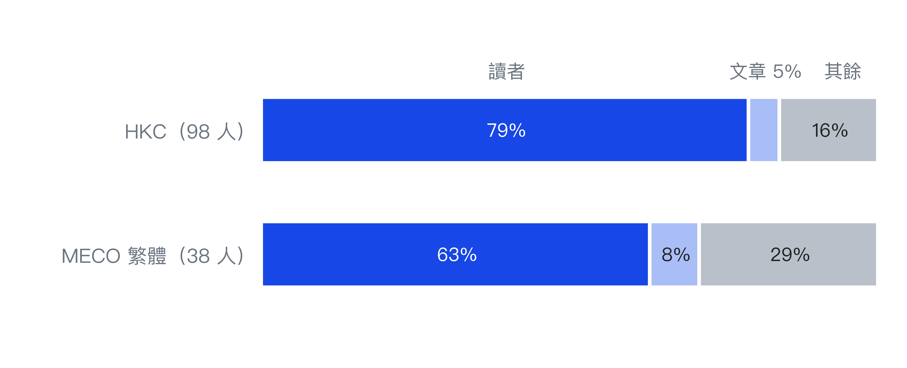{width=640}
:::

@fig-variance 把取對數後的閱讀速率變異拆成讀者、文章與其餘三份。**讀者之間的差異，比文章之間的差異大得多**：HKC 約 79% 來自讀者、5% 來自文章；MECO `ch_t` 約 63% 來自讀者、8% 來自文章。改用平方和占比交叉檢查，HKC 是讀者 82%、文章 5%，MECO `ch_t` 是讀者 68%、文章 8%，結論相同。不過文章只有 7 篇與 12 篇，文章那一份不穩定。

### 簡單迴歸：經驗與閱讀時間

針對 EMIP，將閱讀時間取完對數之後，做兩個迴歸。模型 1 只放題目：

$$
\log T_i = \beta_0 + \beta_1\,\text{車輛}_i + \varepsilon_i
$$

模型 2 再加入經驗：

$$
\log T_i = \beta_0 + \beta_1\,\text{車輛}_i + \beta_2\,\text{初階}_i + \beta_3\,\text{中階}_i + \beta_4\,\text{資深}_i + \varepsilon_i
$$

其中 $i$ 是第幾次閱讀（共 432 次），$T_i$ 是這次閱讀的秒數，$\varepsilon_i$ 是這次閱讀無法被右邊各項解釋的部分。右邊每一項都是 0 或 1 的指標，例如第 $i$ 次讀的是車輛題時 $\text{車輛}_i = 1$，否則為 0。模型 2 的基準是讀矩形題的無經驗者，四項都是 0，此時 $e^{\beta_0}$ 就是基準的閱讀時間；模型 1 的基準則是讀矩形題的所有人。車輛題是讀 `Vehicle` 程式的那一題，所以 $\beta_1$ 是相對於矩形題的差異；初階、中階與資深的係數 $\beta_2$ 到 $\beta_4$，是相對於無經驗者的差異。

取對數後，係數可以解讀成倍數：$e^{\beta_1}$ 是車輛題的時間相對於矩形題的倍數，例如 $e^{0.173} \approx 1.19$，代表多了 19%。

::: {#tbl-emip}
EMIP 閱讀時間取對數的迴歸結果

|  | 模型 1 | 模型 2 |
|---|---|---|
| {sub} | log 閱讀時間 | log 閱讀時間 |
| 車輛題 | 0.173\*\*\* | 0.173\*\*\* |
| | (0.031) | (0.031) |
| 初階 | | 0.540\*\*\* |
| | | (0.140) |
| 中階 | | 0.636\*\*\* |
| | | (0.121) |
| 資深 | | 0.467\*\*\* |
| | | (0.131) |
| 截距 | 3.865\*\*\* | 3.313\*\*\* |
| | (0.035) | (0.113) |
| 閱讀次數 | 432 | 432 |
| 讀者人數 | 216 | 216 |
| {rule} $R^{2}$ | 0.028 | 0.106 |

\* $p < 0.05$，\*\* $p < 0.01$，\*\*\* $p < 0.001$
1. 係數下方括號內是標準誤，依讀者分群計算。
2. 模型 2 的基準是讀矩形題的無經驗者，模型 1 的基準是讀矩形題的所有人，所以兩個截距不同。
:::

由@tbl-emip 的係數可知，同一個人讀車輛那段程式（記錄車速、可以加速），會比讀矩形那段（用兩個角的座標算面積）多花約兩成的時間；車輛那段比較長（22 行對 18 行），還多了一段條件判斷。兩個模型的車輛題係數都是 0.173：每個人兩題都讀，題目的差異是同一個人自己跟自己比，加不加經驗都不會改變。

經驗的結果比較反直覺：寫過程式的人，無論是初階、中階還是資深的工程師，都比完全沒經驗的人多花六到九成的時間。一種可能是沒經驗的人看不太懂，掃過一遍就去猜答案，有經驗的人則會真的讀完，@tbl-acc 的答對率也可以推測為此結果，但資料無法直接驗證這個猜測。

更值得注意的是，題目本身只解釋了閱讀時間差異的約 3%（模型 1，$R^{2}$ 為 0.028），加上經驗後也只到一成左右（模型 2，$R^{2}$ 為 0.106）。剩下的約九成來自每個人自己的習慣與速度，跟文字閱讀看到的情況一樣。

換算成每一行，大約 2.6 到 2.7 秒。不過這是從兩段不到 25 行的短程式算出來的，換成更長、更難的程式，數字可能完全不同，只能當作粗略的參考。

對 Weller 而言，我們可以預測一次閱讀的秒數 $T$。首先，模型 1 只考慮文章字數 $W$：

$$
T = a + bW
$$

模型 2 再加入讀者在閱讀前自評的閱讀速度 $S$，從 1（慢）到 5（快）：

$$
T = a + bW + cS
$$

$a$ 是截距，$b$ 是每多一個字增加的秒數，$c$ 是自評速度每高一分增加的秒數。

同一篇文章有 33 到 38 次閱讀，彼此並不獨立，所以標準誤依文章分群計算。評估預測好不好時，每次拿掉**一整篇**文章當測試，用其餘文章擬合直線，這樣被預測的文章不會出現在擬合過程中。誤差用平均絕對誤差（MAE）衡量，也就是預測秒數與實際秒數平均差多少。

Weller 的整篇文章閱讀速度中位數是 258 字／分，與 Medium 的 265 很接近。用字數預測閱讀時間，結果如下：

| 預測方法 | MAE（秒） |
|---|---|
| 固定每分鐘 240 字 | 52.08 |
| 固定每分鐘 258 字 | 50.32 |
| 字數的直線（留一篇交叉驗證） | 50.95 |
| 字數加自評速度（留一篇交叉驗證） | 48.95 |
| 只用全體平均時間 | 66.80 |

字數確實有用，誤差從 66.80 秒降到約 51 秒。但直線並沒有比固定速度好，剩下的 50 秒光靠字數消不掉。加入自評速度後，誤差再降到 48.95 秒，比只用字數少約 2 秒。

::: {#tbl-weller}
Weller 閱讀時間的迴歸結果

|  | 模型 1 | 模型 2 |
|---|---|---|
| {sub} | 閱讀時間（秒） | 閱讀時間（秒） |
| 字數（秒／字） | 0.218\*\*\* | 0.219\*\*\* |
| | (0.012) | (0.011) |
| 自評速度（秒／分） | | -25.87\*\*\* |
| | | (2.97) |
| 截距（秒） | 18.35\* | 106.71\*\*\* |
| | (9.23) | (13.69) |
| 閱讀次數 | 1,130 | 1,130 |
| 文章篇數 | 32 | 32 |
| {rule} $R^{2}$ | 0.400 | 0.448 |

\* $p < 0.05$，\*\* $p < 0.01$，\*\*\* $p < 0.001$
1. 模型 1 只放字數，模型 2 再加入自評速度。
2. 係數下方括號內是標準誤，依文章分群計算。
3. 自評速度是讀者在閱讀前自己評的，1 是慢，5 是快。
:::

@tbl-weller 的字數係數在兩個模型都約是每個字 0.22 秒，換算成每分鐘約 276 字，和中位數 258 字很接近。模型 1 的截距只有 18 秒（$p$ 值 0.047），代表直線和固定速度差不多，這也是兩者誤差相近的原因。

模型 2 的自評速度係數是 -25.87：字數相同時，自評每高一分，閱讀時間平均少約 26 秒，自評較快的讀者實際上也讀得較快。不過 $R^{2}$ 只從 0.400 升到 0.448，仍有過半的變異不在這兩個變數裡。

此外，自評速度是讀者自己的特徵，讀者開啟文章前無從得知，預估閱讀時間也就無法使用。因此模型 2 的用途是衡量讀者差異的解釋力，而不是為公式增加一個輸入。

::: {#fig-weller}
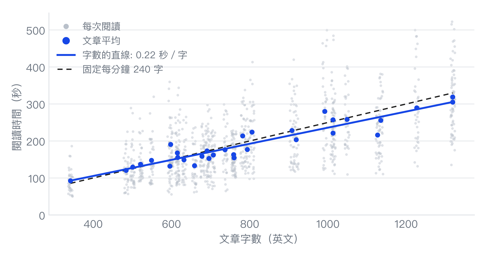{width=640}
:::

@fig-weller 的灰點是每次閱讀，藍點是各篇文章的平均。字數的直線與固定每分鐘 240 字的線幾乎重合，灰點卻散得很開：同一篇文章，不同次閱讀花的時間差很多，這正是那 50 秒誤差的來源。

### 蒙地卡羅模擬

文字和程式碼的資料來自不同的人，沒辦法直接量出一篇混合文章要讀多久。蒙地卡羅模擬的做法是讓電腦一次次扮演讀者：隨機抽一個文字速度、一個程式碼速度，算出這次的閱讀時間，重複很多次後看時間怎麼分佈。每一次的步驟如下：

1. 從 MECO 的繁體標籤中，抽一位讀者（放回），取這位讀者的中位數速度 $v$（字／分，不計標點）作為文字速度。38 位讀者的 $v$ 中位數是 433 字／分。
2. 從 EMIP 抽一次程式碼閱讀，取每行秒數 $s$。
3. 對一篇有 $C$ 個中文字與 $L$ 行程式碼的文章，閱讀時間是

$$
T = \frac{C}{v} + \frac{L\,s}{60}
$$

重複 200,000 次，得到 200,000 個閱讀時間，用它們的分佈代表讀者讀這篇文章要花多久。

這個模擬假設文字速度與程式碼速度**彼此獨立**，因為兩份資料是不同的人。如果讀得快的人兩者都快，真實的範圍會比這裡更寬。它是用觀測到的速率推算，不是實際量到任何一篇文章的閱讀時間。

下面是三種文章的推算。文字用 MECO `ch_t`（不計標點，只數中文字），程式碼用 EMIP 的每行秒數。

| 文章 | 中文字 | 程式碼 | 推算中位數（5% 到 95%） | 現行公式 | 公式 ÷ 推算 |
|:---|:---:|:---:|:---:|:---:|:---:|
| &emsp;純文字 | 3,000 | 0 行 | 6.6（3.7 至 11.2）分 | 11.2 分 | 1.70 |
| &emsp;教學文章 | 2,000 | 60 行 | 7.6（5.0 至 11.6）分 | 9.4 分 | 1.25 |
| &emsp;程式為主 | 1,500 | 150 行 | 10.4（6.1 至 19.2）分 | 10.5 分 | 1.01 |

::: {#fig-sim}
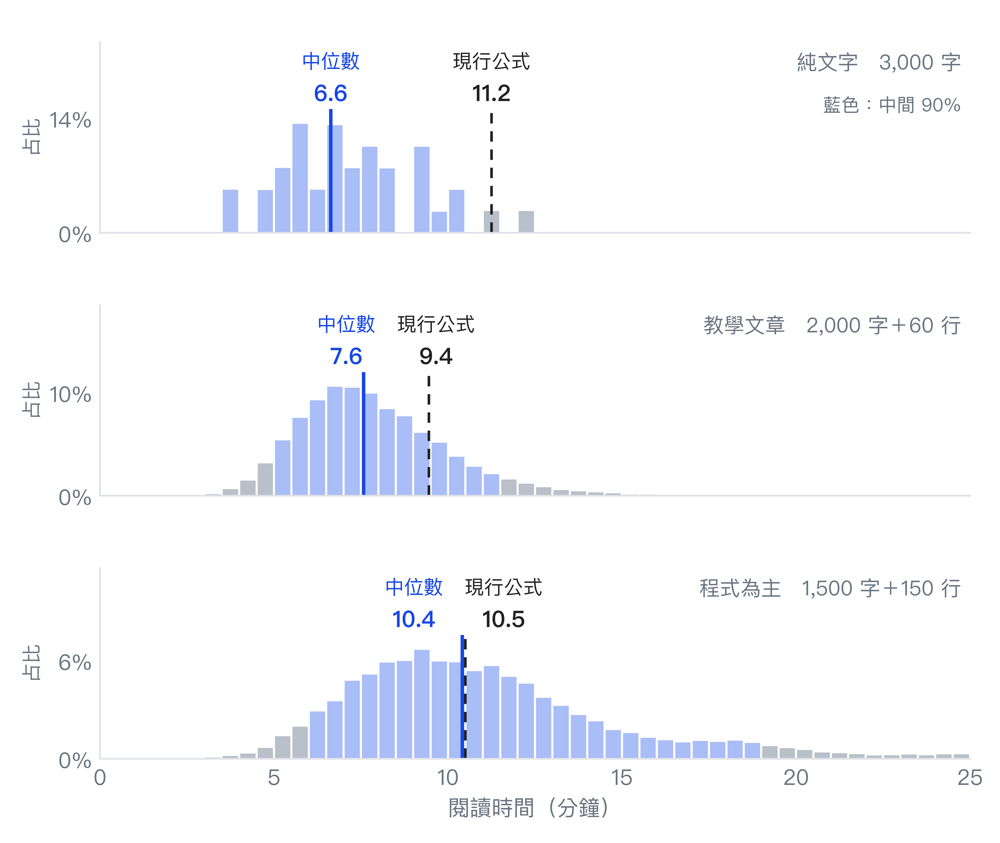{width=640}
:::

@fig-sim 是 200,000 次模擬的閱讀時間分佈。藍色長條是中間 90%（5% 到 95%），實線是中位數，虛線是現行公式。純文字那一格只有零星幾根長條，因為沒有程式碼，時間只取決於抽到哪一位讀者，38 位讀者最多只有 38 種結果。純文字的現行公式 11.2 分剛好落在中間 90% 的上界；程式為主的 10.5 分則幾乎和中位數重合。

## 討論

### 讀者之間的差異


同一篇 3,000 字的文章，讀得快的人不到 4 分鐘就讀完，讀得慢的人要 11 分鐘以上。這個差距主要來自人，而不是文章。

所以**約 $N$ 分鐘**比較合適的讀法，是中間那位讀者大概要花多久，而不是你一定會花多久。調整公式的權重，只會把中位數往左或往右移；讀者之間兩到三倍的差距，任何單一數字都處理不了。

### 沒有混合內容的資料

這份推算把文字與程式碼的時間**相加**，假設兩者互不影響。真實的閱讀可能不是這樣：一段程式可能讓讀者回頭重讀前面的說明，一張圖也可能讓讀者省下幾百字的閱讀。我找到的公開資料裡，沒有任何一份能檢驗這件事。

::: {#fig-heatmap}
{width=640}

德文維基百科首頁的視線熱點圖，來自 [Wikimedia Commons](https://commons.wikimedia.org/wiki/File:Eyetracking_heat_map_Wikipedia.jpg)（CC BY-SA 4.0）
:::

另外還有兩個限制：

- 程式碼的速率只來自兩段短程式，而且包含思考答案的時間。教學文章裡的程式碼通常更長，讀者也可能邊讀邊動手試，這些都不在資料裡。
- 圖片、表格與公式完全沒有資料。Medium 的說明提到會依圖片調整 @citep[medium2026readtime]，但我沒有查到它的依據。

## 結論

這篇文章用四份公開資料檢查部落格現行的閱讀時間公式：文字的部分偏高，程式碼的部分證據不足，最大的變數則是讀者而不是文章。同一篇文章，讀得快與讀得慢的人可以差到兩、三倍，所以公式的權重可以微調，但任何單一數字都只代表中間那一位讀者。與其追求更精確的分鐘數，更誠實的做法是把預估時間當成一個範圍。

- **文字：** 公開資料中，華語讀者只數中文字的速度中位數約 430 字／分（MECO `ch_t`），比我的部落格公式隱含的 267 字／分快得多，純文字文章的時間大約被高估 7 成。
- **程式碼：** EMIP 的每行約 2.6 秒，與公式的 1.95 秒是同一個量級，但資料只有兩段程式，證據很薄。
- **讀者差異：** 六到八成的變異來自讀者，同一篇文章的 5% 到 95% 範圍約差 2 到 3 倍。
- **範圍的限制：** 資料都是短文章、實驗室環境，也沒有圖片、表格與公式。

如果要依這份分析調整公式，有證據支持的是降低文字的權重；程式碼的係數，目前的證據不足以改。這些都是用實驗資料推算的，不能取代在真實讀者身上量到的時間。

不過，預估的閱讀分鐘數其實還有兩件事情可以談——是讀得快不見得讀懂：EMIP 裡完全沒經驗的人讀得最快，答對率卻最低，所以時間短不代表理解了。另一件是中英夾雜：公式只數中文字，文章裡的英文單字等於沒被算進去，到底低估多少。

因此，帶著這些疑問，我們將在這裡稍作收尾，留到下一篇再談論！

[^bootstrap]: Bootstrap 可以想成一個抽紙條的遊戲。把每位讀者的閱讀速度各寫在一張紙條上，全部放進袋子。從袋子裡抽出一張，記下速度，再把紙條放回去，重複抽到和原本一樣多張為止。這樣抽出的一批叫一次重抽，每抽完就放回的抽法叫重複抽樣（有放回抽樣）。因為每次都放回，有些人會被抽到好幾次，有些人一次也沒被抽到，所以這一批和原本的樣本不完全相同，算出來的中位數也會略有不同。把這個遊戲玩一萬次，就得到一萬個中位數，它們散開的範圍，就是**換一批讀者來，中位數大概會差多少**的估計：散得越開，表示手上的中位數越不可靠。這個方法不必假設速率長成常態分佈之類的形狀，只用手上的資料。

[^text-share]: @eq:share-text 的文章占比要特別小心。$\sigma_b^2$ 是 @eq:crossed 中文章效果 $b_j$ 的變異數，只能從文章之間的差異估出來，而 HKC 只有 7 篇、MECO 只有 12 篇，等於只用 7 個和 12 個數字估一個變異數，多一篇或少一篇特別難讀的文章，結果就可能明顯改變。所以文章的占比只能看大概的量級，不能當成精確的數字。

## 參考文獻

[references]
