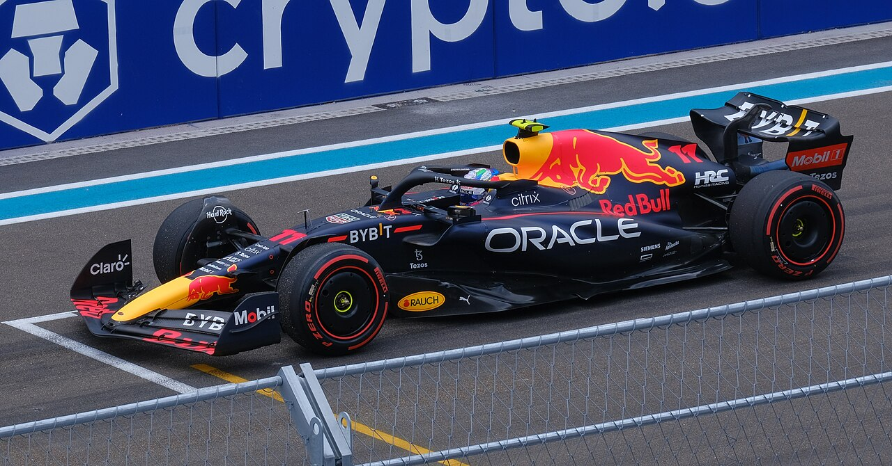

Since 2021, Formula 1 has capped what each team may spend per year. The cap started at 145 million US dollars, and driver salaries, the pay of the three highest-paid executives, and marketing and hospitality costs are not counted @citep[motorsport2025costcap]. In October 2022, the FIA (the sport's governing body) found that Red Bull had overspent its 2021 cap by about 1.86 million pounds (1.6%), which counted as a minor overspend. The penalty was a 7 million dollar fine and a 10% cut in the team's aerodynamic testing allowance for the following year @citep[motorsport2025costcap].

<figure><figcaption>The Red Bull RB18 at the 2022 Miami Grand Prix (<a href="https://commons.wikimedia.org/wiki/File:2022_Miami_GP_-_Red_Bull_RB18_of_Sergio_P%C3%A9rez.jpg">Dcmaradiaga</a>, <a href="https://creativecommons.org/licenses/by-sa/4.0/">CC BY-SA 4.0</a>)</figcaption></figure>

Teams spend money on developing a car to win the championship, and whether they win or lose, the money cannot be recovered. This is close to the Tullock contest at the start of [the first post](/articles/tullock/tullock-introduction-en/)[^f1-fit]. The difference is that Formula 1 officially limits how much a team can spend per year, and a team that goes over is punished.

The models in the first two posts have no such limit. [The first post](/articles/tullock/tullock-introduction-en/) assumed that cost is proportional to spending, and [the second post](/articles/tullock/tullock-n-player-contest-en/) raised the number of players to $n$ and relaxed the contest intensity to $r$, but in both posts players could spend as much as they wanted. This leads to the central question of this post:

> When cost rises faster and faster with spending, or when spending itself is capped by a budget, how do equilibrium spending and rent dissipation change?

## A General Cost Function

Both previous posts assumed that cost is $cx_i$: every extra unit of spending adds the same cost $c$. This means that marginal cost does not depend on how much a player has already spent. In this section we first relax that assumption, let marginal cost rise with spending, and derive the symmetric equilibrium.

### Model Setup

Apart from the cost function, the assumptions are the same as in [the previous post](/articles/tullock/tullock-n-player-contest-en/#Model-Setup): $n \geq 2$ players, complete information, simultaneous moves, the same prize valuation $V > 0$, and the contest intensity fixed at $r = 1$. The cost of spending $x_i$ is now

::: {.equation #eq:power-cost}
C(x_i) = \dfrac{c}{q} x_i^{q}, \quad c > 0, \ q \geq 1
:::

where $q$ sets the curvature of the cost, and the corresponding marginal cost is

$$
C'(x_i) = c x_i^{q - 1}
$$

When $q = 1$, marginal cost is always $c$, which is the linear cost of the first two posts. When $q > 1$, marginal cost rises with spending: each extra unit adds more cost than the one before it[^q-range]. The factor $\frac{1}{q}$ in the cost function is there only so that the coefficient of marginal cost is exactly $c$.

Player $i$'s expected payoff is therefore

::: {.equation #eq:power-payoff}
\pi_i(x_i, X_{-i}) = \dfrac{x_i}{x_i + X_{-i}} V - \dfrac{c}{q} x_i^{q}
:::

where $X_{-i} = \sum_{j \neq i} x_j$ is the total spending of the other players.

### The Symmetric Nash Equilibrium

We solve it in the same way as in the first two posts: first find each player's optimal spending given $X_{-i}$, then require that all players' optimal spending is the same.

Consider first $X_{-i} > 0$. The derivative of the win probability is the same as in the previous post, so from @eq:power-payoff the first derivative is:

$$
\dfrac{\partial \pi_i}{\partial x_i} = \underbrace{\dfrac{VX_{-i}}{(x_i + X_{-i})^2}}_{\text{marginal expected benefit}} - \underbrace{c x_i^{q - 1}}_{\text{marginal cost}}
$$

Setting it to zero gives the first-order condition:

::: {.equation #eq:power-foc}
\dfrac{VX_{-i}}{(x_i + X_{-i})^2} = c x_i^{q - 1}
:::

Compared with linear cost, the marginal expected benefit on the left is unchanged. Only the marginal cost on the right changes, from the constant $c$ to $c x_i^{q-1}$, which rises with $x_i$.

Next we check the second-order condition (SOC). For $x_i > 0$,

$$
\dfrac{\partial^2 \pi_i}{\partial x_i^2} = -\dfrac{2VX_{-i}}{(x_i + X_{-i})^3} - c(q - 1) x_i^{q - 2} < 0
$$

The first term is always negative, and the second is not positive when $q \geq 1$. So the expected payoff is strictly concave in $x_i$, and if @eq:power-foc has a positive solution, it is the unique optimal spending.

There is one difference from linear cost. When $q > 1$, the marginal cost of spending close to zero is also close to zero, while the marginal expected benefit at $x_i = 0$ is $\frac{V}{X_{-i}} > 0$. So as long as the other players spend a positive amount, @eq:power-foc always has a positive solution. In other words, when $q > 1$ the optimal spending is never the corner solution $x_i = 0$.

Now we look for the symmetric equilibrium. Let $x_1^* = \cdots = x_n^* = x^*$, so $X_{-i} = (n - 1)x^*$. Substituting into @eq:power-foc:

$$
\dfrac{V(n - 1)x^*}{\left[ x^* + (n - 1)x^* \right]^2} = \dfrac{V(n - 1)}{n^2 x^*} = c (x^*)^{q - 1}
$$

Multiplying both sides by $x^*$ gives $c (x^*)^q = \frac{(n - 1)V}{n^2}$, and therefore:

::: {.equation #eq:power-eq-input}
x_i^* = \left( \dfrac{(n - 1)V}{cn^2} \right)^{1/q}, \quad i = 1, \cdots, n
:::

When $q = 1$, @eq:power-eq-input reduces to $x_i^* = \frac{(n - 1)V}{cn^2}$ from [the previous post](/articles/tullock/tullock-n-player-contest-en/).

::: {.proposition}
# Symmetric Nash equilibrium with power-function cost

In a Tullock contest with $n \geq 2$ players, complete information, simultaneous moves, the same prize valuation $V > 0$, the same cost function $\frac{c}{q} x_i^q$ ($c > 0$, $q \geq 1$) and $r = 1$, there is a unique pure-strategy Nash equilibrium:

$$
(x_1^*, \cdots, x_n^*) = \left( \left( \dfrac{(n - 1)V}{cn^2} \right)^{1/q}, \cdots, \left( \dfrac{(n - 1)V}{cn^2} \right)^{1/q} \right)
$$
:::

::: {.proof}
Consider first the case where every player spends a positive amount. Let $X = \sum_j x_j$ be total spending, so $X_{-i} = X - x_i$ and each player's first-order condition is:

$$
\dfrac{V(X - x_i)}{X^2} = c x_i^{q - 1}, \quad i = 1, \cdots, n
$$

The equations have the same form and differ only in $x_i$. For a fixed $X$, the left side is strictly decreasing in $x_i$ and the right side is not decreasing when $q \geq 1$, so the same equation has at most one solution, and all $x_i$ must be equal. That is, any pure-strategy equilibrium in which everyone spends a positive amount must be symmetric, and it is uniquely determined by @eq:power-eq-input.

Now we rule out the boundary cases:

- If only one player spends a positive amount, their win probability is 1. They can lower their spending and still win for sure at a lower cost, so the original spending is not a best response
- If at least two players spend a positive amount and at least one spends zero, let total spending be $X > 0$. For a player who spends a positive amount, the first-order condition is $\frac{V(X - x_i)}{X^2} = c x_i^{q - 1}$. For a player who spends zero, the marginal cost at $0$ is $0$ when $q > 1$, while the marginal expected benefit $\frac{V}{X}$ is positive. When $q = 1$ the marginal cost is $c$, and since $X - x_i < X$, we have $\frac{V}{X} > \frac{V(X - x_i)}{X^2} = c$. In both cases, spending a small enough positive amount raises the expected payoff, so this is not an equilibrium
- If nobody spends anything, each player's expected payoff is $\frac{V}{n}$. If one player spends a small enough $\varepsilon > 0$, their win probability becomes 1 and their expected payoff is $V - \frac{c}{q}\varepsilon^q > \frac{V}{n}$, so nobody spending is not an equilibrium

Finally we verify that the candidate is indeed an equilibrium. When the other players all spend $x^* > 0$, we have $X_{-i} = (n - 1)x^* > 0$, $\pi_i$ is strictly concave in $x_i$, and $x_i = x^*$ satisfies the first-order condition. So it is the unique global maximum over $x_i \geq 0$, and $(x_1^*, \cdots, x_n^*)$ is a Nash equilibrium. $\blacksquare$
:::

With the equilibrium spending known, we can compute the equilibrium win probability and expected payoff. All players spend the same amount, so the win probability is still

$$
p_i^* = \dfrac{1}{n}
$$

which does not depend on the cost function. From @eq:power-eq-input we know that $c (x_i^*)^q = \frac{(n - 1)V}{n^2}$, and substituting this into @eq:power-payoff gives each player's equilibrium expected payoff:

::: {.equation #eq:power-eq-payoff}
\pi_i^* = \dfrac{V}{n} - \dfrac{1}{q} \cdot \dfrac{(n - 1)V}{n^2} = \dfrac{(qn - n + 1)V}{qn^2}
:::

When $q = 1$, $\pi_i^* = \frac{V}{n^2}$, which agrees with the previous post.

### The Effect of Cost Curvature

With the equilibrium in hand, we can ask: when $q$ is larger, that is, when cost rises faster with spending, how does the equilibrium change?

First consider individual spending. From @eq:power-eq-input we know that $x_i^* = A^{1/q}$, where $A = \frac{(n - 1)V}{cn^2}$ does not depend on $q$. Treating $q$ as continuous for now and differentiating:

::: {.equation #eq:power-dq}
\dfrac{\partial x_i^*}{\partial q} = -\dfrac{\ln A}{q^2} \, x_i^*
:::

So the direction depends on whether $A$ is larger than 1:

- When $A > 1$, $x_i^*$ falls as $q$ rises
- When $A < 1$, $x_i^*$ rises as $q$ rises
- When $A = 1$, $x_i^* = 1$ regardless of $q$

Intuitively, a larger $q$ should make players spend less, but the direction of individual spending is not fixed. The reason is that $C'(1) = c$ holds for every $q$, so all cost curves have the same marginal cost at $x = 1$. When $q$ rises, the marginal cost for $x < 1$ becomes lower and the marginal cost for $x > 1$ becomes higher, so equilibrium spending moves toward $1$, and $x_i^* \to 1$ as $q \to \infty$.

And how large a spending of $x = 1$ is depends on the unit of measurement: if the same spending is measured in another unit, $c$ and $A$ change with it. So the direction in which individual spending moves with $q$ cannot be taken directly as the effect of $q$.

Instead, we use a quantity that does not depend on the unit: the cost players actually pay. From @eq:power-eq-input we know that $c (x_i^*)^q = \frac{(n - 1)V}{n^2}$, so the equilibrium cost of one player and the total contest cost of all players are:

::: {.equation #eq:power-tc}
C(x_i^*) = \dfrac{1}{q} \cdot c (x_i^*)^q = \dfrac{(n - 1)V}{qn^2}, \qquad TC^* = nC(x_i^*) = \dfrac{(n - 1)V}{qn}
:::

This result does not depend on $c$, and it is not affected by the unit of measurement. When $q = 1$, $TC^* = \frac{n - 1}{n}V$, which agrees with the previous post. As $q$ rises, total contest cost shrinks in proportion to $\frac{1}{q}$.

::: {.proposition}
# Cost curvature and equilibrium outcomes

In a Tullock contest with $n \geq 2$ players, with $n$, $V$, $c$ and $r = 1$ fixed, as the cost curvature $q \geq 1$ increases:

1. Each player's equilibrium cost $C(x_i^*)$ and the total contest cost $TC^*$ fall
2. Each player's expected payoff $\pi_i^*$ rises
3. Each player's equilibrium spending $x_i^*$ moves toward $1$: it falls when $A > 1$ and rises when $A < 1$
:::

In $\pi_i^* = \frac{V}{n} - \frac{(n - 1)V}{qn^2}$, only the subtracted cost term falls with $q$, so $\pi_i^*$ rises. Take $n = 5$ and $V = 100$ as an example, with three values of the unit cost $c$:

| $q$ | $x_i^*$ ($c = 1$) | $x_i^*$ ($c = 16$) | $x_i^*$ ($c = 64$) | $TC^*$ | $\pi_i^*$ |
| --- | --- | --- | --- | --- | --- |
| 1 | 16.00 | 1.00 | 0.25 | 80.00 | 4.00 |
| 2 | 4.00 | 1.00 | 0.50 | 40.00 | 12.00 |
| 3 | 2.52 | 1.00 | 0.63 | 26.67 | 14.67 |
| 4 | 2.00 | 1.00 | 0.71 | 20.00 | 16.00 |

The three columns of $x_i^*$ move in different directions: it falls for $c = 1$ ($A = 16$), stays the same for $c = 16$ ($A = 1$), and rises for $c = 64$ ($A = 0.25$). But $TC^*$ and $\pi_i^*$ are exactly the same in all three cases, and they do not depend on $c$.

### The Change in the Rent Dissipation Rate

Dividing total contest cost by the value of the prize gives the rent dissipation rate for power-function cost:

::: {.equation #eq:power-dissipation}
D^* = \dfrac{TC^*}{V} = \dfrac{n - 1}{qn}
:::

When $q = 1$, $D^* = \frac{n - 1}{n}$, which is the result of the previous post. With power-function cost, the dissipation rate is the dissipation rate under linear cost divided by $q$.

The equilibrium expected payoff can also be written in the same form as in the previous post. From @eq:power-tc we know that each player's cost is $\frac{D^* V}{n}$, so

$$
\pi_i^* = \dfrac{V}{n} - \dfrac{D^* V}{n} = \dfrac{(1 - D^*)V}{n}
$$

From @eq:power-dissipation we get two results:

- For a fixed $q$, $D^*$ rises with $n$, so more players still raise the dissipation rate
- For a fixed $n$, $D^*$ falls with $q$: the larger $q$ is, the smaller the share of the prize spent on the contest

Now consider the case of a very large $n$:

$$
\lim_{n \to \infty} D^* = \dfrac{1}{q}
$$

Under linear cost the dissipation rate approaches 1. But when $q > 1$, even if the number of players goes to infinity, only $\frac{1}{q}$ of the prize value is spent on the contest.

This result comes from $C(x) = \frac{1}{q} \cdot x C'(x)$: for the same marginal cost and spending, the larger $q$ is, the smaller the total cost. And from the first-order condition, in equilibrium the product of marginal cost and spending is $\frac{(n - 1)V}{n^2}$, which does not depend on $q$, so only the factor $\frac{1}{q}$ changes the total cost.

## Budget Limits and Corner Solutions

Back to the Formula 1 example at the start: the cost cap sets how much each team may spend at most, which in the model corresponds to an upper bound on spending. In this section we add that limit to the model and see how it changes the equilibrium.

### Model Setup

The model is the same as in the previous section, with one extra constraint: each player's spending cannot exceed the budget $B > 0$, that is,

::: {.equation #eq:budget}
0 \leq x_i \leq B
:::

All players have the same budget[^same-budget], and the expected payoff is still @eq:power-payoff.

### The Equilibrium

First consider a single player. When $X_{-i} > 0$, $\pi_i$ is strictly concave in $x_i$, so the optimal spending on $[0, B]$ is the smaller of the unconstrained optimum and $B$: if the optimum is above $B$, the player stops at $B$. This is a **corner solution**.

So with a budget limit there are only two possibilities for equilibrium spending: either the budget is large enough and the limit does not bind, or it is too small and every player uses up the whole budget.

::: {.proposition}
# Equilibrium with a budget limit

In the Tullock contest of the previous section, suppose each player's spending must satisfy $x_i \leq B$, and let $x^* = \left( \frac{(n - 1)V}{cn^2} \right)^{1/q}$ be the equilibrium spending without a limit. Then there is a unique pure-strategy Nash equilibrium, in which each player spends:

$$
x_i^B = \min \{ B, \, x^* \}
$$

That is, when $B \geq x^*$, the equilibrium is the same as without a limit; when $B < x^*$, every player uses up the whole budget.
:::

::: {.proof}
We first show that $x_i^B$ is indeed an equilibrium when $B \geq x^*$ and when $B < x^*$.

- If $B \geq x^*$, when the others spend $x^*$, player $i$'s unconstrained optimum is $x^*$, and $x^* \leq B$ is already within the limit, so nobody wants to deviate
- If $B < x^*$, and the others all spend $B$, then $X_{-i} = (n - 1)B$. The first derivative of $\pi_i$ at $x_i = B$ is $\frac{V(n - 1)}{n^2 B} - cB^{q - 1}$. Since $B^q < (x^*)^q = \frac{(n - 1)V}{cn^2}$, this value is positive. Together with the strict concavity of $\pi_i$, $\pi_i$ is increasing on $[0, B]$, so the optimal spending is $B$

Next we show uniqueness. The case of zero spending is the same as in the previous section and is not an equilibrium, so we only need to consider the case where everyone spends a positive amount. Let total spending be $X$, and let $g(x) = \frac{V(X - x)}{X^2} - c x^{q - 1}$, which is strictly decreasing in $x$, and the first derivative of $\pi_i$ is $g(x_i)$. A player who spends less than $B$ satisfies the first-order condition $g(x_i) = 0$; a player who spends exactly $B$ satisfies $g(B) \geq 0$.

If both kinds of players exist, the player who spends $B$ requires $g(B) \geq 0$, and since $g$ is decreasing, the root of $g$ is not smaller than $B$. But the spending of a player who spends less than $B$ is exactly the root of $g$, which contradicts it being smaller than $B$. So all players spend the same amount: if all spend less than $B$, it is the $x^*$ of the previous section and requires $x^* < B$; if all spend exactly $B$, it requires $g(B) \geq 0$, that is, $B \leq x^*$. Together, the two cases are exactly $x_i^B = \min \{ B, x^* \}$. $\blacksquare$
:::

### The Effect of the Budget Limit

When $B \geq x^*$, the budget limit does not bind and the result is exactly the same as in the previous section. What matters is $B < x^*$: each player spends $B$, the win probability is still $\frac{1}{n}$, but the cost falls to $\frac{c}{q} B^q$, which is lower than $\frac{c}{q} (x^*)^q$ without a limit. The total contest cost, the rent dissipation rate and each player's expected payoff are therefore:

::: {.equation #eq:budget-result}
TC^B = \dfrac{ncB^q}{q}, \qquad D^B = \dfrac{ncB^q}{qV}, \qquad \pi_i^B = \dfrac{V}{n} - \dfrac{cB^q}{q}
:::

When $B = x^*$, we know from @eq:power-eq-input that $c (x^*)^q = \frac{(n - 1)V}{n^2}$, and substituting gives $D^B = \frac{n - 1}{qn}$, the same as @eq:power-dissipation, so the two pieces join continuously at $B = x^*$.

From @eq:budget-result we get: the lower the budget, the lower $D^B$ and the higher each player's expected payoff $\pi_i^B$. Without a limit every player wants to spend $x^*$, but when everyone spends more, nobody's win probability rises and the only effect is a higher cost. A budget cap makes everyone spend a bit less at the same time.

If we want to push the rent dissipation rate down to a target $d$, we set $D^B = d$ and the budget cap is $B = \left( \frac{qdV}{nc} \right)^{1/q}$.

Take $n = 5$, $V = 100$, $c = 1$ and $q = 1$ as an example, where $x^* = 16$:

| Budget $B$ | Equilibrium spending $x_i^B$ | $TC^B$ | $D^B$ | $\pi_i^B$ |
| --- | --- | --- | --- | --- |
| 4 | 4 | 20 | 0.20 | 16 |
| 8 | 8 | 40 | 0.40 | 12 |
| 12 | 12 | 60 | 0.60 | 8 |
| 16 | 16 | 80 | 0.80 | 4 |
| 20 | 16 | 80 | 0.80 | 4 |

When $B$ falls from 16 to 4, total contest cost falls from 80 to 20, and each player's expected payoff rises from 4 to 16. $B = 20$ is already above $x^* = 16$, so the limit does not bind and the result is the same as for $B = 16$.

A budget cap matters only when it is below the equilibrium spending $x^*$ without a limit, and then every player uses up the whole budget. The win probability is still $\frac{1}{n}$ while the cost is lower, so the rent dissipation rate falls and each player's expected payoff rises. This result assumes that the cap is always obeyed. But in Formula 1, a team can choose to overspend, at the price of a penalty.

### The Overspending Penalty

We use the simplest kind of penalty: for the part of spending above $B$, each unit is fined $\lambda > 0$, so the expected payoff is

::: {.equation #eq:penalty-payoff}
\pi_i(x_i, X_{-i}) = \dfrac{x_i}{x_i + X_{-i}} V - \dfrac{c}{q} x_i^{q} - \lambda \max \{ x_i - B, \, 0 \}
:::

Spending no longer has an upper bound. A fine is a transfer to the organizer and not a resource that is used up, so when computing the rent dissipation rate we still count only $\frac{c}{q} x_i^q$.

When everyone spends $B$, the marginal expected benefit of one more unit minus the marginal cost is

::: {.equation #eq:penalty-threshold}
\overline{\lambda} = \dfrac{(n - 1)V}{n^2 B} - cB^{q - 1}
:::

When $B < x^*$, $\overline{\lambda} > 0$, as the proof below shows. It is the minimum strength of the penalty needed so that players do not want to overspend.

::: {.proposition}
# Equilibrium with an overspending penalty

In the Tullock contest of the previous section, suppose each unit of spending above $B$ is fined $\lambda > 0$. Then every pure-strategy Nash equilibrium is symmetric, and each player spends:

1. $B \geq x^*$: $x^*$, and the penalty has no effect
2. $B < x^*$ and $\lambda \geq \overline{\lambda}$: $B$, the same as with a hard cap
3. $B < x^*$ and $\lambda < \overline{\lambda}$: $x^\lambda \in (B, x^*)$, the unique solution of

$$
\dfrac{(n - 1)V}{n^2 x} = c x^{q - 1} + \lambda
$$
:::

::: {.proof}
The case of zero spending is the same as before and is not an equilibrium, so we only consider the case where everyone spends a positive amount. Let total spending in equilibrium be $X$, and let $h(x) = \frac{V(X - x)}{X^2} - c x^{q - 1}$, which is strictly decreasing in $x$. The first derivative of $\pi_i$ with respect to $x_i$ is $h(x_i)$ when $x_i < B$ and $h(x_i) - \lambda$ when $x_i > B$; at $x_i = B$, the left derivative is $h(B)$ and the right derivative is $h(B) - \lambda$.

Let $x_0$ be the root of $h(x) = 0$ and $x_\lambda$ the root of $h(x) = \lambda$. Since $h$ is strictly decreasing, $x_\lambda < x_0$. Since $\pi_i$ is strictly concave, the optimal spending is the median of $x_\lambda$, $B$ and $x_0$. This value depends only on $X$ and not on $i$, so all players spend the same amount, and any equilibrium must be symmetric.

Let everyone spend $x$, so $X = nx$ and $h(x) = \frac{(n - 1)V}{n^2 x} - c x^{q - 1}$.

- If $B \geq x^*$, then $x = x^*$ gives $h(x) = 0$, and $x^* \leq B$, so it is the optimal spending
- If $B < x^*$, then $h(B) = \overline{\lambda} > 0$. When $\lambda \geq \overline{\lambda}$, $h(B)$ lies within $[0, \lambda]$, and spending $B$ is optimal
- If $B < x^*$ and $\lambda < \overline{\lambda}$, then $h(B) > \lambda$, so the optimal spending is above $B$ and satisfies $h(x) = \lambda$. Since $h$ is strictly decreasing, the solution is unique; and since $h(B) = \overline{\lambda} > \lambda > 0 = h(x^*)$, we have $B < x^\lambda < x^*$. $\blacksquare$
:::

The third case is the transition between a hard cap and no cap. The lighter the penalty, the closer $x^\lambda$ is to $x^*$; as $\lambda$ rises to $\overline{\lambda}$, $x^\lambda$ falls to $B$. So as long as the penalty is heavy enough, a cap that can be exceeded has the same effect as a hard cap.

Take $n = 5$, $V = 100$, $c = 1$, $q = 1$ and $B = 8$ as an example, where $x^* = 16$, $\overline{\lambda} = 1$ and $x^\lambda = \frac{16}{1 + \lambda}$:

| Penalty $\lambda$ | Equilibrium spending | $TC$ | $D$ | Expected payoff per player |
| --- | --- | --- | --- | --- |
| 0 | 16.00 | 80.00 | 0.80 | 4.00 |
| 0.25 | 12.80 | 64.00 | 0.64 | 6.00 |
| 0.5 | 10.67 | 53.33 | 0.53 | 8.00 |
| 1 | 8.00 | 40.00 | 0.40 | 12.00 |
| 2 | 8.00 | 40.00 | 0.40 | 12.00 |

When $\lambda = 0.5$, players overspend and still have to pay the fine, but their expected payoff of 8.00 is higher than the 4.00 without a cap, because everyone spends less. Once $\lambda$ is above $\overline{\lambda} = 1$, the result is the same as with a hard cap.

This penalty is the simplest form. The actual penalty in Formula 1 combines a fine with a reduced testing allowance, which is not a linear function of spending, and an overspend is not always detected. If the probability of being caught is $p$ and players care only about expected payoff, we can simply replace $\lambda$ with $p\lambda$.

## Numerical Simulation

The results so far are all analytical. In this section we check them another way: without using any formula, we use a numerical method to find each player's best response, let all players take turns best-responding to the others' spending, and repeat until nobody wants to change. The point we reach is the Nash equilibrium, and we finally compare it with the analytical solution.

The simulator below lets you change the number of players $n$, the cost curvature $q$, the budget cap $B$, the overspending penalty $\lambda$, the prize $V$ and the unit cost $c$, and the results are computed in your browser in real time.

### Cost Curvature and the Dissipation Rate

Start with **By $q$**. The horizontal axis is $q$, the solid line is the rent dissipation rate computed from the formula, and the dots are the equilibrium solved numerically without any formula.

You can try adjusting it:

- Set the budget $B$ to $40$ and the penalty $\lambda$ to $0$. The cap no longer binds, and the solid line is $D^* = \frac{n - 1}{qn}$ from @eq:power-dissipation. With $n = 5$, $q = 1, 2, 4$ give $D^*$ of $0.8, 0.4, 0.2$, and all the dots lie on the curve.
- With the same settings, change the unit cost $c$ from $1$ to $4$. The equilibrium spending $\overline{x}$ in the readout at the bottom right changes, but the rent dissipation rate does not, which agrees with the fact that the result in @eq:power-tc does not contain $c$.
- Raise $n$ and the whole curve moves up, but its shape is still $\frac{1}{q}$ falling with $q$.
- Switch to **Iteration**. Each line is one player's spending. The starting points are deliberately different, but all the lines converge to the dashed line, which is the equilibrium spending from the formula.

### Budget and Penalty

Now switch to **By budget**. The horizontal axis is $B / x^*$, and the horizontal dashed line is $D^* = \frac{n - 1}{qn}$ without a cap.

The default values are $n = 5$, $q = 1$, $V = 100$, $c = 1$ and $\lambda = 0.5$, where $x^* = 16$. The curve has three parts, which match the three cases in the proposition:

- $B / x^* \leq \frac{2}{3}$: $\overline{\lambda} \geq 0.5$, players prefer to overspend, spending stays at $x = \frac{16}{1 + \lambda} \approx 10.67$, and the dissipation rate is the flat $0.533$
- $\frac{2}{3} \leq B / x^* \leq 1$: $\overline{\lambda} \leq 0.5$, the penalty is heavy enough, every player spends $B$, and the dissipation rate rises linearly with $B$ until it returns to $0.8$ at $B = x^*$
- $B / x^* \geq 1$: the cap does not bind, and the dissipation rate stays at $0.8$

Next, adjust the penalty:

- Set $\lambda$ to $0$: the curve becomes a horizontal line. With no penalty, the cap is meaningless.
- Set $\lambda$ to $3$: the flat part shrinks to $B / x^* \leq 0.25$, and the dissipation rate already falls with $B$ when $B$ is only a little below $x^*$.
- Go back to the defaults, set $B$ to $8$ and $\lambda$ to $1$. The case in the readout becomes **everyone uses up the budget**, equilibrium spending is $8$, the rent dissipation rate is $0.4$ and each player's expected payoff is $12$, which agrees with the table above. Raising $\lambda$ further does not change the result.

## Conclusion

From cost curvature, budget limits and overspending penalties, we obtain the following results:

| Object of analysis | Result |
| --- | --- |
| Equilibrium spending | $x_i^* = \left( \frac{(n - 1)V}{cn^2} \right)^{1/q}$ |
| Total contest cost | $TC^* = \frac{(n - 1)V}{qn}$ |
| Rent dissipation rate | $D^* = \frac{n - 1}{qn}$ |
| With a budget cap $B$ | $x_i^B = \min \{ B, \, x^* \}$ |
| Threshold of the overspending penalty | $\overline{\lambda} = \frac{(n - 1)V}{n^2 B} - cB^{q - 1}$ |

Back to the opening question: the faster cost rises with spending, the more total contest cost and the rent dissipation rate shrink, in proportion to $\frac{1}{q}$. When a budget cap is below the equilibrium spending without a limit, all players use up the budget, the win probability stays the same, the cost falls, and so each player's expected payoff rises. If the cap can be exceeded, then as long as the penalty is not below the threshold $\overline{\lambda}$, the result is the same as with a hard cap.

These results also remind us that the resources a contest consumes depend not only on how large the prize is and how many players take part, but also on the cost structure and the rules of the contest. In the standard model the rent dissipation rate is $\frac{n - 1}{n}$, but that depends on two assumptions, linear cost and no upper bound on spending, and once either one changes, the dissipation is no longer the same.

These results rest on identical players, complete information, simultaneous moves, equal budgets and $r = 1$. How the equilibrium changes when players differ, when they do not know their opponents' costs, or when they move in sequence needs a separate analysis.

[^f1-fit]: Formula 1 does not match the model exactly. The teams' cost cap covers only part of their spending and excludes items such as driver salaries and marketing @citep[motorsport2025costcap]. So what the cap limits is only a part of the spending $x_i$ in the model. The championship is also not decided by a probability function like $\frac{x_i}{\sum_j x_j}$. We only borrow the situation in which spending is limited by a cap.

[^q-range]: This post considers only $q \geq 1$. When $0 < q < 1$, the cost function is concave, so the second-order condition no longer holds and needs a separate analysis.

[^same-budget]: This post considers only the case where all players have the same budget. Different budgets make the equilibrium asymmetric, which needs a separate analysis.

## References

[references]
