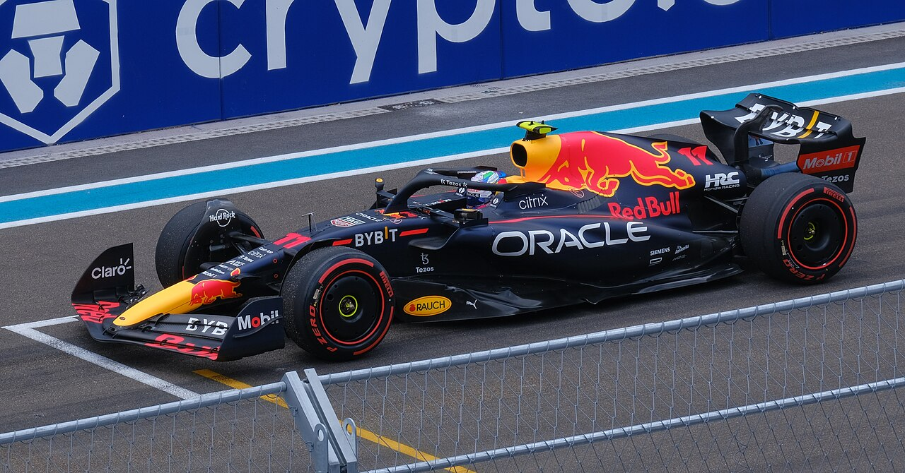

2021 年起，一級方程式賽車（Formula 1）規定各車隊每年的花費不得超過成本上限，首年為 1.45 億美元，車手薪資、前三位高階主管的薪資，以及行銷與接待等支出不計入 @citep[motorsport2025costcap]。2022 年 10 月，國際汽車運動總會（FIA）認定 Red Bull 車隊 2021 年的花費超出上限約 186 萬英鎊（1.6%），屬於輕微超支，處分是罰款 700 萬美元，並把隔年的空氣動力學測試額度減少 10% @citep[motorsport2025costcap]。

<figure><figcaption>Red Bull RB18，2022 年 Miami 大獎賽（<a href="https://commons.wikimedia.org/wiki/File:2022_Miami_GP_-_Red_Bull_RB18_of_Sergio_P%C3%A9rez.jpg">Dcmaradiaga</a>，<a href="https://creativecommons.org/licenses/by-sa/4.0/">CC BY-SA 4.0</a>）</figcaption></figure>

車隊投入資金研發賽車、爭奪冠軍，不論輸贏，花掉的錢都收不回來，這與[第一篇](/articles/tullock/tullock-introduction/)開頭的 Tullock 競賽相當接近[^f1-fit]。不同的是，F1 官方明文限制了每年能花多少，超過就要受罰。

前兩篇的模型沒有這種限制。[第一篇](/articles/tullock/tullock-introduction/)假設成本與投入成正比，[第二篇](/articles/tullock/tullock-n-player-contest/)把參賽者增加到 $n$ 位、競賽強度放寬到 $r$，但兩篇都讓參賽者想投入多少就投入多少。這引出了本篇的核心問題：

> 當成本隨投入增加得越來越快，或投入本身有預算上限時，均衡投入與租金耗散會怎麼改變？

## 一般化成本函數

前兩篇都假設成本為 $cx_i$：每多投入一單位，成本就增加固定的 $c$。這表示邊際成本不會隨投入的多寡而改變。本節先放寬這項假設，讓邊際成本可以隨投入遞增，並推導對稱均衡。

### 模型設定

除了成本函數，其餘假設與[上一篇](/articles/tullock/tullock-n-player-contest/#模型設定)相同：$n \geq 2$ 名參賽者、完全資訊、同時決策、相同的獎勵估值 $V > 0$，競賽強度固定為 $r = 1$。參賽者投入 $x_i$ 的成本改為

::: {.equation #eq:power-cost}
C(x_i) = \dfrac{c}{q} x_i^{q}, \quad c > 0, \ q \geq 1
:::

其中 $q$ 決定成本的曲率，對應的邊際成本為

$$
C'(x_i) = c x_i^{q - 1}
$$

當 $q = 1$ 時，邊際成本恆為 $c$，回到前兩篇的線性成本。當 $q > 1$ 時，邊際成本隨投入遞增，每多投入一單位，增加的成本都比前一單位更高[^q-range]。成本函數中的 $\frac{1}{q}$ 只是為了讓邊際成本的係數剛好是 $c$。

因此，參賽者 $i$ 的預期報酬函數為

::: {.equation #eq:power-payoff}
\pi_i(x_i, X_{-i}) = \dfrac{x_i}{x_i + X_{-i}} V - \dfrac{c}{q} x_i^{q}
:::

其中 $X_{-i} = \sum_{j \neq i} x_j$ 為其他參賽者的總投入。

### 對稱 $Nash$ 均衡

求解方式與前兩篇相同：先在給定 $X_{-i}$ 的前提下求出最適投入，再要求所有人的最適投入彼此一致。

先考慮 $X_{-i} > 0$。勝率部分的微分與前一篇相同，因此由@eq:power-payoff 可得一階偏導數為：

$$
\dfrac{\partial \pi_i}{\partial x_i} = \underbrace{\dfrac{VX_{-i}}{(x_i + X_{-i})^2}}_{\text{邊際預期收益}} - \underbrace{c x_i^{q - 1}}_{\text{邊際成本}}
$$

令其為零，得到一階條件：

::: {.equation #eq:power-foc}
\dfrac{VX_{-i}}{(x_i + X_{-i})^2} = c x_i^{q - 1}
:::

與線性成本相比，左式的邊際預期收益沒有改變，只有右式的邊際成本從常數 $c$ 變成了隨 $x_i$ 遞增的 $c x_i^{q-1}$。

接著檢查二階條件 (SOC)。對 $x_i > 0$，

$$
\dfrac{\partial^2 \pi_i}{\partial x_i^2} = -\dfrac{2VX_{-i}}{(x_i + X_{-i})^3} - c(q - 1) x_i^{q - 2} < 0
$$

第一項恆為負，第二項在 $q \geq 1$ 時不大於零，因此預期報酬函數對 $x_i$ 嚴格凹，只要@eq:power-foc 有正的解，它就是唯一的最適投入。

這裡有一個與線性成本不同的地方。當 $q > 1$ 時，投入趨近於零的邊際成本也趨近於零，而邊際預期收益在 $x_i = 0$ 時為 $\frac{V}{X_{-i}} > 0$，所以只要其他人有正的投入，@eq:power-foc 就一定有正的解。換言之，$q > 1$ 時最適投入不會落在角解 $x_i = 0$。

接著尋找對稱均衡，令 $x_1^* = \cdots = x_n^* = x^*$，此時 $X_{-i} = (n - 1)x^*$，代入@eq:power-foc：

$$
\dfrac{V(n - 1)x^*}{\left[ x^* + (n - 1)x^* \right]^2} = \dfrac{V(n - 1)}{n^2 x^*} = c (x^*)^{q - 1}
$$

兩邊同乘 $x^*$，得到 $c (x^*)^q = \frac{(n - 1)V}{n^2}$，因此：

::: {.equation #eq:power-eq-input}
x_i^* = \left( \dfrac{(n - 1)V}{cn^2} \right)^{1/q}, \quad i = 1, \cdots, n
:::

當 $q = 1$ 時，@eq:power-eq-input 回到[上一篇](/articles/tullock/tullock-n-player-contest/)的 $x_i^* = \frac{(n - 1)V}{cn^2}$。

::: {.proposition}
# 冪函數成本下的對稱 Nash 均衡

在 $n \geq 2$、完全資訊、同時決策、相同獎勵估值 $V > 0$、相同成本函數 $\frac{c}{q} x_i^q$（$c > 0$，$q \geq 1$）且 $r = 1$ 的 Tullock 競賽中，存在唯一的純策略 Nash 均衡：

$$
(x_1^*, \cdots, x_n^*) = \left( \left( \dfrac{(n - 1)V}{cn^2} \right)^{1/q}, \cdots, \left( \dfrac{(n - 1)V}{cn^2} \right)^{1/q} \right)
$$
:::

::: {.proof}
先考慮所有人投入皆為正的情形。令總投入為 $X = \sum_j x_j$，則 $X_{-i} = X - x_i$，每個人的一階條件為：

$$
\dfrac{V(X - x_i)}{X^2} = c x_i^{q - 1}, \quad i = 1, \cdots, n
$$

各式的形式相同，差別只在 $x_i$。固定 $X$ 時，左式對 $x_i$ 嚴格遞減，右式在 $q \geq 1$ 時不遞減，因此同一個方程式至多只有一個解，所有 $x_i$ 必須相等。也就是說，任何全員正投入的純策略均衡都必須對稱，並由@eq:power-eq-input 唯一決定。

再排除邊界情形：

- 若只有一人投入為正，則他的勝率為 1。他可以降低投入而仍然必勝，成本更低，因此原本的投入不是最佳反應
- 若至少兩人投入為正，且至少一人投入為零，令總投入為 $X > 0$。投入為正者的一階條件為 $\frac{V(X - x_i)}{X^2} = c x_i^{q - 1}$。投入為零者在 $0$ 處的邊際成本，在 $q > 1$ 時為 $0$，而邊際預期收益 $\frac{V}{X} > 0$。在 $q = 1$ 時邊際成本為 $c$，而 $X - x_i < X$，所以 $\frac{V}{X} > \frac{V(X - x_i)}{X^2} = c$。兩種情形下，只要投入一個足夠小的正數，預期報酬便會提高，因此這不是均衡
- 若所有人皆不投入，每人的預期報酬為 $\frac{V}{n}$。任何一人改為投入足夠小的 $\varepsilon > 0$，勝率變為 1，預期報酬為 $V - \frac{c}{q}\varepsilon^q > \frac{V}{n}$，因此全員不投入不是均衡

最後驗證候選解確實是均衡。當其他人皆投入 $x^* > 0$ 時，$X_{-i} = (n - 1)x^* > 0$，$\pi_i$ 對 $x_i$ 嚴格凹，且 $x_i = x^*$ 滿足一階條件，因此它是 $x_i \geq 0$ 上唯一的全域最大值，$(x_1^*, \cdots, x_n^*)$ 為 Nash 均衡。$\blacksquare$
:::

取得均衡投入後，可以計算均衡下的勝率與預期報酬。所有人投入相等，因此勝率仍然是

$$
p_i^* = \dfrac{1}{n}
$$

不受成本函數影響。再由@eq:power-eq-input 可知 $c (x_i^*)^q = \frac{(n - 1)V}{n^2}$，代回@eq:power-payoff，得到每位參賽者的均衡預期報酬：

::: {.equation #eq:power-eq-payoff}
\pi_i^* = \dfrac{V}{n} - \dfrac{1}{q} \cdot \dfrac{(n - 1)V}{n^2} = \dfrac{(qn - n + 1)V}{qn^2}
:::

當 $q = 1$ 時，$\pi_i^* = \frac{V}{n^2}$，與上一篇的結果一致。

### 成本曲率的影響

有了均衡解，就可以問：$q$ 越大，也就是成本隨投入增加得越快，均衡會如何改變？

先看個別投入。根據@eq:power-eq-input 可知 $x_i^* = A^{1/q}$，其中 $A = \frac{(n - 1)V}{cn^2}$ 與 $q$ 無關。暫時將 $q$ 視為連續變數並對其微分：

::: {.equation #eq:power-dq}
\dfrac{\partial x_i^*}{\partial q} = -\dfrac{\ln A}{q^2} \, x_i^*
:::

因此方向取決於 $A$ 是否大於 1：

- $A > 1$ 時，$x_i^*$ 隨 $q$ 增加而下降
- $A < 1$ 時，$x_i^*$ 隨 $q$ 增加而上升
- $A = 1$ 時，$x_i^* = 1$，與 $q$ 無關

直覺上，$q$ 越大，參賽者應該投入得越少，但個別投入的方向並不固定。原因在於 $C'(1) = c$ 對任何 $q$ 都成立，所有成本曲線在 $x = 1$ 的邊際成本相同。$q$ 增加時，$x < 1$ 的邊際成本變低，$x > 1$ 的邊際成本變高，所以均衡投入會朝 $1$ 的方向移動，當 $q \to \infty$ 時，$x_i^* \to 1$。

而 $x = 1$ 代表多大的投入，取決於計量單位：同一筆投入換個單位計算，$c$ 與 $A$ 就會跟著改變。因此，個別投入隨 $q$ 增減的方向，不能直接當成 $q$ 的影響。

改用與單位無關的量，也就是參賽者實際付出的成本。由@eq:power-eq-input 可知 $c (x_i^*)^q = \frac{(n - 1)V}{n^2}$，所以個別均衡成本與全體的總競賽成本為：

::: {.equation #eq:power-tc}
C(x_i^*) = \dfrac{1}{q} \cdot c (x_i^*)^q = \dfrac{(n - 1)V}{qn^2}, \qquad TC^* = nC(x_i^*) = \dfrac{(n - 1)V}{qn}
:::

這個結果與 $c$ 無關，也不受計量單位影響。當 $q = 1$ 時，$TC^* = \frac{n - 1}{n}V$，與上一篇一致。$q$ 增加時，總競賽成本以 $\frac{1}{q}$ 的比例縮小。

::: {.proposition}
# 成本曲率與均衡結果

在 $n \geq 2$ 的 Tullock 競賽中，固定 $n$、$V$、$c$ 與 $r = 1$，隨著成本曲率 $q \geq 1$ 增加：

1. 個別均衡成本 $C(x_i^*)$ 與總競賽成本 $TC^*$ 下降
2. 個別預期報酬 $\pi_i^*$ 上升
3. 個別均衡投入 $x_i^*$ 朝 $1$ 的方向變動：$A > 1$ 時下降，$A < 1$ 時上升
:::

其中 $\pi_i^* = \frac{V}{n} - \frac{(n - 1)V}{qn^2}$ 中，只有減去的成本項隨 $q$ 下降，所以 $\pi_i^*$ 上升。以 $n = 5$、$V = 100$ 為例，列出三組單位成本 $c$：

| $q$ | $x_i^*$（$c = 1$） | $x_i^*$（$c = 16$） | $x_i^*$（$c = 64$） | $TC^*$ | $\pi_i^*$ |
| --- | --- | --- | --- | --- | --- |
| 1 | 16.00 | 1.00 | 0.25 | 80.00 | 4.00 |
| 2 | 4.00 | 1.00 | 0.50 | 40.00 | 12.00 |
| 3 | 2.52 | 1.00 | 0.63 | 26.67 | 14.67 |
| 4 | 2.00 | 1.00 | 0.71 | 20.00 | 16.00 |

三組的 $x_i^*$ 方向各不相同：$c = 1$（$A = 16$）下降，$c = 16$（$A = 1$）不變，$c = 64$（$A = 0.25$）上升。但 $TC^*$ 與 $\pi_i^*$ 完全相同，也與 $c$ 無關。

### 租金耗散率的變化

把總競賽成本除以獎勵價值，得到成本函數為冪函數時的租金耗散率：

::: {.equation #eq:power-dissipation}
D^* = \dfrac{TC^*}{V} = \dfrac{n - 1}{qn}
:::

當 $q = 1$ 時，$D^* = \frac{n - 1}{n}$，回到上一篇的結果。成本函數為冪函數時，租金耗散率就是線性成本下的耗散率除以 $q$。

均衡預期報酬也可以寫成與上一篇相同的形式。由@eq:power-tc 可知每位參賽者的成本為 $\frac{D^* V}{n}$，所以

$$
\pi_i^* = \dfrac{V}{n} - \dfrac{D^* V}{n} = \dfrac{(1 - D^*)V}{n}
$$

由@eq:power-dissipation 可得兩個結果：

- 固定 $q$，$D^*$ 隨 $n$ 遞增，參賽人數增加仍會使耗散率上升
- 固定 $n$，$D^*$ 隨 $q$ 遞減，$q$ 越大，花在爭奪上的比例越低

再看 $n$ 非常大的情形：

$$
\lim_{n \to \infty} D^* = \dfrac{1}{q}
$$

線性成本下，耗散率會逼近 1。但在 $q > 1$ 時，即使參賽人數趨近於無窮，也只有 $\frac{1}{q}$ 的獎勵價值被爭奪花掉。

這個結果的來源是 $C(x) = \frac{1}{q} \cdot x C'(x)$：在邊際成本與投入相同的情況下，$q$ 越大，總成本越小。而由一階條件可知，均衡時的邊際成本與投入的乘積為 $\frac{(n - 1)V}{n^2}$，與 $q$ 無關，所以只有 $\frac{1}{q}$ 這個係數會改變總成本。

## 預算限制與角解

回到開頭 F1 的例子，成本上限規定每支車隊最多只能花多少，這在模型中對應的是對投入設一個上界。本節把這個限制加進模型，看它如何改變均衡。

### 模型設定

模型與上一節相同，只多一項限制：每位參賽者的投入不得超過預算 $B > 0$，也就是

::: {.equation #eq:budget}
0 \leq x_i \leq B
:::

所有參賽者的預算相同[^same-budget]，預期報酬函數仍為@eq:power-payoff。

### 均衡

先看個別參賽者。當 $X_{-i} > 0$ 時，$\pi_i$ 對 $x_i$ 嚴格凹，所以在 $[0, B]$ 上的最適投入，就是無限制的最適投入與 $B$ 之中較小的一個：最適投入若超過 $B$，就停在 $B$，這便是**角解 (corner solution)**。

因此，有預算限制時的均衡投入只可能有兩種情形：預算足夠，限制不會生效；預算不足，每個人都把預算用盡。

::: {.proposition}
# 預算限制下的均衡

在上一節的 Tullock 競賽中，若每位參賽者的投入須滿足 $x_i \leq B$，令 $x^* = \left( \frac{(n - 1)V}{cn^2} \right)^{1/q}$ 為無限制時的均衡投入，則存在唯一的純策略 Nash 均衡，每位參賽者的投入為：

$$
x_i^B = \min \{ B, \, x^* \}
$$

也就是說，$B \geq x^*$ 時，均衡與無限制時相同；$B < x^*$ 時，每位參賽者都把預算用盡。
:::

::: {.proof}
先證明 $B \geq x^*$ 與 $B < x^*$ 時，$x_i^B$ 確實是均衡。

- 若 $B \geq x^*$，其他人投入 $x^*$ 時，$i$ 在無限制下的最適投入就是 $x^*$，而 $x^* \leq B$ 本來就在限制之內，所以沒有人想偏離
- 若 $B < x^*$，其他人皆投入 $B$，則 $X_{-i} = (n - 1)B$。$\pi_i$ 在 $x_i = B$ 的一階偏導數為 $\frac{V(n - 1)}{n^2 B} - cB^{q - 1}$。因為 $B^q < (x^*)^q = \frac{(n - 1)V}{cn^2}$，此值大於零，加上 $\pi_i$ 嚴格凹，$\pi_i$ 在 $[0, B]$ 上遞增，所以最適投入為 $B$

再證明唯一性。零投入的情形與上一節相同，不是均衡，因此只需考慮所有人投入皆為正。令總投入為 $X$，並令 $g(x) = \frac{V(X - x)}{X^2} - c x^{q - 1}$，它對 $x$ 嚴格遞減，且 $\pi_i$ 的一階偏導數為 $g(x_i)$。投入小於 $B$ 的人，一階條件是 $g(x_i) = 0$；投入等於 $B$ 的人，則是 $g(B) \geq 0$。

若兩者同時存在，投入等於 $B$ 的人要求 $g(B) \geq 0$，由 $g$ 遞減可知 $g$ 的根不小於 $B$。但投入小於 $B$ 的人，其投入正好是 $g$ 的根，與其小於 $B$ 矛盾。所以所有人的投入相同：若都小於 $B$，就是上一節的 $x^*$，且須 $x^* < B$；若都等於 $B$，則須 $g(B) \geq 0$，也就是 $B \leq x^*$。兩種情形合起來，恰好是 $x_i^B = \min \{ B, x^* \}$。$\blacksquare$
:::

### 預算限制的效果

當 $B \geq x^*$ 時，預算限制不起作用，結果與上一節完全相同。真正有影響的是 $B < x^*$：每位參賽者投入 $B$，勝率仍為 $\frac{1}{n}$，但成本降為 $\frac{c}{q} B^q$，比無限制時的 $\frac{c}{q} (x^*)^q$ 更低。因此總競賽成本、租金耗散率與個別預期報酬為：

::: {.equation #eq:budget-result}
TC^B = \dfrac{ncB^q}{q}, \qquad D^B = \dfrac{ncB^q}{qV}, \qquad \pi_i^B = \dfrac{V}{n} - \dfrac{cB^q}{q}
:::

$B = x^*$ 時，由@eq:power-eq-input 可知 $c (x^*)^q = \frac{(n - 1)V}{n^2}$，代入後 $D^B = \frac{n - 1}{qn}$，與@eq:power-dissipation 相同，所以兩段在 $B = x^*$ 連續。

由@eq:budget-result 可得：預算越低，$D^B$ 越低，每位參賽者的預期報酬 $\pi_i^B$ 越高。每個人在無限制時都想投入 $x^*$，但全體都多投入並沒有提高任何人的勝率，只是增加成本，預算上限讓所有人同時少花一些。

若想把租金耗散率壓低到某個目標 $d$，令 $D^B = d$，解得預算上限為 $B = \left( \frac{qdV}{nc} \right)^{1/q}$。

以 $n = 5$、$V = 100$、$c = 1$、$q = 1$ 為例，此時 $x^* = 16$：

| 預算 $B$ | 均衡投入 $x_i^B$ | $TC^B$ | $D^B$ | $\pi_i^B$ |
| --- | --- | --- | --- | --- |
| 4 | 4 | 20 | 0.20 | 16 |
| 8 | 8 | 40 | 0.40 | 12 |
| 12 | 12 | 60 | 0.60 | 8 |
| 16 | 16 | 80 | 0.80 | 4 |
| 20 | 16 | 80 | 0.80 | 4 |

$B$ 從 16 降到 4，總競賽成本從 80 降到 20，每位參賽者的預期報酬從 4 提高到 16。而 $B = 20$ 已經高於 $x^* = 16$，限制不起作用，結果與 $B = 16$ 相同。

預算上限只有低於無限制的均衡投入 $x^*$ 時才有作用，此時每位參賽者都把預算用盡。勝率仍是 $\frac{1}{n}$，成本卻降低，所以租金耗散率下降，個別預期報酬上升。這個結果假設上限一定被遵守。但在 F1，車隊可以選擇超支，代價是受罰。

### 超支罰則

改用最簡單的罰則：投入超過 $B$ 的部分，每單位罰 $\lambda > 0$，此時預期報酬函數為

::: {.equation #eq:penalty-payoff}
\pi_i(x_i, X_{-i}) = \dfrac{x_i}{x_i + X_{-i}} V - \dfrac{c}{q} x_i^{q} - \lambda \max \{ x_i - B, \, 0 \}
:::

投入不再有上界。罰款是付給主辦方的轉移，不是耗費掉的資源，所以計算租金耗散率時，仍只計入 $\frac{c}{q} x_i^q$。

令全體都投入 $B$ 時，再多投入一單位的邊際預期報酬扣掉邊際成本為

::: {.equation #eq:penalty-threshold}
\overline{\lambda} = \dfrac{(n - 1)V}{n^2 B} - cB^{q - 1}
:::

當 $B < x^*$ 時，$\overline{\lambda} > 0$，證明見下。它是罰則至少要達到的強度，參賽者才不想超支。

::: {.proposition}
# 超支罰則下的均衡

在上一節的 Tullock 競賽中，若投入超過 $B$ 的部分每單位罰 $\lambda > 0$，則每個純策略 Nash 均衡都是對稱的，且每位參賽者的投入為：

1. $B \geq x^*$：投入為 $x^*$，罰則不起作用
2. $B < x^*$ 且 $\lambda \geq \overline{\lambda}$：投入為 $B$，與硬性上限相同
3. $B < x^*$ 且 $\lambda < \overline{\lambda}$：投入為 $x^\lambda \in (B, x^*)$，是下式的唯一解

$$
\dfrac{(n - 1)V}{n^2 x} = c x^{q - 1} + \lambda
$$
:::

::: {.proof}
零投入的情形與前面相同，不是均衡，因此只考慮所有人投入皆為正。令均衡的總投入為 $X$，並令 $h(x) = \frac{V(X - x)}{X^2} - c x^{q - 1}$，它對 $x$ 嚴格遞減。$\pi_i$ 在 $x_i$ 的一階偏導數，在 $x_i < B$ 時是 $h(x_i)$，在 $x_i > B$ 時是 $h(x_i) - \lambda$；在 $x_i = B$ 處，左導數為 $h(B)$，右導數為 $h(B) - \lambda$。

令 $x_0$ 為 $h(x) = 0$ 的根，$x_\lambda$ 為 $h(x) = \lambda$ 的根，因為 $h$ 嚴格遞減，所以 $x_\lambda < x_0$。$\pi_i$ 嚴格凹，所以最適投入是 $x_\lambda$、$B$、$x_0$ 三者的中間值。這個值只由 $X$ 決定，與 $i$ 無關，所以所有人的投入相同，均衡必然對稱。

令所有人投入 $x$，則 $X = nx$，且 $h(x) = \frac{(n - 1)V}{n^2 x} - c x^{q - 1}$。

- 若 $B \geq x^*$，則 $x = x^*$ 使 $h(x) = 0$，而 $x^* \leq B$，因此它是最適投入
- 若 $B < x^*$，則 $h(B) = \overline{\lambda} > 0$。當 $\lambda \geq \overline{\lambda}$ 時，$h(B)$ 落在 $[0, \lambda]$ 之內，投入 $B$ 是最適投入
- 若 $B < x^*$ 且 $\lambda < \overline{\lambda}$，則 $h(B) > \lambda$，所以最適投入大於 $B$，且滿足 $h(x) = \lambda$。$h$ 嚴格遞減，所以解唯一；又 $h(B) = \overline{\lambda} > \lambda > 0 = h(x^*)$，所以 $B < x^\lambda < x^*$。$\blacksquare$
:::

第三種情形是硬性上限與沒有上限之間的過渡。罰則越輕，$x^\lambda$ 越接近 $x^*$；$\lambda$ 增加到 $\overline{\lambda}$，$x^\lambda$ 下降到 $B$。因此，只要罰則夠重，一個可以被超越的上限，效果與硬性上限相同。

以 $n = 5$、$V = 100$、$c = 1$、$q = 1$、$B = 8$ 為例，此時 $x^* = 16$，$\overline{\lambda} = 1$，$x^\lambda = \frac{16}{1 + \lambda}$：

| 罰則 $\lambda$ | 均衡投入 | $TC$ | $D$ | 個別預期報酬 |
| --- | --- | --- | --- | --- |
| 0 | 16.00 | 80.00 | 0.80 | 4.00 |
| 0.25 | 12.80 | 64.00 | 0.64 | 6.00 |
| 0.5 | 10.67 | 53.33 | 0.53 | 8.00 |
| 1 | 8.00 | 40.00 | 0.40 | 12.00 |
| 2 | 8.00 | 40.00 | 0.40 | 12.00 |

$\lambda = 0.5$ 時，參賽者雖然超支，仍要付出罰款，但預期報酬 8.00 仍比沒有上限時的 4.00 高，因為大家都少投入了。$\lambda$ 超過 $\overline{\lambda} = 1$ 之後，結果與硬性上限相同。

這個罰則是最簡單的形式。F1 實際的處分包含罰款與減少測試額度，並不是投入的線性函數，而且超支不一定會被查到。若被查到的機率為 $p$，且參賽者只在乎預期報酬，把 $\lambda$ 換成 $p\lambda$ 即可。

## 數值模擬

前面的結果都是解析解。這一節換個方式驗證：不套用任何公式，直接用數值方法求出每位參賽者的最佳反應，再讓所有人輪流對其他人的投入做最佳反應，重複到沒有人想改變為止，所得的點就是 Nash 均衡，最後再與解析解比較。

下方的模擬器可以調整參賽人數 $n$、成本曲率 $q$、預算上限 $B$、超支罰則 $\lambda$、獎勵 $V$ 與單位成本 $c$，結果會在瀏覽器中即時計算。

### 成本曲率與耗散率

先看**隨 $q$ 變化**，橫軸是 $q$，實線是由公式算出的租金耗散率，圓點則是不用公式、直接用數值方法解出來的均衡。

可以試著調整看看：

- 把預算 $B$ 拉到 $40$、罰則 $\lambda$ 調到 $0$，此時上限不起作用，實線就是@eq:power-dissipation 的 $D^* = \frac{n - 1}{qn}$。$n = 5$ 時，$q = 1, 2, 4$ 對應的 $D^*$ 為 $0.8, 0.4, 0.2$，所有圓點都落在曲線上。
- 在同一組設定下，把單位成本 $c$ 從 $1$ 拉到 $4$。右下角讀數中的均衡投入 $\overline{x}$ 改變了，租金耗散率卻不變，與@eq:power-tc 的結果不含 $c$ 一致。
- 拉高 $n$，整條曲線上移，但形狀仍然是 $\frac{1}{q}$ 隨 $q$ 遞減。
- 切到**迭代過程**，每條線代表一位參賽者的投入。起點刻意設成彼此不同，但所有線最後都收斂到虛線，也就是公式算出的均衡投入。

### 預算與罰則

再切到**隨預算變化**，橫軸是 $B / x^*$，水平虛線是沒有上限時的 $D^* = \frac{n - 1}{qn}$。

預設值為 $n = 5$、$q = 1$、$V = 100$、$c = 1$、$\lambda = 0.5$，此時 $x^* = 16$。曲線分成三段，正好對應命題中的三種情形：

- $B / x^* \leq \frac{2}{3}$：$\overline{\lambda} \geq 0.5$，參賽者寧可超支，投入固定在 $x = \frac{16}{1 + \lambda} \approx 10.67$，耗散率為水平的 $0.533$
- $\frac{2}{3} \leq B / x^* \leq 1$：$\overline{\lambda} \leq 0.5$，罰則足夠重，每個人都投入 $B$，耗散率隨 $B$ 直線上升，到 $B = x^*$ 時回到 $0.8$
- $B / x^* \geq 1$：上限不起作用，耗散率維持 $0.8$

接著調整罰則：

- 把 $\lambda$ 調到 $0$：曲線變成一條水平線，罰則為零時，上限形同虛設。
- 把 $\lambda$ 調到 $3$：水平段縮短到 $B / x^* = 0.25$ 以下，$B$ 稍低於 $x^*$ 時，耗散率就已經隨 $B$ 下降。
- 回到預設值，把 $B$ 設為 $8$、$\lambda$ 調到 $1$。讀數中的情形變成**全員用盡預算**，均衡投入為 $8$，租金耗散率為 $0.4$，個別預期報酬為 $12$，與前面的表格一致。$\lambda$ 再往上調，結果也不再改變。

## 結論

從成本曲率、預算限制與超支罰則，我們得到以下結果：

| 分析對象 | 結果 |
| --- | --- |
| 均衡投入 | $x_i^* = \left( \frac{(n - 1)V}{cn^2} \right)^{1/q}$ |
| 總競賽成本 | $TC^* = \frac{(n - 1)V}{qn}$ |
| 租金耗散率 | $D^* = \frac{n - 1}{qn}$ |
| 有預算上限 $B$ | $x_i^B = \min \{ B, \, x^* \}$ |
| 超支罰則的門檻 | $\overline{\lambda} = \frac{(n - 1)V}{n^2 B} - cB^{q - 1}$ |

回到開頭的問題：成本隨投入增加得越快，總競賽成本與租金耗散率就以 $\frac{1}{q}$ 的比例縮小。預算上限低於無限制的均衡投入時，所有人都把預算用盡，勝率不變、成本降低，個別預期報酬因此上升。若上限可以被超越，只要罰則不低於門檻 $\overline{\lambda}$，結果就與硬性上限相同。

這些結果也提醒我們，一項競賽的資源耗費，不只取決於獎勵有多大與有多少人參加，也取決於成本結構與競賽規則。在標準模型中，租金耗散率為 $\frac{n - 1}{n}$，但這依賴線性成本與投入沒有上限這兩項假設，只要其中之一改變，耗散就不再相同。

這些結果建立在相同的參賽者、完全資訊、同時決策、相同預算且 $r = 1$ 的假設上。參賽者彼此不同、不知道對手的成本，或依序行動時，均衡又會如何改變，需要另外分析。

[^f1-fit]: F1 與模型並非完全對應。車隊的成本上限只涵蓋部分支出，排除了車手薪資與行銷等項目 @citep[motorsport2025costcap]，因此上限所限制的，只是模型中投入 $x_i$ 的一部分。冠軍也不是由 $\frac{x_i}{\sum_j x_j}$ 這樣的機率函數決定，這裡只借用投入受到上限限制的情境。

[^q-range]: 本篇只考慮 $q \geq 1$。當 $0 < q < 1$ 時，成本函數為凹函數時，二階條件不再保證成立，需要另外分析。

[^same-budget]: 本篇只考慮所有參賽者預算相同的情形。預算不同會讓均衡不再對稱，需要另外分析。

## 參考文獻

[references]
