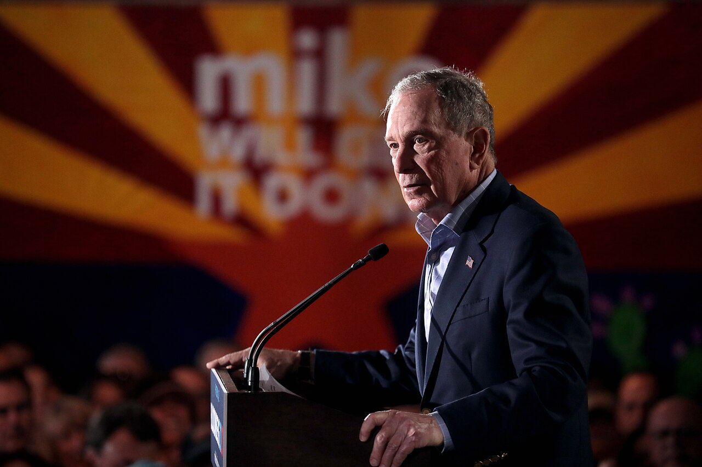

2020 年，美國前紐約市長 Michael Bloomberg 參加民主黨總統初選。根據競選團隊的最終財務申報，他在約三個月的競選期間花費近 9.4 億美元 @citep[clark2020bloomberg][^bloomberg]。然而，他在 Super Tuesday 的隔天宣布退選，整場初選僅贏下美屬薩摩亞一處 @citep[ewallwice2020bloomberg]。

<figure><figcaption>Bloomberg，2020 年 2 月。<a href="https://commons.wikimedia.org/wiki/File:Michael_Bloomberg_(49474987843).jpg">Gage Skidmore</a>，<a href="https://creativecommons.org/licenses/by-sa/2.0/">CC BY-SA 2.0</a></figcaption></figure>

投入大量資源，卻未必換得勝利，這正是傳統理論不容易解釋的現象。

在傳統個體經濟理論中，我們時常研究消費者如何最大化效用、廠商如何最大化利潤，以及市場如何透過價格機制分配資源。

然而，現實生活中仍存在許多無法僅透過價格機制解釋的競爭行為，例如：

- 兩間企業投入資金遊說政府，希望獲得獨家經營許可
- 兩個政黨投入競選資源，希望贏得選舉
- 兩間公司投入研發經費，希望率先取得一項專利
- 兩個團體投入資源，爭取政府補助或政策支持

上述案例有一項共同特徵：**參賽者必須投入具有成本的資源，但投入最多的一方不必然獲勝**。

以選舉為例，政黨增加競選經費，通常可以提升勝選機率，但並不代表支出最多的政黨必然獲勝。

因此，我們需要一個能夠描述**投入如何影響勝率**的理論模型，這正是**競賽理論 (contest theory)** 希望解決與探究的問題。

## 從尋租到競賽

競賽理論的重要思想來源之一是**尋租理論 (rent-seeking theory)**。

經濟學中的**租**指的**經濟租 (economic rent)**，並非日常語言中的房屋租金[^rent]。尋租則是指經濟主體為了取得或維持特定經濟利益，而投入資源影響利益分配的行為。

::: {.definition}
# 尋租

政府對經濟活動的管制會創造出租 (rent)，經濟主體為了取得這些租而投入資源互相競爭的行為 @citep[krueger1974political|p. 291]。
:::

例如：政府準備發放一張價值 1,000 萬元的獨家營業許可。兩間企業都想獲得這張許可，因此分別雇用顧問、進行政策遊說，並投入大量行政與法律資源。即使最後只有一間企業成功，兩間企業投入的競爭成本都已經發生。

這便產生了一個重要的經濟學問題：

> 一項既定的經濟利益，其價值可能只有 1,000 萬元，但社會為了決定誰取得這項利益，可能額外消耗大量資源。

傳統福利分析若只關注價格扭曲造成的無謂損失，可能低估此類競爭的社會成本。

@citet[tullock1967welfare] 在 *The Welfare Costs of Tariffs, Monopolies, and Theft* 中，便強調了這類資源耗費在福利分析中的重要性。其後 @citet[krueger1974political] 進一步發展尋租社會的政治經濟學分析。

@citet[tullock1980efficient] 的 *Efficient Rent Seeking* 則成為機率式尋租競賽模型的重要經典文獻。我可以將 Tullock 競賽的研究問題濃縮為三個：

1. 個別投入如何決定勝率？
2. 理性的參賽者會投入多少資源？
3. 個體最適的競爭結果是否具有社會效率？

## Tullock 競賽基本模型

考慮兩位參賽者 $N$，兩人共同競爭一項**不可分割 (indivisible)** 的獎勵，價值為 $V > 0$。每名參賽者 $i$ 選擇投入 $x_i \in [0, \infty)$，可代表投入的金錢、努力、時間或其他競爭資源。

為簡化分析，假設投入成本為線性，即 $C_i(x_i) = cx_i$，且 $c \in R_{+}$ 表示每單位投入的邊際成本。

本文採用以下標準假設：

| 變數 | 假設 |
| --- | --- |
| 參賽者 | 兩人，$i = 1, 2$ |
| 獎勵 | 單一、不可分割，價值 $V$ |
| 行動順序 | 同時決策 |
| 資訊結構 | 完全資訊 |
| 策略空間 | $x_i \geq 0$ |
| 成本 | $C_i(x_i) = cx_i$ |
| 風險態度 | 風險中立 |
| 支付規則 | 不論輸贏，皆須承擔投入成本 |

### 競賽成功函數

接著我們需要建立一個函數，用於描述投入如何轉換為勝率，此函數稱為**競賽成功函數 (contest success function, CSF)**。Tullock 競賽常見的 CSF 形式為：

::: {.equation #eq:general-csf}
p_{i} (x_i,\cdots,x_n) = \dfrac{x_i^{r}}{\sum_{j = 1}^{n} x_{j}^{r}}
:::

其中各項符號的意義如下：

- $p_i$：參賽者 $i$ 的勝率
- $x_i$：參賽者 $i$ 的投入
- $x_j$：對手的投入
- $r$：衡量實力差距程度

@eq:general-csf為最一般的情況。本文僅考慮兩名參賽者，因此可改寫為：

::: {.equation #eq:two-contestor-csf}
p_{i} (x_i, x_j) = \dfrac{x_i^{r}}{x_{i}^{r} + x_{j}^{r}}
:::

當兩人均不投入的情況下，通常會額外定義

$$
p_1(0, 0) = p_2(0, 0) = \dfrac{1}{2}
$$

亦即在沒有投入的情況下，以相同機率決定勝負[^tie]。

### 衡量實力差距

在 CSF 中，參數 $r$ 可理解為競賽對投入差異的敏感程度，用於衡量是否有辦法區隔出參賽者的實力高低。

若具有較高的 $r$，意味著競賽結果高度取決於參賽者的真實實力或付出的努力，實力較強或更努力的人，勝出的機率顯著提高；較低的 $r$ 則意味著競賽中含有大量的運氣、隨機雜訊或不完美的評審機制。在這種情況下，實力差距被模糊化，即使實力有差，每個人勝出的機率卻差不多。

為了避免討論複雜的情況，本文僅採用 $r = 1$，因此@eq:two-contestor-csf可簡化為

$$
p_{i} (x_i, x_j) = \dfrac{x_i}{x_{i} + x_{j}}
$$

@citet[konrad2009strategy] 與 @citet[corchon2007theory] 將其稱為**樂透競賽 (lottery contest)**，因此可以將其理解為購買樂透的數量：

::: {.example}
假設參賽者 1 投入 60、參賽者 2 投入 40，則

$$
\begin{aligned}
p_{1} &= \dfrac{60}{60 + 40} = 0.6\\
p_{2} &= \dfrac{40}{60 + 40} = 0.4
\end{aligned}
$$

注意到此模型衡量的是相對投入，而非絕對投入——當雙方投入同時加倍時，雙方勝率仍會完全相同。
:::

### 報酬與預期報酬

無論輸贏，參賽者 $i$ 都必須付出成本 $cx_i$。因此報酬取決於競賽結果：

- 獲勝（機率為 $p_i$）：獲得獎勵 $V$，扣除成本後的報酬為 $V - cx_i$
- 落敗（機率為 $1 - p_i$）：沒有獎勵，報酬為 $-cx_i$

由於勝負具有隨機性，參賽者無法事先確定自己會落在哪一種結果。將各結果乘上其機率後加總，得到**預期報酬 (expected payoff)**：

$$
\underbrace{p_{i}(x_i, x_j)V}_{\text{預期獎勵}} - \underbrace{cx_{i}}_{\text{投入成本}}
$$

在風險中立的假設下[^risk]，參賽者只在乎預期報酬，因此參賽者 $i$ 的效用函數可表達為：

::: {.equation #eq:payoff}
\pi_{i} (x_{i}, x_{j}) = \dfrac{x_{i}}{x_{i} + x_{j}} V - cx_{i}
:::

其中 $x_{i} + x_{j} > 0$，即至少有一人投入為正（否則勝率沒有定義）。投入越多，獲勝的機率越高；但投入越多，需要付出的成本也越高。因此，理性的參賽者不會無限制地提高投入，而是尋找一個能夠最大化預期報酬的投入水準。

## 雙人對稱 Tullock 競賽

有了預期報酬函數，就可以求解這個賽局了。雙方同時決定投入，各自都在給定對手投入的前提下，選擇能最大化自己預期報酬的水準。當沒有人能夠透過單獨改變投入來提高自己的預期報酬時，則可求得 $Nash$ 均衡[^pure]。

### 個別最適化問題

對參賽者 $i$ 而言，對手的投入 $x_j$ 是給定的，因此其面臨的最適化問題為：

$$
\max_{x_i \geq 0} \ \pi_i(x_i, x_j) = \dfrac{x_i}{x_i + x_j} V - cx_i
$$

先考慮 $x_j > 0$。勝率對自身投入的微分為：

$$
\dfrac{\partial}{\partial x_i} \left( \dfrac{x_i}{x_i + x_j} \right) = \dfrac{(x_i + x_j) - x_i}{(x_i + x_j)^2} = \dfrac{x_j}{(x_i + x_j)^2}
$$

因此預期報酬對 $x_i$ 的一階偏導數為：

$$
\dfrac{\partial \pi_i}{\partial x_i} = \underbrace{\dfrac{Vx_j}{(x_i + x_j)^2}}_{\text{邊際預期收益}} - \underbrace{c}_{\text{邊際成本}}
$$

參賽者在決定是否增加投入時，會比較多投入一單位所帶來的邊際預期收益與邊際成本：

- 若邊際預期收益大於 $c$，增加投入能提升預期報酬
- 若邊際預期收益小於 $c$，繼續增加投入便不划算

因此，內部最適解必須滿足**一階條件 (first-order condition, FOC)**：

::: {.equation #eq:foc}
\dfrac{Vx_j}{(x_i + x_j)^2} = c
:::

### 二階條件

一階條件只能找出候選的最適解，還需要檢查**二階條件 (second-order condition, SOC)**。對 $x_i$ 再微分一次：

$$
\dfrac{\partial^2 \pi_i}{\partial x_i^2} = -\dfrac{2Vx_j}{(x_i + x_j)^3} < 0
$$

由於 $V > 0$ 且 $x_j > 0$，預期報酬函數對自身投入**嚴格凹 (strictly concave)**。因此，只要一階條件的解為正，它就是唯一的最適投入；若沒有正的解，最適投入則為角解 $x_i = 0$。

### 最佳反應函數

由@eq:foc可得：

$$
(x_i + x_j)^2 = \dfrac{Vx_j}{c}
$$

投入非負，故：

$$
x_i + x_j = \sqrt{\dfrac{Vx_j}{c}}
$$

移項後再加上 $x_i \geq 0$ 的限制，便得到**最佳反應函數 (best response function)**：

::: {.equation #eq:br}
BR_i(x_j) = \max \left\{ 0, \sqrt{\dfrac{Vx_j}{c}} - x_j \right\}, \quad x_j > 0
:::

它告訴我們：給定對手投入多少，參賽者 $i$ 的最適投入是多少。

值得注意的是，對手投入增加，不一定會使我們跟著增加投入。對 $x_j$ 微分可知，$BR_i$ 在 $x_j = \frac{V}{4c}$ 時達到最大，超過 $x_j = \frac{V}{c}$ 後則變為零：

- 對手投入較少時，他多投入一些會刺激我們也多投入，兩者互為**策略互補 (strategic complements)**
- 對手投入已經很多時，繼續追趕不再划算，我們反而會減少投入，兩者變為**策略替代 (strategic substitutes)**

因此，Tullock 競賽的策略關係並非永遠互補，也非永遠替代。

在 $x_j = 0$ 時，@eq:br不能直接套用。依照前面零投入平手的設定，只要對手完全不投入，我們任何一個正的投入都能確保獲勝，且投入越小成本越低；但不存在最小的正數，因此這時沒有最佳反應。這個邊界問題不影響下面的正投入均衡。

### 對稱 $Nash$ 均衡

兩位參賽者的獎勵估值與成本函數完全相同，因此先尋找對稱均衡 $x_1^* = x_2^* = x^*$。代入@eq:foc：

$$
\dfrac{Vx^*}{(2x^*)^2} = \dfrac{V}{4x^*} = c
$$

解得：

::: {.equation #eq:eq-input}
x_1^* = x_2^* = \dfrac{V}{4c}
:::

此即雙人對稱樂透競賽的均衡投入。

::: {.theorem}
# 對稱 $Nash$ 均衡

在雙人、完全資訊、同時決策、相同獎勵估值 $V > 0$、相同線性成本 $cx_i$ 且 $r = 1$ 的 Tullock 競賽中，存在唯一的純策略 $Nash$ 均衡：

$$
(x_1^*, x_2^*) = \left( \dfrac{V}{4c}, \dfrac{V}{4c} \right)
$$
:::

::: {.proof}
先考慮兩人投入皆為正的情形，兩人的一階條件分別為：

$$
\begin{aligned}
\dfrac{Vx_2}{(x_1 + x_2)^2} &= c\\
\dfrac{Vx_1}{(x_1 + x_2)^2} &= c
\end{aligned}
$$

兩式左側分母相同，因此 $x_1 = x_2$。也就是說，任何正投入的純策略均衡都必須對稱，並由@eq:eq-input唯一決定。

再排除邊界情形：

- 若只有一人投入為正，例如 $x_1 > 0 = x_2$，則參賽者 1 的勝率為 1。他可以把投入減半而仍然必勝，成本更低，因此原本的投入不是最佳反應
- 若兩人皆不投入，每人的預期報酬為 $\frac{V}{2}$。任何一人改為投入足夠小的 $\varepsilon > 0$，勝率變為 1，預期報酬為 $V - c\varepsilon > \frac{V}{2}$，因此 $(0, 0)$ 不是均衡

最後驗證候選解確實是均衡。當 $x_j = \frac{V}{4c} > 0$ 時，$\pi_i$ 對 $x_i$ 嚴格凹，且 $x_i = \frac{V}{4c}$ 滿足一階條件，因此它是 $x_i \geq 0$ 上唯一的全域最大值，$(x_1^*, x_2^*)$ 為 $Nash$ 均衡。$\blacksquare$
:::

## 均衡分析

得到均衡投入後，我們可以進一步分析均衡下的勝率、報酬與競賽成本。

### 均衡勝率

由於均衡投入相等：

$$
p_1^* = p_2^* = \dfrac{x^*}{x^* + x^*} = \dfrac{1}{2}
$$

兩位參賽者都投入了正數的資源，卻仍然各有一半的機率獲勝。這並不是參賽者決策錯誤，而是因為雙方都知道對手會調整投入，最後彼此抵銷了對方的優勢。

### 均衡預期報酬

把均衡投入代回@eq:payoff：

::: {.equation #eq:payoff-star}
\pi_i^* = p_i^* V - cx_i^* = \dfrac{V}{2} - c \cdot \dfrac{V}{4c} = \dfrac{V}{4}
:::

每位參賽者的均衡預期報酬等於獎勵價值的四分之一。

### 租金耗散

兩人合計的投入成本為：

$$
TC = \sum_{i=1}^{2} cx_i^* = 2c \cdot \dfrac{V}{4c} = \dfrac{V}{2}
$$

將總競賽成本占獎勵價值的比例定義為**租金耗散率 (rent dissipation rate)**：

::: {.equation #eq:dissipation}
D = \dfrac{\sum_{i} C_i(x_i^*)}{V} = \dfrac{1}{2}
:::

在標準的雙人對稱樂透競賽中，參賽者合計會花費相當於獎勵價值 50% 的資源來爭奪它。這回應了開頭的問題：即使每個人都理性行事，競爭本身仍會耗用可觀的資源。

不過，不能直接把所有競賽投入都視為社會福利損失。如果投入具有生產性的外部效益（例如研發競賽），就必須把這些效益納入福利分析。只有在投入純粹是為了爭奪既定的租，且成本代表真實的資源消耗時，這些支出才能解讀為相應的社會資源耗費。

## 比較靜態

最後觀察參數變動對均衡的影響。由@eq:eq-input，對獎勵價值 $V$ 與邊際成本 $c$ 分別微分：

$$
\begin{aligned}
\dfrac{\partial x_i^*}{\partial V} &= \dfrac{1}{4c} > 0\\
\dfrac{\partial x_i^*}{\partial c} &= -\dfrac{V}{4c^2} < 0
\end{aligned}
$$

獎勵價值越高，均衡投入越多；投入的邊際成本越高，均衡投入越少。

成本變高時，參賽者會減少投入，那麼他實際付出的成本是不是也會跟著下降？把均衡投入乘上單位成本 $c$：

$$
cx_i^* = c \cdot \dfrac{V}{4c} = \dfrac{V}{4}
$$

答案是不會。單位投入的成本上升，參賽者減少的是投入的**數量**，但均衡下每位參賽者付出的**成本**恆為 $\frac{V}{4}$，與 $c$ 無關——單位成本 $c$ 越高，每投入一單位的代價越大，但均衡投入 $x_i^*$ 也同比例減少，兩者相乘剛好抵銷[^symmetry]。

## 數值模擬

前面的結果都是解析解。這一節換個方式驗證：不套用任何公式，直接用數值方法求出最佳反應，再讓雙方輪流對彼此的投入做最佳反應，重複到沒有人想改變為止，所得的點就是 $Nash$ 均衡。最後再與解析解比較。

下方的模擬器可以直接調整參數，結果會在瀏覽器中即時計算。Python 版的程式碼也可以[下載](https://oiebjktmnefstbzgyhdg.supabase.co/storage/v1/object/public/code/tullock-sim/tullock-sim-zh.zip)後自行執行。

圖的橫軸為 $x_1$，縱軸為 $x_2$。實線是參賽者 1 的最佳反應 $x_1 = BR(x_2)$，虛線是參賽者 2 的最佳反應 $x_2 = BR(x_1)$。兩條線的交點，就是雙方都沒有誘因單獨改變投入的 **$Nash$ 均衡**。

切換到**預期報酬**分頁，則是參賽者 1 在對手停在均衡投入 $x_2^*$ 時，預期報酬 $\pi_1(x_1, x_2^*)$ 如何隨自己的投入 $x_1$ 變化。曲線的最高點正好落在 $x_1^*$，這就是最佳反應的定義。兩張圖都可以下載成 SVG、PNG 或 PDF。

可以試著調整看看：

- 預設值 $V = 100$、$c = 1$、$r = 1$ 時，交點落在 $(25, 25)$，與 $\frac{V}{4c}$ 一致，勝率為 $\frac{1}{2}$，租金耗散率為 $\frac{1}{2}$。
- 調整 $V$ 或 $c$，數值均衡始終與公式值相同。$c$ 變大時均衡投入減少，但租金耗散率仍是 $\frac{1}{2}$，這對應到前一節的結論：均衡下每位參賽者付出的成本恆為 $\frac{V}{4}$。
- 也可以把 $r$ 調離 1，看看畫面如何變化[^r-le2]。

## 結論

從 Tullock 競賽的基本模型，我們得到以下結果：

| 分析對象 | 均衡結果 |
| --- | --- |
| 個別投入 | $x_i^* = \frac{V}{4c}$ |
| 個別勝率 | $p_i^* = \frac{1}{2}$ |
| 個別預期報酬 | $\pi_i^* = \frac{V}{4}$ |
| 租金耗散率 | $D = \frac{1}{2}$ |

回到開頭的三個問題：前兩個問題已由均衡投入與均衡勝率回答；第三個問題，則由租金耗散率提供了基本的衡量方式。

這些結果建立在相當嚴格的假設上：只有兩位參賽者、估值與成本皆相同、同時決策、完全資訊，且 $r = 1$。因此，比起記住公式，更值得記住的是背後的策略性邏輯：

> 參賽者是否應該增加投入，不只取決於獎勵有多大，也取決於對手投入多少，以及自己增加投入後能提高多少獲勝機率。

當每個人都想藉由提高投入來增加勝率，理性的個別決策便可能共同造成可觀的競賽成本。這也是 Tullock 競賽成為尋租理論 @citep[krueger1974political,tullock1980efficient]、政治競爭、公共選擇與衝突經濟學重要分析工具的原因。

[^bloomberg]: 此為競選團隊最終財務申報的數字 @citep[clark2020bloomberg]。他退選當天，CBS 依廣告追蹤公司 Kantar/CMAG 的資料指出，其廣告支出已超過 5.7 億美元 @citep[ewallwice2020bloomberg]。兩者統計的範圍與時點不同，不宜直接相比。

[^rent]: 經濟租是指要素所得中，超過維持該要素目前用途所需的部分，此一概念可追溯到 Ricardo 的地租理論 @citep[ricardo1817principles|chap. 2]。

[^tie]: 此為常見的約定，只影響兩人皆不投入的邊界情形，不影響下文正投入的均衡。

[^risk]: 若參賽者風險趨避，要最大化的是期望效用而非預期報酬，均衡投入會因此不同。

[^pure]: 本文只討論純策略均衡，即每位參賽者確定地選擇一個投入，不考慮隨機化的策略。

[^symmetry]: 此結論依賴對稱性與線性成本的假設，不能任意推廣到其他競賽模型。

[^r-le2]: 這會超出本文的模型，但仍可觀察。在 $r \le 2$ 的範圍內，均衡依然對稱，數值解為 $\frac{rV}{4c}$，租金耗散率為 $\frac{r}{2}$。這裡沒有推導，只作為模擬的觀察。模擬器把 $r$ 的上限設為 2，因為 $r > 2$ 時均衡的預期報酬 $\frac{(2-r)V}{4}$ 為負，不存在純策略均衡。

## 參考文獻

[references]
