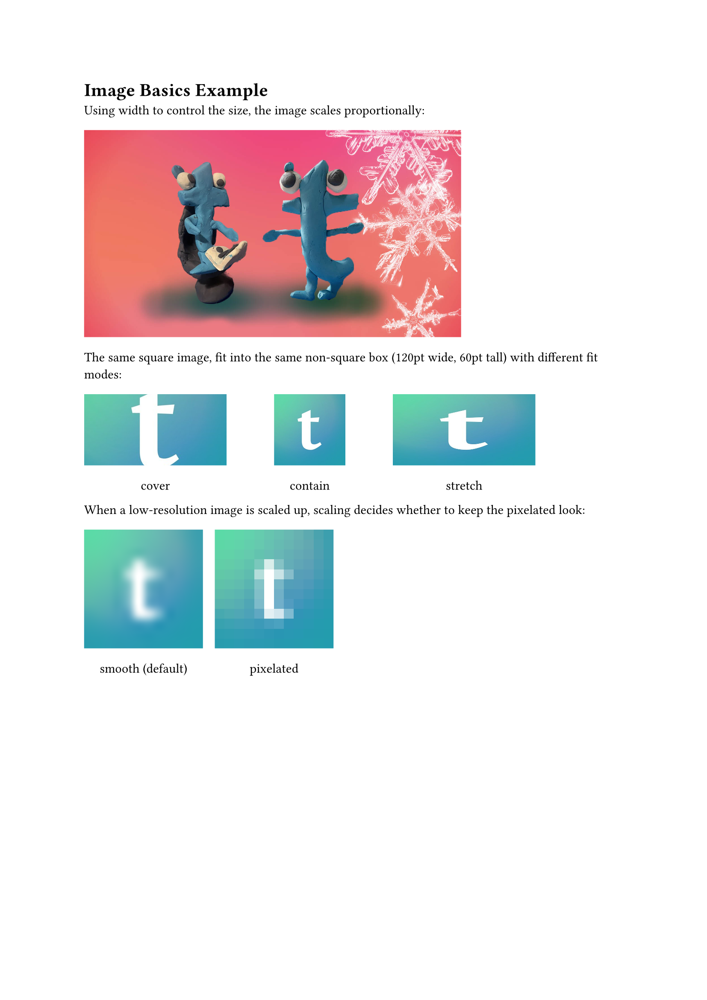
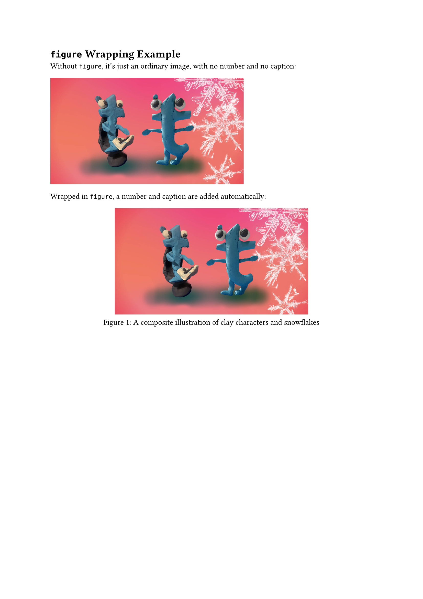
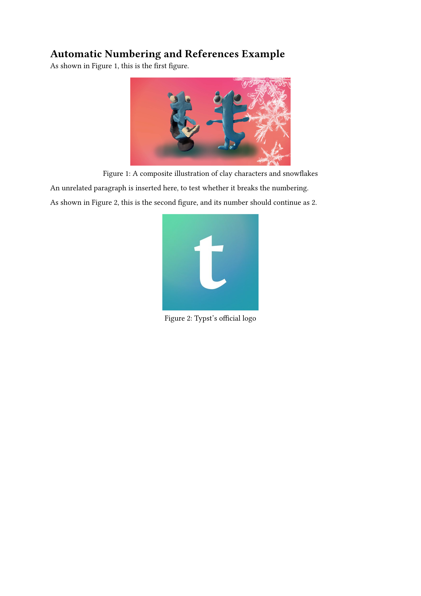
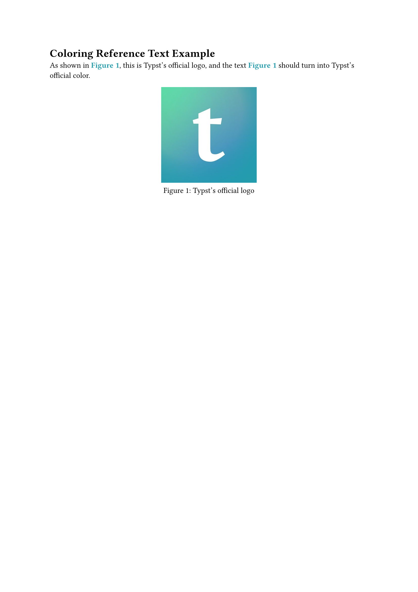
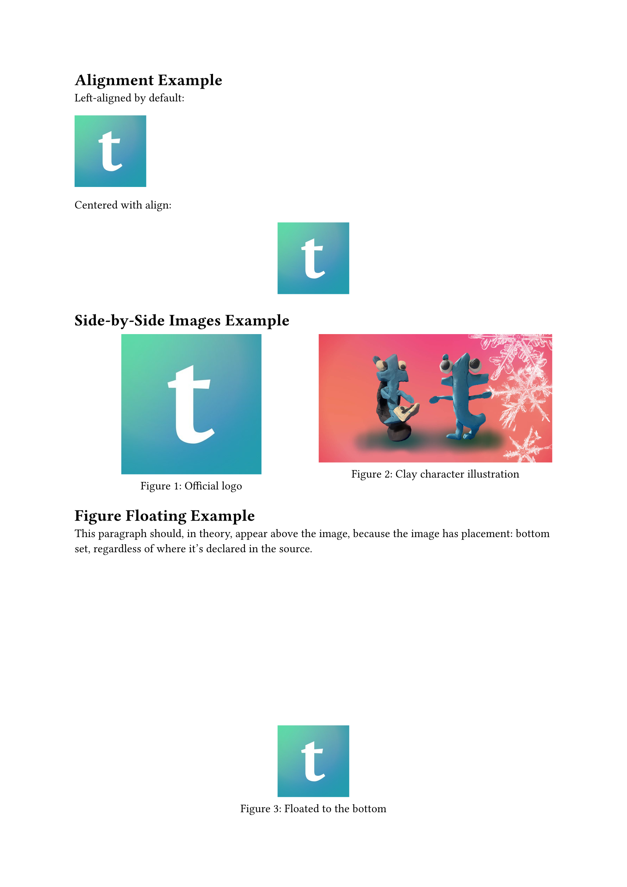

[The previous post](/articles/typst/day08-show-rules-en/) covered the `#show` rule, and how selectors and transformation functions can rewrite an element's presentation. `#set` and `#show` are the underlying logic of Typst's typesetting -- this post takes a different angle, coming back to the elements you actually reach for most often when writing a document: images and figures.

This post starts with the basic `image` function -- how to insert an image and control its size -- then moves on to wrapping images into proper figures with `figure` and adding captions, how figures get numbered automatically and how to reference them with `@` in the body text, and finally layout control: aligning figures more nicely, and even having them float to the top or bottom of the page. From **dropping in an image** to **a figure that numbers itself, carries a caption, and can be referenced from the body text**.

## Inserting Images

Typst uses the `image` function to insert images, supporting common formats like PNG, JPEG, GIF, and SVG. This section starts with the basics.

### The `image` Function Basics

The simplest usage just needs a file path:

```typst
#image("photo.png")
```

`image` returns content, so it can be placed directly in a document, or wrapped in a `figure` -- as the next section shows -- to become a proper figure.

### Common Parameters

| Parameter | Description |
| --- | --- |
| `width` / `height` | Display size -- usually only one is set, and the image scales proportionally |
| `fit` | How the image scales when both `width` and `height` are set: `"cover"` (default, fills and crops), `"contain"` (fully visible, leaves whitespace), `"stretch"` (stretched, may distort) |
| `alt` | Alt text, used for accessibility |
| `format` | Image format, auto-detected by default |
| `scaling` | Interpolation used when scaling: `"smooth"` (default, smooth) or `"pixelated"` (keeps the pixelated look) |

### A Worked Example

<figure><figcaption>Image basics example</figcaption></figure>

Image source: Typst's official logo[^1].

## Figures and Captions

An image inserted with plain `image` is just a piece of content -- no number, no caption, and no way to use it as a proper figure. To turn an image into a proper figure, wrap it with `figure`.

### Wrapping an Image with `figure`

```typst
#figure(
    image("photo.png", width: 60%),
    caption: [Image caption text],
)
```

`figure` does more than just add a caption. It numbers content automatically based on its kind (images, tables, and code each get their own track); it binds the image and caption together as a single block, so layout won't awkwardly split them across a page break; and it centers the content by default. Referencing this figure from the body text with `@` later also depends on the number `figure` assigns -- more on that in the next section.

### Adding a Caption

The caption goes in the `caption` parameter, and by default appears below the image in the format **number + colon + description**, e.g. `Figure 1: ...` -- which is already the natural default for an English document, so no customization is needed here.

### A Worked Example

<figure><figcaption>figure wrapping example</figcaption></figure>

## Automatic Numbering and References

The previous section showed that `figure` numbers itself automatically. This section looks at the numbering rules, and how to reference a figure from the body text.

### Automatic Figure Numbering

`figure` counts separately by content kind -- images are one track, tables another, and they never interfere with each other. Numbering within the same track also isn't interrupted by other content in between: insert an unrelated paragraph, and the next image still continues the sequence, with no skipped or restarted numbers.

### Cross-References

Add a `<label-name>` after a `figure`, and it can be referenced from the body text with `@label-name`, automatically expanding to **Figure N**:

```typst
#figure(
    image("photo.png", width: 60%),
    caption: [Image caption text],
) <fig-demo>

As shown in @fig-demo, ...
```

By default, an `@` reference and its figure's caption render the exact same plain way -- because under the hood they're two independent rendering paths, which is exactly why they can be restyled separately, as the next demo shows.

### A Worked Example

<figure><figcaption>Automatic numbering and references example</figcaption></figure>

Say you want just the reference text to turn into Typst's official brand color (`#239DAD`) -- that means writing a separate `show` rule targeting the `ref` element:

```typst
#show ref: it => {
    if it.element != none and it.element.func() == figure {
        set text(fill: rgb("#239DAD"), weight: "bold")
        it
    } else {
        it
    }
}
```

First check whether the reference points at a `figure`, and only apply the color if it does -- this avoids accidentally affecting other kinds of references (like the section references used later in the series).

<figure><figcaption>Coloring reference text example</figcaption></figure>

## Layout Control

Sizing was already covered earlier, so this last section looks at how to arrange images on the page so they actually look good.

### Controlling Size and Alignment

Images are left-aligned by default; wrap one in `align` to change its position:

```typst
#align(center)[
    #image("photo.png", width: 40%)
]
```

`figure`, on the other hand, is already centered by default, with nothing extra needed.

### Side-by-Side Images

For multiple images side by side, `grid` is the most direct way to split them into columns, with each column holding an image or a `figure`:

```typst
#grid(
    columns: 2,
    gutter: 10pt,
    figure(image("a.png"), caption: [Caption one]),
    figure(image("b.png"), caption: [Caption two]),
)
```

Even placed side by side, the numbering still runs in sequence -- being in the same row doesn't scramble it.

### Floating Figures

`figure` has a `placement` parameter that lets a figure detach from the normal text flow and float to the top or bottom of the page:

```typst
#figure(
    image("photo.png", width: 40%),
    caption: [Image caption text],
    placement: bottom,
)
```

With `placement: bottom` set, the figure automatically ends up at the very bottom of the page, regardless of whether it's declared before or after the surrounding text in the source. The available values are `top`, `bottom`, and `auto` (let Typst decide) -- the default is `none`, meaning no floating, laid out right where it's declared.

### A Worked Example

<figure><figcaption>Layout control example</figcaption></figure>

## Summary

This post started with the basic `image` function and covered common parameters like `width`, `height`, `fit`, and `scaling`; moved on to wrapping images into proper figures with `figure` and adding `caption` text; looked at how figures number themselves automatically by kind, how to reference them with `<label>` and `@`, and even how to color the reference text; and finished with layout control -- alignment, side-by-side placement, and floating. From **dropping in an image** to **a figure that numbers itself, carries a caption, and can be referenced from the body text** -- that's the goal for this post, met.

That covers both of the two most central rules in Typst typesetting from the last two days, plus how images and figures actually get used. The next post moves on to tables, looking at how Typst lays out a clean table.

See you next time~

[^1]: Image source: [Typst's official X account @typstapp](https://x.com/typstapp)
