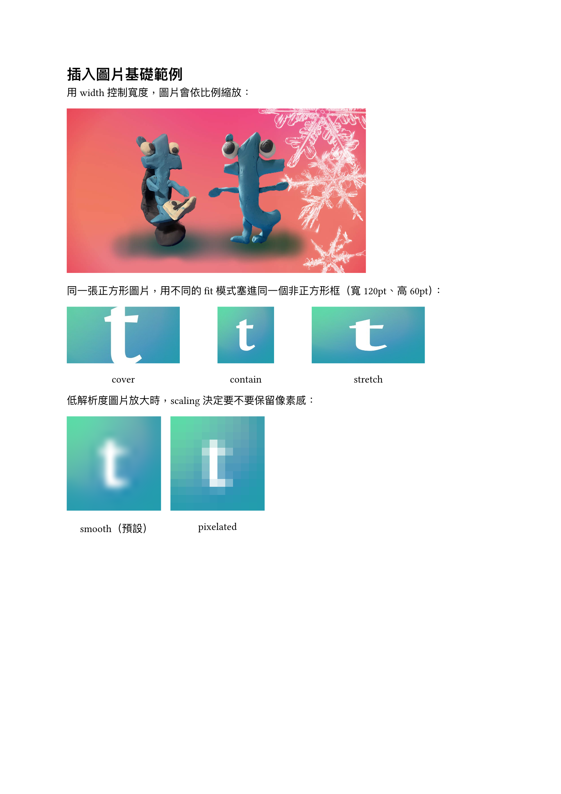

[上一篇](/articles/typst/day08-show-rules/)介紹了 `#show` 規則，學會怎麼用選擇器和轉換式函式改寫元素的呈現方式。`#set` 跟 `#show` 是 Typst 排版的底層邏輯，這篇要換個角度，不抽象了，回到實際寫文件時最常用到的元素：圖片與圖表。

這篇會從最基本的 `image` 函式開始，介紹怎麼插入圖片、控制大小；接著用 `figure` 把圖片包裝成正式的圖表，加上標題說明；再看圖表怎麼自動編號、怎麼在內文用 `@` 參照它；最後談版面控制，讓圖表對齊得更漂亮，甚至浮動到頁面頂部或底部。從**貼一張圖片**，走到**一張會自動編號、附標題、還能被內文引用的圖表**。

## 插入圖片

Typst 用 `image` 函式插入圖片，支援 PNG、JPEG、GIF、SVG 幾種常見格式。這節先從最基本的用法開始。

### `image` 函式基礎

最簡單的用法只需要給檔案路徑：

```typst
#image("photo.png")
```

`image` 回傳的是內容，可以直接放在文件裡，也可以像下一節那樣包進 `figure` 變成正式的圖表。

### 常見參數

| 參數 | 說明 |
| --- | --- |
| `width` / `height` | 顯示大小，通常只設一個，圖片會依比例縮放 |
| `fit` | `width`、`height` 都設定時的縮放方式：`"cover"`（預設，蓋滿裁切）、`"contain"`（完整顯示，留白）、`"stretch"`（拉伸變形） |
| `alt` | 替代文字，用於無障礙閱讀 |
| `format` | 圖片格式，預設自動偵測 |
| `scaling` | 縮放時的插值方式：`"smooth"`（預設，平滑）、`"pixelated"`（保留像素感） |

### 實際範例

<figure><figcaption>插入圖片基礎範例</figcaption></figure>

圖片來源：Typst 官方 logo[^1]。

## 圖表與標題

單純用 `image` 插入的圖片，就只是一段內容，沒有編號、沒有標題，也沒辦法使用圖表的內容。想讓圖片變成正式的圖表，要用 `figure` 包起來。

### `figure` 包裝圖片

```typst
#figure(
    image("photo.png", width: 60%),
    caption: [圖片說明文字],
)
```

`figure` 做的事情不只是加標題。它會依內容種類（圖片、表格、程式碼各自一軌）自動編號；把圖片和標題綁成同一個區塊，排版時不會被硬生生拆到兩頁；還會自動置中。之後要在內文用 `@` 參照這張圖，也得靠 `figure` 給的編號才能運作，下一節會接著講。

### 加上標題說明

標題寫在 `caption` 參數裡，預設顯示在圖片下方，格式是**編號 + 冒號 + 說明文字**，例如 `Figure 1: ...`。中文文件通常想顯示**圖 1**，這時候要用 `supplement` 換掉前綴字樣，再搭配 `show` 規則把**圖 1**的部分加粗：

```typst
#set figure(supplement: [圖])
#show figure.caption: it => [
    *#it.supplement #it.counter.display(it.numbering)*#it.separator#it.body
]
```

| 欄位 | 意義 |
| --- | --- |
| `it.supplement` | 前綴字樣（圖） |
| `it.counter.display(it.numbering)` | 編號 |
| `it.separator` | 預設分隔符（冒號） |
| `it.body` | 說明文字 |

只把前兩個包進 `*...*`，說明文字維持正常字重。之後範例都沿用這個設定。

### 實際範例

<figure><figcaption>`figure` 包裝圖片範例</figcaption></figure>

## 自動編號與參照

上一節看到 `figure` 會自動編號、自動套用 `圖 1` 這種前綴。這節接著看編號規則，以及怎麼在內文參照圖表。

### 圖表自動編號

`figure` 依內容種類分別計數，圖片是一軌、表格是另一軌，彼此不會互相干擾。同一軌的編號也不會被中間插入的其他內容打斷，插入一段跟圖表無關的文字，下一張圖片還是接續編號，不會跳號或重來。

### 交互參照

在 `figure` 後面加上 `<標籤名稱>`，就能在內文用 `@標籤名稱` 參照它，自動展開成**圖 N**：

```typst
#figure(
    image("photo.png", width: 60%),
    caption: [圖片說明文字],
) <fig-demo>

如同@fig-demo 所示，...
```

要注意的是，`@` 參照展開出來的**圖 N**不會套用到 `caption` 那條 `show` 規則，所以文字不會像標題那樣自動加粗，這是兩個各自獨立的渲染路徑。

### 實際範例

<figure><figcaption>自動編號與參照範例</figcaption></figure>

如果想讓它單獨變成 Typst 官方色（`#239DAD`），要另外針對 `ref` 元素寫一條 `show` 規則：

```typst
#show ref: it => {
    if it.element != none and it.element.func() == figure {
        set text(fill: rgb("#239DAD"), weight: "bold")
        it
    } else {
        it
    }
}
```

先判斷這個參照指向的是不是 `figure`，是的話才套用顏色，避免連帶影響到其他種類的參照（例如之後會用到的章節參照）。

<figure><figcaption>參照文字上色範例</figcaption></figure>

## 版面控制

圖片大小已在前面提及，在此不再贅述。在本篇最後一節，我們要來看圖片在頁面上要怎麼擺才好看。

### 控制圖片大小與對齊

圖片預設靠左對齊，用 `align` 包起來可以改變位置：

```typst
#align(center)[
    #image("photo.png", width: 40%)
]
```

`figure` 則預設就是置中的，不用額外處理。

### 並排圖片

多張圖片要並排，用 `grid` 分欄最直接，每一欄放一張圖片或一個 `figure`：

```typst
#grid(
    columns: 2,
    gutter: 10pt,
    figure(image("a.png"), caption: [說明一]),
    figure(image("b.png"), caption: [說明二]),
)
```

即使圖片並排，編號還是照順序排下去，不會因為同一列而搞混。

### 圖表浮動

`figure` 有個 `placement` 參數，可以讓圖表脫離原本的文字流，浮動到頁面頂部或底部：

```typst
#figure(
    image("photo.png", width: 40%),
    caption: [圖片說明文字],
    placement: bottom,
)
```

設定 `placement: bottom` 之後，圖表會自動跑到頁面最下方，不管它在原始碼裡宣告的位置在文字前面還是後面。可用的值是 `top`、`bottom`、`auto`（交給 Typst 自動決定），預設 `none` 表示不浮動，照原本位置排版。

### 實際範例

<figure><figcaption>版面控制範例</figcaption></figure>

## 小結

這篇從最基本的 `image` 函式開始，講了 `width`、`height`、`fit`、`scaling` 這些常用參數；接著用 `figure` 把圖片包裝成正式的圖表，加上 `caption` 標題，也示範怎麼把預設的 **Figure** 換成中文的**圖**並加粗；再看圖表怎麼依種類自動編號、怎麼用 `<標籤>` 和 `@` 參照，甚至幫參照文字上色；最後講對齊、並排、浮動這些版面控制。從**貼一張圖片**，走到**一張會自動編號、附標題、還能被內文引用的圖表**，這篇的目標算是達成了。

下一篇要進到表格，看看 Typst 怎麼排出乾淨的表格版面。

我們下次見囉～

[^1]: 圖片來源：[Typst 官方 X 帳號 @typstapp](https://x.com/typstapp)
