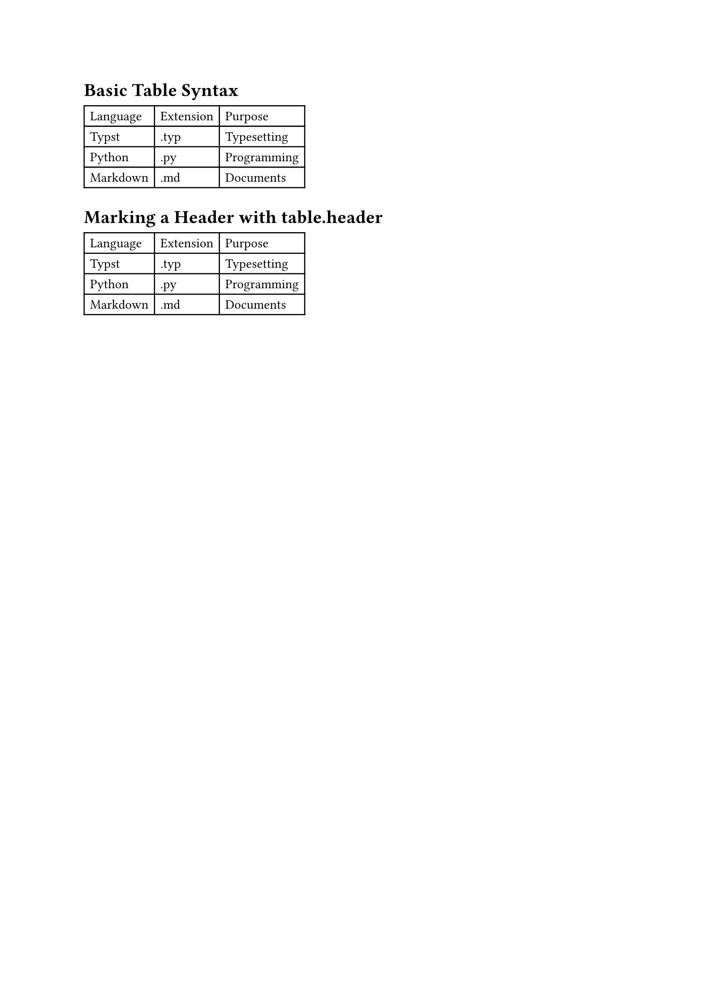
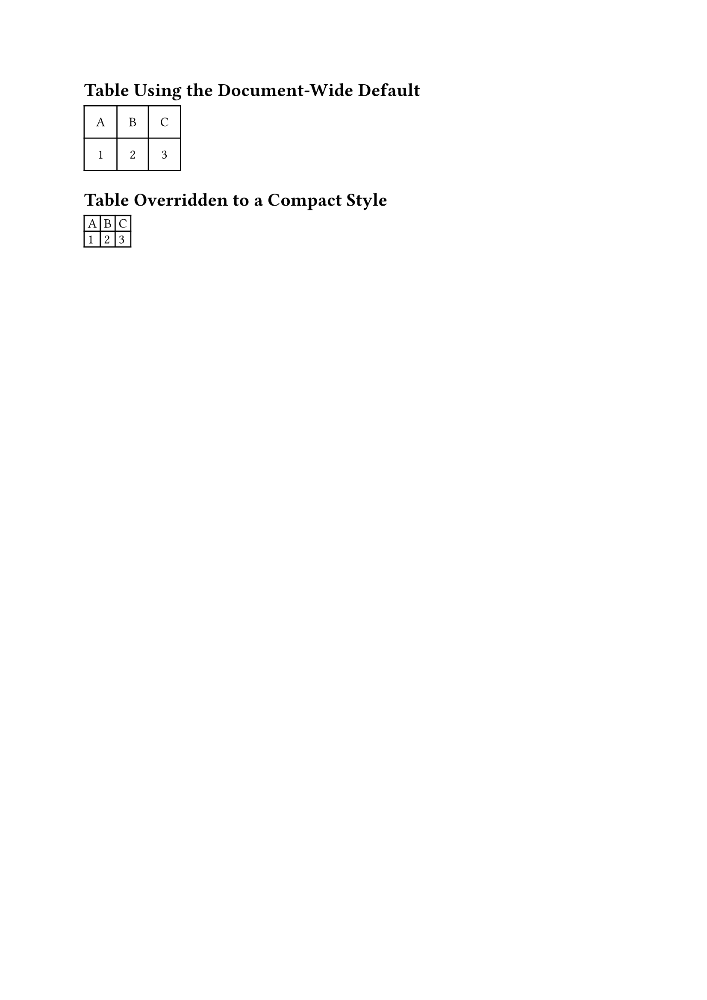
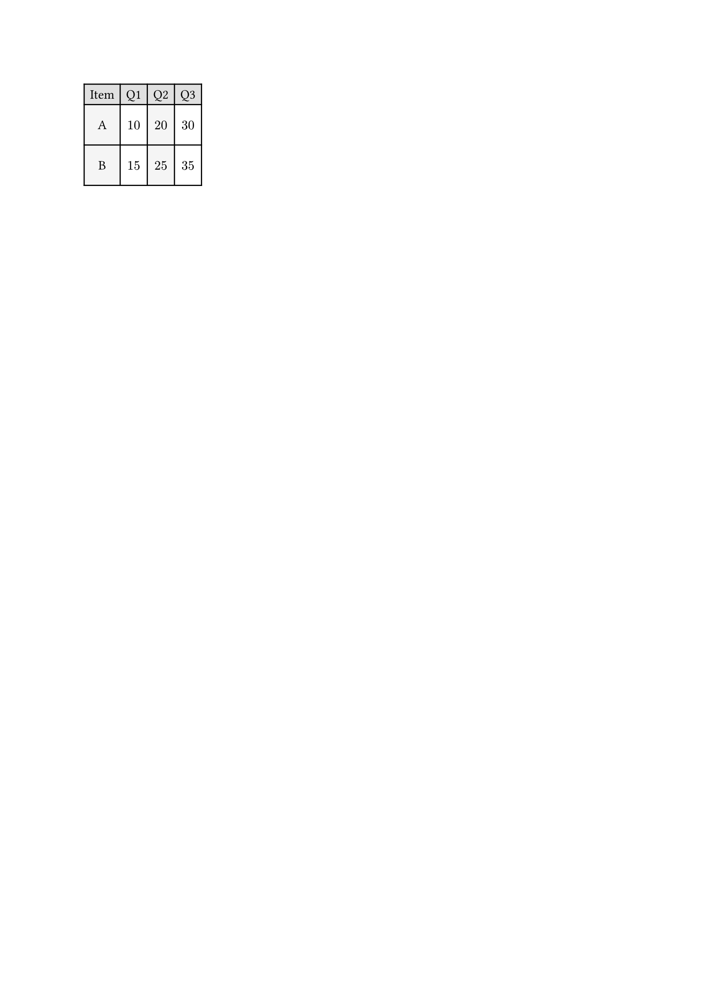
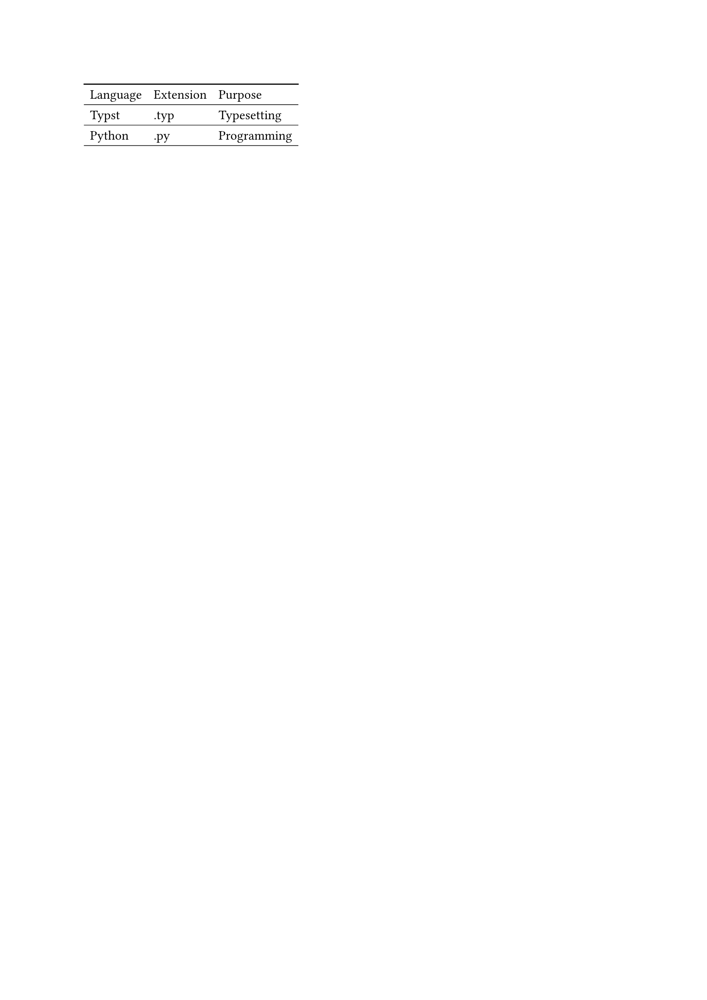
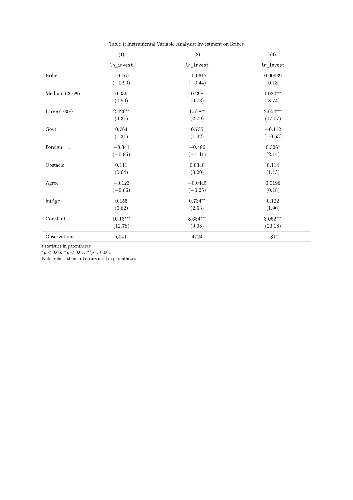
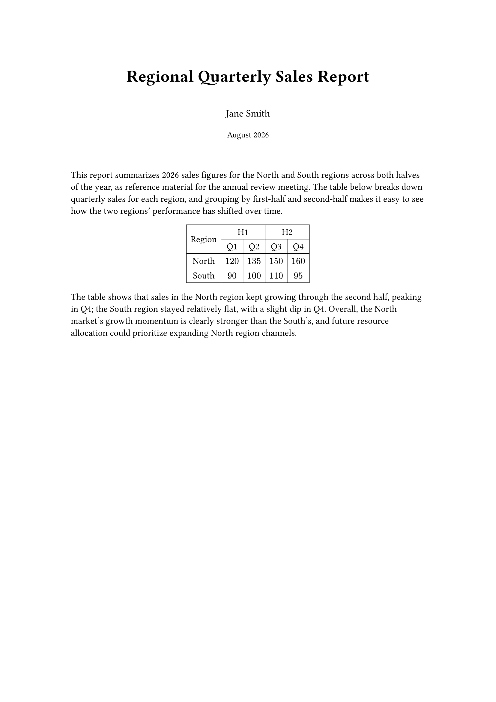

[The previous post](/articles/typst/day09-images-and-figures-en/) covered images and `figure` -- how to insert an image, add a caption, get automatic numbering, and reference it from the body text. This post moves on to another content element you'll reach for constantly: tables.

This post starts with the basic syntax of the `table` function, looking at how columns and headers are set up; then covers cell styling -- alignment, spacing, fill, and stroke; then moves on to the three-line table so common in academic writing, building a clean layout with `hline` and covering caption position and notes along the way; and finishes with how to merge cells.

## Table Basics

Typst uses the `table` function to draw tables. This section starts with the basic syntax.

### The `table` Function and Basic Syntax

A `table`'s content is a flat sequence of cells, laid out left to right and top to bottom to fill the given number of columns -- quite similar to LaTeX's `tabular`:

```typst
#table(
    columns: 3,
    [Language], [Extension], [Purpose],
    [Typst], [.typ], [Typesetting],
    [Python], [.py], [Programming],
)
```

`columns: 3` means every 3 cells start a new row. This example has 9 cells total, laying out a 3-column, 3-row table whose first row is the **header**.

### Columns and Headers

Besides a plain number, `columns` also accepts an array of lengths or ratios to control each column's width -- for example `columns: (1fr, 2fr, 1fr)` makes the middle column twice as wide.

Common width units are listed below:

| Unit | Description |
| --- | --- |
| `auto` | Sized automatically to fit the content (default) |
| `1fr` | Distributes remaining space proportionally[^1] |
| `3cm`, `50pt` | Fixed length |
| `30%` | A percentage of the page's available width |

A table's first row is often a header. Writing it as the first cells in the list works, but it's better to mark it explicitly with `table.header(...)`:

```typst
#table(
    columns: 3,
    table.header([Language], [Extension], [Purpose]),
    [Typst], [.typ], [Typesetting],
    [Python], [.py], [Programming],
)
```

Both approaches look identical by default. The difference is that once marked with `table.header`, the header row automatically repeats at the top of the next page when a table spans multiple pages -- no need to copy it manually -- and it makes clear, semantically, that this row is a header.

### A Worked Example

<figure><figcaption>Basic table example</figcaption></figure>

## Cell Styling

`table` has quite a few style parameters you can adjust. This section covers alignment, spacing, fill, and stroke, and the scope each adjustment applies to.

### Alignment and Spacing

The common style parameters are `align` (text alignment), `inset` (cell padding, which indirectly affects row height), and `rows` (sets row heights directly, used the same way as `columns`). Adjustments can be scoped at three levels, from broadest to narrowest:

**The whole document:** use `#set table(...)`, and every `#table` after that point picks up this default, so you don't have to repeat it for every table:

```typst
#set table(inset: 10pt, align: center)
```

This line sets **10pt of cell padding and centered content for every `#table` from here on**, so you don't need to repeat these two parameters each time you call `#table`.

**A single table:** pass parameters directly to one `#table(...)` call, overriding only that table without affecting the others:

```typst
#table(
    columns: 3,
    inset: 3pt,
    align: left,
    [A], [B], [C],
    [1], [2], [3],
)
```

Seeing these two together makes the effect clearest: the document-wide default is loose and centered, and this particular table overrides `inset` and `align` to become compact and left-aligned -- the same logic as stacking multiple `#set` rules back on Day 7:

<figure><figcaption>Table styling scope example</figcaption></figure>

**Specific cells:** parameters like `align` and `fill` can also take a function `(x, y) => ...`, where `x` is the column index and `y` is the row index, returning a different value based on position -- the most common use is alternating row colors:

```typst
#table(
    columns: 4,
    fill: (x, y) => if y == 0 {
        rgb("#e0e0e0")
    } else if calc.even(x) {
        rgb("#f5f5f5")
    } else {
        white
    },
    align: center + horizon,
    [Item], [Q1], [Q2], [Q3],
    [A], [$10$], [$20$], [$30$],
    [B], [$15$], [$25$], [$35$],
)
```

`y == 0` checks whether it's the header row, and `calc.even(x)` checks whether the column index is even -- these two conditions together decide the fill color. `align: center + horizon` centers every cell's content both horizontally and vertically:

<figure><figcaption>Per-cell table customization example</figcaption></figure>

### Fill and Stroke

Fill was already covered above, so this section looks at `stroke` for borders. Just like `fill`, `stroke` also accepts an `(x, y) => ...` function, except the return value is a dictionary specifying the `top`, `bottom`, `left`, and `right` sides individually:

```typst
#table(
    columns: 3,
    stroke: (x, y) => (
        top: if y == 0 { 1pt } else { 0.5pt },
        bottom: 0.5pt,
    ),
    [Language], [Extension], [Purpose],
    [Typst], [.typ], [Typesetting],
    [Python], [.py], [Programming],
)
```

This dictionary only sets `top` and `bottom` -- with `left` and `right` left out, there's no vertical border at all, leaving only horizontal lines. That's already very close to the three-line table the next section covers.

### A Worked Example

<figure><figcaption>Table stroke example</figcaption></figure>

## Three-Line Tables

That table with nothing but horizontal lines from the last section is already very close to the **three-line table** style common in academic papers: only a top rule, a rule under the header, and a bottom rule, with no vertical rules at all.

The three-line table traces back to Edward Tufte's **data-ink** concept from 1983: every bit of ink in a table should be used to represent data, and anything else should be cut. In 2003, Simon Fear built that philosophy into LaTeX's `booktabs` package, explicitly arguing you should **never use vertical rules, and never use double rules**. That style went on to become the standard for international academic journal typesetting[^2].

### Building a Three-Line Table with `hline`

A three-line table turns off all default borders and adds lines manually at specific positions with `table.hline`:

```typst
#table(
    columns: 3,
    stroke: none,
    table.hline(stroke: 1pt),
    table.header([Group], [Mean Score], [Std Dev]),
    table.hline(stroke: 0.5pt),
    [Treatment], [85.3], [4.2],
    [Control], [78.1], [5.6],
    table.hline(stroke: 1pt),
)
```

`stroke: none` first turns off all the table's built-in borders, then three `table.hline` calls are inserted manually: the top and bottom rules use a heavier `1pt`, and the rule under the header uses a lighter `0.5pt`. That contrast in weight is the convention for a three-line table, and it's the most obvious difference from an ordinary table.

Typst's own package registry also has a ready-made [`booktabs` package](https://typst.app/universe/package/booktabs/) that wraps this whole manual setup into functions like `toprule`, `midrule`, and `bottomrule` you can call directly, instead of hand-rolling it every time. Installing and using packages is left for a dedicated post on packages later in the series -- for now, just know the option exists.

### Caption Position and Notes

Table captions are conventionally placed **above** the table, the opposite of the default for images, which needs a separate `show` rule:

```typst
#show figure.where(kind: table): set figure.caption(position: top)
```

`figure.where(kind: table)` only selects `figure`s whose content is a table, so it doesn't affect where image captions land.

Academic tables often need a note below them, such as an explanation of significance asterisks. Typing `*` directly in the content gets treated by Typst as a bold marker, so it needs to be escaped with a backslash as `\*` to display as a literal asterisk. Statistical symbols like `p` are conventionally written in math mode as `$p < 0.05$`, which automatically italicizes:

```typst
#figure(
    stack(
        dir: ttb,
        table(...),
        v(4pt),
        text(size: 9pt)[\*$p < 0.05$],
    ),
    caption: [...],
)
```

A note can't just be written outside the `figure` -- that turns it into its own separate paragraph, with too much whitespace between it and the table, so it reads as disconnected. Wrapping the table and the note together into one piece of content with `stack`, then placing that whole thing inside `figure`, keeps the note glued right under the bottom rule.

### A Worked Example

Real three-line tables in papers are usually much more elaborate -- regression tables, for instance, commonly have a **coefficient + test statistic** two-line cell, which a `\` line break inside a single cell handles easily. Numbers in the table are also consistently wrapped in math mode `$...$`, and significance stars use a grouped superscript like `^(**)` rather than bare asterisks, to avoid any confusion with multiplication; variable names (like `` `ln_invest` ``) are conventionally set in monospace, which just falls out of wrapping them in backticks as raw text. This example is adapted from a LaTeX regression-table layout discussion[^3]:

<figure><figcaption>Regression-table three-line example</figcaption></figure>

## Merging Cells

Sometimes a table needs one cell to span multiple columns or rows -- a multi-level header, for instance. This section looks at how `table.cell` handles that.

### Merging Columns

Swap a cell for `table.cell(colspan: n)[...]`, and it occupies `n` columns horizontally:

```typst
#table(
    columns: 5,
    [], table.cell(colspan: 2)[H1], table.cell(colspan: 2)[H2],
    ...
)
```

One thing to watch for: a merged cell automatically consumes the next `n` column slots, so you should **not** add empty placeholder cells afterward -- doing so throws off the whole table's layout.

### Merging Rows

The usage mirrors `colspan` -- swap in `rowspan` and a cell occupies multiple rows downward:

```typst
table.cell(rowspan: 2)[Region]
```

Same idea: the next row doesn't need a placeholder for that column either -- `rowspan` handles it automatically.

### A Worked Example

Combining both kinds of merging is how you build the common multi-level header:

<figure><figcaption>Merged-cell table example</figcaption></figure>

## Summary

This post started with the basic syntax of the `table` function, covering how `columns` sets column widths and `table.header` marks a header; moved on to cell styling, looking at how `align`, `inset`, `fill`, and `stroke` can be scoped at the whole-document, single-table, and per-cell levels; then covered the three-line table so common in academic writing, hand-built with `table.hline`, along with a more realistic regression-table example; and finished with how `colspan` and `rowspan` merge cells into multi-level headers.

The next post moves on to the bit of math typesetting only briefly touched on so far, looking at how Typst handles inline and block math.

See you next time~

[^1]: `fr` is short for fraction, meaning a **fractional unit**: after subtracting every column with a fixed width (`auto`, a length, or a percentage), whatever space is left gets split proportionally by each column's `fr` value -- for example `(1fr, 2fr)` splits the remaining space 1:2.

[^2]: For the origin of the three-line table style and the `booktabs` package's design principles, see [Better LaTeX Tables with Booktabs](https://nhigham.com/2019/11/19/better-latex-tables-with-booktabs/).

[^3]: The original layout for the regression-table example is adapted from [Regression table alignment problem - TeX Stack Exchange](https://tex.stackexchange.com/questions/364602/regression-table-alignment-problem).
