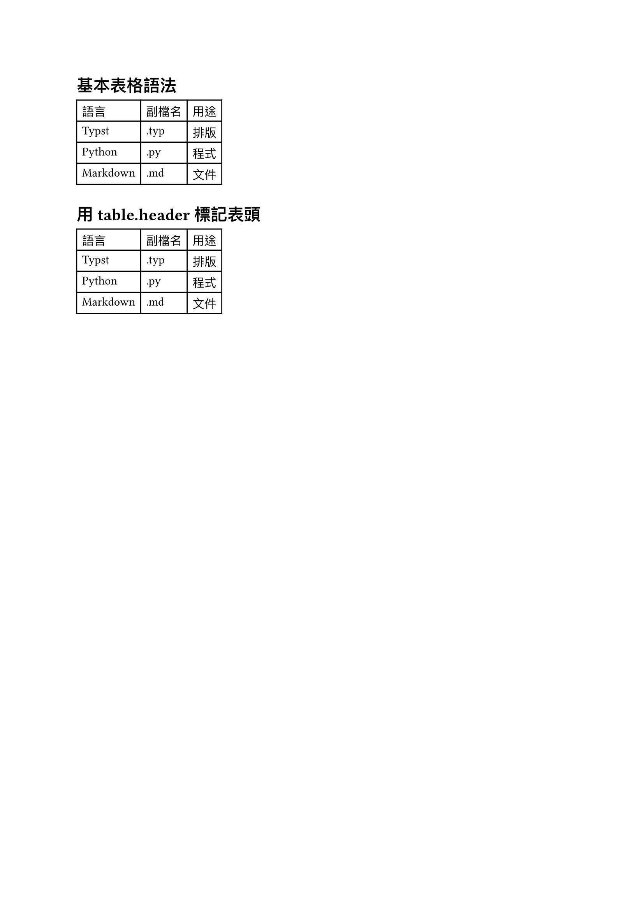
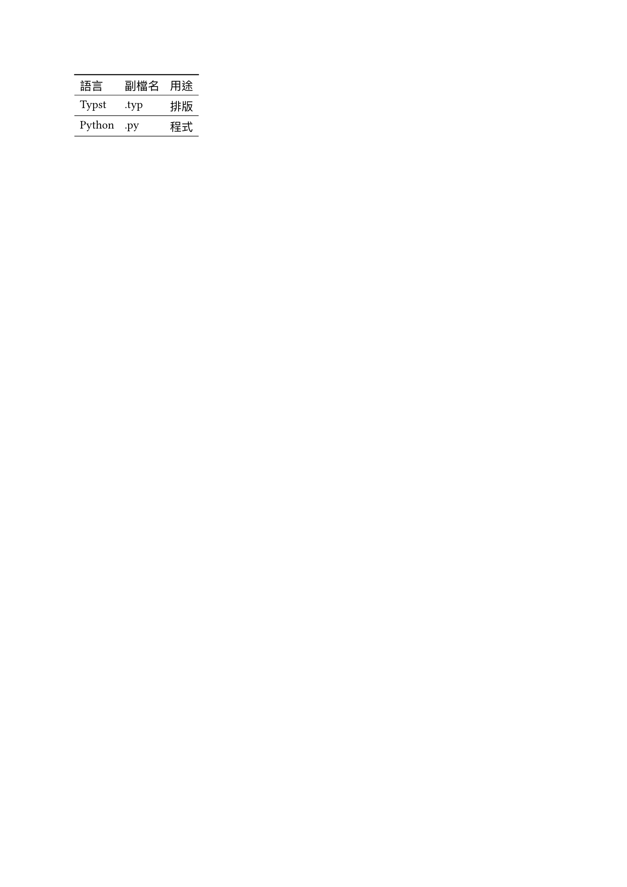
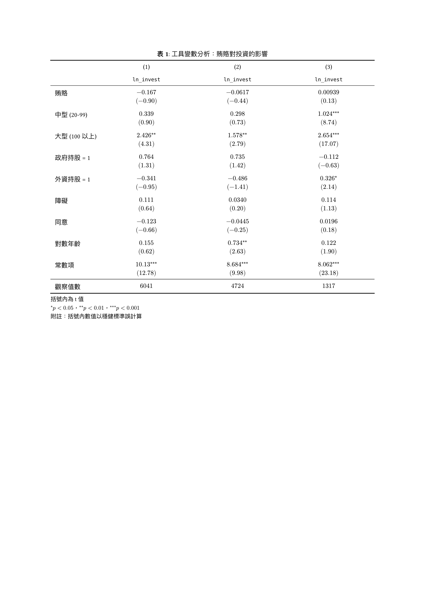
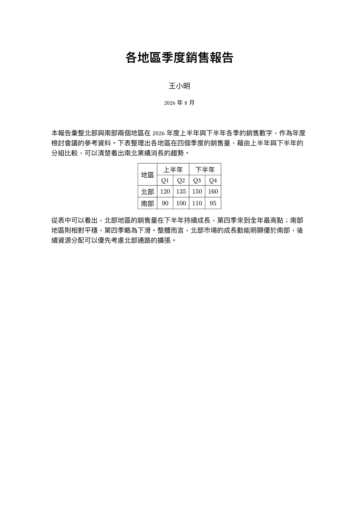

[上一篇](/articles/typst/day09-images-and-figures/)講了圖片跟 `figure`，怎麼插入圖片、加上標題、自動編號、還能在內文參照。這篇要換另一種常見的內容元素：表格。

這篇會從 `table` 函式的基本語法開始，看欄位、表頭怎麼設定；接著講儲存格的樣式，對齊、間距、底色、框線怎麼調；再進到學術寫作最常見的三線表，用 `hline` 做出乾淨的版面，順便講標題位置跟附註怎麼寫；最後看儲存格要怎麼合併。

## 表格基礎

Typst 用 `table` 函式繪製表格，這節將先從最基本的語法開始。

### `table` 函式與基本語法

`table` 的內容是一串儲存格，依序由左到右、由上到下排列，填滿指定的欄數，十分類似 LaTeX 的 `tabular`：

```typst
#table(
    columns: 3,
    [語言], [副檔名], [用途],
    [Typst], [.typ], [排版],
    [Python], [.py], [程式],
)
```

`columns: 3` 代表每 3 個儲存格換一列，這個例子總共 9 個儲存格，會排出一個 3 欄 3 列的表格，其中第一列為**表頭 (header)**。

### 欄位與表頭

`columns` 除了給定數字之外，也可以給長度或比例的陣列，控制每一欄的寬度，例如 `columns: (1fr, 2fr, 1fr)` 讓中間那欄變成兩倍寬。

常見的寬度單位如下表所示：

| 單位 | 說明 |
| --- | --- |
| `auto` | 依內容自動決定寬度（預設） |
| `1fr` | 依比例分配剩餘空間[^1] |
| `3cm`、`50pt` | 固定長度 |
| `30%` | 佔頁面可用寬度的百分比 |

表格的第一列常常是表頭，直接寫在儲存格清單的最前面也能用，但建議改用 `table.header(...)` 明確標記：

```typst
#table(
    columns: 3,
    table.header([語言], [副檔名], [用途]),
    [Typst], [.typ], [排版],
    [Python], [.py], [程式],
)
```

兩種寫法預設看起來一樣，差別在於用 `table.header` 標記後，表格跨頁時表頭會自動在下一頁重複出現，不用自己複製貼上，語意上也更清楚這一列是表頭。

### 實際範例

<figure><figcaption>表格基礎範例</figcaption></figure>

## 儲存格樣式

`table` 可以調整的樣式參數不少，這節來討論如何控制對齊、間距、底色、框線，以及調整的適用範圍。

### 對齊與間距

常用的樣式參數有 `align`（文字對齊）、`inset`（儲存格內距，間接影響列高）、`rows`（直接指定列高，用法跟 `columns` 一樣）。調整範圍分三個層級，範圍越小、優先權越高：

**整份文件：** 用 `#set table(...)`，之後所有 `#table` 都會套用這個預設值，不用每張表格重複寫一次：

```typst
#set table(inset: 10pt, align: center)
```

上述程式碼設定了**之後每個 `#table`，儲存格內距都是 10pt、內容都置中**，就不用在每次呼叫 `#table` 時重複寫這兩個參數。

**單一表格：** 直接把參數傳給某個 `#table(...)`，只覆蓋這張表格，其他表格不受影響：

```typst
#table(
    columns: 3,
    inset: 3pt,
    align: left,
    [A], [B], [C],
    [1], [2], [3],
)
```

前面全域設定寬鬆置中的樣式，這張表格再用自己的 `inset`、`align` 覆蓋成緊湊靠左，跟第七天的 `#set` 疊加是同樣的邏輯：

<figure><figcaption>表格樣式套用範圍範例</figcaption></figure>

**特定欄列：** `align`、`fill` 這類參數可以吃一個函式 `(x, y) => ...`，`x` 是欄索引、`y` 是列索引，依座標回傳不同的值，最常見的用法就是隔行上色：

```typst
#table(
    columns: 4,
    fill: (x, y) => if y == 0 {
        rgb("#e0e0e0")
    } else if calc.even(x) {
        rgb("#f5f5f5")
    } else {
        white
    },
    align: center + horizon,
    [項目], [Q1], [Q2], [Q3],
    [A], [$10$], [$20$], [$30$],
    [B], [$15$], [$25$], [$35$],
)
```

`y == 0` 判斷是不是表頭，`calc.even(x)` 判斷欄是不是偶數欄，兩個條件分別決定底色；`align: center + horizon` 讓所有內容水平垂直都置中：

<figure><figcaption>表格特定欄列客製化範例</figcaption></figure>

### 底色與框線

底色已經在上一節示範過，這節接著看 `stroke` 怎麼調框線。跟 `fill` 一樣，`stroke` 也能吃 `(x, y) => ...` 函式，只是回傳值換成一個字典，分別指定 `top`、`bottom`、`left`、`right` 四個邊：

```typst
#table(
    columns: 3,
    stroke: (x, y) => (
        top: if y == 0 { 1pt } else { 0.5pt },
        bottom: 0.5pt,
    ),
    [語言], [副檔名], [用途],
    [Typst], [.typ], [排版],
    [Python], [.py], [程式],
)
```

這個字典只給了 `top` 跟 `bottom`，沒寫的 `left`、`right` 就沒有框線，整張表格只剩水平線，看起來已經很接近下一節要教的三線表了。

### 實際範例

<figure><figcaption>表格框線範例</figcaption></figure>

## 三線表

上一節最後那個只剩水平線的表格，其實已經很接近學術論文常見的**三線表**了。這種只留頂線、表頭下方一條線、底線，完全不畫垂直線的風格。

三線表最早可以追溯到 Edward Tufte 在 1983 年提出的**資料墨水 (data-ink)** 概念：表格裡的每一筆墨水都該用來呈現資料，能省則省。2003 年，Simon Fear 把這個理念寫進 LaTeX 的 [`booktabs` 套件](https://ctan.org/pkg/booktabs?lang=en)，明確主張**絕對不要用垂直線、也不要用雙線**，這套風格後來成為國際學術期刊排版的標準，也就是中文學界常說的三線表[^2]。

### 用 `hline` 打造三線表

三線表要把預設的框線全部關掉，改用 `table.hline` 在特定位置手動加線：

```typst
#table(
    columns: 3,
    stroke: none,
    table.hline(stroke: 1pt),
    table.header([組別], [平均分數], [標準差]),
    table.hline(stroke: 0.5pt),
    [實驗組], [85.3], [4.2],
    [對照組], [78.1], [5.6],
    table.hline(stroke: 1pt),
)
```

`stroke: none` 先把表格內建的框線全部關掉，接著手動插入三條 `table.hline`：頂線和底線用比較粗的 `1pt`，表頭下方那條用比較細的 `0.5pt`，粗細分明是三線表的慣例，也是跟一般表格最明顯的差異。

Typst 官方套件庫也有現成的 [`booktabs` 套件](https://typst.app/universe/package/booktabs/)，把這整套手動設定包成 `toprule`、`midrule`、`bottomrule` 幾個函式可以直接呼叫，不用每次自己刻。套件的安裝和用法留到後面專門講套件的文章再仔細展開，這裡先知道有這個選項就好。

### 標題位置與附註

表格的標題習慣放在**上方**，跟圖片預設放在下方剛好相反，需要另外用 `show` 規則調整：

```typst
#show figure.where(kind: table): set figure.caption(position: top)
```

`figure.where(kind: table)` 只篩選內容是表格的 `figure`，不會影響圖片的標題位置。

學術表格常常需要在下方加附註，例如統計顯著性的星號說明。直接在內容裡打 `*` 會被 Typst 當成粗體符號，要用反斜線跳脫成 `\*` 才會顯示成星號本身；`p` 這種統計符號則習慣用數學模式的 `$p < 0.05$` 來寫，會自動變成斜體：

```typst
#figure(
    stack(
        dir: ttb,
        table(...),
        v(4pt),
        text(size: 9pt)[\*$p < 0.05$],
    ),
    caption: [...],
)
```

附註不能直接寫在 `figure` 外面，那樣會變成獨立的一個段落，跟表格之間留白過大，看起來像跟表格脫節。要用 `stack` 把表格和附註包成同一塊內容，再一起放進 `figure`，附註才會緊貼在表格下方。

### 實際範例

實際論文裡的三線表通常複雜得多，例如迴歸分析常見的**係數 + 檢定統計量**雙行儲存格，用 `\` 換行就能在同一格塞進兩行文字。表格裡的數字也統一用數學模式 `$...$` 包起來，顯著性星號則用 `^(**)` 這種帶括號的上標寫法，避免跟乘號搞混；變數名稱（例如 `` `ln_invest` ``）習慣用等寬字體，直接用反引號包成 raw 文字就會自動套用。範例參考自一份 LaTeX 迴歸表排版討論[^3]：

<figure><figcaption>迴歸分析三線表範例</figcaption></figure>

## 合併儲存格

有時候表格需要一個儲存格橫跨多欄或多列，例如多層表頭。這節看 `table.cell` 怎麼做到。

### 合併欄

把儲存格換成 `table.cell(colspan: n)[...]`，就能讓這格橫向佔用 `n` 欄：

```typst
#table(
    columns: 5,
    [], table.cell(colspan: 2)[上半年], table.cell(colspan: 2)[下半年],
    ...
)
```

要注意的是，合併後的儲存格會自動佔掉接下來 `n` 個欄位的位置，後面**不用**再補空的儲存格佔位，不然整份表格的排列會被擠亂。

### 合併列

用法跟 `colspan` 對稱，換成 `rowspan` 就能讓儲存格往下佔用多列：

```typst
table.cell(rowspan: 2)[地區]
```

同樣道理，接下來那一列也不用再幫這一欄補位，`rowspan` 會自動處理。

### 實際範例

兩種合併一起用，就能做出常見的多層表頭：

<figure><figcaption>合併儲存格範例</figcaption></figure>

## 小結

這篇從 `table` 函式的基本語法開始，講了 `columns` 怎麼設定欄寬、`table.header` 怎麼標記表頭；接著看儲存格樣式，`align`、`inset`、`fill`、`stroke` 怎麼分成整份文件、單一表格、特定欄列三個層級調整；再進到學術寫作常見的三線表，用 `table.hline` 手刻，也示範了更貼近真實論文的迴歸分析表；最後講 `colspan`、`rowspan` 怎麼合併儲存格做出多層表頭。

下一篇要開始進到前面僅提到一點點的數學排版，看看 Typst 怎麼排版行內和區塊數學式。

我們下次見囉～

[^1]: `fr` 是 fraction 的縮寫，代表**分數單位**：先扣掉所有固定寬度（`auto`、長度、百分比）的欄位後，剩下的空間依各欄 `fr` 值的比例分配，例如 `(1fr, 2fr)` 會把剩餘空間切成 1:2。

[^2]: 三線表風格的起源與 `booktabs` 套件設計原則，參考 [Better LaTeX Tables with Booktabs](https://nhigham.com/2019/11/19/better-latex-tables-with-booktabs/)。

[^3]: 迴歸分析表範例的原始版面，參考 [Regression table alignment problem - TeX Stack Exchange](https://tex.stackexchange.com/questions/364602/regression-table-alignment-problem)。
