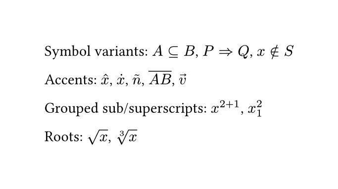
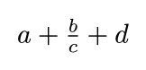
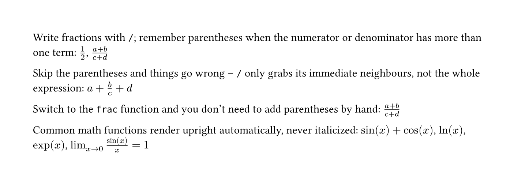
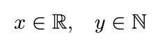
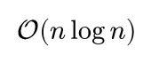
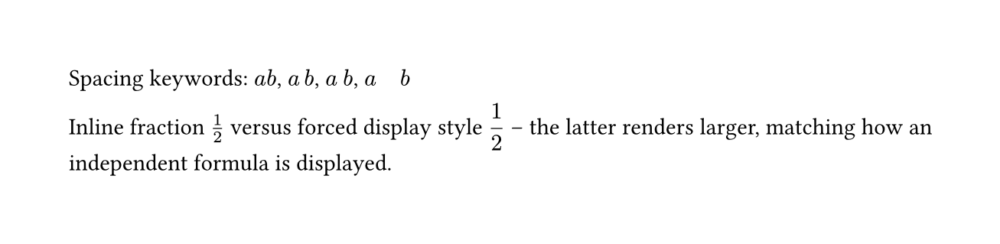

[The previous post](/articles/typst/day10-tables-en/) covered tables -- basic syntax, cell styling, three-line tables, and merged cells. This post picks up a thread left dangling back on [Day 5](/articles/typst/day05-markup-code-math-en/): math formulas only got a brief introduction there, and it's time to go further.

## Common Symbols and Operators

[Day 5](/articles/typst/day05-markup-code-math-en/) covered how `$...$` splits into inline and independent formulas, and touched on built-in symbol names like `pi` and `alpha` -- the full list lives in the [official reference](https://typst.app/docs/reference/symbols/sym/). This section fills in two mechanics that post never got to: stacking symbol variants, and writing sub/superscripts and roots.

### Symbol Variants and Accents

Many symbol names accept a `.variant` suffix that can be chained on, e.g. `arrow.r` plus `.double` becomes a double-line arrow. To find out what variants a symbol has, search its base name in the [symbols reference page](https://typst.app/docs/reference/symbols/sym/)'s search box -- typing `arrow`, for instance, filters down to every `arrow.xxx` variant, and clicking one copies it straight away:

```typst
$A subset.eq B$, $P arrow.r.double Q$, $x in.not S$
```

To add an accent mark to a variable, wrap it in functions like `hat`, `dot`, `tilde`, or `overline`:

```typst
$hat(x)$, $dot(x)$, $tilde(n)$, $overline(A B)$, $arrow(v)$
```

One thing worth flagging: a vector arrow uses `arrow`, not `vec` -- `vec` is the function for writing column vectors and matrices, a completely different job from accents. That's a topic for a later, dedicated math article.

### Grouped Sub/Superscripts and Roots

If the content of a `^` superscript or `_` subscript is more than one character, it needs parentheses to group it -- otherwise only the character immediately next to it gets treated as the sub/superscript:

```typst
$x^(2+1)$, $x_1^2$
```

Square roots use `sqrt`; for an $n$-th root, use `root`, whose first argument is the index:

```typst
$sqrt(x)$, $root(3, x)$
```

### Worked Example

<figure><figcaption>Math symbols and accents example</figcaption></figure>

## Fractions and Special Functions

Fractions are unavoidable in math writing, and so are functions like `sin` and `cos`. Both look simple, but each has a small trap worth knowing about -- this section covers how to handle them correctly.

### Writing Fractions

The most direct way is `/`. If the numerator or denominator has more than one term, remember to group it with parentheses:

```typst
$1/2$, $(a+b)/(c+d)$
```

Skip the parentheses and things go wrong, because `/` only grabs whatever's immediately next to it, not the whole expression:

```typst
$a+b/c+d$
```

<figure><figcaption>Output of a fraction written without parentheses</figcaption></figure>

What actually comes out is **only `b/c` treated as a fraction**, with `a` and `d` left outside it entirely -- nothing like the `(a+b)/(c+d)` that was intended. To skip the manual-parentheses hassle, switch to the `frac` function, whose two arguments are the numerator and denominator, with grouping built in:

```typst
$frac(a+b, c+d)$
```

<figure><figcaption>Output of the frac function</figcaption></figure>

Worth a side note: `binom`, which looks similar, is actually a different thing entirely -- it's the **binomial coefficient**. The output is a pair of round parentheses wrapping two stacked numbers, with no dividing line, a distinct mathematical object from a fraction. Don't mix the two up:

```typst
$binom(n, k)$
```

<figure><figcaption>Output of the binom function</figcaption></figure>

### Common Math Functions

Functions like `sin`, `cos`, `ln`, and `exp` render upright automatically in Typst -- they're never italicized the way a regular variable would be:

```typst
$sin(x) + cos(x)$, $ln(x)$, $exp(x)$
```

`lim` is also a built-in function, and its subscript can take an arrow directly to show what a variable is approaching:

```typst
$lim_(x -> 0) (sin(x))/x = 1$
```

### Worked Example

<figure><figcaption>Fractions and functions example</figcaption></figure>

## Style and Spacing Control

This last section rounds up the math font styles you'll reach for most often, plus how to adjust spacing and layout by hand.

### Math Font Styles

Variables in math mode default to italic, but mathematical convention calls for a different font in some situations. Typst has built-in functions for all of these -- no extra packages needed:

**Upright:** constants like Euler's number $e$ and the imaginary unit $i$ are conventionally set upright, unlike an ordinary italic variable:

```typst
$upright(e)^(i pi) + 1 = 0$
```

<figure><figcaption>Upright style example</figcaption></figure>

**Bold:** vectors are conventionally bold, replacing the arrow notation:

```typst
$bold(v) = bold(u) + bold(w)$
```

<figure><figcaption>Bold style example</figcaption></figure>

**Blackboard bold:** the standard way to write number sets, like the reals or naturals:

```typst
$x in bb(R), quad y in bb(N)$
```

<figure><figcaption>Blackboard bold style example</figcaption></figure>

**Calligraphic:** common for sets and algorithmic-complexity notation, like Big-O:

```typst
$cal(O)(n log n)$
```

<figure><figcaption>Calligraphic style example</figcaption></figure>

**Fraktur:** rarer, usually showing up in algebra -- for instance, Lie algebras:

```typst
$frak(g)$
```

<figure><figcaption>Fraktur style example</figcaption></figure>

### Adjusting Spacing by Hand

Spacing between symbols in math mode is handled automatically, but sometimes it still needs a manual nudge. The simplest tools are a handful of built-in spacing keywords, in increasing width:

```typst
$a b$, $a thin b$, $a med b$, $a quad b$
```

Separately, [Day 5](/articles/typst/day05-markup-code-math-en/) noted that inline and independent formulas lay out differently -- structures like fractions and limits get more room to breathe in an independent formula. To apply that same independent-formula layout inside an inline formula, wrap it in the `display` function:

```typst
Inline fraction $1/2$ versus forced display style $display(1/2)$
```

### Worked Example

<figure><figcaption>Spacing and display style example</figcaption></figure>

## Summary

This post started with symbol variants and accents, then grouped sub/superscripts and roots; moved on to the two ways of writing fractions, the parentheses gotcha, `frac`, and `binom` (which looks like a fraction but isn't); covered built-in functions like `sin`, `cos`, and `lim`; and finished with the upright, bold, blackboard-bold, calligraphic, and fraktur math styles, plus spacing keywords and the `display` function for manual layout control.

The next post moves into more advanced math typesetting: matrices, piecewise functions, and multi-line aligned equations. See you next time~
