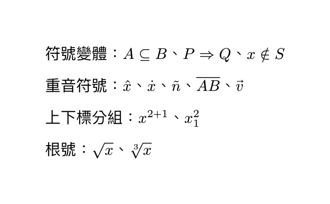
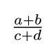
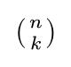
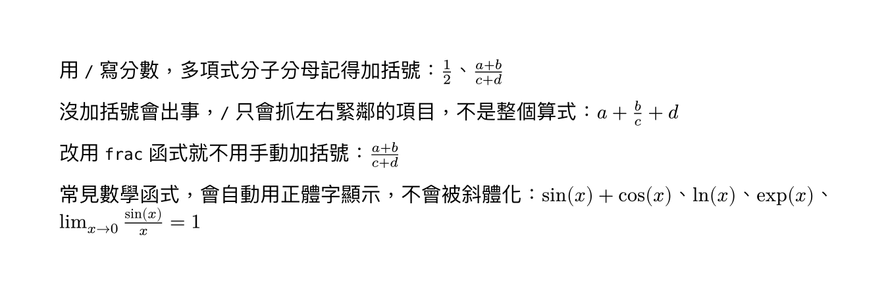
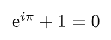
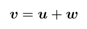
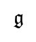
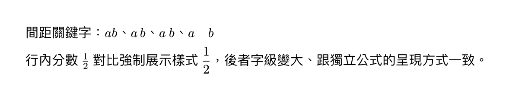

[上一篇](/articles/typst/day10-tables/)講了表格，從基本語法、儲存格樣式，到三線表跟合併儲存格。這篇要回頭接續講[第五天](/articles/typst/day05-markup-code-math/)埋下的伏筆：當時數學公式只淺嚐即止，現在要開始講更複雜的數學語法了！

## 常用符號與運算子

[第五天](/articles/typst/day05-markup-code-math/)提過 `$...$` 的行內、獨立公式怎麼分，也帶過 `pi`、`alpha` 這類內建符號名稱，完整清單可以查[官方參考](https://typst.app/docs/reference/symbols/sym/)。這節接著補兩個沒教過的機制：符號怎麼疊加變體、上下標跟根號怎麼寫。

### 符號變體與重音符號

很多符號名稱後面可以再接 `.變體` 疊加變化，例如 `arrow.r` 加上 `.double` 就變成雙線箭頭。想知道一個符號有哪些變體，可以到[符號參考頁](https://typst.app/docs/reference/symbols/sym/)的搜尋框打基底名稱，例如打 `arrow`，所有 `arrow.xxx` 的變體就會被篩出來，點一下還能直接複製：

```typst
$A subset.eq B$、$P arrow.r.double Q$、$x in.not S$
```

要幫變數加重音符號，則是用 `hat`、`dot`、`tilde`、`overline` 這類函式把內容包起來：

```typst
$hat(x)$、$dot(x)$、$tilde(n)$、$overline(A B)$、$arrow(v)$
```

要注意的是，向量箭頭要用 `arrow`，不是 `vec`——`vec` 是用來寫直行向量、矩陣的函式，跟重音符號是兩回事，這個留到後面數學專題會再深入。

### 上下標與根號

`^` 上標、`_` 下標如果內容不只一個字元，要用括號包起來分組，不然只有緊鄰的第一個字元會被當成上下標：

```typst
$x^(2+1)$、$x_1^2$
```

根號用 `sqrt`，開 $n$ 次方根則用 `root`，第一個參數是次方數：

```typst
$sqrt(x)$、$root(3, x)$
```

### 實際範例

<figure><figcaption>數學符號與重音範例</figcaption></figure>

## 分數與特殊函式

寫數學式難免會遇到分數，還有 `sin`、`cos` 這類函式，這兩個東西看起來簡單，但各自都有一些容易踩到的小地雷，這節就來看怎麼正確處理。

### 分數寫法

最直接的寫法是用 `/`，如果分子或分母不只一項，記得加括號分組：

```typst
$1/2$、$(a+b)/(c+d)$
```

沒加括號會出事，因為 `/` 只會抓左右緊鄰的那一項，不是抓整個算式：

```typst
$a+b/c+d$
```

<figure><figcaption>沒加括號的分數輸出結果</figcaption></figure>

這樣寫出來的其實是**只有 `b/c` 被當成分數**，`a` 跟 `d` 都被排除在分數外面，跟原本想要的 `(a+b)/(c+d)` 完全是兩回事。想省掉手動加括號的麻煩，可以改用 `frac` 函式，兩個參數分別是分子、分母，本身自帶分組：

```typst
$frac(a+b, c+d)$
```

<figure><figcaption>frac 函式輸出結果</figcaption></figure>

順帶一提，長得像分數的 `binom` 其實是另一回事——它是數學上的**二項式係數**（組合數），輸出是一對圓括號夾住上下兩個數字，中間沒有分隔線，跟分數是不同的數學物件，不要搞混：

```typst
$binom(n, k)$
```

<figure><figcaption>binom 函式輸出結果</figcaption></figure>

### 常見數學函式

`sin`、`cos`、`ln`、`exp` 這類數學函式，Typst 會自動用正體字顯示，不會被斜體化成一般變數：

```typst
$sin(x) + cos(x)$、$ln(x)$、$exp(x)$
```

`lim` 也是內建函式，下標可以直接寫箭頭表示趨近：

```typst
$lim_(x -> 0) (sin(x))/x = 1$
```

### 實際範例

<figure><figcaption>分數與函式範例</figcaption></figure>

## 樣式與間距控制

最後這節整理數學模式裡常用的字體樣式，以及怎麼手動調整間距跟排版方式。

### 數學字體樣式

數學模式裡，變數預設是斜體，但有些場合照數學慣例要換成別的字體，Typst 內建了對應的函式，不需要額外裝套件：

**正體：** 像是尤拉數 $e$、虛數單位 $i$ 這類數學常數，慣例上會用正體字，不像一般變數斜體：

```typst
$upright(e)^(i pi) + 1 = 0$
```

<figure><figcaption>正體樣式範例</figcaption></figure>

**粗體：** 向量習慣用粗體表示，取代箭頭符號：

```typst
$bold(v) = bold(u) + bold(w)$
```

<figure><figcaption>粗體樣式範例</figcaption></figure>

**黑板體：** 數系符號的標準寫法，例如實數、自然數：

```typst
$x in bb(R), quad y in bb(N)$
```

<figure><figcaption>黑板體樣式範例</figcaption></figure>

**花體：** 常見於集合、演算法複雜度記號，例如大 O 表示法：

```typst
$cal(O)(n log n)$
```

<figure><figcaption>花體樣式範例</figcaption></figure>

**哥德體：** 比較少見，通常出現在代數領域，例如李代數：

```typst
$frak(g)$
```

<figure><figcaption>哥德體樣式範例</figcaption></figure>

### 手動調整間距

數學模式裡符號跟符號之間的間距是自動排的，但有時候還是需要手動微調。最簡單的是幾個內建的間距關鍵字，寬度依序遞增：

```typst
$a b$、$a thin b$、$a med b$、$a quad b$
```

另外，[第五天](/articles/typst/day05-markup-code-math/)提過行內公式跟獨立公式排版不同，獨立公式的分數、極限這類結構會排得比較大、比較舒展。如果想在行內公式裡也套用獨立公式的排版方式，可以用 `display` 函式包起來：

```typst
行內分數 $1/2$ 對比強制展示樣式 $display(1/2)$
```

### 實際範例

<figure><figcaption>間距與展示樣式範例</figcaption></figure>

## 小結

這篇從符號變體跟重音符號怎麼寫、上下標跟根號怎麼分組開始；接著講分數的兩種寫法、沒加括號會踩到的坑、`frac` 跟長得像分數卻是另一回事的 `binom`，還有 `sin`、`cos`、`lim` 這類內建函式；最後整理了正體、粗體、黑板體、花體、哥德體這幾種數學字體樣式，以及間距關鍵字跟 `display` 函式怎麼手動控制排版。

下一篇要進到矩陣、分段函數、多行對齊方程式這些更進階的數學排版。我們下次見囉～
