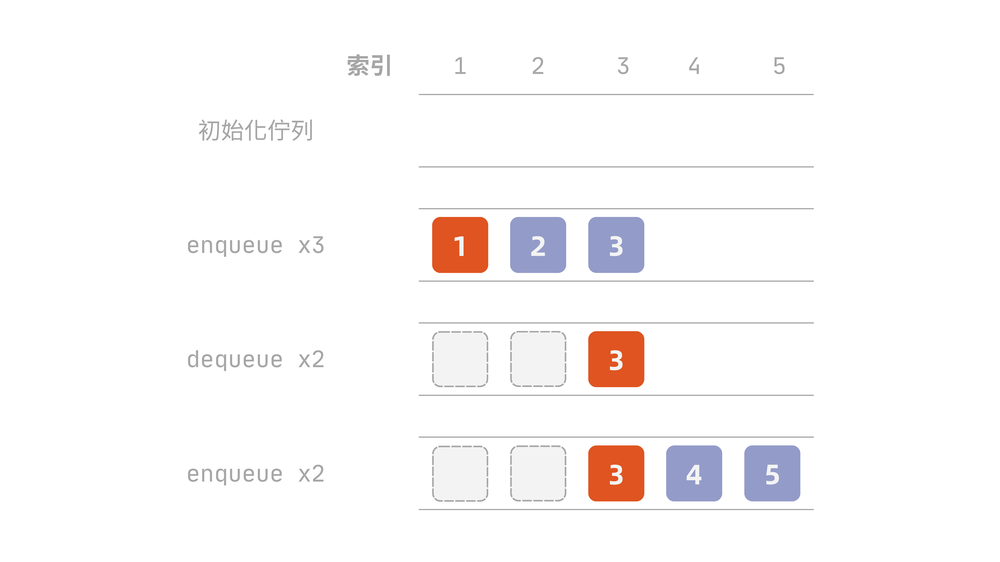

**佇列 (queue)** 的應用比[堆疊](../stack/index)更廣泛，也相較於堆疊稍微複雜一點。

!!! info "定義：佇列 (queue)"
    佇列是一種動態集合，其中元素的插入與刪除遵循**先進先出 (first-in-first-out, FIFO)** 的原則，每次刪除的元素，永遠是目前集合中最早被插入、且尚未被刪除的那一個。

    佇列支援兩種基本操作：

    - `enqueue(Q, x)`：將元素 $x$ 插入佇列 $Q$ 的**尾端 (tail)**
    - `dequeue(Q)`：刪除並回傳佇列 $Q$ **頭端 (head)** 的元素

## 基本操作

不同於堆疊，佇列的操作分別在頭尾兩端，新增元素從尾端放進去，要拿元素僅能從頭端拿走。

佇列的操作分為：將元素放到尾端的**入列 (enqueue)**、將頭端元素拿掉的**出列 (dequeue)**，以及查看頭端但不動它的**查佇列首 (front)**。

但比較需要注意的是，如果我們使用堆疊的方法處裡入/出列，會發生如@fig-queue-drift 的問題：

::: {#fig-queue-drift}

:::

最後一步的 `tail` 跑到 6，已經超出陣列範圍，但佇列裡其實只有 3 個元素，前面還空著 2 格——空間沒用完卻已塞不下了。

因此通常我們會使用**環形佇列 (circular queue)** 的技巧，將指標繞一圈，在邏輯上形成一個環，重複利用。

### 入列

入列首先要檢查佇列是否已滿，並且執行以下操作：

- 若已滿：拒絕插入，可回傳/輸出失敗訊息
- 若未滿：將元素放進 `tail` 指到的那一格，再把 `tail` 往後移一格；若 `tail` 已經在最後一格，則繞回第一格

```plaintext
Enqueue(Q, x)
    if (tail[Q] mod length[Q]) + 1 = head[Q] then
        error "overflow"
    else
        Q[tail[Q]] = x
        if tail[Q] = length[Q] then
            tail[Q] = 1
        else
            tail[Q] = tail[Q] + 1
        end if
    end if
```

這裡的 `(tail[Q] mod length[Q]) + 1` 就是「`tail` 的下一格」，寫成 `mod` 是為了處理繞回開頭的情況。如果下一格剛好就是 `head`，代表再放就會撞上頭端，因此判定為已滿。

!!! tip "為什麼長度 $n$ 的陣列只能裝 $n-1$ 個元素？"
    注意上面的判定式：**空**是 `head[Q] = tail[Q]`，**滿**卻是`tail` 的下一格等於 `head`，也就是刻意留了一格不用。原因是這兩個狀態會撞在一起。假設真的把 $n$ 格全部塞滿的話，`tail` 從最後一格繞回開頭之後，剛好會停在 `head` 的位置，於是 `head[Q] = tail[Q]`——但這正是佇列為空的判定條件。同一組指標值同時代表空與滿，程式就再也分不出來了。

    因此環形佇列會犧牲一格當作分隔，讓 `head[Q] = tail[Q]` 唯一對應空這個狀態，長度 $n$ 的陣列實際可用容量是 $n-1$。若真的需要用滿 $n$ 格，就得額外維護一個 `size` 欄位記錄目前元素個數，改用 `size = 0` 判空、`size = length[Q]` 判滿，不再依賴指標關係。

### 出列

出列就是判斷是否為空：

- 若為空：拒絕出列，可回傳/輸出失敗訊息
- 若非空：取出 `head` 指到的元素，將 `head` 往後移一格（同樣會繞回開頭），回傳該元素

用虛擬碼的方式撰寫如下：

```plaintext
Dequeue(Q)
    if head[Q] = tail[Q] then
        error "underflow"
    else
        x = Q[head[Q]]
        if head[Q] = length[Q] then
            head[Q] = 1
        else
            head[Q] = head[Q] + 1
        end if
        return x
    end if
```

### 查佇列首

查佇列首則是一樣先判斷是否為空：

- 若為空：拒絕查看，可回傳/輸出失敗訊息
- 若非空：回傳頭端元素，但不將其移除

用虛擬碼的方式撰寫如下：

```plaintext
Front(Q)
    if head[Q] = tail[Q] then
        error "underflow"
    else
        return Q[head[Q]]
    end if
```

### 各項操作時間複雜度

`enqueue`、`dequeue`、`front` 三個操作都只碰 `head[Q]`、`tail[Q]` 這兩個指標，以及它們指到的那一格——不管是判斷、讀寫，還是移動指標（包含繞回開頭的 `mod` 運算），動作次數都是固定的，完全不需要因為佇列裡目前有幾個元素而多做事，所以都是 $O(1)$。

| 操作 | 時間複雜度 |
| --- | --- |
| `enqueue` | $O(1)$ |
| `dequeue` | $O(1)$ |
| `front` | $O(1)$ |
| 走訪（訪問所有元素） | $O(n)$ |

這裡要特別留意的是，環形佇列的 $O(1)$ 是**繞回開頭**換來的。如果不繞、改成每次 `dequeue` 就把後面的元素整批往前搬一格來補上空位，`head` 確實永遠會停在第一格，但每次出列都要搬動 $O(n)$ 個元素，佇列最核心的操作就從 $O(1)$ 掉到 $O(n)$ 了。

同堆疊一樣，走訪整個佇列一樣不算標準操作，佇列僅保證能碰到 `head`。如果想看過每一個元素，只能從 `head` 開始一路往後，沒有辦法跳著存取，每個元素都要碰一次，因此是 $O(n)$；用 `dequeue` 走訪還會把佇列本身清空，除非邊 `dequeue` 邊存到別的地方再 `enqueue` 回去。

## 佇列實作

### 使用陣列

```python
class ArrayQueue:
    def __init__(self):
        self._queue: list[int] = []
        self.size: int = 0
        self.head: int = 0
        self.tail: int = 0
```

### 使用鏈結串列ㄎ